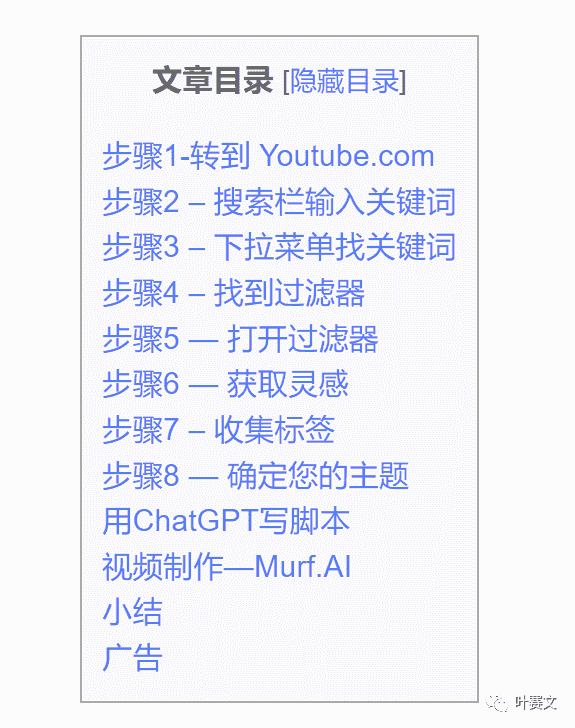
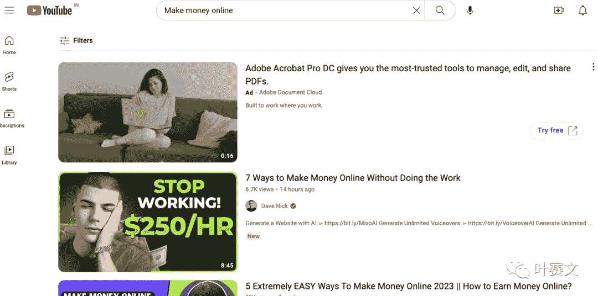
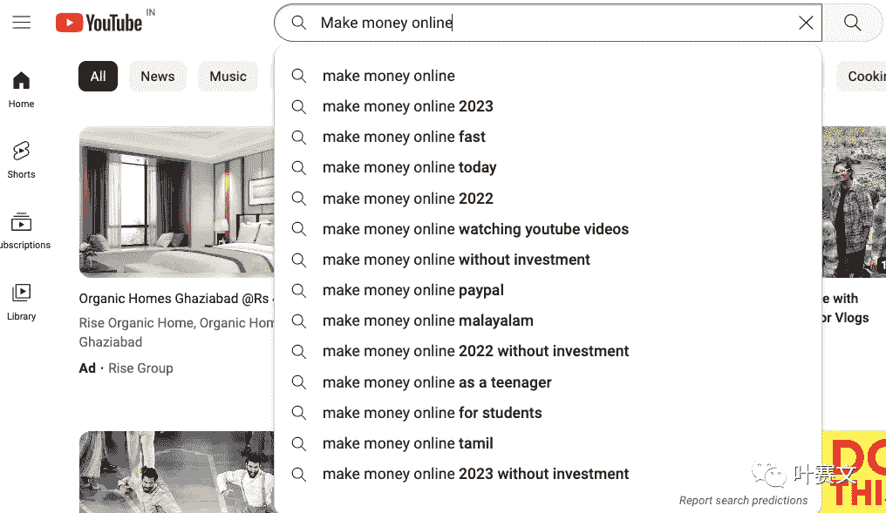
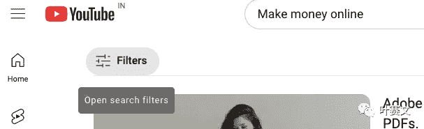
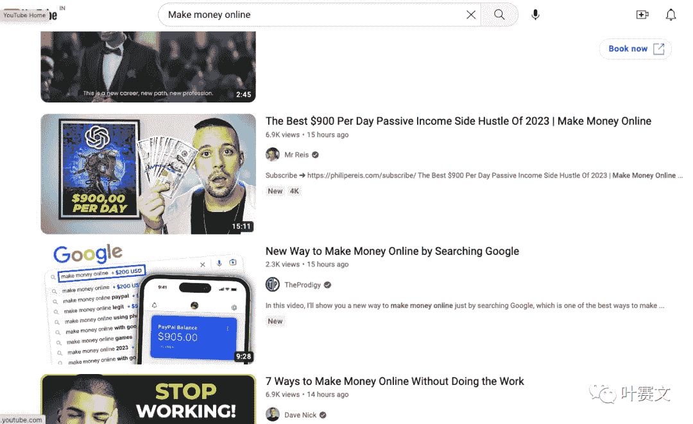
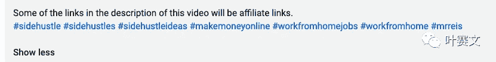
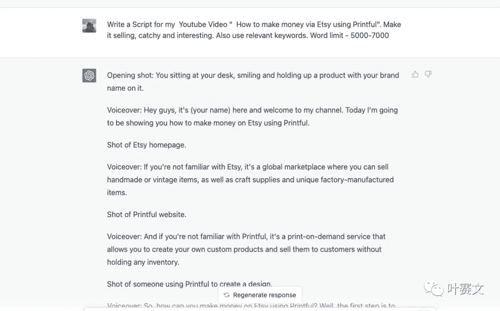

# ChatGPT变现思路：ChatGPT+管油+Murf.AI（译文）

> 来源：[https://diwfpqo78m.feishu.cn/docx/KYd3dRDKOo4OT3xzK2JcJ87inX1](https://diwfpqo78m.feishu.cn/docx/KYd3dRDKOo4OT3xzK2JcJ87inX1)

**内容简介 **：曾听过有人通过ChatGPT写视频脚本，但是不知道具体如何操作。本文介绍了一种应用ChatGPT赚钱的思路，包含整个流程：如何确定主题、如何用ChatGPT写脚本及用murf配音。可以参考借鉴应用在国内的视频市场。

原作者：Kanika B K，编译：ChatGPT，叶赛文

这是在medium上看到的一篇ChatGPT变现思路，可以了解一下：

（正文）

好消息是，在线收入没有上限；通过采用这种策略，YouTube创作者通常每月可以赚取约7000美元左右。

我最近看到不露脸Youtube视频的增加，如果你有类似的想法，那么现在是开始使用Youtube的最佳时机。

最棒的是：你不需要投入太多的努力，只需要工作得聪明一些。平均每周可以在10-15小时内完成这项工作。

我个人遇到了许多使用这种方法的新YouTube频道，他们的月收入范围从7000美元到50000美元不等。

**以下是我的三个令人兴奋的工具 - Yout**ube，ChatGPT和 Murf.AI

请记住，正确的工具组合是任何策略中最重要的部分。

好的工具可以加快您的工作速度，并拿到超过100倍的结果。

让我们快速了解一下工具及其使用方法。

分三个简单的步骤：

**主题研究、写脚本和视频发布**

我们将使用：

**YouTube **—用于研究主题，关键字和主题标签 - 免费!!!!

**ChatGPT **— 用于脚本制作 — 免费!!!!

**Murf.AI **— 用于视频制作 - 免费!!!!

我做了一些研究，这是我在 Youtube 上收入最高的利基市场及其CPMs列表：

**利基 — 每千次展示费用**

| 利基 | CPM（每千次展示费用） |
| --- | --- |
| 在线赚钱 | $13.52 |
| 数字营销 | $ 12.52 |
| 个人理财和投资 | $12 |
| 教育内容 | $9.89 |
| 汽车频道 | $4.32 |
| 技术和小工具 | $2.39 |
| 生活方式 | $3.47 |
| 时尚和试穿 | $3.13 |
| 烹饪 | $2.50 |
| 健身和健美 | $1.60 |
| 视频游戏 | $1.40 |

现在我们已经有了最高付费CPM的列表，我们可以选择自己感兴趣的领域。这样更容易坚持。

在YouTube首页上方的仪表板顶部，您将看到一个领域列表；这些是基于您过去搜索内容而推荐给您的YouTube类别。

例如，这是我的YouTube推荐分类的样子。它包括新闻、音乐、股票、游戏、财富、混合内容、园艺、人工智能、销售、烹饪节目和思考等类别。（看起来像是各种各样的混合！）

研究不同的利基/话题，并选择一个。例如——假设我选择了赚钱在线这个话题，这也是我的最爱。

##  步骤1-转到 Youtube.com

我们必须进行研究，以找到与这个专业领域相关的最新信息和新闻。

例如——在“网上赚钱（Making Money Online）”领域中最近的发展可能涉及推出新工具、新联盟计划、免费工具和各种其他策略。

这只是让你思考：如何进入这个主题。

##  步骤2 - 搜索栏输入关键词

在搜索栏输入利基市场“ 在线赚钱（MAKE MONEY ONLINE）”

你会看到很多推荐的视频，但我们不会浏览第一页上的所有视频，而是用另一种不同的搜索方式。

##  步骤3 - 下拉菜单找关键词

您将看到这样的下拉菜单，列出了很多关键字

## ** 步骤4 - 找到过滤器 **

您将看到推荐视频列表

这是一个被很多人忽略的基础用法，也是我的秘密武器

回车后，转到左上角，打开过滤器。搜索过滤器是收集关键字、信息和新闻的强大工具。

## ** 第 5 步 — 打开过滤器 **

+   简单选择本月或本周

+   在“持续时间”选项卡上，选择 4–20 分钟

为什么？因为超过95%的、超过20分钟长视频度通常是描述性质的，通常详细说明某些工具如何使用。信息类视频的理想长度在8到14分钟之间。

**类型 — 视频**

应用这个过滤器，你将会看到高质量且相关的视频。每一个视频都包含相关且最新的素材。

应用过滤器的唯一目的是：收集有关新工具的信息。

例如，如果您打算制作一个关于：如何通过联盟营销赚钱的视频，那么获得观看的机会可能非常低。

但是，如果您选择制作有关如何使用 X 工具，通过联盟营销赚钱的视频，其中 X 工具是新的，没有多少人知道它，但正在搜索它。这样获得观看的机会会更高。

## ** 第 6 步 — 获取灵感 **

假设我们打开列表中的第一个视频，在我的页面显示的是：来自Youtube频道 - Mr. Reis。视频标题是“2023年最佳每日被动收入副业 | 在线赚钱”，并且每天可以赚取900美元。

观看视频，获得灵感，或者我通常会检查视频的描述部分，在那里 YouTuber 已经提到了联盟链接。

## ** 步骤7 - 收集标签 **

在描述框中，您将看到包含的标签。创建标签列表。

##  第 8 步 — 确定您的主题

观看 4 -5 个视频并列出要制作视频的标题。

假设我们选择的主题是 “如何使用 Printful 通过 Etsy 赚钱“

现在研究部分已经完成。

## ** 用ChatGPT写脚本 **

ChatGPT是一个很棒的工具，完全免费

注册后，就可以开始写提示词。

这是我提示的结果 - 你可以看到ChatGPT可以为你做所有的脚本工作。就我而言，它向我展示了镜头+画外音。

我的提示词是：

为我的Youtube视频 "如何使用Printful通过Etsy赚钱 "写一个脚本。使其具有卖点，朗朗上口且有趣。同时使用相关的关键词。字数限制 - 5000-7000（ Write a Script for my Youtube Video " How to make money via Etsy using Printful". Makeit selling, catchy and interesting.Also use relevant keywords. Word limit - 5000-7000 ）

此脚本在 2 分钟内准备就写完了!!!!!

## ** 视频制作—Murf.AI **

今天我要告诉你们，2022年我发现的最强大的工具之一。

Murf.ai是一款AI启用的文本转语音工具，可以让用户为视频和演示生成“和真人一样”的配音。

你所需要做的就是为你的Youtube视频准备文本脚本，Murf AI会将其转换成语音。

它生成逼真的声音，并且这个工具声称：“Murf提供了100%自然发音的AI语音选择，涵盖20种语言，可用于制作专业视频和演示文稿配音。“

没有必要为配音演员或麦克风单独花钱。不仅如此，您还可以节省大量时间和精力。

我看到很多人在他们的视频中强调特定关键词。好吧，Murf.AI带来了所有的好处，你可以按照自己想要的方式进行配音。你也可以...

+   强调这些词

+   用音调掌控你的叙述

+   用停顿提升你的故事。

它能做到和Youtube上的其他视频一样声音自然。Murf目前提供20种语言的多个声音选择。

正如我之前所说，Murf AI 是我最近发现的最强大、节省时间的工具之一。一个典型的 YouTube 视频需要 20-30 小时的工作。这是一个漫长的过程，从研究到视频编辑。而且，就像我看到的那样，并不是每个人都喜欢上传面部视频，在这种情况下 Murf 可以让你的工作变得更加轻松和快速。

我的个人最喜欢的功能是语音克隆。通过语音克隆功能，可以生成一个模仿真实人类情感（如愤怒、快乐、悲伤等）的AI语音克隆。您可以在脚本期间随时进行修改。

## ** 小结 **

因此，如果您上传高质量内容视频以获取高收益的利基市场，并且假设从一个视频中，您可以获得400美元（这是一个非常小的数字），并且每周制作5个视频和每月20个视频。数学很简单 -

400x20 = $8000

当然，这可能需要长达 2，3 个月的时间。

但如果您的频道或任何视频病毒式传播，收入会高得多。此外，Youtube视频具有经常性收入概念，这意味着一旦视频发布，它将一直（或直到您删除它）为您提供一定数量的收入。

行动>一切。我希望您可以充分利用这三个工具。

## ** 广告 **

无