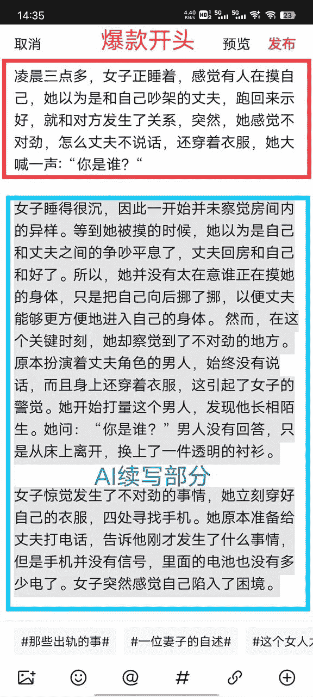
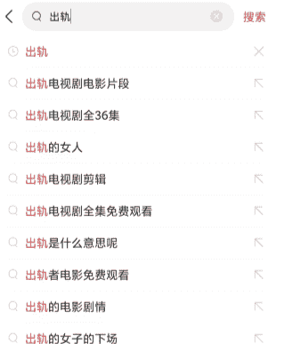
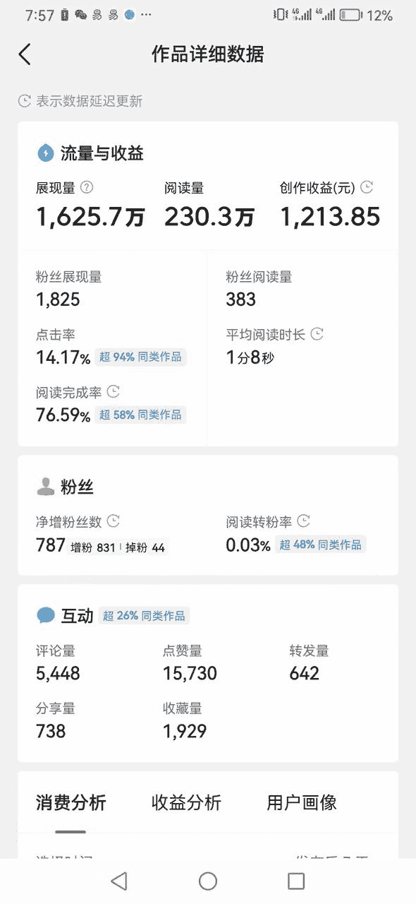

# 微头条AI创作项目保姆级教程

> 来源：[https://diwfpqo78m.feishu.cn/docx/VFNYduhoioXAKqx4aiCcdqx4n6d](https://diwfpqo78m.feishu.cn/docx/VFNYduhoioXAKqx4aiCcdqx4n6d)

### 项目简介

这个项目就是在【今日头条】发布微头条，当阅读量爆了之后，获取平台收益。

整个实操过程，就3个步骤：

【步骤1：找爆款，复制开头】

【步骤2：使用工具——AI觉醒创作助手，一键润色文章】

【步骤3：编辑文章，配图，发布微头条，产生收益】

### 一、如何寻找爆款文章

在开始寻找爆款文章之前，让我们先了解一下爆款文章的定义和标准：

爆款文章通常以以下四个指标作为评判标准：展现量、点赞量、评论量和阅读量。

1.  展现量：指文章在特定平台上被显示给用户的次数。展现量较高意味着更多的人有机会看到这篇文章。

1.  点赞量：指文章收到的点赞数量。点赞量高表示读者对文章的认可和喜爱程度。

1.  评论量：指文章收到的评论数量。评论量多意味着读者对文章内容有更多的反馈和互动，文章的讨论度较高。

1.  阅读量：指文章被点击和阅读的次数。阅读量大表示文章引起了广泛的兴趣和关注。

一篇文章评论量有200左右，或者点赞量有1000左右，就是我们要的爆款文章。

### 二、添加指令，让ai续写

**因为我们利用****ai****帮我们写文章，所以我们提供爆款素材给****ai****去**编写，而我们和ai的交流话术，就叫指令。

**比如：**

①续写这段故事，要以震惊、无奈、戏剧性的情绪续写，字数750字：“xxxxxx”

续写这段故事，要有正反观点，字数800字：“xxxxxx”

续写这段故事，要有对话场景，字数xxx字：“xxxxxx”

续写这段故事，要有中国法律的解读和人性的批判，字数xxx字：“xxxxxxx”

②以吃瓜者的角度续写这篇文章，插入一句名人名言，要有网友的神评论，字数xxx，：“xxxxxx”

以情感专家的角度续写这篇文章，字数xxx，：“xxxxxx”

以通俗易懂的语言风格续写这篇文章，字数xxx，：“xxxxxx”

以幽默、内涵的文笔风格续写这篇文章，字数xxx，：“xxxxxx”

以生动有趣的文笔风格续写这篇文章，字数xxx，：“xxxxxx”

以情感真挚的文笔风格续写这篇文章，字数xxx，：“xxxxxx”

以时间线清晰的文笔风格续写这篇文章，要有对话场景，字数xxx，：“xxxxxx”

以批判的风格续写这段故事，字数xxx，：“xxxxxx”

以口语化的文笔风格，续写这段故事，内容丰富且有反转，结尾加上一段鸡汤，字数xxx，：“xxxxxx”

以自然语言的文笔风格，续写这段故事给年龄30-60岁的人群看，包含正反观点和质疑声，字数xxx：“xxxxxx”

将这段话写成一个刺激、震惊，内容丰富的故事，不要有重复的词语：“xxxxxx”

**这些****指令**根据你找的爆款开头，可以自行修改其中的某些描述词，也可以互相结合起来。

举个例子：

以吃瓜者的角度续写这段故事，文笔风格简洁含蓄，内容丰富有反转，文章受众是50岁以上的男人，要有网友的正反观点评论，结尾加上情感专家的分析，字数800字：“xxxxxx”

**重点：你的****指令****要求越丰富，生成的故事越好。**

以上这些就是指令，我采用最简单的一个：

续写这段故事，字数750左右“凌晨三点多，女子正睡着，感觉有人在摸自己，她以为是和自己吵架的丈夫，跑回来示好，就和对方发生了关系，突然，她感觉不对劲，怎么丈夫不说话，还穿着衣服，她大喊一声：“你是谁？”

### 三、微信工具——AI觉醒创作助手

重点来了，要想高效，工具最重要，如图：

**点击我的，点击意见反馈，联系输入我要**关键词“1狗”即可获得200次问答机会。

### 四、微头条编辑发布

把开开头输入进去加上AI所写的，如图如下：

文章表达方式，每一段落字数不要密密麻麻的，大概4行字左右成一段落。这样会让文章排版看起来更舒服，然后再看有没有什么敏感词，如果没什么问题的话，去百度找张尽可能吸引人眼球的图片

### 五、老雷手把手教你找爆款

**方式一：**

步骤一：

选定一个关键词，然后在头条搜索，比如：出轨、婚姻、家庭、少妇、沦陷、出轨、情感、小三、包养、二奶、丈夫、妻子、女人、亲情、爱情、婆媳、私密生活、离婚、婚检、婚恋、婚配、裸聊、裸体、结婚、婚外情、夫妻、婚约、伴侣、情人、情侣、少女、富婆、美女、男性、男人、女性、性生活、做爱、打炮、生理需求、接吻、亲嘴、异性、幸福女人，聪明女人、已婚、未婚、荡妇、奸夫淫妇、暗恋、恋人...等等

步骤二：

拉动上面这一栏，找到【微头条】

步骤三：

在【微头条】下，找到点赞量1000左右或者评论200左右的文章，如下图：

**方式二：**

步骤1： 转发文章到微信聊天页面

步骤2： 点击文章

步骤3： 继续往下拉，找到爆款

等待收益：

