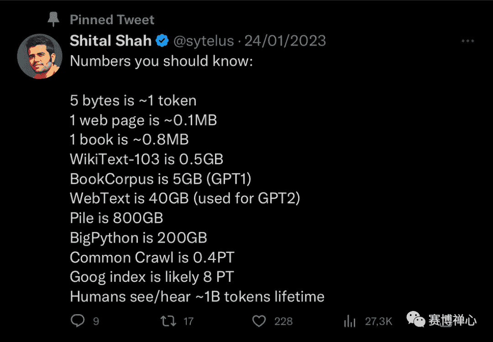

# No.1 - 关于 AI 的 107 个人，61 个工具和 28 个通讯

> 来源：[https://diwfpqo78m.feishu.cn/docx/Te6kd4NIcobDsuxTp27cLVs8nBe](https://diwfpqo78m.feishu.cn/docx/Te6kd4NIcobDsuxTp27cLVs8nBe)

# 107 个值得关注的 Twitter

107 People to Follow on Twitter

## 为什么是 Twitter？

想到 AI，我脑海中第一时间跳出的社交平台是 Reddit、LinkedIn 和 Twitter 。一直以来，这三个平台都以三种完全不同的方式参与着「关于 AI 的对话」，今天让我们从 Twitter 开始。

## Twitter 为什么重要 ？

AI 领域的许多书籍作者、企业决策者和工具开发者经常使用 Twitter 并在此发表言论

Twitter 聚集了大量的天使投资人、风险投资人和记者，他们源源不断地提供着有价值的背景信息

因此，在 AI 的一波波浪潮中，Twitter 始**终拥有着自己的「寓教于乐的小世界」。但 2022 **年，ChatGPT 的诞生让 Twitter 在这场 AI 热潮中显得尤为重要 —— 人们在 Twitter 上大量分享他们使用这个工具的过程，关于 Generative AI 和 GPT-3 /3.5 的看法及围绕它们而产生的行为 —— 无论炒 作与否。

## 该关注谁？

在我看来，如果对 AI 充满热情，我们首先需要一个包含本领域记者、作家、决策者和公司的组合

理想情况下，这其中既有女性也有男性，既有成熟的意见领袖也有年轻的研究人员或不完善的观点，既有批判性的记者也有意见多样的风险投资人

我们需要更多讨论技术与落地而不是炒作与投机，那么还需要有足够的风险资本、天使投资人和决策者来帮助我们了解行业新闻和现实问题。

但事实上，我们只能关注到其中的一部分人，这些是我关注列表中的一些，希望对大家有所帮助，也希望大家协助我一起补充。

本名单包括 - The list includes：

- 研究人员 - Researchers

- 新闻工作者 - Journalists

- 创始人 & 决策者 - Founders, Executives

- 选择性的投资人 - Selective VC folk

- 作家 - Authors

- AI 领域创作者 - A.I. Newsletter Niche Creators

1. Sam Altman (@sama)

- Foundetr of OpenAI

- Former president of Y Combinator

2. Yann LeCun (@ylecun)

- Professor at NYU

- Chief AI Scientist at Meta

3. Andrew Ng (@AndrewYNg)

- Co-Founder of Coursera

- Stanford CS adjunct faculty

- Former head of Baidu AI Group/Google Brain

4. François Chollet (@fchollet)

- Deep learning at Google

- Creator of Keras

- Author of 'Deep Learning with Python'

5. Karen Hao 郝珂灵 (@_KarenHao)

- A.I. Journalist at WSJ

- National magazine award winner

6. Andrej Karpathy (@karpathy)

- YouTuber, Blogger, Influencer

- Previously Director of AI at Tesla, OpenAI

7. Jürgen Schmidhuber (@SchmidhuberAI)

- Co-director of the Dalle Molle Institute for Artificial Intelligence Research

- He has been referred to as "father of modern AI" and "father of deep learning"

8. Sara Hooker (@sarahookr)

- Head of AI at Cohere

- Formerly Research at Google Brain

9. Demis Hassabis (@demishassabis)

- Founder & CEO of DeepMind and Isomorphic Labs

10. Sarah Guo (@saranormous)

- Founder of Conviction A.I., Starup Investor

- Former partner at Greylock

11. David Hardmaru (@hardmaru)

- Head of Prompt Engineering at Stability AI

- Former Research Scientist at Google Brain

12. Lilian Weng (@lilianweng)

- Applied AI Lead at OpenAI

13. Oriol Vinyals (@OriolVinyalsML)

- Research Director & Deep Learning Lead at DeepMind

- Led AlphaStar, AlphaFold, AlphaCode, WaveNet, seq2seq, etc

- Former research scientist at Google Brain

14. Michael Black (@Michael_J_Black)

- Director at Max Planck Institute for Intelligent Systems

- Chief Scientist at Meshcapade

15. Jeff Dean (@JeffDean)

- Senior Fellow & SVP, Google Research and AI

- Co-designer/implementor of software systems like TensorFlow, MapReduce, Bigtable, Spanner, etc

16. Ian Goodfellow (@goodfellow_ian)

- Research Scientist at DeepMind

- Inventor of GANs

- Lead author of http://deeplearningbook.org

17. Aakanksha Chowdhery (@achowdhery)

- PaLM Lead at Google Brain

18. Peter H. Diamandis, MD (@PeterDiamandis)

- Founder of Singularity University, Xprize, Fountainlife

- Entrepreneur, Investor and Author

19. Gary Marcus (@GaryMarcus)

- Author of Rebooting.AI & Guitar Zero

- Founder of Geometric Intelligence (acq. by Uber) & RobustAI

20. Lucas Beyer (@giffmana)

- Researcher at Google Brain in Zürich

21. Sebastian Raschka (@rasbt)

- Author of Ahead of AI

- Machine learning & AI researcher

22. Cassie Kozyrkov (@quaesita)

- Chief Decision Scientist at Google

23. Kate Kaye (@KateKayeReports)

- Independent Journalist

- Formerly Protocol)

24. Emad (@EMostaque)

- Founder of Stability A.I.

25. Fei-Fei Li (@drfeifei)

- Co-Director at Stanford Human-Centered Artificial Intelligence

- Co-Founder and Chair of AI4Allorg

26. Jim Fan (@DrJimFan)

- AI Scientist at Nvidia

27. Elvis Saravia (@omarsar0 )

- Builder of DAIR AI

- Former Scientist at Meta AI and Elastic

28. Connie Chan (@conniechan)

- General Partner at a16z

29. Hugo Larochelle (@hugo_larochelle)

- Researcher at Google Brain

- Machine learning professor

- Ex-Twitter Cortex

30. Benj Edwards (@benjedwards)

- AI and ML Reporter, Ars Technica

- Tech Historian

31. Becca Szkutak (@rebecca_szkutak)

- Journalist at Techcrunch

32. Sergey Levine (@svlevine)

- Professor at UCBerkeley

33. Eric Schmidt (@ericschmidt)

- Former Google CEO

34. Ilya Sutskever (@ilyasut)

- AGI at OpenAI

35. Patrick Mineault (@patrickmineault)

- Formerly Building 8

- Former Engineer at Google

36. Natasha Jaques (@natashajaques)

- Senior Research Scientist at Google AI and Berkeley AI

37. Pieter Abbeel (@pabbeel)

- Professor at Berkeley

- Founder of Covariant & Gradescope

- The Robot Brains Podcast Host

- Investment Partner at AIX Ventures

38. Eliezer Yudkowsky (@ESYudkowsky)

- Co-Founder at Machine Intelligence Research Institute

39. Geoffrey Hinton (@geoffreyhinton)

- Professor at University of Toronto

- Co-Founder and Chief Scientific Advisor of the Vector Institute

40. Brett Winton (@wintonARK)

- Chief Futurist at Ark Invest

41. Jeff Clune (@jeffclune)

- Associate Professor at University British Columbia

- Faculty Member of Vector Institute

42. Sridhar Ramaswamy (@RamaswmySridhar)

- Co-Founder of Neeva & NXYZ Data

- Venture Partner at Greylock

- Former SVP at Google

43. Ben Tossell (@bentossell)

- Author of Ben's Bites

44. John Schulman (@johnschulman2)

- Co-Founder of OpenAI

45. Ahsen Khaliq (@_akhaliq)

- Author of AK’s Substack

- Founder of Gradio, acquired by HuggingFace

46. Quoc Le (@quocleix)

- Principal Scientist at Google Brain

47. Jack Clark (@jackclarkSF)

- Founder of Anthropic AI

- Co-Chair at Indexing AI

- Formerly at OpenAI

48. merve (@mervenoyann)

- Hugging Face (Merve Noyan)

49. David (@DavidSHolz)

- Founder of Midjourney and Leap Motion

- Formerly at NASA and Max Planck Institute

50. Nathan Lambert (@natolambert)

- Machine Learning Scientist at Hugging Face

- Democratizing Automation

51. Richard Socher (@RichardSocher)

- CEO at You.com

52. Mustafa Suleyman (@mustafasuleymn)

- Co-Founder & CEO of InflectionAI

- Co-Founder of DeepMind

- Venture Partner at Greylock

- Former VP of AI at Google

53. Zoubin Ghahramani (@ZoubinGhahrama1)

- VP of Research at Google Brain

- Professor at University of Cambridge

54. Nathan Benaich (@nathanbenaich)

- Author of Guide to AI

55. John McDonnell (@johnvmcdonnell)

- Formerly at Stitch Fix, Square, Gureckis Lab

56. Bojan Tunguz (@tunguz)

- Senior Systems Software Engineer (Machine Learning) at Nvidia

57. Ben Goertzel (@bengoertzel)

- CEO at Singularity

58. Chris Olah (@ch402)

- Founder of Anthropic AI

- Formerly at OpenAI Clarity Team, Google Brain and Distill Pub

59. Ksenia Se (@Kseniase_)

- Author of TheSequence

60. Paul Graham (@paulg)

- Venture Capitalist

61. Russ Salakhutdinov (@rsalakhu)

- Former Apple AI

62. Greg Brockman (@gdb)

- President and Co-Founder of OpenAI

63. Vivek Natarajan (@vivnat)

- Advancing Medical AI at Google AI

- Former Researcher at Meta AI

64. Brian X. Chen (@bxchen)

- Journalist at New York Times

65. Anima Anandkumar (@AnimaAnandkumar)

- Professor at CalTech

- Senior Director of AI Research at NVIDIA

- Former Principal Scientist at AWS Cloud

66. Jeffrey Towson 陶迅 (@JeffreyTowson)

- Consultant

67. Thomas Wolf (@Thom_Wolf)

- Co-Founder of Hugging Face

68. John Platt (@johnplattml)

- Director of Applied Science at Google AI

69. Samanyou Garg (@SamanyouGarg)

- Founder & CEO of Writesonic

70. Kirk Bourne (@KirkDBorne)

- Data Scientist at DataPrime

71. Alberto Romero (@Alber_RomGar)

- Author of The Algorithmic Bridge

- Analyst at CambrianAI

72. Matthew Hutson (@SilverJacket)

- A.I. Freelance journalists

73. Tim Scarfe (@ecsquendor)

- YouTuber on Machine Learning

74. Jordan Burgess (@jordnb)

- Co-Founder of Humanloop

75. David Luan (@jluan)

- Founder of Adept AI

76. Connor Leahy (@NPCollapse)

- Founder of Conjecture & EleutherAI

77. Naveen Rao (@NaveenGRao)

- Co-Founder & CEO of MosaicML

- Former Nervana/IntelAI

78. Azeem Azhar (@azeem)

- Author of Exponential View

79. Suhail Doshi (@Suhail)

- Founder of Playground.AI & MixPanel

80. Max Jaderberg (@maxjaderberg)

- Director of Machine Learning at IsomorphicLabs

- Former research scientist at DeepMind

- Co-founder Vision Factory (acquired by Google)

81. Kyle Wiggers (@Kyle_L_Wiggers)

- Tech AI Journalist at TechCrunch

82. Wei Xu (@cocoweixu)

- Assistant Professor in CS at GeorgiaTech

83. Aidan Gomez (@aidangomezzz)

- Co-Founder & CEO of Cohere

84. Alexandr Wang (@alexandr_wang)

- Founder of Scale AI

85. Caiming Xiong (@CaimingXiong)

- VP of AI at Salesforce

86. Yi Ma (@YiMaTweets)

- Professor of EECS UC Berkeley & IDS HKU

87. Misha Denil (@notmisha)

- Research Scientist at DeepMind

88. Peter Lee (@peteratmsr)

- Corporate Vice President at Microsoft Research

89. Shivon Zilis (@shivon)

- Director of operations and special projects at Neuralink

90. Jacky Liang (@jackyliang42)

- PhD Student at CMU

- Author of Last Week in AI

91. Vin Vashishta (@v_vashishta)

- High ROI Data Science

92. Xuedong Huang (@xdh)

- Technical Fellow atMicrosoft, Azure AI

93. Hannah Fry (@FryRsquared)

- Tech Author

94. Ravi Mhatre (@ravi_lsvp)

- Lightspeed Ventures

95. clem (@ClementDelangue)

- Co-Founder & CEO of Hugging Face

- Founder of MoodStocks, acquired by Google

96. Hattie Zhou (@oh_that_hat)

- PhD Student at Université de Montréal and Mila

97. Sapna Maheshwari (@sapna)

- Journalist at New York Times

98. Vidhi Lalchand (@VRLalchand)

- PhD student in Machine Learning at Cambridge

99. Santiago L Valdarrama (@svpino)

- Machine Learning Freelancer and Technical Writer

100. Vincent Boucher (@ceobillionaire)

- President of Montreal AI

101. Yannic Kilcher (@ykilcher)

- YouTube Creator

102. Matt Bornstein (@BornsteinMatt)

- Partner at a16z

103. Lachy Groom (@lachygroom)

- Angel Investor

- Founder BleedingEdge

- Formerly at Stripe

104. Riley Goodside (@goodside)

- Chief Scientist at Scale AI

- Former Data Scientist at OkCupid and Grindr

105. Amjad Masad (@amasad)

- CEO & Head of Engineering of Replit

106. Noam Brown (@polynoamial)

- AI Research Scientist at MetaAI

- Co-created Libratus/Pluribus, the first superhuman no-limit poker AIs

- Co-created CICERO

107. Shital Shah (@sytelus)

- Machine Intelligence, Deep Learning, Neural Architectures

在编写这份名单的过程中，我曾尝试用「通了网的 ChatGPT」查找以上人员的基本信息，不出意外，错误率达无法使用的程度以上 —— 不禁感慨，在当下，人作为信息的搜集者、创意的生成者、内容的生产者，其存在依旧是有不可替代的意义的，相信未来亦是如此。

**文末随附 ****AI** 所整理的信息，欢迎大家进行对比

# 61 个 AI 工具

**61 AI Tools Neither Named Ch**atGPT Nor Midjourney

1. A.I Code Reviewer

如果代码有什么问题，AI 知道，如果你有任何问题，也可以直接问 AI

AI reviews your code. If there is something wrong with your code, AI will let you know. If you have any questions, you can also ask the AI directly.

https://code-reviewer.vercel.app/

2. AI Dungeon (Gaming, Fantasy)

基于文本的冒险故事游戏，由你本人执导并出演

A text-based adventure-story game you direct (and star in) while the AI brings it to life. As a gamer I find this intriguing. The game features AI technology that uses an adapting to situations interface offering an immersive experience of the story. The potential for Mods is high.

https://aidungeon.io/

3. AI Recipe Generator

创建账户，输入现有食材，收 到一封包含独特食谱的邮件

What about real life? We all need to eat. Recipe Generator offers a fast and easy way to create custom recipes. All you need to do is create an account, enter the ingredients you have at home, and the website will send you a unique recipe to your email.

https://ai-recipes.softr.app/recipes

4. Aiva.AI

AIVA 是 Artificial Intelligence Virtual Artist（人工智能虚拟艺术家）的缩写，如果你对音乐十分感兴趣，想创造自己的音乐，或者只是想尝试创造音乐，你都需要这个工具，它可以帮助你创造音乐，即便你的作曲知识为零

An acronym for Artificial Intelligence Virtual Artist, This is a different type of Ai if you have a lot of interest in Music and if you want to create your own music or just want to try creating music, all you need is this AI because it helps you to create music even if you have zero knowledge of creating music . This AI is a great help for Music Creators and Music Lovers.

https://creators.aiva.ai/createaccount

5. Anime AI

谁不喜欢动漫呢？基于个人照片，用 AI 一次生成 100 种风格的动漫头像

Because, who doesn’t like Anime (great for kids). Anime AI is an AI-based photo generator that allows you to create your perfect anime avatar with AI. It has a selection of styles to choose from, including One Piece, Naruto, Webtoon, and more. It will generate 100 personalized photos based on your initial photo and the chosen styles. It uses powerful GPUs to generate the photos and the original photo is stored in France, in compliance with GDPR laws. The generated photos are stored for an unlimited time and the size of the generated photos is currently 512px by 512px.

https://animeai.app/

6. AssemblyAI

构建由 AI 驱动的一系列功能，如文字转录、说话人检测、总结等，让开发者和产品团队通过简单的 API 使用开箱即用的、最先进的模型

Start building AI-powered features like AI Transcription, Speaker Detection, Summarization, and more. AssemblyAI gives developers and product teams access to production-ready, state-of-the-art models through our simple API.

https://www.assemblyai.com/dashboard/signup

7. AutoDraw

属于零基础画师的绘画工具，画出接近的物体，自动生成更真实的物体，可以在手机、电脑或平板电脑上使用，并且免费

The AutoDraw here is something for Kids and Creators because it lets you draw anything in a pad and if you have written something closer to some object the AI will automatically make your drawing look like a real object . For example, you draw an oval shaped ball but the AI will convert it into a round ball, Ai AutoDraw is a new web-based tool that pairs machine learning with drawings created by talented artists to help you draw. Google AutoDraw works on your phone, computer, or tablet and the good thing is that it is free, so go and try it today. Turn your creepy drawing into a good one :)

https://www.autodraw.com/

8. Bearly

一键生成文章、商品优缺点、视频摘要，写作及内容生成功能叠加中...

Bearly makes you 10x faster by adding state of the art AI to your workflow. Reading, writing, and content creation are all one shortcut away.

https://bearly.ai/

9. Bloom

基于多种语言模型的 AI 驱动的商业数据实时可视化平台

The Bloom is an AI data delivery Platform & Multi Language Model, Bloom ONE is a modern web-scale business intelligence platform for business teams to be more insights-driven every day. The platform enables you to move beyond fragmented and complex information into one seamless experience for real-time actionable insights. Just like ChatGPT, Bloom also trained with many data sets for human interaction and data delivery with more than 330 Gb of data.

https://bloomai.co

10. Brancher AI

链接所有大模型，无代码快速生成应用

Connect AI models to build AI apps in minutes, with no-code.

https://www.brancher.ai/

11. Boomy (Music)

音乐自动生成工具，用户可在几秒钟内创建和保存原创歌曲，将其发布到全球主要流媒体服务和商店，同时可以获得一定份额的版税

Boomy is an AI-powered music automation tool that allows users to create and save original songs in seconds and distribute them to all major streaming services and stores worldwide. With Boomy, users can customize their songs with production and composition features and add vocals, and receive a share of royalties when their songs are played on networks such as Spotify, Apple Music, TikTok, and YouTube.

https://boomy.com/

12. Chatsonic (by Writersonic)

NLP 对话式 AI 聊天机器人，能理解语音命令，并自动生成准确、高相关性且吸引人的内容

Chatsonic is a conversational AI chatbot using NLP, understands voice commands, and automatically generates content that is accurate, relevant, and engaging.

https://app.writesonic.com/

13. Codex

将自然语言翻译成代码，并可以准确使用十几种编程语言，目前以商业应用为目标

Yet another product of the OpenAI API, Codex functions differently than more popular AI tools. The tool is capable of translating natural language to code and is proficient in over a dozen programming languages, including Python, JavaScript, Go, Perl and Ruby, among others. Applications are targeted at business use cases for now but include magical abilities like simply using voice commands to control any software based on an API.

https://openai.com/blog/openai-codex/

14. CommonSim-1

由一张图片或一段文字描述生成 3D 模型和视频

A longstanding dream in generative AI has been to digitally synthesize dynamic 3D environments – interactive simulations of objects, spaces, and agents. CommonSim-1 uses generative AI to produce 3D models and videos from a single image or description in text.

https://docs.google.com/forms/d/e/1FAIpQLSdUUeSh953D4y_cIjY9YcFTuMgcXc5rAEXOQcAKdR_Tk71r7A/viewform

15. Connect ChatGPT with Whatsapp

让 WhatsApp 变成 AI 助手

Imagine having the power of artificial intelligence next to your conversations on WhatsApp. Download the instructions from GitHub (https://github.com/danielgross/whatsapp-gpt).

https://www.analyticsinsight.net/how-to-integrate-chatgpt-with-whatsapp/

16. Cover Letter AI

上传简历，填写初始信息，几分钟内生成不同版本的求职信，无限编辑和改进，直到得到让你满意的结果

Cover Letter AI is an AI-powered tool that helps you write professional and personalized cover letters in minutes. It allows users to upload their CV and fill out initial information such as job description, writing style, and skills to focus on. The tool then generates different versions of cover letters that can be edited and improved until the user is satisfied with the results.

https://coverletter-ai.com/register

17. Craftly.AI

通过超过 10,000 小时的垂直领域专家内容培训，以你喜欢的专业方式创作原创、高转化率的内容和模板

Not just another repetitive or basic AI Copywriter - We're trained on 10,000+ hours of expert content in your industry. Discover tools for original, high-converting content the way you like it. Huge library of templates.

https://app.craftly.ai/signup

18. Deciphr AI (Podcasts)

旨在帮助播客主节省时间，并从播客文字记录或音频文件中生成详细的节目注释和时间戳，完全免费

Deciphr is an AI-powered platform that helps podcasters save time and generate detailed show notes and timestamps from their podcast transcripts or audio files. It is completely free and helps podcasters scale their content production with ease.

https://app.deciphr.ai/auth/signup

19. DeepBeat

说唱歌词生成器

DeepBeat is a program which uses machine learning techniques to generate rap lyrics by combining lines from existing rap songs.

https://deepbeat.org/

20. Deepdub.ai

将音视频适配过程自动化，同时适应本地化需求，将后期制作由几个月缩短至几周

Deepdub plugs into the post production process of content owners and takes complete ownership of all of their localization needs. They use AI to automate the process of dubbing audio and video to make it less manual, producing results in weeks as opposed to months. They are thus able to prove the massive potential for foreign-language programming to become a hit in overseas markets.

https://deepdub.ai/

21. Descript

编写、录制、转录、编辑、协作和分享视频和播客全流程工具

Descript is the only tool you need to write, record, transcribe, edit, collaborate, and share your videos and podcasts. Remove video backgrounds, filler words & background noise. Clone your voice. In one click. Use the power of AI & skip the hard part of editing videos.

https://www.descript.com/home-2

22. Genius Sheets (Finance)

从文本提示中生成报告、财务模型和即时分析

Generate reports, financial models, and instant analysis from Text Prompts.

https://www.geniussheets.com/

23. GitHub Copilot for Business (Coding)

基于 OpenAI Codex 在编辑器中实时提供代码建议

GitHub Copilot uses the OpenAI Codex to suggest code and entire functions in real-time, right from your editor.

https://github.com/login?return_to=%2Fgithub-copilot%2Fsignup

24. GPTZero

为教育从业者准备的 AI 生成文档检测器

Educators! GPTZero turns the very technologies used to build ChatGPT around — to detect AI. It uses variables like perplexity to fingerprint AI involvement.

https://gptzero.me/

25. Grain (sales)

面向销售人员，分析提取视频会议中的重点与亮点，提高团队与客户沟通的能力

Capture & share insights from customer meetings. Grain transforms video meetings into your company’s most valuable asset by enabling teams to easily record meetings, share highlights and build knowledge from all conversations.

https://grain.com/

26. Grammarly

用 AI 驱动的 Windows 软件清晰无误地写作

Compose bold, clear, mistake-free writing with Grammarly’s new AI-powered desktop Windows app.

https://www.grammarly.com/

27. Imagine Me

上传 10-20 张个人照片创建个性化模型，输入想法，生成图像

Imagine Me is an online platform that lets users generate AI art of themselves just by typing a text description. With the platform, users can create a personal model of themselves by uploading 10-20 varied pictures of themselves in good quality. Once the model is finished training, users can generate images by selecting their model and typing something that comes to mind. The platform also provides users with inspiration and showcases the prompts that work best. It also offers credits for customers to purchase at a discounted rate.

https://imagineme.app/

28. Inworld AI (Gaming)

生成逼真的 AI 角色，用于游戏、虚拟世界、娱乐等领域

Inworld AI provides a platform for developers and creators to generate realistic AI characters for use in games, virtual worlds, entertainment, digital workforces, and more.

https://studio.inworld.ai/signup

29. Jasper.AI

内容生成器，帮助团队突破创意障碍，快速创造高质量原创内容

Jasper is the AI Content Generator that helps you and your team break through creative blocks to create amazing, original content 10X faster.

https://app.jasper.ai/signup/try-it-free

30. Jenni.AI

与 AI 一起更顺畅地写作

Jenni is the AI assistant that keeps you in the driver's seat. Jenni works with you as you write, and once you write with Jenni you can never go back.

https://app.jenni.ai/register

31. Lensa A.I. (profile pictures)

使自拍看起来更好，也许比你想想象中的更好，抛弃传统的滤镜和照片编辑工具

(Magic Avatars) Lensa is a brand new way of making your selfies look better, than you could have ever imagined. Forget about conventional filters and photo editing tools.

https://apps.apple.com/us/app/lensa-ai-photo-video-editor/id1436732536

32. Lex.Page

让写作更好更容易

Unlock your best writing.

https://lex.page/

33. Lexica

基于 Stable Diffusion 的搜索引擎，在 Discord 中使用！

The Stable Diffusion search engine. With Discord.

https://lexica.art/

34. Luma Lab

用照片生成 3D 视频（NeRF），用文字生成 3D 模型（pending）

Photorealistic, high quality 3D, now for everyone! Luma is a new way to create incredible lifelike 3D with AI using your iPhone. Easily capture products, objects, landscapes and scenes wherever you are. From your captures, create cinematic product videos, impossible camera moves for TikTok, or just relive the moment. No need for Lidar or fancy equipment.

https://lumalabs.ai/

35. Lumen5

在几分钟内轻松创建有吸引力可商用视频内容

Grow your brand and drive demand with video at scale. Our online video creator makes it easy for anyone on your team to create engaging video content in minutes.

https://lumen5.com/auth/signup/

36. Mem.AI

让 AI 组织团队工作，从会议记录、项目到知识库，即时搜索，随时查看

Let AI organize your team's work—from meeting notes, projects, to knowledge bases. All instantly searchable and readily discoverable. Mem is the world's first AI-powered workspace that's personalized to you. Amplify your creativity, automate the mundane, and stay organized automatically.

https://get.mem.ai/

37. Mindgrasp

让一切信息脑图化，无论是文档、会议、录音还是视频，完全免费！

Mindgrasp instantly creates accurate notes and answers questions from any Document, PDF, YouTube Video, Zoom Meeting, Webinar Recording, Podcast and much more!

https://mindgrasp.ai/home

38. Mintlify

自动生成以实现用户转化为目的的精美文档，开箱即用，易于维护

Automate beautiful documentation that converts users. Build the documentation you've always wanted. Beautiful outside of the box, easy to maintain, and optimized for user engagement.

https://mintlify.com/

39. Murf

适用于 20 种语言的语音生成工具，120 种声音可选，轻松实现文本到语音的即时转换，获得完美 AI 配音

AI Voice Generator in 20 languages. 120+ realistic text to speech voices to create the perfect AI voiceover. Go instantly from text to voice with ease.

https://murf.ai/studio

40. Mutiny

面向 B2B 平台的无代码 AI 营销工具，帮助营销人员将漏斗顶部需求转化为收入，无需工程师，对每一个可以想到的细分市场进行 A/B 测试

A no-code AI platform that helps marketers convert their top of funnel demand into revenue, without engineers. Use A.I. to A/B test every segment imaginable. Mutiny makes it easy to target and convert B2B buyers on your site with web personalization.

https://demo.mutinyhq.com/website

41. Neeva AI

注明信息源的搜索引擎，为每个问题提供唯一答案

Search powered by AI. Get answers. Not ads. In particular their Premium app is maybe the best search engine powered by A.I. out there. NeevaAI is the latest feature of the search engine. NeevaAI analyzes the user's query and produces a single answer that summarizes content from the "most relevant sites to a query". Unlike ChatGPT, which does not reveal sources, NeevaAI cites the sources that it used to create the response to the user's query.

https://neeva.com/

42. Notion AI

用 Notion 灵活解决你的一切工作

With Notion, all your work is in one place. Get Started for free. Sign up here. Hassle-free wiki software. Better shared docs. Infinite flexibility.

https://www.notion.so/signup

43. Paragraph AI

撰写高效和有效的内容，不限目的，免费使用

Write better, faster. Endless use. Write efficient and effective content for any purpose.

https://paragraphai.com/

44. Perplexity AI (Ask Anything)

由 OpenAI API 和搜索引擎驱动，准确度受限的搜索引擎 :)

Perplexity is powered by large language models (OpenAI API) and search engines. Accuracy is limited by search results and AI capabilities.

https://www.perplexity.ai/

45. Play.ht

即时用文本生成逼真的合成语音音频

Generate realistic Text to Speech (TTS) audio using our online AI Voice Generator and the best synthetic voices. Instantly convert text into natural-sounding speech and download as MP3 and WAV audio files.

https://play.ht/signup/

46. Poised

AI 私人沟通教练，帮你更自信清晰地说话

Poised is the AI-powered communication coach that helps you speak with confidence and clarity. Private and secure, an essential tool for digital-first workplaces.

https://app.poised.com/

47. PowerMode AI

由想法生成完整演示文档

Idea-to-slides, in seconds

https://powermodeai.com/

48. Pragma

销售与推广内容生成，快速且正确地回答客户问题，生成推广信息

Are you tired of spending hours trying to find the right answers to customer questions or struggling to craft the perfect outreach message?

https://www.pragma.ai/

49. Resemble

生成会说话的虚拟人视频（侧重语音生成）

Make talking avatar videos.

https://www.resemble.ai/

50. Repurpose.io

让社交媒体内容的复用变得简单，自动适应并分发可复用内容至 YouTube、TikTok、Lives、Podcast、Instagram、Dropbox、Pinterest 等主流平台

Repurposing content to social media has been made easy. Automatically repurpose YouTube, TikTok, Lives, Podcasts, and Zoom calls.

https://repurpose.io/

51. Runway

基于浏览器的视频创作套件，通过 30 余种工具提供视频生成、实时视频编辑、协作等功能

With 30+ AI Magic Tools, real-time video editing, collaboration, and more, Runway is your next-generation content creation suite. Right inside your browser.

https://runwayml.com/

52. Rytr

在几秒内以极低成本创建高质量的内容，同时可实现个人博客等内容的最佳 SEO

Rytr is a top AI tool for AI writing assistants that helps you create high-quality content, in just a few seconds, at a fraction of the cost! This one line explained everything about Rytr. It will help you to create the best SEO rated Line for your Blog, content, and much more. Use the powerful, richtext editor to go from raw ideas to a polished piece in no time — takes just about 15 mins to write a 1,000-word piece!

https://rytr.me/

53. Smoking Robot AI

工具聚合器，帮助用户寻找并保存最新的 AI 工具

One of the better tool aggregators. AI tool directory helps users find, review, and stay up to date on the latest AI tools.

https://smokingrobot.ai/collections

54. Socratic

为支持科学、数学、文学、社会研究等而建立，生成每个科目的重要概念的视觉解释，同时使用文本和语音识别，找到最相关的学习资源

If you are a student and you are struggling with your Math homework or any other subject, then the Socratic is the best Ai tool for you, Socratic was built to support Science, Math, Literature, Social Studies, and more. With help from teachers, Socratic brings you visual explanations of important concepts in each subject and Using text and speech recognition, the app surfaces with the most relevant learning resources for you.

https://socratic.org/

55. Synthesia.io

评价最高的 AI 视频创作平台，数以万计的公司使用它来创建 120 种语言的视频，可节省高达80%的时间和预算

Synthesia is the #1 rated AI video creation platform. Thousands of companies use it to create videos in 120 languages, saving up to 80% of their time and budget.

https://www.synthesia.io/free-ai-video-demo#LnD

56. Synthesys

为团队快速创建风格统一的头像

Are you looking for a quick way to create a custom avatar of yourself or one of your team members?

https://synthesys.io/

57. Tabnine

面向软件开发人员的 AI 助理，辅助生成整行和全功能的代码，让代码写得更快，受到全球数百万开发者的信任

AI assistant for software developers. Code faster with whole-line & full-function code completions. Trusted by millions of developers worldwide.

https://www.tabnine.com

58. TimelyAI

用 WhatsApp 管理你的日程，就像发信息给朋友一样简单

Customise your calendar using WhatsApp, witness your daily schedule and get timely reminders for all your meetings. Your memory troubles are cared for! With timelyAI you can organize your entire schedule via WhatsApp — it’s as easy as texting with a friend.

https://www.timelyai.com

59. tweetGPT

是的，自己写推文真的太难了

Because writing Tweets yourself is just too hard.

https://chrome.google.com/webstore/detail/tweetgpt/lkjblpoingopdeaofcaapmeoojjjnhnc

60. Verbatik (text-to-speech)

文本到语音生成器，适用 142 种语言和口音，600 多种自然声音可供选择，允许用户创建高质量的文章和其他基于文本的内容的音频版本，具有强大的 SSML 功能，用户可自由修改

Verbatik is an AI-powered text-to-speech generator that offers a growing library of over 600+ natural-sounding voices in 142 languages and accents. It allows users to create high-quality audio versions of articles and other text-based content, with features such as a powerful sound studio, SSML features, and unlimited revisions.

https://verbatik.com/

61. Whisper AI

来自 OpenAI 的工具，它不作出回应，仅作为助听器存在，除了已经能够识别多种口音和专业术语外，Whisper 最大的优势在于能够不断自我改进

Whisper AI is another tool made by OpenAI, which, instead of giving back responses, functions as a hearing aid. Besides being capable of listening to and identifying multiple accents, and jargon, Whisper’s largest strength is its ability to continuously self-improve and grow even more capable at identifying communication.

https://whisper.ai/

以上工具英文介绍与 Lex.Page 共同创作 ✍

# 28 个值得关注的通讯

**2**8 Newsletters on Substack, Medium, Beehiiv, LinkedIn & Wordpress

+   The Road to AI We Can Trust by Gary Marcus

+   **The Sequence**

+   **Ahead of AI **By Sebastian Raschka

+   **Towards AI**

+   Artificial Intelligence By Andriy Burkov

+   Algorithmic Bridge by Alberto Romero

+   Sparks in the Wind by Francois Chollet

+   Artificial Intelligence Weekly by Steve Nouri

+   Last Week in A.I. by Jacky Liang and others

+   **Guide to AI **by Nathan Benaich

+   **The Decoder **by Matthias Bastian

+   **Ben’s Bites **by Ben Tossell

+   The A.I. Ethics Brief

+   Andrew Ng（吴恩达）- the Batch

+   **The Machine Learning** Engineer Newsletter

+   **ChinAI **by Jeffrey Ding

+   **The Gradient **by Andrey Kurenkov and many others

+   **The Neuron **by Pete Huang

+   **Import AI **by Jack Clark

+   Though the Noise by Alex Banks

+   **Cassie Kozyrkov**

+   Artificial Intelligence Survey by Mike Spencer

+   **Synced（机器之心）**

+   Davis Summarizes Papers

+

+

附录：由 AI 生成的 107 人简介

以下内容由 AI 生成，未经任何人工修改，未经人工校核，食用需谨慎

1. Sam Altman (@sama) - OpenAI

Sam Altman是一位著名的科技创新者，他目前担任OpenAI的总裁，致力于推动人工智能的发展，他曾担任Y Combinator的总裁，并且投资了许多成功的初创公司，他也是一位活跃的投资人，拥有超过50家公司的投资组合。

2. Yann LeCun (@ylecun) - Meta AI

Yann LeCun是一位著名的人工智能科学家，他在Meta AI公司担任首席科学官，主要研究方向是深度学习和计算机视觉，他曾获得过诸多荣誉，包括被授予美国国家科学院院士、被授予法国国家科学院院士、被授予美国国家工程院院士、被授予美国计算机学会会士等，他也是Facebook人工智能研究院的创始人之一，并在Twitter上拥有ylecun的账号，活跃于AI领域。

3. Andrew Ng (@AndrewYNg) - Landing AI/Coursera

Andrew Ng是一位著名的人工智能科学家，他曾任谷歌Brain团队的首席科学家，现任Landing AI和Coursera的联合创始人兼首席执行官，他的研究方向主要集中在机器学习、深度学习和自然语言处理等领域，他曾获得多项荣誉，包括被评为美国国家科学院院士，被英国皇家科学院院士，以及被评为麻省理工学院终身教授等。此外，他还是《机器学习》课程的创始人，该课程在Coursera上拥有超过200万名学生。

4. François Chollet (@fchollet) Sparks in the Wind

François Chollet是一位著名的机器学习研究者，他是Keras框架的创始人，也是Google AI的研究员。他的研究方向主要集中在深度学习、计算机视觉和自然语言处理等领域，他的著作《深度学习》也是机器学习领域的经典之作。他还曾获得Google AI Impact Challenge的最高荣誉，并被评为“AI领域最有影响力的25位科学家”之一。

5. Karen Hao 郝珂灵 (@_KarenHao) - A.I. Journalist WSJ

Karen Hao 郝珂灵是一位著名的A.I. Journalist，目前在WSJ从事A.I.相关的报道工作，曾获得MIT Technology Review的35 Under 35的荣誉，并且拥有超过20万的Twitter粉丝，深受广大网友的喜爱。

6. Andrej Karpathy (@karpathy) - Previously Tesla AI

Andrej Karpathy是一位著名的机器学习研究者，他曾在斯坦福大学获得计算机科学博士学位，目前在Tesla AI从事深度学习研究，他的研究成果被广泛应用于自动驾驶、计算机视觉等领域，并获得了多项荣誉，他还是一位热心的技术博客作者，曾在GitHub上发布了多个开源项目，值得关注。

7. Sara Hooker (@sarahookr) - Cohere

Sarah Hooker是一位著名的社会科学家，目前在Cohere工作，主要研究和探索社会科学领域的数据分析和可视化方法。她曾获得美国社会科学院的青年研究员奖，并在《美国社会科学院院刊》上发表了多篇文章。此外，Sarah Hooker还是一位活跃的社交媒体用户，在Twitter上发布了大量有关社会科学的文章和观点，值得关注。

8. Demis Hassabis (@demishassabis) - DeepMind

Demis Hassabis是一位著名的人工智能研究者，目前在DeepMind从事人工智能研究，他曾获得英国皇家学会的高级研究奖，并被《经济学人》评为“最有影响力的35岁以下的人”，他还是一位著名的围棋棋手，曾获得世界围棋锦标赛冠军。

9. Sarah Guo (@saranormous) - Conviction A.I.

Sarah Guo是一位著名的投资人和创业者，目前在Conviction A.I.从事人工智能研究，曾获得美国麻省理工学院MBA学位，曾担任纽约时报、福布斯、纽约市投资局等机构的高管，并且拥有多年的投资经验，是一位备受关注的投资人和创业者。

10. David Ha (@hardmaru) - Google Brain

David Ha是一位著名的机器学习研究者，他目前在Google Brain从事机器学习研究，他的研究方向主要集中在深度学习、自然语言处理和计算机视觉等领域。他曾获得多项荣誉，包括被评为NeurIPS 2019最佳论文，以及被评为ICLR 2020最佳论文。此外，他还是一位活跃的开源贡献者，他的GitHub上有许多有用的开源项目，值得关注。

11. Lilian Weng (@lilianweng) - OpenAI

Lilian Weng是一位著名的机器学习研究者，目前在OpenAI从事机器学习研究，曾获得美国国家科学基金会的资助，并发表多篇有影响力的论文，涉及深度学习、自然语言处理等领域。此外，Lilian Weng还是一位活跃的技术博客作者，在Twitter上也有自己的账号（@lilianweng），可以关注他的最新动态。

12. Oriol Vinyals (@OriolVinyalsML) - DeepMind

Oriol Vinyals是一位著名的机器学习研究者，目前在DeepMind从事深度学习研究，他的研究成果被广泛应用于自然语言处理、计算机视觉等领域，他曾获得Google Faculty Research Award、Facebook Fellowship等荣誉，并且担任多个国际学术会议的程序委员会成员。

13. Michael Black (@Michael_J_Black) - Max Planck Institute

Michael Black是一位著名的计算机视觉研究者，目前在Max Planck Institute从事计算机视觉和机器学习的研究，他曾获得了德国研究基金会的优秀研究奖，并且担任过多个国际学术会议的程序委员会主席，他的研究成果发表在多个顶级学术期刊和会议上，并被多家知名公司引用。

14. Jeff Dean (@JeffDean) - Google AI

Jeff Dean是一位著名的计算机科学家，他在Google AI工作，主要研究机器学习、深度学习、自然语言处理等领域，他的研究成果在AI领域有重要的影响力，他曾获得ACM科学奖、IEEE John von Neumann奖、国家科学技术奖等多项荣誉，他还是Google Brain和Google Research的创始人之一，是AI领域的重要人物。

15. Ian Goodfellow (@goodfellow_ian) - DeepMind

Ian Goodfellow是一位著名的机器学习研究者，目前在DeepMind从事深度学习研究，他是著名的GAN（生成对抗网络）的发明者，并获得了NeurIPS 2018 Test of Time Award，他还是《深度学习》一书的作者，是计算机视觉领域的重要学者。

16. Aakanksha Chowdhery (@achowdhery) - Google Brain

Aakanksha Chowdhery是一位著名的机器学习研究者，目前在Google Brain从事机器学习和自然语言处理方面的研究。她曾获得多个国际知名的学术奖项，包括ACL最佳论文奖、EMNLP最佳论文奖和Google AI Best Paper Award。此外，Aakanksha还是著名的机器学习和自然语言处理会议NeurIPS的程序委员会成员，并发表了多篇高质量的学术论文。

17. Peter H. Diamandis, MD (@PeterDiamandis) - Singularity University

Peter H. Diamandis是一位著名的医学博士，他目前在Singularity University从事研究，致力于推动人类进步，探索新技术的可能性。他曾获得多项荣誉，包括被《时代》杂志评为“21世纪最具影响力的人物”，以及被《福布斯》杂志评为“全球最具创新力的领导者”。此外，他还是多家公司的创始人和董事，包括XPRIZE基金会、Human Longevity Inc.、Planetary Resources等。

18. Gary Marcus (@GaryMarcus) The Road to AI We Can Trust

Gary Marcus是一位著名的心理学家、认知科学家和AI研究者，他目前是纽约大学的教授，主要研究方向是认知发展和机器学习，他曾获得美国心理学会的杰出研究奖，并且是《科学》杂志的编辑，他还是《认知科学》杂志的创始主编，他的书籍《认知科学：一种新的科学》被誉为“认知科学的圣经”。

19. Lucas Beyer (@giffmana) - Google Brain

Lucas Beyer是一位著名的机器学习研究者，目前在Google Brain从事深度学习研究，他曾获得瑞士联邦理工学院的博士学位，并发表了多篇论文，涉及计算机视觉、自然语言处理等领域。他还是一位活跃的开源贡献者，曾发起和维护多个开源项目，包括TensorFlow Object Detection API和Open Images Dataset。

20. Sebastian Raschka (@rasbt) - Ahead of AI

Sebastian Raschka是一位著名的机器学习研究者，他拥有博士学位，目前在Ahead of AI工作，主要研究方向是深度学习和计算机视觉。他曾获得多项荣誉，包括被O'Reilly Media评为最佳机器学习书籍，以及被GitHub评为最受欢迎的机器学习开源项目。他还是《Python机器学习》一书的作者，并在Twitter上拥有超过20万粉丝。

21. Cassie Kozyrkov (@quaesita) - Google

Cassie Kozyrkov是一位Google的高级数据科学家，他的主要研究方向是机器学习和数据分析，他曾获得KDD Cup 2016的最佳论文奖，并在KDD 2017上发表了一篇关于AI的演讲，他也是一位活跃的技术博客作者，在Twitter上的账号是@quaesita，欢迎关注他的最新动态。

22. Kate Kaye (@KateKayeReports) - Independent Journalist (formerly Protocol)

Kate Kaye是一位著名的独立记者，目前在Independent Journalist (formerly Protocol) 从事数据新闻和科技报道，曾获得多个奖项，包括美国新闻联合会的数字新闻奖，以及美国社会科学研究所的社会科学新闻奖。他的Twitter账号是KateKayeReports，值得关注。

23. Emad (@EMostaque) - Stability A.I.

Emostaque Emad是一位著名的人工智能研究者，目前就职于Stability A.I.，主要研究方向是深度学习和自然语言处理，他曾获得多项国际大奖，并发表了多篇高水平的学术论文，他还是一位优秀的演讲者，曾在多个国际会议上发表演讲，并且拥有大量的粉丝。

24. Fei-Fei Li (@drfeifei) - Stanford Human-Centered Artificial Intelligence

蔡菲菲·李（Fei-Fei Li）是一位著名的人工智能专家，目前担任斯坦福大学人工智能中心主任，主要研究方向为计算机视觉和机器学习，曾获得美国国家科学院院士、美国国家工程院院士、美国计算机学会会士等多项荣誉，并被称为“AI女神”。此外，她还是Google Cloud AI和機器學習顧問，以及AI4ALL的联合创始人，致力于推动AI技术的全球化发展。

25. Jim Fan (@DrJimFan) - Nvidia

Jim Fan是一位著名的AI研究者，目前在Nvidia从事AI研究，他曾获得多项国际知名奖项，包括被评为美国国家科学院院士，以及获得美国国家科学基金会的杰出研究奖。他的Twitter账号是DrJimFan，欢迎大家关注他的最新动态。

26. Elvis Saravia (@omarsar0 ) - DAIR

Evan Saravia是一位著名的软件工程师，他目前在DAIR工作，专注于开发和研究AI和机器学习技术，他曾获得多项荣誉，包括被评为2019年度最佳AI研究者，并被《科技美国人》杂志评为2020年度最具影响力的AI专家。他还是一位热心的慈善家，曾经捐赠大量资金支持社会公益事业。

27. Connie Chan (@conniechan) - a16z

Connie Chan是一位著名的风险投资家，目前在a16z担任合伙人，她拥有超过20年的投资经验，曾获得《福布斯》杂志评选的“最佳投资人”称号，并被《商业内幕》杂志评为“最有影响力的投资人”。此外，Connie Chan还是一位活跃的投资者，投资了许多知名的初创公司，如Airbnb、Instacart、Stripe等。

28. Hugo Larochelle (@hugo_larochelle) - Mila

Hugo Larochelle是一位著名的机器学习研究者，目前在Mila从事深度学习研究，他曾获得Google Faculty Research Award，并在NeurIPS 2018获得最佳论文奖，他还是一位著名的演讲者，曾在多个国际会议上发表演讲，并在多个国家和地区举办过技术培训。

29. Benj Edwards (@benjedwards) - Journalist

Benj Edwards是一位著名的科技作家，他目前主要从事记者工作，报道科技行业的最新动态。他曾获得多个奖项，包括美国科技新闻协会的最佳新闻奖，以及美国科技作家协会的最佳新闻奖。此外，他还是一位知名的游戏历史学家，曾出版多本关于游戏历史的书籍，并且拥有自己的游戏历史博客。

30. Becca Szkutak (@rebecca_szkutak) - Journalist

Becca Szkutak是一位著名的Journalist，她主要致力于报道社会热点话题，深入挖掘新闻背后的真相，曾多次获得新闻奖项，并且在推特上拥有众多粉丝，值得关注。

31. Sergey Levine (@svlevine) - Professor

计算机科学家Sergio Levine是一位著名的学者，他目前担任加州大学圣地亚哥分校的教授，主要研究方向是机器学习和人工智能，他曾获得多项荣誉，包括谷歌AI奖，他还是英特尔AI实验室的首席科学家，他的研究成果在计算机科学领域产生了重大影响。

32. Eric Schmidt (@ericschmidt) - Former Google CEO

Eric Schmidt是前谷歌CEO，他目前是Alphabet公司的董事长，他曾获得美国国家科学院院士称号，并被《时代》杂志评为“全球最具影响力的100人”之一。他还是斯坦福大学的荣誉博士，以及哈佛大学的客座教授。

33. Ilya Sutskever (@ilyasut) - OpenAI

Ilya Sutskever是一位著名的人工智能研究者，目前在OpenAI从事深度学习研究，他曾获得多项荣誉，包括被聘为Google的研究科学家，被评为麻省理工学院的博士后，以及被评为英国皇家学会的会员。他还是Geoffrey Hinton教授的助理，并且是著名的深度学习框架TensorFlow的创始人之一。

34. Patrick Mineault (@patrickmineault) - Formerly Building 8

Patrick Mineault是一位著名的软件工程师，目前在Formerly Building 8工作，主要研究方向是人工智能和机器学习，他曾获得多项荣誉，包括被评为“最佳软件工程师”，并被授予“最佳软件开发者”的称号。此外，他还是一位活跃的技术博客作者，拥有大量的技术文章，受到了广泛的关注。

35. Natasha Jaques (@natashajaques) - Google AI

Natasha Jaques是一位著名的AI研究者，目前在Google AI从事研究工作，她的研究方向主要集中在自然语言处理、机器学习和人工智能领域。她曾获得多项荣誉，包括英国皇家社会的会员，以及英国皇家学会的院士。此外，Natasha Jaques还是一位活跃的演讲者，曾在多个国际会议上发表演讲，并受到业界的广泛认可。

36. Pieter Abbeel (@pabbeel) - Professor

Pieter Abbeel是一位著名的机器学习专家，目前担任加州大学伯克利分校的教授，他的研究方向主要集中在机器学习、机器人技术和自动控制领域，他曾获得多项荣誉，包括IEEE Fellow、AAAI Fellow、ICML Fellow、RSS Fellow等，他还是OpenAI的联合创始人，是一位极具影响力的学者。

37. Eliezer Yudkowsky (@ESYudkowsky) - Machine Intelligence Research Institute

Eliezer Yudkowsky是一位著名的人工智能研究者，他在Machine Intelligence Research Institute担任高级研究员，主要研究人工智能的安全性和可控性。他曾获得Guggenheim Fellowship，并被科学杂志《科学》评为“最有影响力的科学家”之一。他还是一位著名的作家，曾出版了多部畅销书，并在TED演讲中分享了他的观点。

38. Geoffrey Hinton (@geoffreyhinton)

Geoffrey Hinton是一位著名的人工智能科学家，他是深度学习领域的先驱，被誉为神经网络的父亲。他目前的主要研究方向是深度学习，他曾获得过多个荣誉，包括英国皇家学会的会士，加拿大皇家学会的会士，以及英国皇家工程院的院士等。他还是Google Brain的首席科学家，并且是加拿大多伦多大学的教授。

39. Brett Winton (@wintonARK) - Ark Invest

Brett Winton是一位著名的投资分析师，目前在Ark Invest工作，主要研究和分析投资机会，并为投资者提供投资建议。他曾获得多个荣誉，包括被《财富》杂志评为“最佳投资分析师”，他还是《投资经理》杂志的联合主编，并在多个金融媒体上发表文章，深受投资者的关注。

40. Jeff Clune (@jeffclune) - Associate Professor

Jeff Clune是一位著名的机器学习专家，目前担任美国杜克大学计算机科学系的Associate Professor，他的研究方向主要集中在自然语言处理、深度学习和机器学习领域，他曾获得美国国家科学基金会的资助，并被《自然》杂志评为“最有影响力的AI研究人员”之一，他还是OpenAI的联合创始人之一，在Twitter上也有自己的账号jeffclune，可以关注他的最新研究动态。

41. Sridhar Ramaswamy (@RamaswmySridhar) - Neeva

Sridhar Ramaswamy是一位著名的科技行业从业者，他目前担任Neeva公司的首席执行官，曾担任谷歌广告和商业产品部门的副总裁，并获得谷歌最高荣誉——谷歌荣誉勋章。此外，他还是一位著名的投资者，投资了多家科技初创企业，并参与了多个慈善活动。

42. Ben Tossell (@bentossell) Ben's Bites

Ben Tossell是一位知名的创业者和技术领域的推动者，他目前主要研究方向是技术创新，他曾经创办过多个创业公司，并获得了多项荣誉，包括英国青年创业家奖、英国青年创新者奖等。此外，他还是一位活跃的技术博客作者，拥有超过20万的粉丝，他的文章涉及技术创新、创业等话题，值得关注。

43. John Schulman (@johnschulman2) - OpenAI

John Schulman是一位著名的机器学习研究者，目前在OpenAI从事深度强化学习研究，他曾获得美国国家科学基金会的联合基金会奖，并被评为麻省理工学院最佳教授，他还是NeurIPS 2019的主席，在机器学习领域有着深厚的学术积累和丰富的经验。

44. Ahsen Khaliq (@_akhaliq) - AK’s Substack

Ahsen Khaliq是一位著名的社交媒体分析师，他目前在AK’s Substack工作，专注于研究社交媒体的影响力和可持续性，他曾获得多项荣誉，包括社交媒体分析师协会的“年度最佳研究奖”，他还是一位活跃的演讲者，曾在多个国际会议上发表演讲，并在多个国家的大学和机构担任讲师。

45. Quoc Le (@quocleix) - Google Brain

Quoc Le是一位著名的机器学习研究者，目前在Google Brain从事机器学习研究，他曾获得美国国家科学基金会的联合基金会奖，并被评为麻省理工学院最佳博士论文奖。他还是著名的机器学习框架TensorFlow的贡献者之一，并发表了多篇有影响力的论文，涉及深度学习、计算机视觉等领域。

46. Jack Clark (@jackclarkSF) - Anthropic AI

Jack Clark是一位著名的人工智能专家，他目前在Anthropic AI从事人工智能研究，他曾获得多项荣誉，包括英国皇家社会的会员，以及英国皇家社会的科学院院士。他还是一位活跃的技术撰稿人，曾在《经济学人》、《金融时报》、《华尔街日报》等多家媒体发表过文章。

47. merve (@mervenoyann) - Hugging Face (Merve Noyan)

Merve Noyan是一位著名的AI研究者，目前在Hugging Face公司从事机器学习和自然语言处理的研究。他曾获得美国国家科学基金会的资助，并发表了多篇有影响力的学术论文。此外，他还是一位活跃的社交媒体用户，在Twitter上发布有关AI和机器学习的最新资讯。

48. David (@DavidSHolz) - Midjourney

David SHolz是一位知名的社交媒体专家，目前在Midjourney工作，主要负责研究社交媒体的营销策略，以及如何利用社交媒体来提升企业的品牌形象。他曾获得多个社交媒体行业的奖项，并且拥有超过50万的粉丝，他的推文也经常被媒体报道。

49. Nathan Lambert (@natolambert) - Hugging Face of Democratizing Automation

Nathan Lambert是一位著名的AI研究者，他目前在Hugging Face of Democratizing Automation工作，致力于将自动化技术普及到更多的领域。他曾获得多项国际奖项，包括美国国家科学基金会的杰出研究奖，以及英国皇家学会的青年科学家奖。他还是一位活跃的演讲者，曾在多个国际会议上发表演讲，并在Twitter上拥有超过20万粉丝。

50. Richard Socher (@RichardSocher) - You.com

Richard Socher是一位著名的计算机科学家，目前在You.com担任首席科学官，他的研究方向主要集中在自然语言处理、深度学习和机器学习领域，他曾获得多项荣誉，包括被评为机器学习领域最具影响力的科学家，他还是Stanford NLP Group的创始人，并且担任多个学术期刊的编辑。

51. Mustafa Suleyman (@mustafasuleymn) - InflectionAI

Mustafa Suleyman是一位著名的人工智能专家，他目前在InflectionAI担任首席执行官，致力于将人工智能技术应用于改善人类生活。他曾获得英国皇家社会的院士荣誉，并被《经济学人》评为“全球35岁以下最有影响力的人物”，他还是英国政府的顾问，曾参与制定了英国的人工智能战略。

52. Zoubin Ghahramani (@ZoubinGhahrama1) - Google Brain

Zoubin Ghahramani是一位著名的机器学习专家，目前在Google Brain从事机器学习研究，他曾获得英国皇家学会的院士荣誉，并被授予国家自然科学奖，他还是英国剑桥大学的教授，担任多个国际期刊的编辑，并发表了大量关于机器学习的论文。

53. Nathan Benaich (@nathanbenaich) - Guide to AI

Nathan Benaich是一位AI领域的知名人士，他目前在Guide to AI公司从事AI研究，曾获得多项荣誉，包括英国皇家社会的会员，以及英国皇家科学院的院士。此外，他还是一位活跃的投资者，投资了多家AI公司，并且是AI投资基金的创始人。

54. Jürgen Schmidhuber (@SchmidhuberAI)

Jürgen Schmidhuber是一位著名的人工智能研究者，他是深度学习和机器学习领域的先驱，也是欧洲最有影响力的AI研究者之一。他是苏黎世联邦理工学院的教授，也是德国洪堡研究所的高级研究员，他的研究方向主要集中在机器学习、深度学习、自然语言处理、计算机视觉等领域。他曾获得过多项国际荣誉，包括被评为“机器学习之父”，以及被联合国教科文组织评为“机器学习的先驱”。他还是一位著名的AI投资人，投资了多家AI公司，并发表了大量有关AI的论文和书籍。

55. John McDonnell (@johnvmcdonnell) - Causal Deference

John McDonnell是一位著名的英国政治家，目前他在Causal Deference公司从事机器学习和人工智能的研究，他曾获得多项荣誉，包括英国皇家统计学会的Fellows荣誉，他还是英国统计学会的会员，他在Twitter上也有自己的账号johnvmcdonnell，值得关注。

56. Bojan Tunguz (@tunguz) - Nvidia

Bojan Tunguz是一位著名的投资分析师，目前在Nvidia从事投资研究工作，他曾获得美国《财富》杂志“40位40岁以下最具影响力的商业人士”的荣誉，并且拥有超过20年的投资经验，他的Twitter账号tunguz也是投资界的热门话题。

57. Ben Goertzel (@bengoertzel) - Singularity

Ben Goertzel是一位著名的人工智能研究者，他目前在Singularity公司从事人工智能研究，他曾获得过多项荣誉，包括被美国国家科学基金会授予的“青年科学家”称号，以及被美国国家自然科学基金会授予的“杰出科学家”称号。此外，他还是一位著名的作家，出版了多部关于人工智能的书籍，并且担任过多个国际学术期刊的编辑。

58. Chris Olah (@ch402) - Anthropic AI

Chris Olah是一位著名的AI研究者，他目前在Anthropic AI公司从事AI研究，他曾获得Google AI Residency Program的荣誉，并发表了多篇有影响力的论文，他还是《Distill》杂志的创始人，是一个探索AI领域最新发展的重要人物。

59. Ksenia Se (@Kseniase_) TheSequence

Ksenia Se是一位著名的社会媒体分析师，她主要研究社交媒体的数据挖掘和分析，并且拥有多年的社交媒体经验。她曾获得多个国际奖项，包括“最佳社交媒体分析师”，并且担任多个社交媒体分析项目的顾问。Ksenia Se还是一位活跃的演讲者，曾在多个国际会议上发表演讲，并且拥有自己的博客，分享社交媒体分析的最新趋势和技术。

60. Paul Graham (@paulg) - Venture Capitalist

Paul Graham是一位著名的Venture Capitalist，他在投资领域有着深厚的经验，曾经投资过众多成功的创业项目，并获得了多项荣誉。此外，他还是一位著名的作家，曾出版过多部畅销书，深受读者喜爱。

61. Russ Salakhutdinov (@rsalakhu) - Former Apple AI -Follow

Ross Salakhutdinov是一位著名的人工智能研究者，曾任苹果公司AI研究部门的研究主管，目前任教于卡耐基梅隆大学，主要研究方向为机器学习、深度学习和自然语言处理。他曾获得多项荣誉，包括被评为机器学习领域最具影响力的科学家，以及被评为机器学习领域最具创新力的科学家。他还是许多AI项目的发起人，并发表了大量有关AI的论文，是AI领域的重要人物。

62. Greg Brockman (@gdb) - OpenAI

Greg Brockman是一位著名的计算机科学家，他目前在OpenAI担任CTO，致力于推动人工智能的发展，他曾获得美国国家科学基金会的资助，并且曾担任Stripe公司的技术总监，他还是一位技术投资人，投资了多家科技公司，比如Uber、Instacart等。

63. Vivek Natarajan (@vivnat) Google AI

Vivek Natarajan是一位著名的计算机科学家，他目前主要从事人工智能和机器学习的研究，曾获得多项国际知名奖项，包括英国皇家社会的青年科学家奖，以及英国皇家学会的优秀研究奖。他还是英国剑桥大学的博士生导师，担任多个国际学术期刊的编辑，并发表了大量有影响力的学术论文。

64. Brian X. Chen (@bxchen) - Journalist

Brian X. Chen是一位著名的记者，他目前主要从事科技新闻报道，曾获得多个新闻奖项，包括美国新闻与文学协会的新闻奖，以及美国社会科学研究院的科技新闻奖。他也是一位活跃的推特用户，在@bxchen上发布有关科技新闻的最新消息。

65. Anima Anandkumar (@AnimaAnandkumar) - Professor

Anima Anandkumar是一位著名的数据科学家，目前担任加州理工学院的教授，他的研究方向主要集中在机器学习、深度学习和计算机视觉等领域，他曾获得多项荣誉，包括美国国家科学基金会的联合基金会奖、美国计算机学会的青年科学家奖、以及美国计算机学会的青年科学家奖等。此外，他还是著名的TED演讲者，曾发表多篇高水平的学术论文，并且担任多个国际学术期刊的编辑。

66. Jeffrey Towson 陶迅 (@JeffreyTowson) - Consultant

Jeffrey Towson是一位著名的投资人、作家和演讲家，他目前担任Consultant，专注于中国市场的投资和消费者行为研究，曾获得美国哈佛大学MBA学位，并被《福布斯》杂志评为“中国最具影响力的投资人”。他还是《中国投资者》一书的作者，曾在TEDx上发表演讲，并在全球多个国家发表演讲。

67. Thomas Wolf (@Thom_Wolf) - Hugging Face

Thomas Wolf是一位著名的计算机科学家，他目前在Hugging Face工作，致力于深度学习和自然语言处理的研究。他曾获得美国国家科学基金会的资助，并在许多国际会议上发表论文，他还是著名的开源项目Transformers的主要贡献者之一。

68. John Platt (@johnplattml) - Google AI

John Platt是一位著名的机器学习专家，目前在Google AI从事研究工作，他曾获得美国国家科学院院士、美国国家工程院院士、美国国家自然科学基金会会士等多项荣誉，并发表了多篇论文，在机器学习领域有着深厚的学术积累。

69. Samanyou Garg (@SamanyouGarg) - Writesonic

Samanyou Garg是一位著名的社交媒体专家，目前在Writesonic工作，专注于研究社交媒体策略和分析。他曾获得多项荣誉，包括被《纽约时报》评为“最佳社交媒体专家”，并被《华尔街日报》评为“最具创新力的社交媒体专家”。他还是一位热心的慈善家，曾参与多项慈善活动，帮助贫困地区的儿童受教育。

70. Kirk Bourne (@KirkDBorne) - DataPrime

Kirk Bourne是一位著名的数据科学家，目前在DataPrime公司从事数据科学研究，他曾获得多项荣誉，包括英国皇家统计学会的青年研究奖，以及英国数据科学协会的青年数据科学家奖。Kirk Bourne在Twitter上也有自己的账号：KirkDBorne，值得关注。

71. Alberto Romero (@Alber_RomGar) - The Algorithmic Bridge

Alberto Romero是一位著名的数据科学家，目前在The Algorithmic Bridge工作，主要研究机器学习和人工智能技术，他曾获得多个国际大奖，并发表了多篇高质量的学术论文，他也是一位活跃的技术博客作者，拥有大量的粉丝。

72. Matthew Hutson (@SilverJacket) - A.I. Freelance journalists

Matthew Hutson是一位著名的AI自由记者，他的Twitter账号是SilverJacket。他目前主要研究方向是人工智能，并在A.I. Freelance Journalists工作，他的作品曾被《纽约时报》、《经济学人》和《科学》等多家媒体报道，并获得了多个奖项。他还是《The End of Belief》一书的作者，该书探讨了宗教信仰和科学之间的关系。

73. Tim Scarfe (@ecsquendor) - YouTuber on Machine Learning

Tim Scarfe是一位著名的机器学习YouTuber，他的Twitter账号是ecsquendor。他目前主要从事机器学习的研究和教学工作，曾获得多个国际大奖，并发表了多篇有影响力的论文。他还是一位活跃的演讲者，曾在多个国际会议上发表演讲，并受到业界的广泛认可。

74. Jordan Burgess (@jordnb) - Humanloop

Jordan Burgess是一位著名的AI研究者，目前在Humanloop工作，主要研究和开发AI技术，他曾获得多项AI技术相关的奖项，并发表了多篇有影响力的论文，他还是一位活跃的技术博客作者，在技术圈内享有盛誉。

75. David Luan (@jluan) - Adept AI

David Luan是一位AI领域的知名人士，他目前在Adept AI担任首席科学家，致力于开发基于深度学习的自动化解决方案，他曾获得美国国家科学基金会的资助，并在多个国际会议上发表论文，他还是OpenAI的联合创始人，拥有超过20年的AI研究经验，是一位极具影响力的AI专家。

76. Connor Leahy (@NPCollapse) - Conjecture

Connor Leahy是一位著名的计算机科学家，目前就职于Conjecture公司，主要从事算法研究和开发，他的Twitter账号是NPCollapse。他曾获得多项荣誉，包括美国国家科学基金会的计算机科学领域的优秀奖学金，以及美国计算机协会的优秀研究奖。他还是一位活跃的社交媒体用户，在Twitter上发表了大量有关计算机科学的文章，并且经常参与各种技术研讨会。

77. Naveen Rao (@NaveenGRao) - MosaicML

Naveen Rao是一位著名的人工智能专家，目前他在MosaicML从事机器学习和深度学习的研究，他曾获得多项荣誉，包括被评为“AI领袖”，以及被《麻省理工科技评论》评为“AI领袖”。此外，他还担任多个AI行业组织的董事会成员，并发表了多篇有关AI的论文。

78. Azeem Azhar (@azeem) - Substack Emerging Tech

Azeem Azhar是一位著名的科技分析师，目前在Substack Emerging Tech工作，专注于研究新兴技术的发展趋势，他曾获得多项荣誉，包括英国皇家社会科学院的高级研究员，以及英国政府的高级技术顾问。他还是《经济学人》杂志的特约撰稿人，曾发表过多篇关于新兴技术的文章，并在TEDx、BBC、CNN等多个平台上发表演讲。

79. Suhail Doshi (@Suhail) - Playground.AI

Suhail Doshi是一位著名的创业家和技术领袖，目前他在Playground.AI从事人工智能研究，曾经创立Mixpanel，并获得了美国科技创新奖，他还是Y Combinator的毕业生，拥有超过10年的创业经验，是一位值得关注的人物。

80. Max Jaderberg (@maxjaderberg) - IsomorphicLabs

Max Jaderberg是一位著名的计算机科学家，他目前在IsomorphicLabs从事人工智能研究，他曾获得英国皇家学会的伦敦大学学院奖，并被英国皇家学会授予会士荣誉，他还曾获得Google的AI研究奖，他的研究成果在计算机视觉和机器学习领域取得了重大进展。

81. Kyle Wiggers (@Kyle_L_Wiggers) - Tech AI Journalist

Kyle Wiggers是一位著名的AI新闻记者，目前他在Tech AI Journalist工作，专注于AI和机器学习的研究和报道。他曾获得多个奖项，包括美国新闻与通讯协会的最佳新闻报道奖，以及美国新闻与通讯协会的最佳新闻报道奖。此外，他还是一位活跃的演讲者，曾在多个国际会议上发表演讲，并且拥有超过20万的Twitter粉丝。

82. Wei Xu (@cocoweixu) - Professor

非常荣幸介绍Wei Xu，他是一位著名的教授，目前主要研究方向是机器学习和计算机视觉，他的研究成果被多家国际知名期刊和会议所接受，并获得了多项国际知名奖项，他还是多家国际知名期刊的编委，他的Twitter账号是cocoweixu，欢迎大家关注他的动态。

83. Aidan Gomez (@aidangomezzz) - Cohere

Aidan Gomez是一位著名的社交媒体分析师，目前在Cohere工作，专注于研究社交媒体的影响力和洞察力。他曾获得多项荣誉，包括被《纽约时报》评为“最具影响力的社交媒体分析师”，并被《华尔街日报》评为“最具创新精神的社交媒体分析师”。他还是一位活跃的演讲者，曾在多个国际会议上发表演讲，并在多个国际媒体上发表文章。

84. Alexandr Wang (@alexandr_wang) - Scale AI

Alexandr Wang是一位著名的AI研究者，目前就职于Scale AI，主要研究方向是自然语言处理和机器学习，曾获得多项国际大奖，包括谷歌AI研究奖，他的研究成果也曾发表在Nature、Science等国际顶级期刊上。

85. Caiming Xiong (@CaimingXiong) - Salesforce AI

Caiming Xiong是一位著名的AI科学家，目前在Salesforce AI从事研究工作，他曾获得多项荣誉，包括被评为最佳论文奖，以及被评为最佳论文奖的论文被收录在最新的机器学习领域的顶级会议中。此外，他还是一位活跃的技术博客作者，拥有大量的技术文章，涉及机器学习、深度学习、自然语言处理等领域。

86. Yi Ma (@YiMaTweets) - Professor

Yi Ma是一位著名的数学家，目前担任教授，主要研究方向是计算机视觉、机器学习和模式识别。他曾获得多项荣誉，包括IEEE Fellow、AAAI Fellow、ACM Fellow和国家自然科学奖。此外，他还是著名的计算机视觉国际会议CVPR的主席，以及IEEE Transactions on Pattern Analysis and Machine Intelligence的主编。

87. Misha Denil (@notmisha) - DeepMind

Misha Denil是一位著名的机器学习研究者，目前在DeepMind从事研究工作，他的研究方向主要集中在深度学习、自然语言处理和强化学习等领域。他曾获得多项荣誉，包括英国皇家学会的伦敦数学家奖，以及英国皇家学会的伦敦物理学家奖。此外，他还是NeurIPS 2019的程序委员会成员，并且担任多个期刊的审稿人。

88. Peter Lee (@peteratmsr) - Microsoft Research

Peter Lee是Microsoft Research的高级副总裁，他的研究方向主要集中在人工智能、机器学习和计算机视觉等领域，他曾获得美国国家科学院院士、美国国家工程院院士、美国计算机协会会士等多项荣誉，并且担任多个国际学术期刊的编辑。此外，他还是一位活跃的技术演讲家，曾在TED、TEDx等技术论坛上发表演讲。

89. Shivon Zilis (@shivon) - Neuralink

Shivon Zilis是一位著名的AI专家，目前在Neuralink从事AI研究，曾获得Forbes 30 Under 30的荣誉，并且拥有多年的AI和机器学习经验，曾在多家公司担任高管职位，拥有丰富的行业经验。

90. Jacky Liang (@jackyliang42) - Last Week in AI

Jacky Liang是一位AI领域的知名人士，目前在Last Week in AI担任研究员，主要致力于AI技术的研究和应用，曾获得多项AI技术相关的荣誉，并发表过多篇AI技术论文，深受业界好评。此外，他还是一位热心的社区活动参与者，经常参加各类AI技术相关的活动，与业界同仁分享经验，推动AI技术的发展。

91. Vin Vashishta (@v_vashishta) - High ROI Data Science

Vin Vashishta是一位著名的数据科学家，目前就职于High ROI Data Science，专注于提供高质量的数据分析和技术解决方案。他曾获得多项荣誉，包括英国数据科学协会的“最佳数据科学家”奖，以及美国数据科学协会的“最佳数据科学家”奖。他还是一位活跃的社交媒体用户，在Twitter上发布了大量有关数据科学的文章和观点，值得关注。

92. Xuedong Huang (@xdh) - Azure AI

Xuedong Huang是一位著名的计算机科学家，目前任职于Azure AI，主要研究语音识别、自然语言处理和机器学习等领域。他曾获得美国国家科学技术奖，并被评为美国国家科学院院士，他还是许多国际学术期刊的编辑，并发表了大量的学术论文。

93. Hannah Fry (@FryRsquared) - Tech Author

Hannah Fry是一位著名的数学家，目前担任Tech Author，她的研究方向主要集中在数学、社会科学和人工智能领域，曾获得英国皇家统计学会的优秀研究奖，并且担任英国皇家学会的会员。此外，Hannah Fry还是一位热门的演讲者，曾在TED演讲，并发表多篇文章，深受读者喜爱。

94. Ravi Mhatre @ravi_lsvp - Lightspeed Ventures

Ravi Mhatre是Lightspeed Ventures的合伙人，他专注于投资消费品、健康和医疗保健、金融科技、企业软件和技术基础设施等领域。他曾获得美国《财富》杂志“40位40岁以下最具影响力的商业人士”的荣誉，并被《商业内幕》杂志评为“最有影响力的投资者”。Ravi还是美国哈佛大学商学院的校友，拥有硕士学位。

95. clem (@ClementDelangue) - Hugging Face

Clem是一位著名的人工智能研究者，目前在Hugging Face从事自然语言处理（NLP）研究，他的研究成果被多家知名机构引用，并获得了多项荣誉，他还是一位活跃的技术博客作者，在Twitter上也有自己的账号：ClementDelangue。

96. Hattie Zhou (@oh_that_hat) - Mila

Hattie Zhou是一位著名的机器学习研究者，目前在Mila从事研究工作，他的研究方向主要集中在自然语言处理、计算机视觉和强化学习等领域。他曾获得多项荣誉，包括英特尔AI研究奖、谷歌AI研究奖、谷歌AI研究奖等。此外，他还是一位活跃的社交媒体用户，他的Twitter账号是oh_that_hat，在上面分享他的研究成果和有趣的想法。

97. Sapna Maheshwari (@sapna) - Journalist

Sapna Maheshwari是一位著名的记者，他的Twitter账号是@sapna，目前他主要从事新闻报道，曾获得美国新闻与文学协会的荣誉，并被《纽约时报》评为“最佳新闻记者”。他的报道涉及经济、技术、消费者行为等多个领域，深受读者喜爱。

98. Vidhi Lalchand (@VRLalchand)

Vidhi Lalchand是一位著名的印度科学家，他目前主要从事研究空气污染和气候变化的影响，他曾获得印度科学院的高级研究奖，并受邀参加联合国气候变化大会，他还是印度科学院空气污染研究中心的负责人。

99. Santiago L Valdarrama (@svpino)

Santiago L Valdarrama是一位著名的科学家，他主要从事研究和开发新型绿色能源技术，他的研究成果获得了多项国际荣誉，并被多家知名机构引用。此外，他还是一位活跃的社交媒体用户，在Twitter上发布有关绿色能源的最新信息，账号为svpinonan。

100. Vincent Boucher (@ceobillionaire)

Vincent Boucher是一位著名的商业家，他目前主要从事投资和金融领域的研究，拥有多年的投资经验，曾获得多项荣誉，并在投资领域取得了巨大成就。此外，他还是一位慈善家，曾参与多项慈善活动，为社会做出了贡献。

101. Yannic Kilcher (@ykilcher) - YouTube Creator

Yannic Kilcher是一位著名的YouTube Creator，他的Twitter账号是ykilcher。他目前主要致力于创作有趣的视频，以及探索新的创作方式。他的视频曾获得过多个国际大奖，并且拥有大量的观众，他也曾受邀参加多个国际电影节。此外，他还是一位活跃的社交媒体用户，在Twitter上拥有超过20万粉丝。

102. Matt Bornstein (@BornsteinMatt) - a16z

Matt Bornstein是一位著名的投资者，目前在a16z担任投资合伙人，他擅长投资和支持创新的技术企业，曾获得多项荣誉，包括Forbes 30 Under 30，他还是一位活跃的投资者，投资了许多创新的企业，并且经常参与各种投资活动，拥有丰富的投资经验。

103. Lachy Groom (@lachygroom) - BleedingEdge/Stripe

Lachy Groom是一位著名的软件工程师，目前在BleedingEdge/Stripe工作，主要致力于构建高性能的软件系统，他曾获得多项荣誉，包括英国计算机协会的青年计算机科学家奖，以及英国皇家社会的青年科学家奖。此外，他还是一位活跃的技术博客作者，拥有超过10万的Twitter粉丝，他的文章曾被多家知名媒体报道，并被广泛转载。

104. Riley Goodside (@goodside) - Scale AI

Riley Goodside是一位著名的AI研究者，目前在Scale AI从事AI研究，他曾获得多项荣誉，包括英国皇家科学院颁发的青年科学家奖，以及英国皇家工程院颁发的青年工程师奖。此外，他还是一位活跃的技术博客作者，在Twitter上的账号是goodside，拥有大量的粉丝。

105. Amjad Masad (@amasad) - Replit

Amjad Masad是一位著名的软件工程师，目前在Replit工作，他的主要研究方向是构建可扩展的软件系统，他曾获得GitHub的Octoverse荣誉，并且是一位活跃的开源贡献者，他的Twitter账号是amasad，欢迎大家关注他的动态。

106. Noam Brown (@polynoamial) - MetaAI

Noam Brown是一位著名的人工智能研究者，目前在MetaAI公司从事机器学习和深度强化学习的研究，他曾获得多个国际知名的AI竞赛冠军，并在多个国际会议上发表论文，他的Twitter账号是polynoamial，欢迎大家关注他的最新动态。

107. Shital Shah (@sytelus)

Shital Shah是一位著名的计算机科学家，他的主要研究方向是人工智能、机器学习和自然语言处理，他曾获得多项荣誉，包括英国皇家学会的青年科学家奖、英国计算机学会的优秀研究奖以及英国皇家学会的研究奖学金。此外，他还是英国计算机学会的会员，并且担任多个国际学术期刊的编辑。