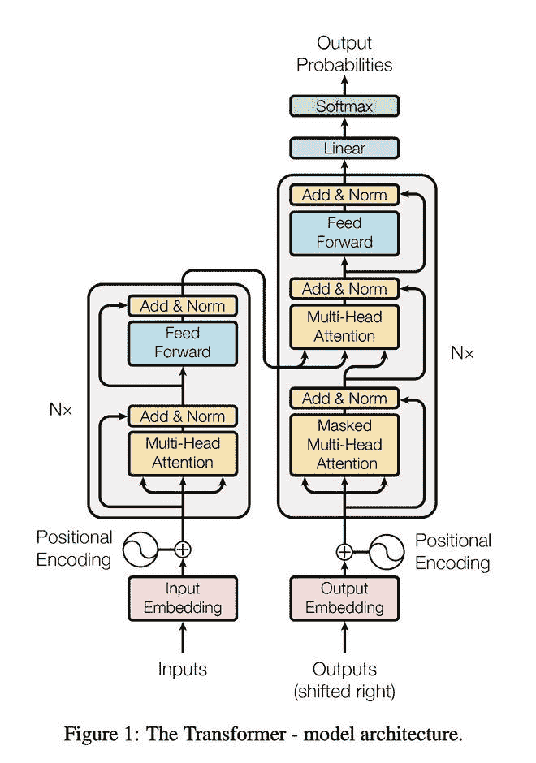
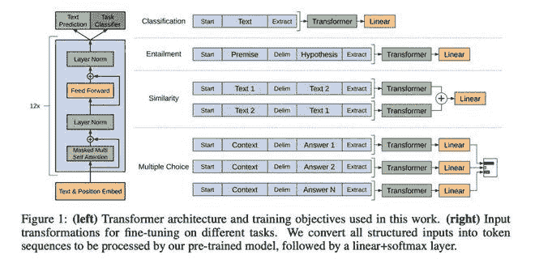
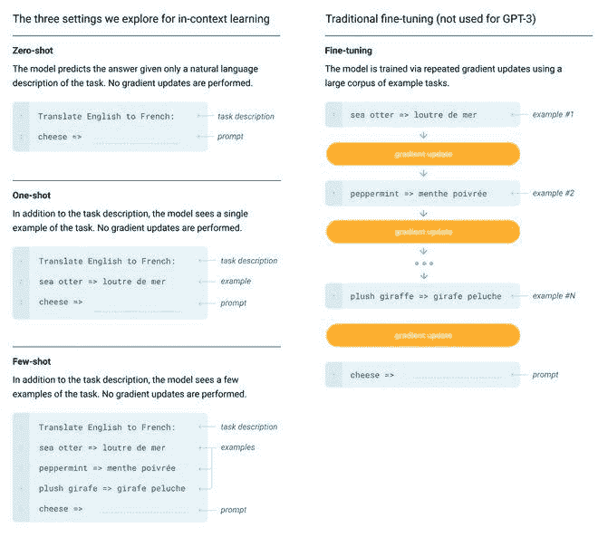
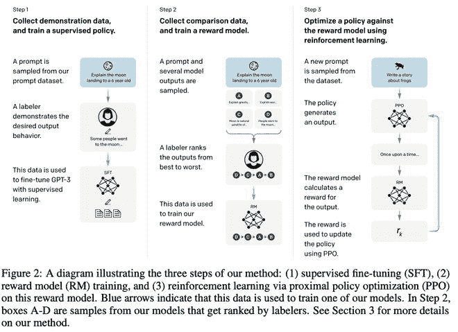
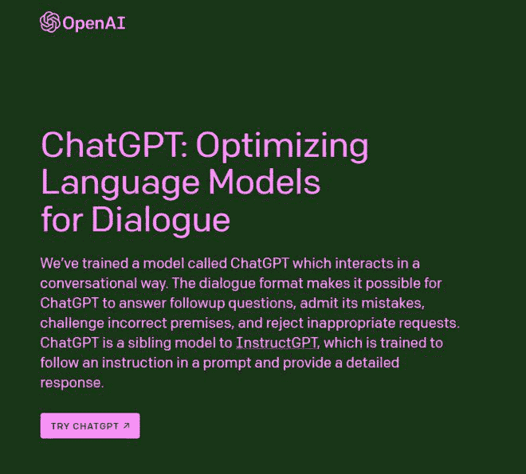
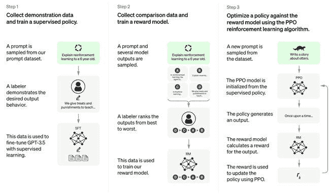

# 一文读懂ChatGPT的前世今生（文末附相关论文下载）

> 来源：[https://diwfpqo78m.feishu.cn/docx/A4YTdpZB9ocgzZxiaS5cfnhQnDg](https://diwfpqo78m.feishu.cn/docx/A4YTdpZB9ocgzZxiaS5cfnhQnDg)

2022年11月，人工智能公司OpenAI推出了一款啥都会的聊天机器人：ChatGPT。它能聊天、能翻译、能做题，还会写情书、写论文、写小说……功能强大到马斯克都表示“我们离强大到危险的 AI 不远了”。

ChatGPT是平地起高楼吗？是横空出世吗？当然不是。伴随着人工智能领域不断更新迭代的研究及不断增长的算力，才有了今天震撼世界的ChatGPT。

悠络客自成立以来一直致力于建立前沿深度学习和算法平台。今天，我们就从技术角度出发，立足基本概念和基础研究，循序渐进对ChatGPT及相关热点内容进行介绍。

## 1. NLP（自然语言处理）

NLP 的全称是 Natural Language Processing（自然语言处理）。它是人工智能的一个重要领域。顾名思义，该领域研究如何处理自然语言。常见的 NLP 任务有机器翻译、舆情监测、自动摘要、观点提取、文本分类、问题回答、文本语义对比、关系抽取、阅读理解等等。

NLP有两个核心的任务，分别是NLU自然语言理解（Natural Language Understanding）和NLG自然语言生成（Natural Language Generation）。NLU聚焦于使机器理解自然语言，NLG则是机器将非语言格式的数据转换为人类可以理解的自然语言。

自然语言理解是人工智能领域皇冠上的明珠，NLP是人工智能赋能社会和赋能行业的硬核科技。“如果我们能够推进自然语言处理，就可以再造一个微软。”比尔·盖茨对自然语言处理在人工智能时代及未来社会发展中的重要性，给予中肯的定义。

## 2. Transformer

在Transformer面世之前，NLP领域的主流模型是循环神经网络RNN（Recurrent Neural Network）及其各种变体。RNN及其各种变体模型有两大问题：

1. 如果传递距离过长就会伴随梯度消失、梯度爆炸和遗忘问题，因此不能有效学习长距离的依赖关系；
2. 在处理序列时必须逐个词进行处理，后一个词要等到前一个词的隐状态输出以后才能开始处理，这样无法同时并行训练，导致训练模型时间过长。

2017年6月，Google Brain发表了一篇论文：Attention Is All You Need（注意力就是你所需要的）。

Transformer是这篇论文里提出的一种模型架构，Transformer基于Encoder-Decoder结构并加入了位置编码及Self-Attention机制。通过Self-Attention机制使得每个序列中的每个词都有全局的语义信息，因此Transformer处理长距离的依赖关系比RNN要好很多；同时由于对输入叠加了Positional Encoding，因此能一次接收整个句子中的所有词作为输入，并行计算后训练的时间相比RNN及其变体也大大缩短。作者将其用于NLP领域中的机器翻译，Transformer在英语-德语和英语-法语相关测试中夺得了SOTA（State-of-the-Art，最先进的）结果，且训练成本相对于以前的一些最好模型要少很多，只是它们的一小部分。

从数学角度来说，NLP可以归为序列建模问题。所谓序列建模，就是要建模产生这个序列的概率分布，或者严格上说是其中的一些条件概率。Transformer的思想是开创性的，对序列建模领域有着深远的影响。Transformer被广泛应用于NLP的各个领域，后续在NLP领域全面开花的语言模型如GPT系列、BERT等，都是基于Transformer。Transformer的出色表现也促使许多人将其应用在计算机视觉领域，相比于传统的卷积神经网络(Convolutional Neural Networks,CNN)，视觉Transformer（Vision Transformers，ViT）依靠出色的建模能力，在多项视觉任务上取得了优异的性能。

## 3. OpenAI公司

2015年，创业孵化器Y Combinator总裁山姆·阿尔特曼、PayPal联合创始人彼得·蒂尔、Linkedin创始人里德·霍夫曼、特斯拉CEO埃隆·马斯克等人出资10亿美元创立OpenAI，旨在实现安全的通用人工智能（AGI）并造福人类。

OpenAI起初是一个非营利组织，但在2019年成立OpenAI LP子公司，目标是盈利和商业化，并引入了微软的10亿美元投资。

OpenAI诞生的初衷，部分原因就是为了避免谷歌在人工智能领域形成垄断。OpenAI的主要成就有：

- 本文后续即将重点介绍的在NLP领域大放异彩的GPT系列；
- 研发和比较强化学习算法的OpenAI Gym工具包；
- 在游戏领域击败Dota2世界冠军的OpenAI Five；
- 连接文本和图像的神经网络CLIP；
- 从文本生成图像的神经网络DALL·E & DALL·E2等。

## 4. GPT（生成式预训练）

2018年6月，OpenAI发表了一篇论文：Improving Language Understanding by Generative Pre-Training(通过生成性预训练提高语言理解能力)。

GPT全称是Generative Pre-Training（生成式预训练），来自于这篇论文标题。该论文提出了一种半监督学习方法，采用了Pre-training + Fine-tuning的训练模式，致力于用大量无标注数据让模型学习“常识”，以缓解标注信息不足的问题。其具体方法是在针对有标签数据训练Fine-tune之前，用无标签数据预训练模型Pre-Train，并保证两种训练具有同样的网络结构。

如上图所示，训练分为两个阶段，第一个阶段是无监督形式的预训练，第二个阶段通过Fine-tuning的模式在监督形式下解决下游任务。GPT使用的Transformer结构也和原始的Transformer有所差异，GPT使用了单向的Transformer来完成预训练任务，将Encoder中的Self-Attention替换成了Masked Self-Attention，如上图左侧所示。使用Masked Self-Attention的目的，是使得句子中的每个词，都只能对包括自己在内的前面所有词进行Attention。

GPT在Transformer的运用和二阶段训练方式上做出了很好的探索，也取得了非常不错的效果，为后续的研究铺平了道路。

## 5. BERT模型（以Transformers为基础的双向编码表达器）

2018年10月，google发表了一篇论文：BERT: Pre-training of Deep Bidirectional Transformers for Language Understanding（BERT：用于语言理解的深度双向变换器的预训练）。

BERT的全称是Bidirectional Encoder Representations from Transformers（以Transformers为基础的双向编码表达器）。BERT和GPT类似的地方在于都是基于“预训练+fine tuning”的模式，在模型规模相当的情况下，BERT在分类、标注等任务下都获得了更好的效果，原因在于BERT采用的是不经过Masked的Transformer块，这样BERT就可以看见整个句子，即BERT不仅可以看到当前词之前的所有词，也能看到当前词之后的所有词，这也是双向的含义所在。

GPT的预训练任务只需要预测下一个词即可。由于BERT能看见整个句子，即BERT是知道参考答案的，因此BERT无法采用和GPT一样的预训练任务来训练模型。BERT论文中提出了两个预训练任务：Masked LM类似于完形填空，训练时随机抹去一句话中的一个或者几个词，然后根据剩余词汇预测被抹去的几个词分别是什么；Next Sentence Prediction类似于句子重排序，通过判断两句话的前后句关系，让模型能够更准确的刻画语句乃至篇章层面的语义信息。通过对这两个任务进行联合训练，使模型输出的每个词的向量表示都尽可能全面准确地表达输入文体的整体信息。

从以上描述可知，BERT是一个自编码语言模型，采用了去噪自编码的思路，随机MASK掉的词就是加入的噪音，训练的目的就是如何去噪。而GPT是一个典型的自回归语言模型，根据上文内容预测下一个可能跟随的词。GPT的缺点是只能利用上文的信息（对比BERT，GPT缺失了下文信息），优点则是在NLG任务中有优势，因为GPT的训练过程和NLG的应用过程是一致的。这也是GPT的后续系列中没有引入双向编码表达器的原因所在。

最后的实验表明BERT模型的有效性，并在11项NLP任务中夺得 SOTA（State-of-the-Art，最先进的）结果。对于NLU任务，BERT较之GPT是有优势的。

## 6. GPT-2

2019年2月，OpenAI又发表了一篇论文：Language Models are Unsupervised Multitask Learners (语言模型是无监督的多任务学习者)，该论文介绍了 GPT 的升级版本GPT-2。

GPT-2相对GPT的第一个主要改进是规模更大、使用的训练数据更多。从模型结构上比较，GPT-2与 GPT 相比几乎没有什么变化，只是GPT-2更大更宽，GPT是12层的Transformer，BERT最深是24层的Transformer，GPT-2则是48层。GPT-2的预训练数据集叫WebText，是OpenAI从网上爬下来的一大堆语料，有800万左右的文档，40G的文本；而GPT使用的训练数据集大小在5GB左右。

第二个主要改进在于，GPT-2取消了Fine-tuning的步骤。也就是说GPT-2采用了一阶段的模型（预训练）代替了二阶段的模型（预训练+ Fine tuning）。在预训练阶段，GPT-2采用了多任务的方式进行学习，每一个任务都要保证其损失函数能收敛。不同的任务共享主干的Transformer参数，这样能进一步提升模型的泛化能力，因此在即使没有Fine-tuning的情况下依旧有非常不错的表现。

作者通过初步论证指出，足够大的语言模型是能够进行多任务学习的，只是学习速度要比监督学习慢得多。语言模型是能够学习某些监督学习的任务，并且不需要明确具体的监督符号。而监督学习由于数据量的关系通常只是无监督学习的一个子集，所以无监督学习的全局最小也必定是监督学习的全局最小，所以目前的问题变为了无监督学习是否能收敛。GPT-2可以完成多任务处理，这证明了半监督语言模型可以在“无需特定任务训练”的情况下，在多项任务上表现出色。该模型在零样本任务转移设置中取得了显著效果。

模型参数大小对比：最大的GPT模型约1.17亿参数（117M）；最大的BERT约3.4亿参数（340M），最大的GPT-2约15亿参数（1542M）。

## 7. 算力单位pfs-day（petaflop/s-day）

如果每秒钟可以进行10的15次方运算，也就是1 peta flops，那么一天就可以进行约10的20次方运算，这个算力消耗被称为1个petaflop/s-day。

OpenAI曾训练过一个强化学习模型OpenAI Five并在2019年战胜了DOTA职业战队OG。该模型训练量达到800 pfs-day，OpenAI透露他们用了256块P100 GPU和12.8万个CPU核心，整整训练了10个月的时间。OpenAI Five的总练习量相当于打了45000年Dota，每天的训练量大概相当于人类打180年游戏。

## 8. GPT-3

2020年5月，OpenAI发表了一篇论文：Language Models are Few-Shot Learners （语言模型是小样本学习者）。

31位作者、75页、320万token、1750亿参数、数据集45TB，训练花了3640pfs-day，训练一次的费用保守估计是460万美元，总训练成本估计达到了1200 万美元。暴力出奇迹。此时微软已经投资OpenAI（2019年投了10亿美元），微软也在2020年9月22日宣布取得了GPT-3的独家授权。

GPT-3的创新也是划时代的。不管是GPT或者GPT-2，下游任务都需要大量的样本。这不符合人类的习惯，人类只需要少量的示例甚至只需要说明就适应一个全新的NLP下游任务。而GPT-3追求的就是人类这种无缝融合和切换多个任务的能力。GPT-3证明了通过增大参数量就能让语言模型提高下游任务在Few-Shot设置下的性能。

传统的Fine-tuning方式一般流程是：

1. 先下载某个开源的预训练模型或自研预训练模型；
2. 收集特定任务的标注数据，在预训练模型上进行Fine-tune训练（此过程是需要进行参数更新的）；
3. 上线推理

下图摘自GPT-3论文，GPT-3提出了In-context learning的三种方式，Zero-shot表示仅需给出任务描述，One-shot表示仅需给出任务描述和一个例子，Few-shot表示仅需给出任务描述和少量的例子，这三种方式都不再需要进行参数更新，仅需要把少量标注样本作为输入文本的上下文，GPT-3即可输出答案。

GPT-3在多个数据集上测试了没有Fine-tune过程的性能表现。整体上，GPT-3在Zero-shot或One-shot设置下能取得尚可的成绩，在Few-shot设置下有可能超越基于Fine-tune的SOTA模型。Zero-shot和One-shot设置的GPT-3能在快速适应和即时推理任务（单词整理、代数运算和利用只出现过一次的单词）中拥有卓越表现。Few-shot设置的GPT-3能够生成人类难以区分的新闻文章，但是在自然语言推理任务（如ANLI数据集）上和机器阅读理解（如RACE或QuAC数据集）的性能有待提高。

## 9. InstructGPT

2022年3月，OpenAI发表论文：Training language models to follow instructions with human feedback （遵循人类反馈指令来训练语言模型）。

InstructGPT是ChatGPT的姊妹模型（此句源自ChatGPT的官方博客）。因为ChatGPT论文还没有放开，因此我们认为，ChatGPT和InstructGPT在实现细节上有最大的相似度。

之前的大语言模型的输出和我们的期待可能会不一致或者不匹配（例如可能会生成错误的、甚至有害的输出）。原因是语言模型的建模目标是“预测当前语境下的下一句话”，而不是“安全且忠实的完成用户的命令”，因此大模型需要进行alignment，来规范模型的“言行举止”，使模型能够helpful、honest、harmless。

InstructGPT基于GPT-3，使用Reinforcement Learning from Human Feedback（RLHF）， 模型训练中加入了人类的评价和反馈数据，而不仅仅是事先准备好的数据集。为了使生成的文本更容易被人理解，OpenAI招募了人类训练师，在训练过程中，人类训练师扮演了用户和人工智能助手的角色。

如上图所示，InstructGPT在一个预训练好的GPT-3模型的基础上，应用了如下三个步骤：

1. 收集人类训练师打标的演示数据（demonstration data），并根据这个数据集训练一个监督策略。人类训练师针对不同的提示语重写期望输出行为的演示答案，这样我们获得了一个在输入提示分布上所期望行为的规范数据集，然后基于这个数据集使用监督学习算法对一个预训练好的GPT-3模型进行调优。
2. 收集人类训练师针对同一个提示语的多个输出进行排序打标后的数据（comparison data），并根据这个数据集训练一个奖励模型。一般来说，对于每一条提示语，模型可以给出多个答案；或者对于多个不同的语言模型，同一个提示语，也可以得到多个答案。人类训练师对一个给定提示语的不同输出，以人类思考交流习惯为依据进行排序，由此再收集了一个比较数据（comparison data）集。然后依据此数据集，继续训练一个奖励模型，用来预测人类偏好的输出，由此帮助模型寻出最优答案。
3. 使用PPO（Proximal Policy Optimization）算法对奖励模型进行策略优化。使用奖励模型的输出作为标量奖励，再使用PPO算法对监督策略进行调优。

步骤2和步骤3可以反复迭代。基于当前最好的策略，收集更多的比较数据，然后用来训练一个新的奖励模型和一个新的监督策略。

InstructGPT的最终实验结果好于GPT-3，InstructGPT生成的结果，在真实性、无害性、有用性方面都有了很大的提高（但是对偏见这种问题依然没有改善）。

## 10. ChatGPT : Optimizing Language Models for Dialogue（一种优化的对话语言模型）

2022年12月，OpenAI发布了ChatGPT模型及相关的blog。

Blog地址：https://openai.com/blog/chatgpt/

ChatGPT的论文还没有放开。我们在此先奉上官方blog第一段的字面翻译：

**一种优化的对话语言模型**

我们训练了一个名为ChatGPT的模型，它以对话的方式进行交互。对话格式使ChatGPT能够回答后续问题、承认错误、质疑不正确的前提和拒绝不适当的请求。ChatGPT是InstructGPT的姊妹模型，后者经过训练，可以遵循提示中的指令并提供详细的响应。

官方blog中提供了和InstructGPT论文中非常相似的一张图（如下所示）。对比InstructGPT论文可知ChatGPT应该和InstructGPT一脉相承，在模型的训练方式上非常相似，只是在一些细节上进行了调整。

本质上ChatGPT是一款由AI驱动的聊天机器人，在网友的一系列测试中表现了惊人的能力：流畅对答、写代码、写剧本、辩证分析问题、纠错等等，甚至让记者编辑、程序员、律师等从业者都感受到了威胁，更不乏其将取代谷歌搜索引擎之说。

通俗来讲，ChatGPT能做到什么？能像真正的人一样跟你聊天，能翻译、能做题、能考试、能作曲、能撰文案、能编代码、能写论文、能构思小说、能写工作周报、能写视频脚本……等等等等，它能做的事情实在是太多了，并且它可能比相当多的人做得还要好。或许在未来，ChatGPT类型的人工智能会取代许多类别的工作岗位。

**当然，ChatGPT也不是无所不能的。**例如ChatGPT依赖于其训练数据中的统计规律，且不会在网络上抓取时事信息（对比谷歌），所以对于最新的事件它没法进行有效的答复，同时由于它的训练数据中关于2021年之后的数据相对较少，所以它对这个时间点之后的世界了解有限，在输出的准确性上也会有所降低；ChatGPT的认知建立在虚拟训练文本上，没有跟实时数据库或信息连接，ChatGPT在某些问题的回答上会出现致命性错误，看似有逻辑的表达实则为错误的信息输出；ChatGPT的奖励模型围绕人类监督而设计，可能会过度优化，训练数据也影响了ChatGPT的写作风格，它喜欢对所有内容进行冗长的回复，经常重复使用特定的短语；此外，训练数据也可能存在偏差，和所有NLP模型一样，由于其知识库受限于训练数据，ChatGPT可能产生负面、不准确甚至言语过激的内容。

## #11 AIGC（AI生产内容）

互联网平台的内容生产模式，经历过两个时代。

**第一个时代是PGC**（Professionally-Generated Content）&OGC（Occupationally-Generated Content），即专家生产内容与专业生产内容。举两个例子，我们在爱奇艺上看到的电视剧《狂飙》，是专业的演员参与、专业的团队制作的；我们在人民网上看到的新闻报道，是专业的记者写的。

**第二个时代是UGC**（User Generated Content），即用户生产内容。相对应的例子，如抖音、各种blog、📕上的大部分内容，都是普通用户自己创作生成的。

**第三个时代即将到来，我们称之为AIGC（AI-Generated Content），即AI生产内容。**而ChatGPT的出现以及其展现的能力，对文字模态的AIGC应用有着重要的意义。

## #12 期待中的GPT-4

ChatGPT不会是这一系列语言模型的尽头。在其论文放开之前，我们称ChatGPT建立在GPT-3.5之上。我们也对未来的GPT-4充满了期待。甚至有人说，“如果GPT-4能充分通过图灵测试，我们不应该感到惊讶。”

所有过往，皆是序章。未来已来，让我们拭目以待……

[`ChatGPT_ppf.pdf`](https://internal-api-drive-stream.feishu.cn/space/api/box/stream/download/all/Zekpb1OGWocejix5MEuc0xkFnBe)
