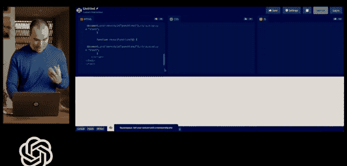
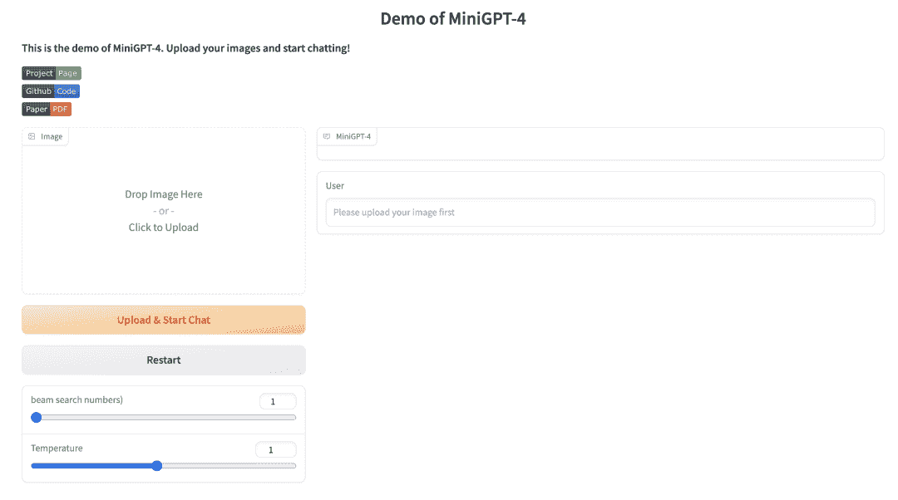
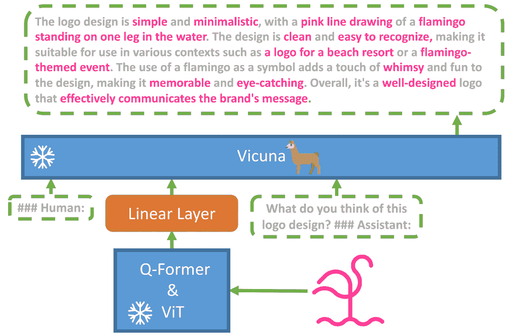
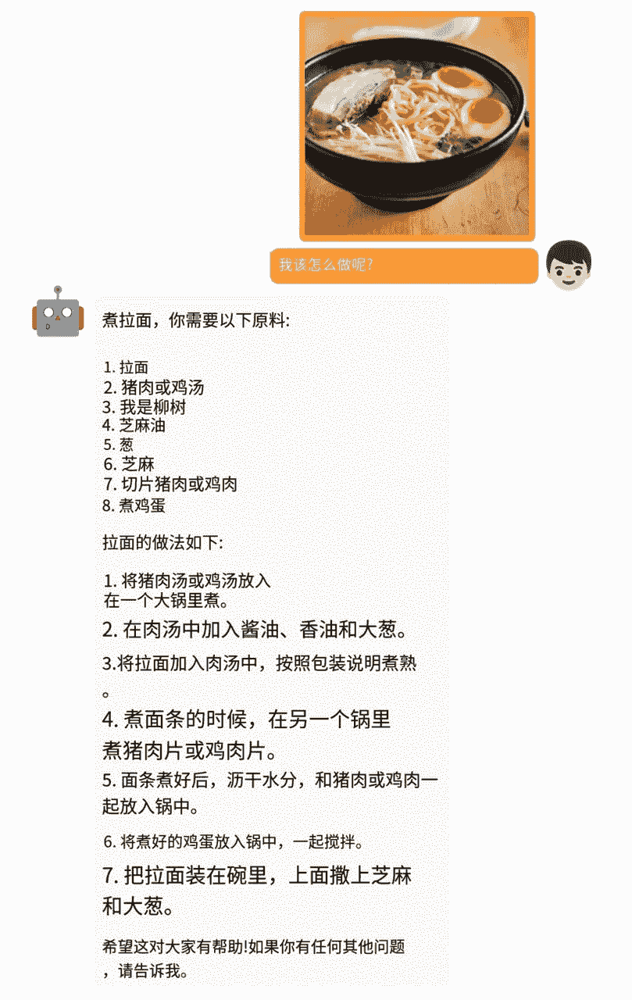
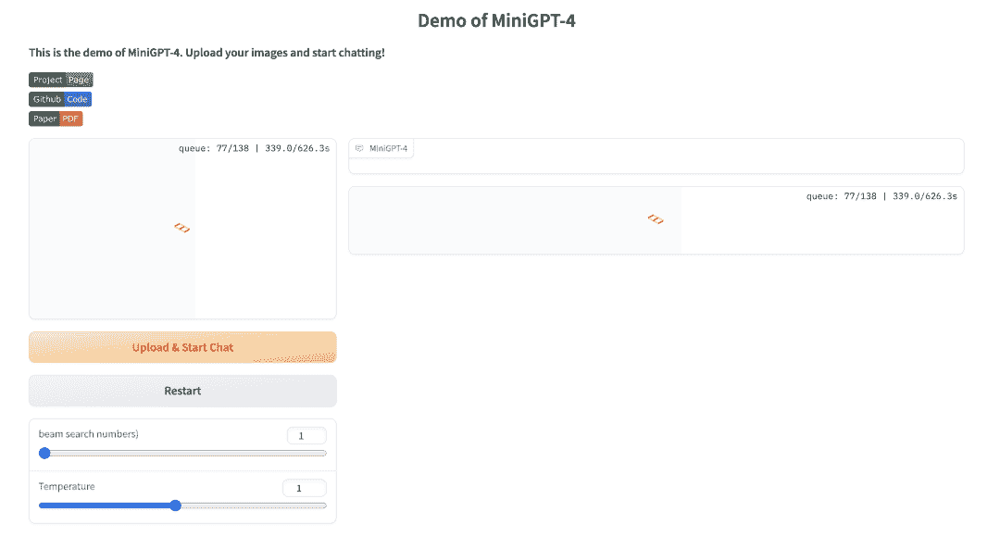

# MiniGPT-4：看图聊天、教学、创作、搭网站......还开源了

> 来源：[https://diwfpqo78m.feishu.cn/docx/DTzidoTg2ocQDKx6gTqcIABOnph](https://diwfpqo78m.feishu.cn/docx/DTzidoTg2ocQDKx6gTqcIABOnph)

> 以下文章来源于公众号：Jack Cui ，作者Jack Cui 部分修改

> 一名热爱技术的算法工程师。分享技术，乐享生活：技术、快乐、财富。

大家好， ChatGPT 的对话能力，想必大家也早已体验过了，无论是文本生成能力，还是写代码的能力，甚至是上下文的关联对话能力，无不一次又一次地震撼着我们。

你还记不记得发布会上，GPT4 的多模态能力吗？输入不仅是可以是文字，还可以是文本和图片。

比如输入：（看图）手套掉下去会怎样？

输出：它会掉到木板上，并且球会被弹飞。


甚至画个网站的草图，GPT4 就可以立马生成网站的 HTML 代码。



**然而，已经过去一个多月了 **！OpenAI 至今也没有提供发布会所展示的多模态处理能力！

原本以为还要再等几个月的官方更新，才能体验上这个功能，没想到，我看到了这么一个项目。

该项目名为 MiniGPT-4，是阿卜杜拉国王科技大学的几位博士做的。

最主要的是，完全开源！效果如视频所示：

退出全屏

切换到横屏模式

[🎦 点击观看视频](http://mpvideo.qpic.cn/0b2eayaaaaaalmactib6ijsfabwdaadaaaaa.f10002.mp4?dis_k=dc85a5887ccd9be11c11258c64fcf9dc&dis_t=1681955866&play_scene=10120&auth_info=Jtu7r/Y3MRRXhoWf13d5LyFmNEtKZDkYZ2AqQWR5S2QXGyUz&auth_key=a61837499edbf57edd1dd5500ad90339&vid=wxv_2889089444841291780&format_id=10002&support_redirect=0&mmversion=false)

> 无法获取音频链接

视频详情

可以看到，MiniGPT-4 能够支持文本和图片的输入，实现了多模态的输入功能。

> GitHub：https://github.com/Vision-CAIR/MiniGPT-4

> 在线体验：https://minigpt-4.github.io

作者还提供了网页 Demo，可以直接体验：



## **项目说明**

MiniGPT-4 是一个很酷的开源项目,它能让计算机更好地理解图片和文字!

MiniGPT-4 是在一些开源大模型基础上训练得到的，fine tune 分为两个阶段，先是在 4 个 A100 上用 500 万图文对训练，然后再用一个一个小的高质量数据集训练，单卡 A100 训练只需要 7 分钟。



给大家看几个例子：



通过商品图，直接生成广告文案：


不过目前使用的人数较多，可以错峰使用，或者本地部署一个服务。



## **部署方式**

要玩转 MiniGPT-4, 首先要准备 Python 环境和下载 Vicuna 的预训练模型。

然后下载 MiniGPT-4 的预训练检查点,或者自己训练一个

我们可以在本地部署一个，首先准备好 Python 环境，这个没啥好说的

```
git clone https://github.com/Vision-CAIR/MiniGPT-4.git
cd MiniGPT-4
conda env create -f environment.yml
conda activate minigpt4
```

准备预训练的 Vicuna 权重,下载 Vicuna-13B 的模型参数,已经开源提供

```
vicuna_weights
├── config.json
├── generation_config.json
├── pytorch_model.bin.index.json
├── pytorch_model-00001-of-00003.bin
...
```

准备预训练的 MiniGPT-4 checkpoint.

然后，在第 11 行的 eval_configs/minigpt4_eval.yaml 中的评估配置文件中设置预训练检查点的路径

运行项目：

```
python demo.py --cfg-path eval_configs/minigpt4_eval.yaml
```

以上就是 MiniGPT-4 项目的部署步骤。

主要需要准备环境、下载预训练模型与数据集、训练模型、评估模型效果等。

由于项目开源, 数据集和预训练模型也都可以公开获取, 大家可以动手实践起来哦！

如果你想了解更多关于 ChatGPT 有趣的项目和玩法，欢迎点击下面的链接，加入我们的社群一起交流探讨

一起期待一下吧～

###