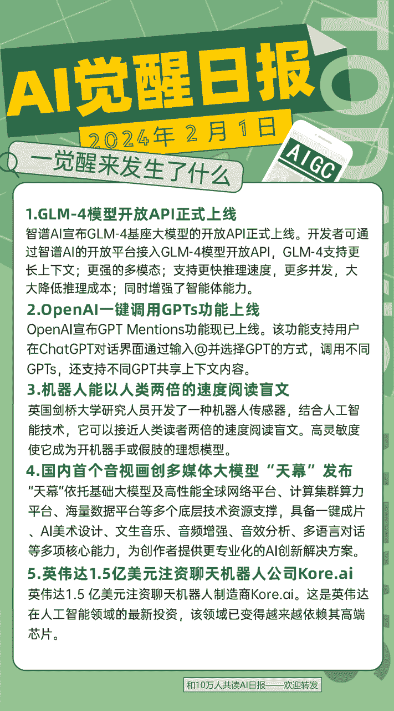
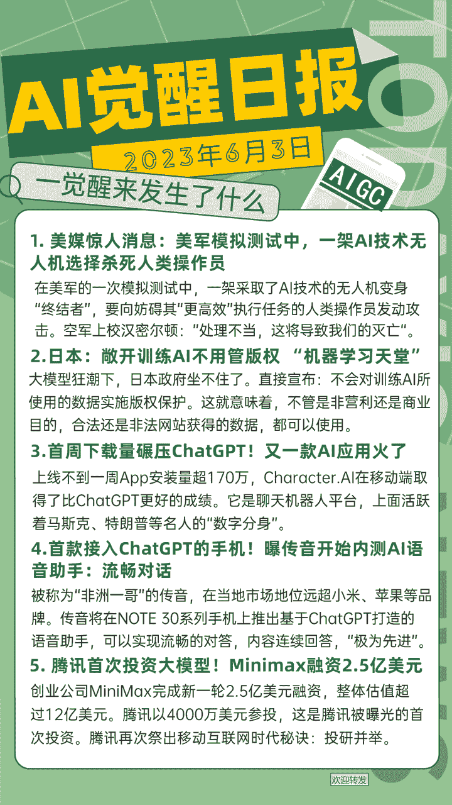
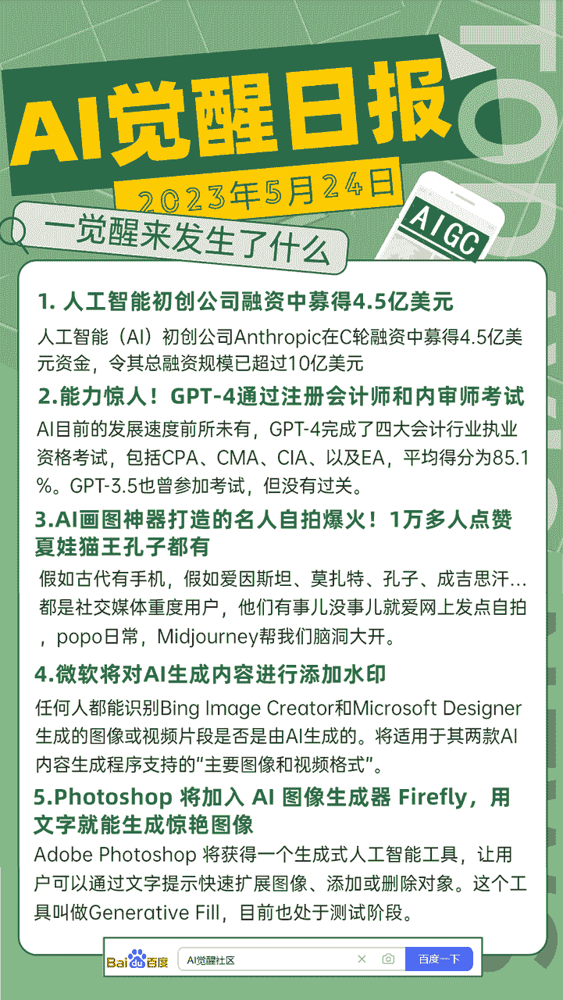
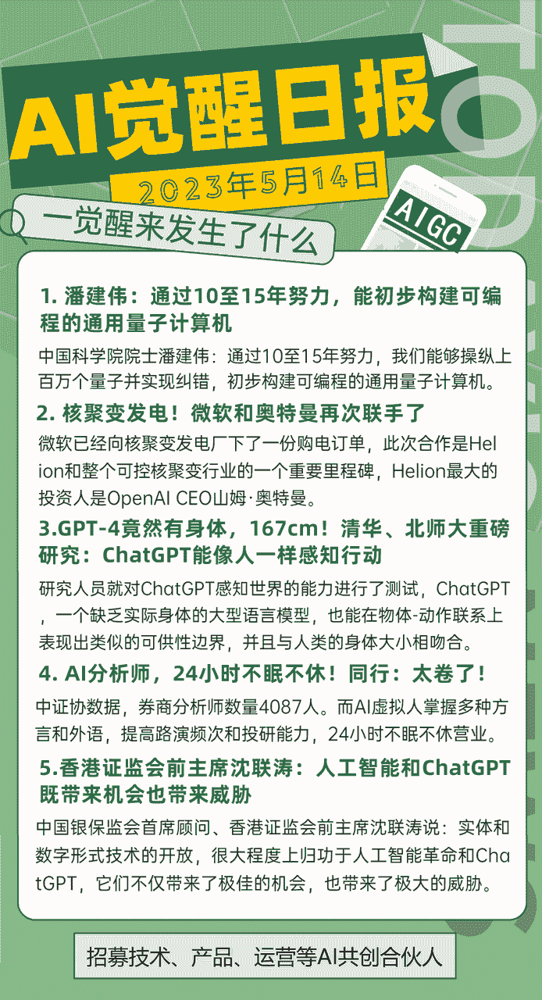

# AI觉醒日报（一觉醒来发生了什么）

> 来源：[https://diwfpqo78m.feishu.cn/docx/NOl4dsah8o4LtixcOv4cdjB3nfb](https://diwfpqo78m.feishu.cn/docx/NOl4dsah8o4LtixcOv4cdjB3nfb)

> 订阅AI觉醒日报，关注“AI觉醒”👸号，已开放全国100城市的同城AI群：13913041

> 【欢迎右上角...收藏转发分享】

# 2024年4月13日

# 2024年4月12日

# 2024年4月11日

# 2024年4月10日

# 2024年4月9日

# 2024年4月8日

# 2024年4月7日

# 2024年4月5日

# 2024年4月4日

# 2024年4月3日

# 2024年4月2日

# 2024年4月1日

# 2024年3月31日

# 2024年3月30日

# 2024年3月29日

# 2024年3月28日

# 2024年3月27日

# 2024年3月26日

# 2024年3月25日

# 2024年3月24日

# 2024年3月23日

# 2024年3月22日

# 2024年3月21日

# 2024年3月20日

# 2024年3月19日

# 2024年3月18日

# 2024年3月17日

# 2024年3月16日

# 2024年3月15日

# 2024年3月14日

# 2024年3月13日

# 2024年3月12日

# 2024年3月11日

# 2024年3月10日

# 2024年3月9日

# 2024年3月8日

# 2024年3月7日

# 2024年3月6日

# 2024年3月5日

# 2024年3月4日

# 2024年3月3日

# 2024年3月2日

# 2024年3月1日

# 2024年2月29日

# 2024年2月28日

# 2024年2月27日

# 2024年2月26日

# 2024年2月25日

# 2024年2月24日

# 2024年2月23日

# 2024年2月22日

# 2024年2月21日

# 2024年2月20日

# 2024年2月19日

# 2024年2月18日

# 2024年2月17日

# 2024年2月16日

# 2024年2月15日

# 2024年2月14日

# 2024年2月9日

# 2024年2月8日

# 2024年2月7日

# 2024年2月6日

# 2024年2月5日

# 2024年2月4日

# 2024年2月3日

# 2024年2月2日

# 2024年2月1日

# 2024年1月31日

# 2024年1月30日

# 2024年1月29日

# 2024年1月28日

# 2024年1月27日

# 2024年1月26日

# 2024年1月25日

# 2024年1月24日

# 2024年1月23日

# 2024年1月22日

# 2024年1月21日

# 2024年1月20日

# 2024年1月19日

# 2024年1月18日

# 2024年1月17日

# 2024年1月16日

# 2024年1月15日

# 2024年1月14日

# 2024年1月13日

# 2024年1月12日

# 2024年1月11日

# 2024年1月10日

# 2024年1月9日

# 2024年1月8日

# 2024年1月7日

# 2024年1月6日

# 2024年1月5日

# 2024年1月4日

# 2024年1月3日

# 2024年1月2日

# 2024年1月1日

# 2023年12月31日

# 2023年12月30日

# 2023年12月29日

# 2023年12月28日

# 2023年12月27日

# 2023年12月26日

# 2023年12月25日

# 2023年12月24日

# 2023年12月23日

# 2023年12月22日

# 2023年12月21日

# 2023年12月20日

# 2023年12月19日

# 2023年12月18日

# 2023年12月17日

# 2023年12月16日

# 2023年12月15日

# 2023年12月14日

# 2023年12月13日

# 2023年12月12日

# 2023年12月11日

# 2023年12月10日

# 2023年12月9日

# 2023年12月8日

# 2023年12月7日

# 2023年12月6日

# 2023年12月5日

# 2023年12月4日

# 2023年12月3日

# 2023年12月2日

# 2023年12月1日

# 2023年11月30日

# 2023年11月29日

# 2023年11月28日

# 2023年11月27日

# 2023年11月26日

# 2023年11月25日

# 2023年11月24日

# 2023年11月23日

# 2023年11月22日

# 2023年11月21日

# 2023年11月20日

# 2023年11月19日

# 2023年11月18日

# 2023年11月17日

# 2023年11月16日

# 2023年11月15日

# 2023年11月14日

# 2023年11月13日

# 2023年11月12日

# 2023年11月11日

# 2023年11月10日

# 2023年11月9日

# 2023年11月8日

# 2023年11月7日

# 2023年11月6日

# 2023年11月5日

# 2023年11月4日

# 2023年11月3日

# 2023年11月2日

# 2023年11月1日

# 2023年10月31日

# 2023年10月30日

# 2023年10月29日

# 2023年10月28日

# 2023年10月27日

# 2023年10月26日

# 2023年10月25日

# 2023年10月24日

# 2023年10月23日

# 2023年10月22日

# 2023年10月21日

# 2023年10月20日

# 2023年10月19日

# 2023年10月18日

# 2023年10月17日

# 2023年10月16日

# 2023年10月15日

# 2023年10月14日

# 2023年10月13日

# 2023年10月12日

# 2023年10月11日

# 2023年10月10日

# 2023年10月9日

# 2023年10月8日

# 2023年10月7日

# 2023年10月6日

# 2023年10月5日

# 2023年10月4日

# 2023年10月3日

# 2023年10月2日

# 2023年10月1日

# 2023年9月30日

# 2023年9月29日

# 2023年9月28日

# 2023年9月27日

# 2023年9月26日

# 2023年9月25日

# 2023年9月24日

# 2023年9月23日

# 2023年9月22日

# 2023年9月21日

# 2023年9月20日

# 2023年9月19日

# 2023年9月18日

# 2023年9月17日

# 2023年9月16日

# 2023年9月15日

# 2023年9月14日

# 2023年9月13日

# 2023年9月12日

# 2023年9月11日

# 2023年9月10日

# 2023年9月9日

# 2023年9月8日

# 2023年9月7日

# 2023年9月6日

# 2023年9月5日

# 2023年9月4日

# 2023年9月3日

# 2023年9月2日

# 2023年9月1日

# 2023年8月31日

# 2023年8月30日

# 2023年8月29日

# 2023年8月28日

# 2023年8月27日

# 2023年8月26日

# 2023年8月25日

# 2023年8月24日

# 2023年8月23日

# 2023年8月22日

# 2023年8月21日

# 2023年8月20日

# 2023年8月19日

# 2023年8月18日

# 2023年8月17日

# 2023年8月16日

# 2023年8月15日

# 2023年8月14日

# 2023年8月13日

# 2023年8月12日

# 2023年8月11日

# 2023年8月10日

# 2023年8月9日

# 2023年8月8日

# 2023年8月7日

# 2023年8月6日

# 2023年8月5日

# 2023年8月4日

# 2023年8月3日

# 2023年8月2日

# 2023年8月1日

# 2023年7月31日

# 2023年7月30日

# 2023年7月29日

# 2023年7月28日

# 2023年7月27日

# 2023年7月26日

# 2023年7月25日

# 2023年7月24日

# 2023年7月23日

# 2023年7月22日

# 2023年7月21日

# 2023年7月20日

# 2023年7月19日

# 2023年7月18日

# 2023年7月17日

# 2023年7月16日

# 2023年7月15日

# 2023年7月14日

# 2023年7月13日

# 2023年7月12日

# 2023年7月11日

# 2023年7月10日

# 2023年7月9日

# 2023年7月8日

# 2023年7月7日

# 2023年7月6日

# 2023年7月5日

# 2023年7月4日

# 2023年7月3日

# 2023年7月2日

# 2023年7月1日

# 2023年6月30日

# 2023年6月29日

# 2023年6月28日

# 2023年6月27日

# 2023年6月26日

# 2023年6月25日

# 2023年6月24日

# 2023年6月23日

# 2023年6月22日

# 2023年6月21日

# 2023年6月20日

# 2023年6月19日

# 2023年6月18日

# 2023年6月17日

# 2023年6月16日

# 2023年6月15日

# 2023年6月14日

# 2023年6月13日

# 2023年6月12日

# 2023年6月11日

# 2023年6月10日

# 2023年6月9日

# 2023年6月8日

# 2023年6月7日

# 2023年6月6日

# 2023年6月5日

# 2023年6月4日

# 2023年6月3日

# 2023年6月2日

# 2023年6月1日

# 2023年5月31日

# 2023年5月30日

# 2023年5月29日

# 2023年5月28日

# 2023年5月27日

# 2023年5月26日

# 2023年5月25日

# 2023年5月24日

# 2023年5月23日

# 2023年5月22日

# 2023年5月21日

# 2023年5月20日

# 2023年5月19日

# 2023年5月18日

# 2023年5月17日

# 2023年5月16日

# 2023年5月15日

# 2023年5月14日

# 2023年5月13日

# 2023年5月12日

# 2023年5月11日

# 2023年5月10日

# 2023年5月9日

# 2023年5月8日

# 2023年5月7日

# 2023年5月6日

# 2023年5月5日

# 2023年5月4日

# 2023年5月3日

# 2023年5月2日

# 2023年5月1日

# 2023年4月30日

# 2023年4月29日

# 2023年4月28日

# 2023年4月27日

# 2023年4月26日

# 2023年4月25日

# 2023年4月24日

# 2023年4月23日

# 2023年4月22日

# 2023年4月21日

# 2023年4月20日

# 2023年4月19日

# 2023年4月18日

# 2023年4月17日

# 2023年4月16日

# 2023年4月15日

# 2023年4月14日

# 2023年4月13日

