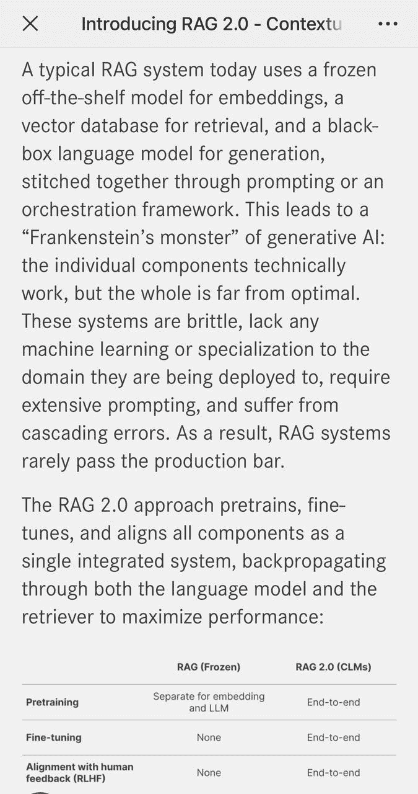
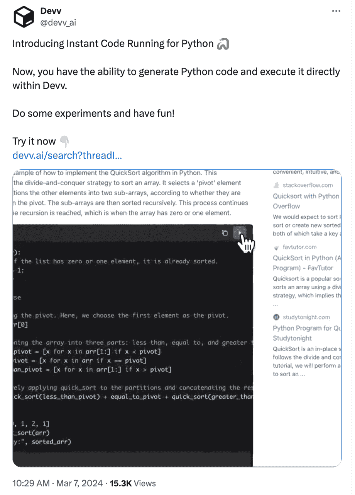

# 最新资讯

> 来源：[https://hqexj12b0g.feishu.cn/docx/D3jsdb7IjoHPIoxEjJkcEYYsnve](https://hqexj12b0g.feishu.cn/docx/D3jsdb7IjoHPIoxEjJkcEYYsnve)

> 本部分欢迎大家按照模版贡献，我在探索借助Agent的手段实现自动化，感兴趣可以一起聊聊。

> [实践案例](https://hqexj12b0g.feishu.cn/wiki/VUUSwxGMeid7M9kaqWfcnUMOnNb)励发布一手资讯，能有自己comment或者实践案例（比较完整可以放到 ）再好不过。

# 2024年4月

占坑

# 2024年3月

## RAG 2.0

2020 facebook RAG论文作者之一，现contextual ai联创Douwe Kirla提出RAG 2.0，实验结果很牛x，但没有细节，对人民群众而言还是RAG 1.0便宜实用

https://contextual.ai/introducing-rag2/

## Devv.ai可以执行python代码了

一个例子：https://devv.ai/search?threadId=dewfgz3xd6o0

## **Perplexity Inspir**ed LLM Answer Engine

这个存储库包含构建复杂答案引擎所需的代码和说明，该引擎利用Groq、Mixtral、Langchain.JS、Brave Search和OpenAI的功能。该项目旨在根据用户查询高效返回来源、答案和后续问题，是从事自然语言处理和搜索技术的开发人员的理想起点。

+   git仓库：https://github.com/developersdigest/llm-answer-engine

+   介绍视频：https://www.youtube.com/watch?v=43ZCeBTcsS8