# AI搜索产品研究群群聊精华（群内使用）

> 来源：[https://hqexj12b0g.feishu.cn/docx/A5lNdTaQOouC37xU395ch7D2n8c](https://hqexj12b0g.feishu.cn/docx/A5lNdTaQOouC37xU395ch7D2n8c)

> [AI搜索产品技术交流|群消息](https://mvhi0v1y6xe.feishu.cn/docx/MJCNdJlYDoc3zKxKfOqcLyQ7nLc)内消息，请仅限群内学习使用，原始链接

> 本文档目的是便于快速回顾群里信息、梳理自己未掌握的信息，如果信息遗漏或错误，请指正

> 使用说明：

+   快速浏览群里消息，不怕错过重要信息

+   比如我不熟悉phind，通过文档按图索骥赶紧学起来；如果还没关注到知乎入场、没用过人均百万上下文的千问，提醒自己赶紧用起来

# 20240401

> 20240325-20240331

## 搜索

360搜跟进了，实际上百度什么的想要跟进也不难，搜索是toc的，老百姓对搜索效果的评价很主观，现在主打的是交互和搜索内容的延展

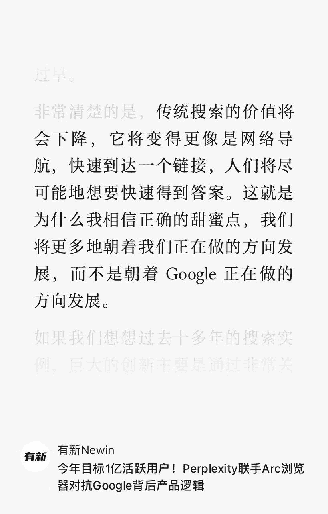

+   Perplexity ceo的专访都值得读一读

+   https://mp.weixin.qq.com/s/LTvxg2AShH3Pa7MmchMheA  Perplexity CEO 专访：拥有十万用户的套壳产品比拥有自有模型却没有用户更有意义

+   @samueli 我感觉人类步入正轨了，纯chatbot的时代应该过去了，因为LLM会幻觉，所以答案未必是对的，需要搜索来纠正，所以搜索ai相当合理。大部分情况下，搜索可以让你得到正确的回答（而不是LLM chat）。我记得PPL CEO是这么个意思。

+   早上听贾扬青播客说他期望未来ai不是100%正确，而是给出答案的同时告诉答案的可信度，类似人表达：我确定，我估计，我猜想…

+   https://www.xiaoyuzhoufm.com/episode/65ee7ba02d96b6aa80f4359d?s=eyJ1IjogIjVmODFjYTVkZTBmNWU3MjNiYjc5NWQ5MiJ9

+   这个之前我提过，这个其实并不算很难

+   人都没有100%正确，groundtruth也是人给的

+   因为LLM推理的时候可以给出下一个token的概率，所以如果模型愿意开放，我们可以用色块标记出这次输出里面哪些是置信的，哪些是不置信的。之前清华有一个研究，甚至可以通过向量特征来判断某段文字的涉黄涉政倾向。然后通过滑词，例如划出不置信的文字部分，要求重新生成。你还可以要求这段文字重新生成的temperature，这样的copilot可能是非常棒的体验。

+   这个是用一个新的模型去滑词吗

+   不一定，你修改了temperature和topp，逻辑上结果会有变化，也可以是个新模型

+   看使用场景，感觉置信低未必是坏事，就像temperature一样

+   对，比如在创作领域，你可以划出比较中庸或者严肃的句子，然后要求用另一种语言风格润色

+   从某个角度来说，brainstorm的那个idea真的很棒，因为是自动选择一个预设的角色来分析润色

+   预计是下个阶段了 堆参数卷上下文结束了就是小模型+知识库lora。反正idea我是无保留贡献了，看谁愿意去做了，我没有部署开源模型的经验，就不搞这玩意儿

+   对，我都震惊了，同样的query，在perplexity，只有20条左右

+   PPL性能优化的不行，或者可能是不舍得放出来让你免费用，秘塔和360搜都很快，应该是rag阶段并发开的比较高

## 搜索速度/pplx

+   pplx是几个AI搜索里速度最慢的

> 这里不是简单的重新输出，因为你重新生成的部分还要跟前面、后面的文字对得上

> 所以本质上prompt是一个填空题，类似于：

> xxxx，______，xxxx

> 原本____处的内容是aaaaa，请重新生成

+   bert那种双向的感觉

+   哈哈我也想到Bert

+   有时候秘塔都深入完了，pplx还在慢慢挪（中文的时候）

+   感觉需要一个buffer去存置信度，可能占内存

+   也可以不占内存，而是做成一个额外的meta字段返回，配在正式response后面

+   只要不是常驻占显存的都ok

+   我试的用英文提问pplx很快，但是用中文提问很慢，不知道是不是孤例

+   啊哈哈我有点带节奏了，应该和pplx自己没关系，大概是gpt写中文的速度就是慢一点吧，我在平时用网页版也感觉到，所以我一般用英文问，最后结果写成中文

+   我感觉pplx是故意针对中文用户，如果先用英文提问再用中文提问回复速度比直接用中文提问快很多

## Kimi

+   kimi 只给个别人 200 的开放么

+   个人感觉是这样的 还在排队中

+   我说一句，用爬虫调metaso api是无限制的

+   虽然一天100估计也用不光了

+   奥看错了，说的是kimi，我说的是metaso，sorry串台了。。。

+   kimi是ai搜索产品吗，我咋记得群里好像有人说过不是

+   不是，但是现在很多llm chatbot会带搜索，等于说不是主打搜索的

+   https://mp.weixin.qq.com/s/HfSWNM5z9Shm8438aXPkEQ，“越长”就越强？为何通义千问卷不动Kimi

+   我和作者的使用体验一致~ 千问的总结体验没有kimi好

+   同感，只是kimi有的时候会罢工

+   谁强都没关系 阿里也是   kimi 的金主

+   说实话 从个人的体而言  国内的模型 就 kimi 最顺手 最满意  其次是  天工AI  和 通义千问

+   kimi聪明的地方是做了一点整合，别的公司只是做了一个模型，它好像还会依照用户的需求自动加载插件和system prompt，比如总结，网页读取，等等

+   如果对比文心一言呢，文心需要自己切换插件，没办法直接拖动文件（我知道这个是个很简单功能hhhhh），我以前创业的时候我总是想着用户如果是我父母他们怎么会怎么操作hhhh

## Chat Bot和AI搜索如何界定

+   那怎么界定chatbot还是ai搜索的标准是啥呀

+   需要么

+   换句话说，有什么能力chatbot能做，ai搜索做不了，什么是ai搜索能做，chatbot做不了

+   挺好的问题，搜索和chat是不是ai落地的两种产品形态，群里有不少产品同学有空也可以聊聊 @所有人

+   认可，chatbot不适合做搜索，kimi用下来发现有些搜索的答案其实是大模型答出来的

+   大致可以这么理解：AI搜索是带搜索的LLMrag过程

+   AI搜索 = 传统搜索 + LLM chatbot

我也想问这个问题来着

+   这是俩不同的纬度吧 chatbot是形态 搜索是业务

+   这么说挺好

+   那像perplexity我也能说是chatbot

+   按照YU的说法，这也没错

+   只不过现在很多chatbot都配有搜索模块了，所以只看搜索的“纯度”有多大

+   一般AI搜索会告诉你他搜出了什么引用资料，采信了什么资料

+   kimi也会

+   对，但是kimi更擅长的还是长文和解析，所以kimi有搜索能力，也有长文能力，所以我才说

+   chatbot, speakbot,人形bot 等等各类bot上可以加装各类能力，比如搜索能力，知识库能力 两种维度确实不一样，只不过现在是初期，没有特别细分

+   等后面市场大了，细分定义和边界会越来越明显

+   对，贴标签可以，但是别做0/1分类

+   这玩意目前还是模糊的 退一步讲 实际上都是根据输入信息做在信息聚合输出 只是信源是引用在线搜索能力还是模型自带的知识

+   现在越来越证明llm自身的能力并不足以正确回答问题

+   本质kimi是要做AGI的 ，搜索只是进行补充

+   未来ai的超级app会不会也像🛰️一样，无所不包

+   需要外围rpa支持

+   现在感觉每一家都当成完全体在做，搜索+个人助手

+   交互性：AI联网问答系统通常更加交互性强，可以进行多轮对话，更好地理解用户的意图；而AI搜索往往是单次交互，用户输入查询，搜索引擎返回结果。

+   技术实现：AI搜索侧重于索引和检索技术，需要对互联网上的内容进行爬取、索引和排序；AI联网问答则侧重于理解和生成语言，需要大量的预训练数据和复杂的语言模型。

+   我感觉就是，你的这个产品出发点是从哪，从chatbot出发的逐渐增强搜索能力，还是你想先解决搜索这个场景的问题用LLM去解决

https://mp.weixin.qq.com/s/JPyfpVUgqI8hxZE-z-zBbg

议古论今：聊聊现在AI应用层创业者面对的三个问题

这篇文章里有张图，agi没实现前，还是百花齐放，都有肉吃

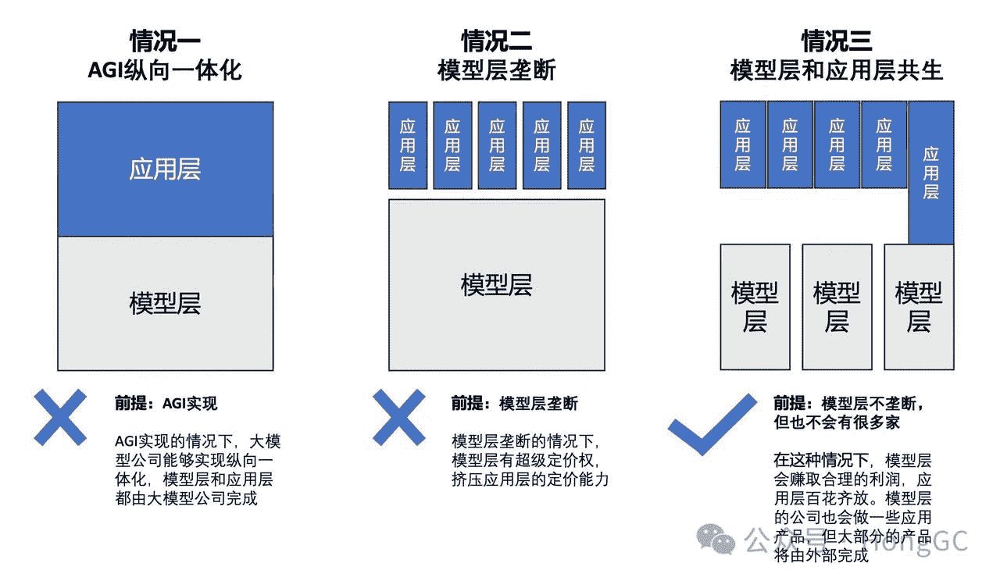

+   我其实有一个想法，很多时候模型输出不符合我们的想法，并不是模型弱，而是我们给到模型的context太少了，也无法包括一些背景设定和我们脑中预设的潜台词

+   赞同 所以我比较期待垂直领域小模型

+   可以感觉到，我大前天买了秘塔写作猫的会员，改写的时候把很多专业词汇改写了，比如营收，现金流量金额，改成收入，变现等等，因为没有背景理解，不知道我在写的内容是股票分析

+   给AI要给一个前提条件，设定环境，不管是在开头说，还是结尾，都要说一下

+   哪位知道给点文字，让Ai出个路线图，用那个ai，就像旅游攻略的图

## 创业先有产品后做模型

+   「AI 创业公司要先做产品，后做模型」这句话深有感触

## 密塔

### 背景

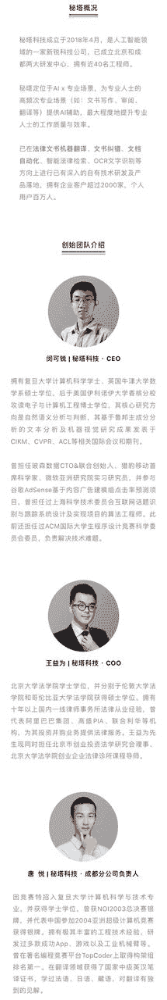

就是秘塔ai搜索，其实推出来很久了，创始人以前在猎豹移动，傅盛大佬投资了

https://metaso.cn/

+   之前在朋友圈推荐了  但觉得没什么核心壁垒

+   需要深入研究的问题，秘塔ai不错，举个例子

+   秘塔搜索应该算是一个Agent吧？多个AI协同？

+   多agent搜索，可以看下 @即将拥有人鱼线 的作品：brainstorm.cool

+   Agent指的是一个自动执行的AI长链事务，上面可能包括LLM步骤，以及一些其他非LLM步骤（例如搜索，检索，排序，安全过滤等等）

所以大家现在看到的大部分AI应用都是agent，但agent不是说的多AI，而是多个AIor非AI步骤联合

### 生成PPT

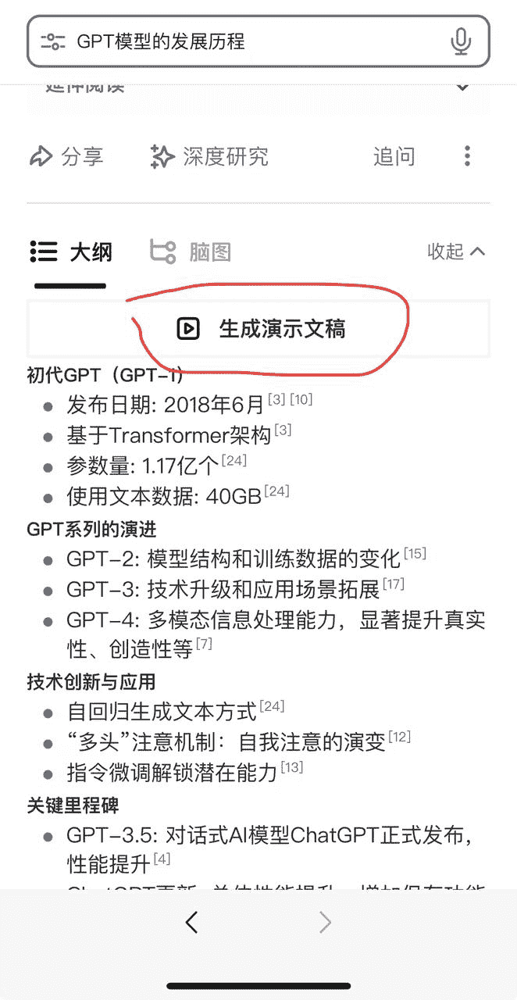

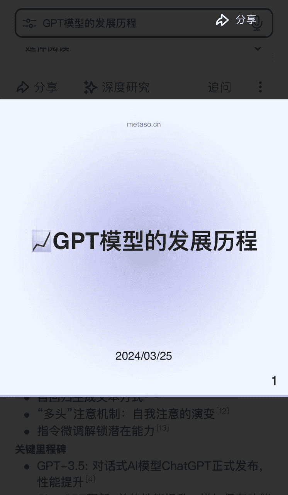

之前秘塔还没有生成ppt功能呢，也没有学术搜索功能，次数也没有限制，现在好像100次限制，进化的好快

### 根据链接读取总结

+   秘塔ai可以扔链接读取总结了

+   看了下返回结果，之前query改写后label是googlesearch，扔链接的时候变成了clawer，应该是crawler吧，难道程序员单词拼错了？

+   还得是秘塔，别的搜索都没讲到这么全面详细

### 其他

+   如果秘塔搜索一定要挑点问题的话，就是似乎缺乏一点点常识，比如把实质上不一样的搜索内容杂糅在一起以为是同一个事情，不过总体而言，在搜索体验来说依然是非常出色的

+   这个有点离谱了，你试试改成leptonai search

+   试了一下，蛮好用的，喔喔看错了，嗯嗯改一下就没事

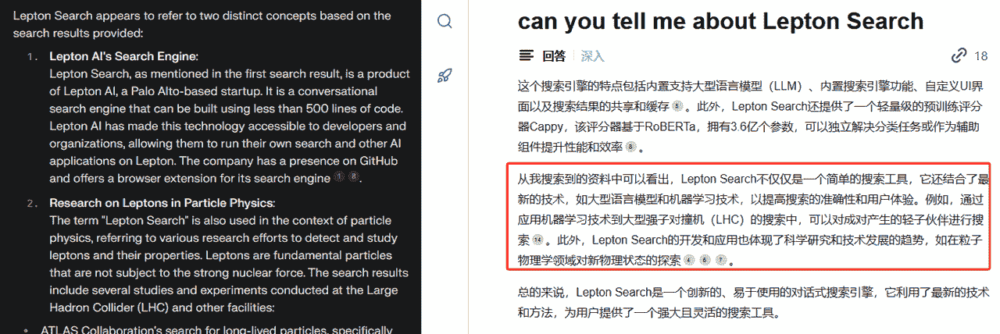

+   有时候是搜索以后总结的时候没区分开。有时候是没说清楚，比如你说某某是谁，可能会吧重名的很多人都混在一起说。

+   蛮惊讶的是gpt4驱动的两个，phind和pplx，是意识到这个信息的重名问题

+   这应该是模型能力问题，比如你问gpt，我要买个苹果，需要多少钱，它会问你想买的是水果，还是手机，就还蛮智能的，模型就是应该解决这类问题，而不是把这种交互要求甩到用户这边

## 天宫AI

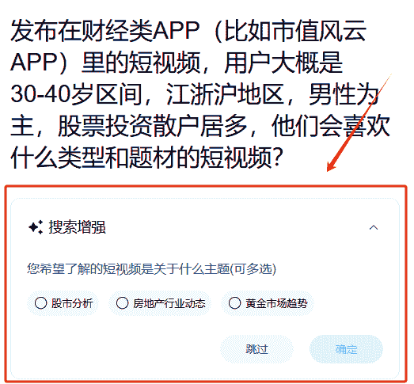

+   国内开始卷了hhhh 天宫AI开始搞PPLX这种和你确认具体想了解的信息方向的对话框

+   我个人的一些猜测，秘塔搜索为了节约成本，实际上context token并不是很大，在深入模式的时候会展开到一些很远的话题hhhh 然后追问模式下，也更多像是集中回答你当下的这个问题，并没有考虑太多之前的内容。目前对于秘塔的机制我蛮感兴趣，可惜我是个不会代码的老炮儿，所以目前很多是一些不成熟的理解。（在别的群聊到的，未成熟的验证想法，我后续继续跟进研究一下。）

+   秘塔的团队说这个项目成本不怎么大，让我来了兴趣，以前我的认知里AI搜索是个烧钱的东西

+   本来就不是很费成本

+   那我需要更新一下我的认知了hhhh

+   只有kimi那种输入多少正文都算token的那种，特别费成本

+   你可以理解成这样

> 由源搜索出相关内容链接-》不怎么要钱

> 相关链接的正文提取 -》不怎么要钱

> 正文抽摘要 -》要钱，但是可能前面的搜索直接帮你做好了

> 正文切片，切片存向量库，摘要存向量库-》不怎么要钱

> 向量召回-》不怎么要钱

>

> 召回内容排序，分析，拓展Q或者拓展A-》要过大模型，要钱。但是前面已经避免了全文输入大模型，而是向量召回一个小段落。

> 根据召回回答问题-》要过大模型，要钱。

+   现阶段差不多是，不过大模型就不怎么要钱，也不怎么要时间

+   输出跟输入相比，消耗的显存一样，消耗的时间大约是30倍

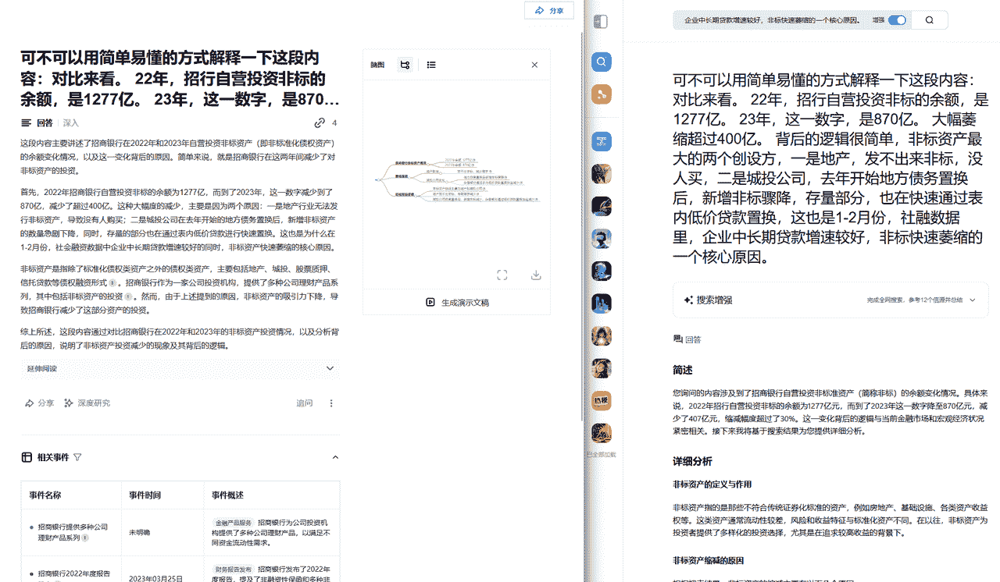

+   天工最近把增强搜索从一天5次变成无限次以后，和秘塔的距离拉近了一点

+   现在秘塔主要的优势还是在于搜索结果，可以查到一些其他的主流AI搜索根本找不到的

+   不过我感觉秘塔应该很难被追上，除非他们自己开始走偏，现在和他们对标的这些公司产品线做的很多，秘塔很专注，是个好事~

## 当代AI搜索的困境

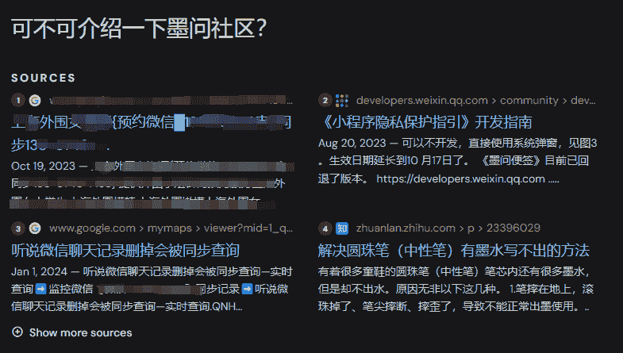

+   当代AI搜索的困境

+   你想说啥？私域高质量数据抓不到？

+   就是phind搜到的信息有时候是这种

+   我以前用某歌搜信息有时候也会这种，很多这种广告内容

+   哦，ghs小广告

+   私域数据也是一个挑战，确实是

+   如果📕和🛰️👸号的内容可以用AI帮忙做点检索应该蛮不错

+   perplexity

## RAG 2.0

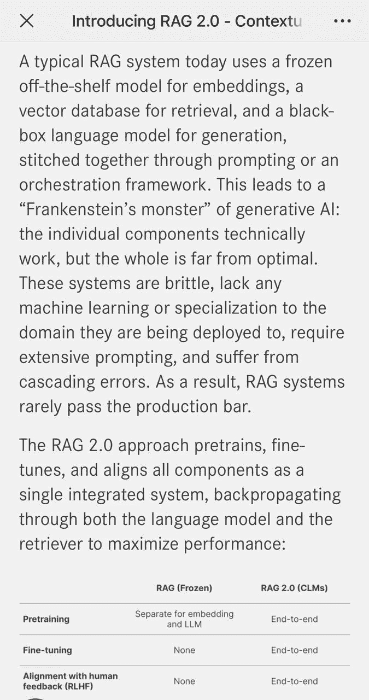

+   https://contextual.ai/introducing-rag2/

+   today, we’re announcing RAG 2.0, our approach for developing robust and reliable AI for enterprise-grade performance. Unlike the previous generation of RAG, which stitches together frozen models, vector databases, and poor quality embeddings, our system is optimized end to end.

+   2020 facebook RAG论文作者之一，现contextual ai联创Douwe Kirla提出RAG 2.0，实验结果很牛x，blog没透露细节，只提到端到端优化，但rag的数据时效性怎么解，内置vectordb会不会很贵，对人民群众而言短期可能1.0更便宜实用

+   已更新到知识库【最新资讯】：[最新资讯](https://hqexj12b0g.feishu.cn/wiki/SbDNw6DI9iBcs7klaFvck0mDnHb)

一个大模型技术群关于rag2.0引发的讨论（以下信息源自群里转的聊天记录）：

+   https://mp.weixin.qq.com/s/jQx-Ed6BSylMuGix1qSMjg，心法利器[111] | 近期RAG技术总结和串讲（4w字RAG文章纪念），RAG的文章已经写了4w字了（撒花！），正好梳理一下，串讲一遍，方便理解和记录。

+   大佬，这个rag 2.0怎么看？

+   看介绍就是一阶召回技术吧，联合训练召回和llm（见下面两张图）

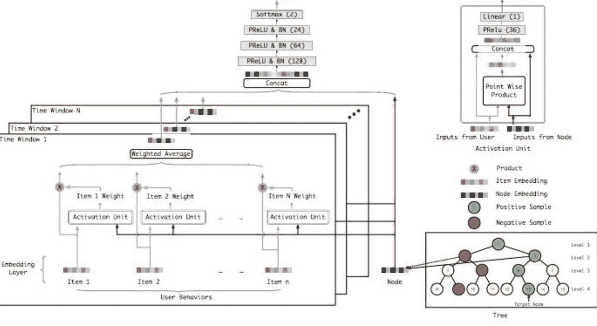

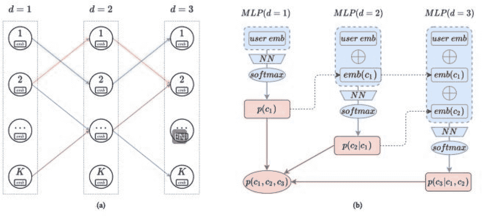

+   如果是一阶召回的end2end训练，又回到之前rag老生常谈的问题了，怎么解决re-index极其耗时的问题？还是asyn idx update或者 inbatch index update？如果还是这样的话，那跟之前的atlas这些有啥不一样的么?...

+   上面聊天记录里提到的LLM召回问题几乎和推荐里的召回问题一样，推荐领域研究得比较多，但是落地到LLM上还是有难度，刚才看了下atlas，e2e的策略从训练上没多大区别，索引更新是不可避免的（或者像atlas一样做query-side fine-tuning），TDM和DR除了e2e外，解决了检索效率的问题

> 感谢分享，我引用错误了。

> Atlas确实是query-side ft而不是e2e，我不应该拿它作为rag2.0的e2e比较对象。

> 传统RAG在做e2e训练时解决index update的方式往往是batch内的部分index update或者asyn idx update，本质上都是希望通过尽可能低成本的方式接近全量re-index的效果。某种程度上这与利用树结构的索引表示从而不用频繁进行全量re-index的思路是一致的。

>

> 所以我好奇的也是这个所谓RAG2.0到底如何实现所谓e2e的？到底是延续这一思路还是又一个力大砖飞？从他展示的结果来看确实有些惊艳。

+   看了你“RAG（检索增强生成）会不会消亡呢”的观点，探讨一下，我觉着现在的RAG主要还是解决context length不够大的问题，因为他只能无损输入比较少的文本，所以需要各种重排、多路召回等检索优化技巧找到最小化且最相关的内容。但随着context length变大，其实很多检索优化技巧不需要了，直接找到相关内容就可以，不需要最小化内容了。个人观点是这样认为的。

+   如果只是谈context length这一个问题，大模型自己的能力就能处理文本长文本，那肯定是好的

+   但问题是rag不止管这一个问题啊，但问题是rag不止管这一个问题啊

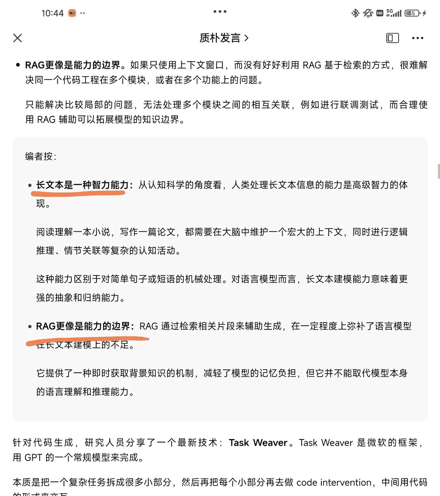

+   我赞同这种观点，长文本有利于agent的记忆能力，检索是一种agent可调用的工具。rag是当前大模型落地比较好的一个结合

+   如果长文本的目的是取代rag，那可能agent的格局小了

+   对的，就是这个逻辑关系。举个形象的例，有了汽车，自行车就淘汰了吗，也不是，短途，路窄，山路，自行车依旧有用武之地

+   就像我们学了数学就不需要计算器了吗，学了英语就不需要翻译词典了吗。这两者有一定的交集，但不意味着此消彼长

+   熟读一本书（长文本），也可以做笔记的（RAG）？

+   我感觉瓶颈还是在推理吧，确实可以每次都读一本书回答问题，但是要是有一个很好的知识点总结，会更快

+   可能我的描述“RAG主要还是解决context length不够大的问题”有错误，个人觉得目前RAG主要方向还是在各种优化技巧提高检索精度，但是context length足够大应该就不需要利用各种技巧提高检索精度了

+   就context lenth这一个问题而言，就这一个问题，大模型真要能处理的好，那大模型自己来没毛病。但，整个大模型领域不只有这一个问题对吧，用这一个问题来聊消亡，不合适吧

+   我们对自己的RAG产品做了一个端到端的测试，每个环节都监控了答案召回率，在大模型端这块，就目前开源的模型来看，从4k到8k长度，长度增加提供给大模型的片段召回率提高了，但是模型给出的答案准确率会降低。

https://arxiv.org/abs/2312.10997

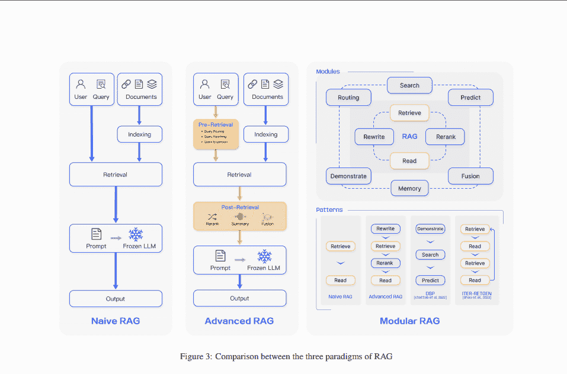

+   长度增加，提供给模型的噪声干扰也增加了，尤其这些文本都是有一定相似度的

+   我的实验结果也是这样的，片段拉长，召回量拉升，效果不见得会变好，反而耗时长了不少，这个我写了解读！https://mp.weixin.qq.com/s/Ebc-DEpfEBNP1nrQHkQv4g，前沿重器[41] | 综述-面向大模型的检索增强生成（RAG）

+   Retrieval-Augmented Generation for Large Language Models: A Survey

+   右边这个routing是类似agent吗，做任务拆解？

+   我也认为RAG不会消亡，但是随着大模型可以无损处理非常大的context length，我觉着那么可能只需要naive RAG就可以了。所以现在RAG的各种技巧可能就不需要了。

+   感觉目前的LLM，context length越长引入的噪声越大，生成的结果反而问题更多

+   我说的前提是“无损长文本”

+   input的精度远高于数量

+   这就和训练数据一样

+   我理解为，原来搜索领域的意图识别

+   真的，现在越看论文，越感觉里面很多思路，就是从传统搜索来的，就是里面一些工作，换成了大模型跑一遍，结果论文里压根没有和传统方法比，不知道是想不到还是不敢

+   context length足够大，意图识别还有必要吗？

+   跟rag的思路一样，先回答问题，意图识别能干啥，这个功能，是不是cl长了就能解

+   RAG不也是么，RAG和long context不是等效的么..long context中，把attention score取top1 chunck，不做加权平局，你看看形式上是什么

+   RAG 数据库中，混淆语料越多，命中精度越差，这步一回事么

+   数据库这么多文档，要选哪个文档，放到大模型里辅助回答，极端的，lc和rag就是两件事，甚至可以一起上

+   这里就是对lc中数据库定义不同导致的，如果你定义lc中文本是RAG数据库的一个子集，且远小于RAG语料量，这时才会混淆，如果两者数据量相等，差异就是attention qkv计算时，v是取Topn/All，attention是否端到端训练的区别。

---

回到AI搜索产品技术交流群

+   而且貌似跟我之前有一个想法类似，就是知识库（或者说向量）节点本身是一个向量空间里面的树状结构，有多级，你可以召回一个L1级别的粗一些的，然后继续召回L1之下的L2，这里还有一个创新的想法，就是score低的节点视作bad sample，可以终止向下的检索

## RAG Search API

+   @艾逗笔，开源我昨天写了一天的 RAG-Search API 项目👇

+   https://m.okjike.com/originalPosts/66021a253b9c66cae4b3c344?s=ewoidSI6ICI1ZWUwZjMxNTgxNjgxMDAwMTc3NWZkNmIiCn0%3D&utm_source=wechat_session

+   大致看完了，代码很清晰，教科书级的，最后llm整理总结的部分没包括吗

+   rag-search没包括 LLM chat 的功能，后面也可以加一个

## brainstorm上头条了

+   https://mp.weixin.qq.com/s/1e9G2897DXb2MKRlPBHgZQ

+   好聪明的开发者！当AI搜索遇见Agent；Claude官方提示词库；AI+玄学科普长文；我要放弃副业了 | ShowMeAI日报

## Metaso

+   metaso开始投放了，https://mp.weixin.qq.com/s/F3bcAEVhj_JqyoL26dOS4w，10秒整理搜索结果，脑图表格一键生成，网友：搜索终于有了该有的样子

+   刚B站首页也看到推广视频了

+   烧钱游戏开始了？

+   kimi，metaso用的很爽，一开始推广就卡了

## 360搜索

+   来用360AI浏览器，对这种单纯的AI搜索工具是降维打击

+   第一次看到知识库里面说kimi是个连谷歌都搜不到的工具，如今已经火的不行

+   https://mp.weixin.qq.com/s/nhh7ydhr-qIv67N3oGy_DQ，加持了AI的360浏览器，强大到让人感到陌生。浏览器是网页和插件的入口，如果浏览器都把这些做了 剩下的空间是不是很窄了

+   真快，前段时间看还没mac版，ai这么烧钱，难道最终活下来的玩家还是巨头么

+   360和腾讯两大老赖，显然知道入口等于一切

+   被骗了，mac版没AI功能

+   是不是有这个可能性，就是360AI搜索现在不提供逐句引用来源链接，就是怕这种风险，他们实际上让他们的爬虫能够看到别的网站的不一定愿意爬的内容

+   229那个版本其实是有的，360人跟我说的，后来不知道什么原因老周让下了

+   原来还有这么细节的东西，229版本，大神你的信息好详细呀连版本号都知道

+   不做直接引用，只是笼统给一个引用列表，别人问起来360可以说我们是从别的来源找到的不是你这里

## Phind

+   我发现phind在非时事新闻类的信息搜索，效果似乎不错，但是我不知道是不是因为它整体来说联网搜索的信息较少，所以生成的结果在话语上连续性较高的结果，我不知道怎么用比较容易懂的方式去说，大概就是，phind的搜索结果只需要总结2-4个信源的信息，所以大语言模型可以总结成一段很流利的结果，但是如果像是秘塔PPLX这种10多个信息，那么更多像是一个信息布告板，东一句西一句。但是我不觉得后者是坏事，至少我个人更偏好信息的广度而不是深度，至少大部分时候我的诉求是AI当我的实习生帮我一起查东西，而phind可能更多像是一个老师，通过瞄准2-4个认为更优质的信息，做深入总结。我去更新一下测评文档hhhh

+   对，像你这个诉求就是copilot控制context pool

## 下一步搜索

+   下一步的搜索引擎应该需要的是copilot，用户参与搜索，排序和生成后润色的过程，或者是每日订阅，我不负责地预测的哈，不准不要抽我

+   我也赞同

+   下一步应该赶紧做个app

## 创作

> 最新创作了一篇文章：《用 AI 给人生开挂的正确方式 - 在 AI 迅速进化的时代，我们应该如何不落伍》

>

> 链接：

> https://blog.csdn.net/w605283073/article/details/137030484

>

> 1 写作背景

>

> 面对 AI  飞速发展，有些人不屑一顾，有些人则担心被 AI  取代。面对这种飞速发展的时代，我们该如何应对，才不容易落伍？

>

> 2 主要内容

>

> 分别从 “AI 时代，我们该学习什么”、“AI 时代，普通人的机会在哪里”、“AI 时代，用 AI 加速学习” 等角度谈谈自己的看法，并且给出自己的简单预见。

>

> 3 看文这篇文章你可以学到

> （1）AI  时代哪些知识和哪些能力是最重要的。

> （2）普通人的机会在哪里，比如跨专业寻找机会、“人人都是工程师”、用 AI 高效解决问题

> （3）AI  时代如何加速自己的学习

> （4）对 AI 时代的简单预见

>

> 欢迎大家评论交流

## 其他厂商

+   https://mp.weixin.qq.com/s/F3qgOeYtWawf0RVAqN7mGg，“Kimi概念”降温，长文本“担不起”大模型的下一步，腾讯科普来了

+   https://mp.weixin.qq.com/s/_kj6nubWUf9Iygc5R0AHBQ，Perplexity想取代Google，几乎不可能

## Anthropic

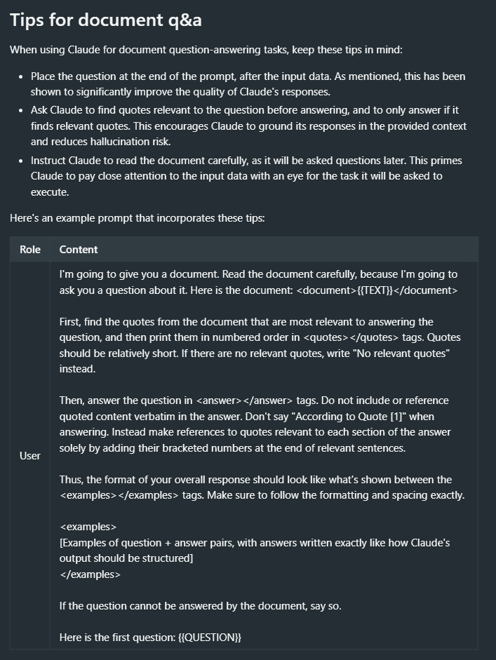

+   分享一个Anthropic官方的【上传文字+提问】的提示词案例，蛮有意思的，虽然可能你们用的技术应该比这个成熟得多

+   我们程序员 以前遇到问题 都不屑用百度 优先用谷歌 今年开始 都是先用 AI工具  极少用到 谷歌  除非是找个官网啥的

+   Stack overflow呢？

+   问题是ai搜索可以帮我在so上找到我最想要的url

+   如果这个需求也没有的话  搜索引擎真的不会直接用到了

+   一般也不会直接进去搜 都是  先上谷歌上搜 然后跳到  SOF

+   其实即便如此，你会发现，还是有的人不知道搜什么，而有的人真的是一搜就出能解决问题的东西

+   这貌似是一种跟语文相关的软实力

+   其实是舒适区的问题  你问问那些用 Windows 电脑的 他们不觉得 Mac 有多好  但是用惯 Mac的人很难再用 Windows 当然 AI比 这个对比更明显，很多人对 AI  还是有误解  认为没啥用  不敢迈出第一步

+   之前在一个linux社区看到有个网友一直在说，为什么不做一键安装的exe，为什么不做独立封装的app彻底解决依赖问题等等

## 生物医药

+   “生物医药这个学科其实非常严谨，研究人员对信息来源质量、时效性等要求都很高。所以我们其实一直想探索一个方法能平衡大模型预训练获得的知识、新发现的知识，以及如何严谨、正确的运用这些信息。感觉LLM驱动的搜索引擎其实蛮能满足这个需求的，所以也在进行一些广泛的调研” 认同你说的，之前我们更多都在学习研究通用ai搜索，特定到ai4s，确实有很大挑战

+   @花生，目前在北医下属企业，主业医学数据库运营，现在在肝一个医学 ai 应用，主要是基于 rag，做医学数据方面的处理

## 防止爬虫

+   为了避免爬虫带来的司法风险，所以下架了逐句引用链接的功能

+   我调用metaso接口的时候，发现他们的Reference是有is_safe这样的属性的，貌似不safe的内容会被参考进回答，但是不会放出url

+   只能说工程层辅助对AI应用的帮助还是很大的，现在可能AI应用做得好不好，60%可能还要靠非算法的工程层

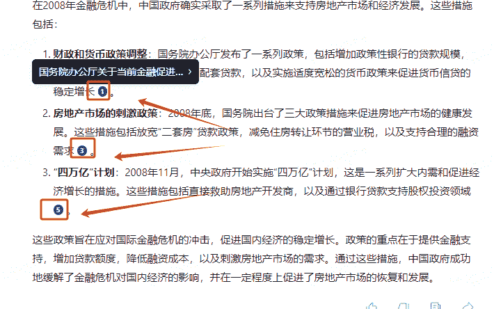

## devv.ai

+   https://www.reddit.com/r/SideProject/comments/1bp4d43/how_we_built_an_ai_search_engine_for_devs_got/，devv.ai创始人分享，500K Users, Make $30K per Month，每月收入3w美金，可以看看

+   虽然我应用场景和devv完全不搭，不过我试试

+   之前phind也是这样被我玩坏

+   佩服devv和phind这种优秀的小而美代表，用自己的钱拔靴做一个解决实际问题的产品，集中细分领域专攻，快速迭代

+   YC，创业维艰，精益创业，这些算是硅谷名著了吧hhhh

## 产品创建过程

+   不仅仅（devv.ai）产品本身，创建产品的过程值得学习：

+   用户至上：用户访谈现实的痛点；代理模式；代码在线执行等，这个决定了增长曲线

+   领域专有：特定研发的高质量数据；自建索引，昨天聊的ai+医学，ai+教育都需要类似方法提升可靠性

+   快速迭代：1周mvp，先能用再好用

## Gemini Token

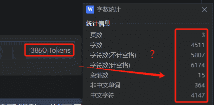

+   Gemini是我见过最有趣的tokenization模式了

+   排除kimi这种没说明或者千问这种我不知道怎么算的，Gemini我我目前唯一知道的一线大模型是把中文词组作为token的，token数比字数少

+   就我的经验，1-1.5中文等于1token，gpt上次7个字等于11token确实吓了我一跳

+   对GPT和Claude算是拆分的比较细致的

+   意味着某个中文可能从unicode的角度被拆成了两个，甚至是2个中文被拆成了3个

+   Claude的200K我上次简单算了，才等于15.9K中文字

+   从中文的角度来说这显然不符合我们中国人的语言逻辑

+   偏旁部首？

+   有可能吧，所以说不定中文本身有更深层次的秘密，相对于英文而言

+   hmm等等我可能小数点搞错了，我重新想想，159K？应该是，那这个也很有意思了，这个是怎么拆的，冷僻字，笔画多的才拆？

+   你这应该是 6174字符-》3860，6174字符包含4147中文，英文字符，回车，空格都还是占token的，不能只看中文数量，当然英文一般是一个单词一切

+   这个文档被我塞了一部分指令在里面，中英混合的

## UFineBench

+   新闻 news：UFineBench：开创基于文本的人物检索新标准。近期，UFineBench成为了文本人物检索领域的新基准。该技术利用详细描述来辅助人工智能更准确地理解和识别图像中的人物。UFineBench的出现标志着人工智能在图像识别领域的又一次重大进步，它不仅提高了识别的准确性，也为未来相关技术的研究和应用奠定了重要基础。

## Samueli老师分享

今晚八点半，研发组 Samueli老师的精彩分享，大家可以提前预约，只有150+名额，相关问答可以在上面的便签留言

## 其他

+   问个问题，如果大模型有lost in the middle的情况，像是stable diffusion输入提示词的时候，有这个情况吗？

+   有点，默认不设置prompt权重的时候，首尾prompt的权重一般比较高

+   我的天海外网友牛逼，他们摸索出perplexity只有32k token（OpenAI的tokenization算法）左右上下的记忆，我不知道他们怎么摸索出来的，貌似Perplexity的模式是，先用fine-tune gpt 3.5理解用户的输入（比如你的提问，或者你提交的长文本），然后转化为必要的搜索，这个搜索是用到了一定的cache的，所以搜索速度会比很多用实时搜索的AI搜索快很多

+   大哥，搜索靠的是rag，llm并不需要long context，32k我都觉得有点多

+   有些人是用PPLX做长文本总结的，然后发现这个

+   如果你需要llm做一个很长文的总结，那么因为注意力lost in the middle的问题，反而会让效果差很多

+   如果你有很长的文本做上下文，那么更合理的方式是切割之后分别总结，再汇总融合

+   他们现在的情况是，PPLX那些网友以为可以用到整个200K claude opus或者128k gpt4 turbo的上下文，然后因为这个设计，所以PPLX并不适合做长文本总结工具

+   这是个废话，要我说ai搜索得输入都应该限制在50字以内，如果你给我一个长文，你想让我搜里面的什么keyword呢？

+   学习了~，我现在大致了解PPLX的工作原理了

## AI剧本杀

+   现在有没有人在做ai剧本杀方向啊？

+   ai写小说，ai剧本杀，ai dnd跑图，ai rogue like，这几个差不多是一个逻辑

+   对，我也以为这个门槛这么低，应该有很多人在做了，但是搜了一圈没看到

+   我觉得主要问题是不挣钱，而且这里我感觉最难的是剧本杀，剧情复杂，还需要生成多视角剧本

+   有道理，体验再好可能用户也不太愿意付费。但我觉得这个东西难度应该不大呀，就弄6~7个agent，每个agent挂一个角色剧本的知识库就行呗

+   可以这样做，你做8个agent，1个上帝，7模拟玩家，agent接🛰️个人号bot，然后把用户拉进🛰️群，这样就可以开玩了，直接就multiagent实现，这种可能做狼人杀比较方便

+   有道理，我认识一个做线上剧本杀的小工作室，经常遇到缺人的难题，要做出来这么个系统估计能卖给他

+   但我觉得这东西肯定有人在开发了，再等等吧，要做狼人杀感觉现在的gpt4智力都不够

+   确实 multi-agent核心还是llm，流程没问题，但效果还不足以落地

+   剧本杀的话rag足够了，我是觉得马上就会涌出来一大堆类似的游戏了，我就等着玩儿就行了

+   确实如此，前几天搞了一个工作流，试了一下效果不好，文本稍微长一些容易超时报错

+   你们可能是jail break没到位

+   本身重要的不是智力，而角色带入的对不对

+   有的玩家就是比较笨的，llm不够聪明也是可以的

+   另外角色模拟可以用minimax或者claude，这是专门角色模拟特化过的模型

# 20240324

> 进群开始-20240324

## 5天写出一个完整的AI搜索产品

+   兄弟们再帮忙冲一把：https://www.producthunt.com/posts/thinkany，看看能不能排进前三

+   upvoted + comment

+   大家都去支持一把，5天写出来一个完整的AI搜索产品，是真牛逼，搁我得写5个月

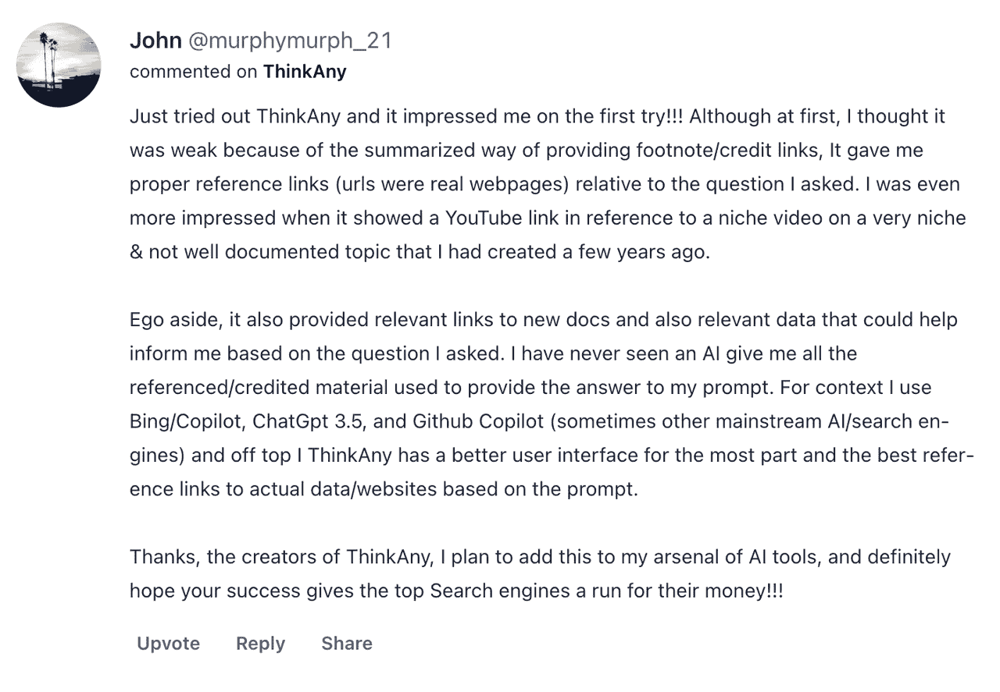

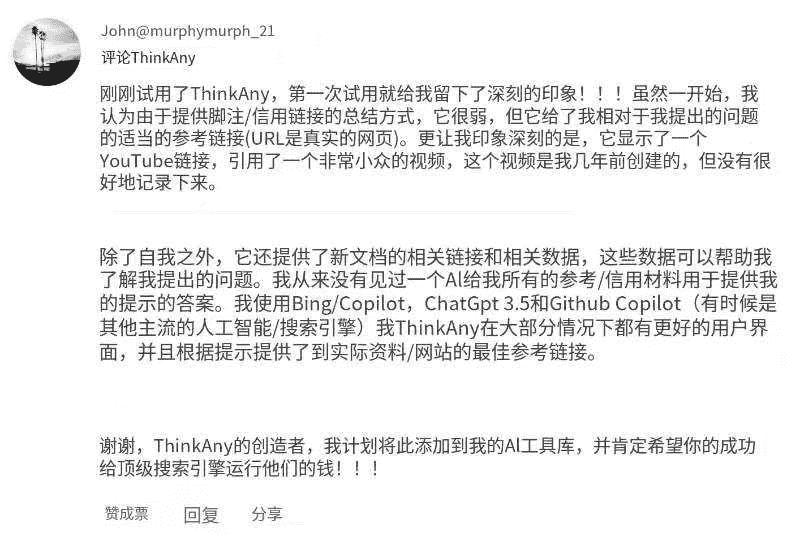

## Multi-Agent

+   @蔡荔Jonathan，倾向于用multi-agent做AI数字员工。目前还有一个业余做的就是用multi-agent帮忙分析股票和财报，看看美股的机会。这个是题外话了，比如今天的PDD财报非常好，估计晚上股价会涨17-20%

+   微软的taskweaver有这个功能，但是它用的模型都是非常旧的，没什么用

## phind

+   Phind有点YC的风格，不管是每次付费还是注册，都会有创始人的email自己直接发到你邮箱

+   phind就是YC投的

+   phind改网页权重我咋没找到

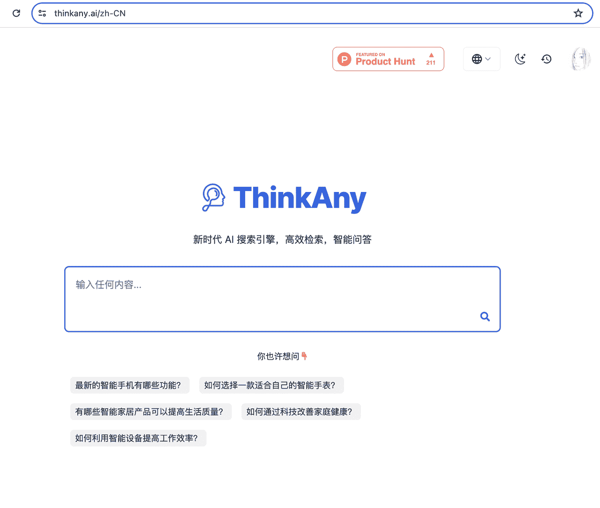

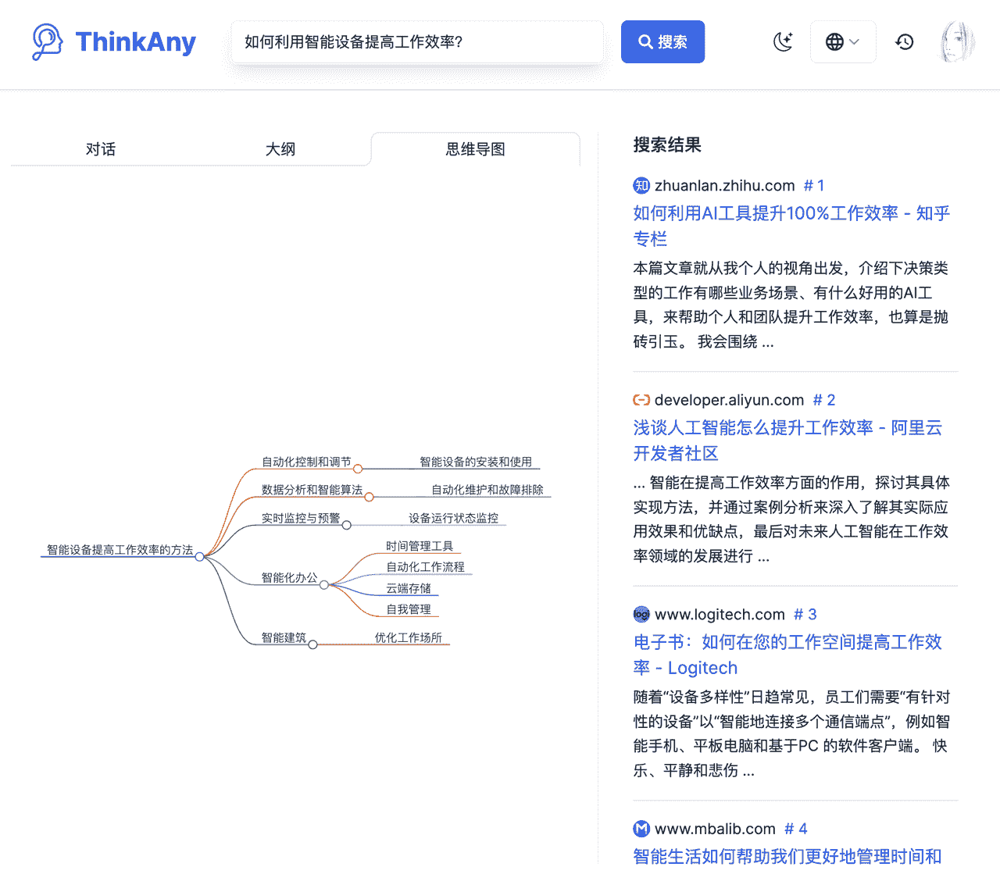

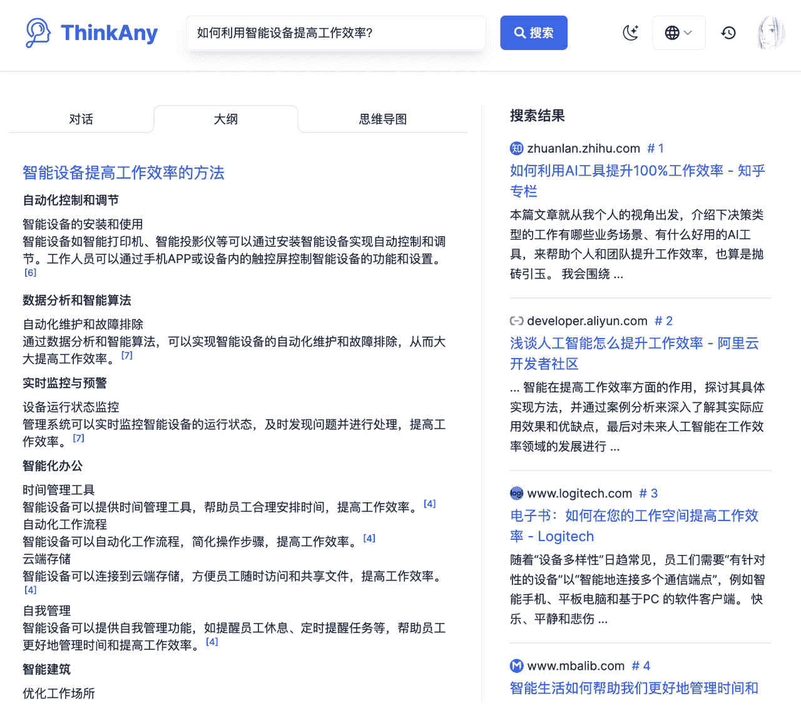

+   phind 也支持深度搜索了（然后我也才知道perplexity也有搜索结果的语音），测评又可以需要更新了真的是日新月异

+   我的天我都不知道phind用了什麽黑科技，搜索的效果甚至比perplexity还好

+   perplexity在国内信源上的表现有时候不好，之前测过几道题，感觉不如metaso，尤其是实时性题目，不过搜索的整体评估和测评，我估计可以整一套题来测测，量级可能是200-500这种

+   我不知道是不是phind设置了某些自我检查机制/评估机制，整体来说在回答的时候引用的信息较少，它在给出一些步骤性的指导的时候（第一步、第二步、第三步等等），是前后一致的，一般就引用一个信源，然后基本上都是能用的

+   perplexity是类似于霰弹枪一样，会用上4-5个来源，所以如果它有时候给出操作步骤的时候，会互相混乱，比如用来源1的信息作为第一步，然后来源2、3作为第二步的信息

+   就是phind会选拔一个比较好的1-3个信息，然后借此作为本次回答的全部信息来源

+   我不敢说哪种思路更好，phind偶尔会出现彻底扑空你的提问，就是从头到位都不是你想要的答案，但是PPLX这种自助餐式的信息呈现，几乎至少总有一点有价值的信息在其中

+   听起来就是有比较好的方案做了score和ranking，这样拿到的ref是很优秀的，然后追求了准确率，而不是召回率，搜索确实更在乎准确率，如果发现没有召回，可能直接说自己不知道，都比瞎说要强一些。

+   PPLX会有瞎说的情况，被眼花缭乱的低相关度搜索结果误导，一些极端小概率情况会出现完全离题的情况（可能有过调整，现在我一直没找到机会截图为证）

+   所以其实我还是很倾向于，把ref交给用户自己勾选的，用户可以去掉自己不想要的，这也是一种copilot

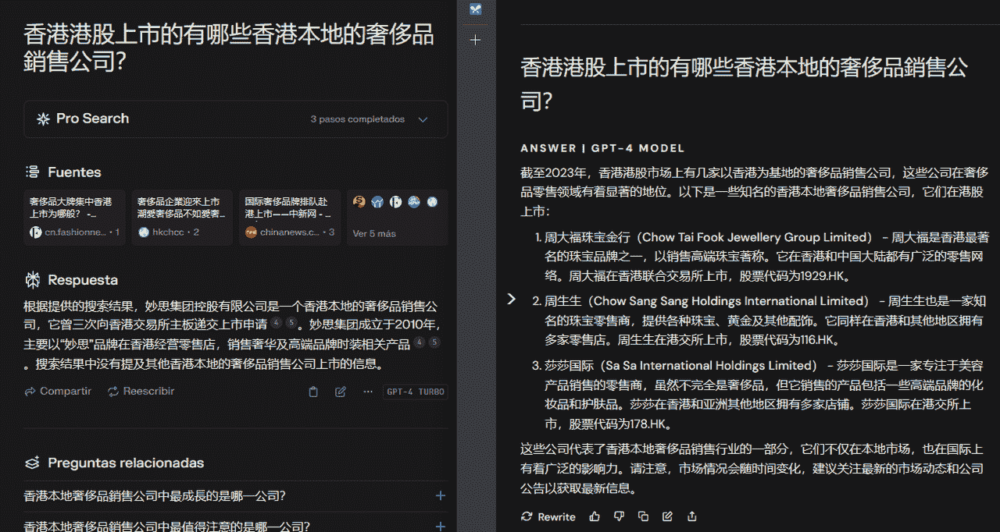

## 文心一言搜索幻觉显著下降

+   说个冷门的AI搜索hhhh 文心一言好像这短时间把搜索的幻觉显著下降了很多

+   不能以单次测试为准，大模型输出有随机，同时搜索源不同，每个搜索应用在不同场景能力可能不同

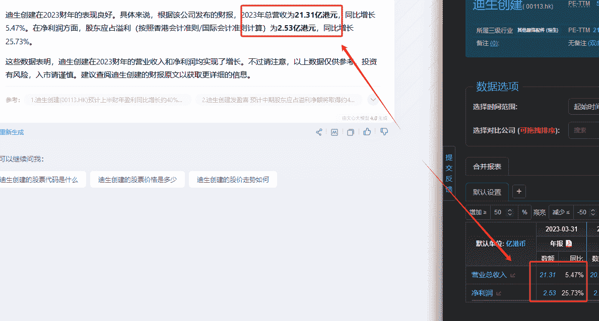

## 天工搜索

+   天工搜索这个产品也可以分析下

+   天工怎么感觉有点高开低走

+   日活都快100万了，确实产品改版动作比较大，感觉也在找定位

+   我问秘塔现在ai搜索哪家强，秘塔说是天工，秘塔真实诚

+   我买了一个会员，用他们的文心4.0模型，现在的搜索质量还是一言难尽，只是发现如今至少搜不到的信息不会编，搜到的信息不说错。不过也好，如今养成了什么都会自己去验证一下的习惯，360搜索改版以后不会逐句对应来源，我现在就不用了

+   ThinkAny 有机会后来居上吗。

+   有有有！现在主流产品还有还多问题。

+   你做的thinkany在信息深度上很优秀

+   简单用了下天工，文档阅读幻觉很严重，搜索只有copilot（每天4次）下效果还行，阅读模式可以传url，写作还没试好像能生成视频，离kimi，秘塔效果还有差距

+   我最近正好在找360AI搜索的替代，现在360不提供对应的逐句引用了，我对信息的验证的难度变大了，所以暂时放一放360

+   现在国内最好的AI搜索应用有哪些？

+   搜索结果：

+   2024年01月15日 2024最好用的14个AI搜索引擎推荐 - 神器集

+   https://hao.logosc.cn/a/899

+   2024年03月12日 国内AI搜索鼻祖，天工AI搜索为何能赢在起跑线？ - 36氪

+   https://m.36kr.com/p/2686507064332932

+   2024年03月04日 谈谈中国第一款AI搜索产品——天工AI - 机器之心

+   https://www.jiqizhixin.com/articles/2024-03-04-15

+   2023年09月28日 大厂搜索之困：超越AI的难题 - 36氪

+   https://m.36kr.com/p/2451340987015043

+   2024年03月04日 天工AI智能助手：中国AI搜索鼻祖 - Chinaz.com

+   https://www.chinaz.com/2024/0304/1600769.shtml

+   [6] 国内AI搜索引擎有哪些

+   https://www.aigc.cn/31366.html

+   2024年03月08日 2024年，中国AI应用“大盘点” - 36氪

+   https://m.36kr.com/p/2680642003876865

+   2023年06月07日 传统搜索引擎遭遇降维打击？——七款最佳AI 搜索引擎推荐 - 搜狐

+   https://www.sohu.com/a/683000486_121292768

+   2024年03月19日 才上线7个月它凭什么成了国内AI搜索“鼻祖” - 快科技

+   https://news.mydrivers.com/1/969/969524.htm

## 王小川/李彦宏

+   王小川那篇除过评价李彦宏这段，其他没太看明白，一直打太极，还是没有朱啸虎和杨植麟有个性

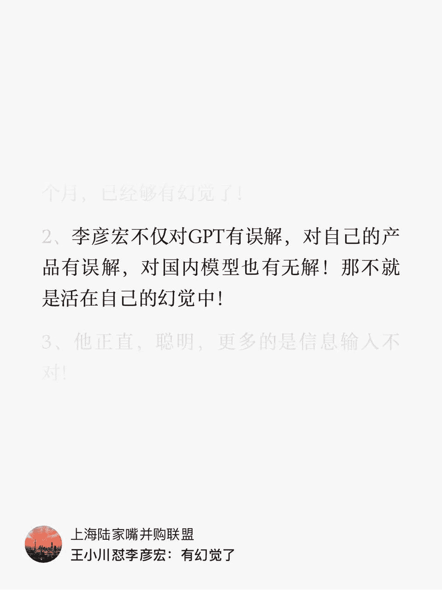

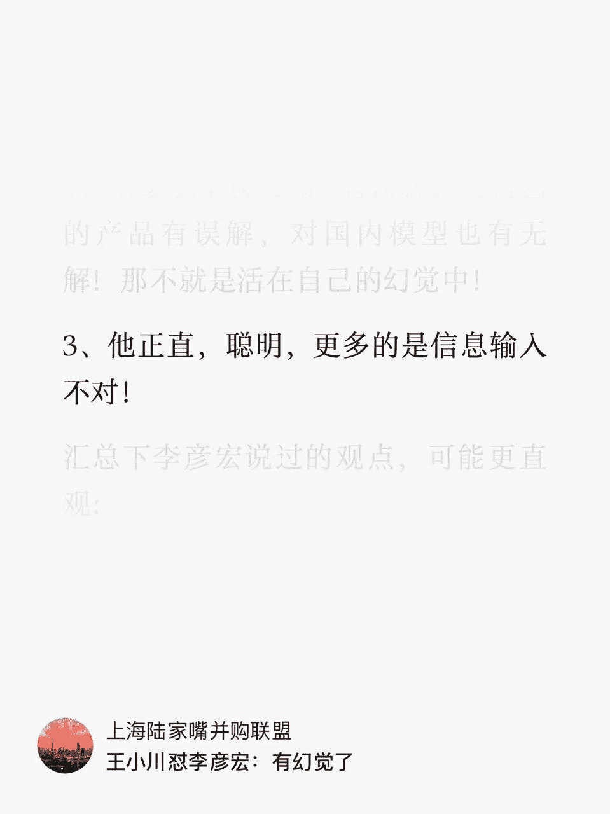

## GPT4

+   gpt4这几个月变得越来越笨了？gpt4好像最近默认模型变弱了

+   好像昨天看另一个群也在聊这个事，第一个版本的gpt 4 0314版本那个（就是李一舟老师提到的那个让他的世界改变的那个hhhh）在榜单上的评价&具体使用感觉是非常不错的

+   后面我看小道消息和奥特曼的一些言语暗示OpenAI在不断炼丹，尝试用不断压缩gpt算力需求

+   因为通用大模型不赚钱，例如智谱chatglm3 turbo，是非常便宜的模型了，费用是0.005/1k token

+   一般一个正常问答还用不到5厘钱，你甚至还需要为这次费用存网络日志，计费打点，数据库和磁盘费用都tm不只5厘了吧

+   上次比尔盖茨采访的时候奥特曼说把gpt的成本压缩到原来的1/10

+   为啥国内互联网公司都这么价格亲民

+   奥，不是，智谱glm4的费用是glm3 turbo的20倍，对标了gpt4

+   我只是在说以前不赚钱，现在可能开始价格回归成本了

+   我看了一下别人算了汇率，咱们这边的服务器和带宽（忘了是什么专业词汇，就数据流量）其实不比国外便宜

## 知乎入场

+   知乎如果做好了那还蛮牛，AI搜索+社区知识库，定点爆破

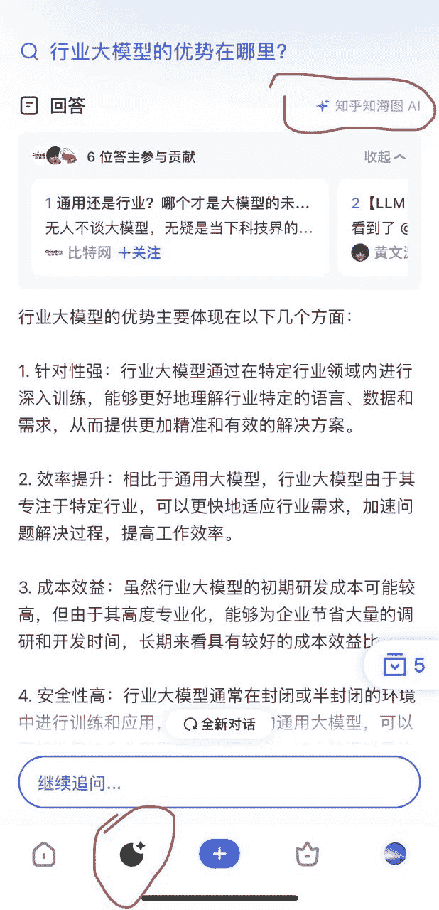

## 欢迎测评

+   @谢润程这些天我深度用下，因为我工作和平时使用用到很多信息检索，过一段时间如果你们感兴趣和你们分享一下使用感受

+   @谢润程等你来评测 ThinkAny from@idoubi

## Kimi

+   kimi有点过热了…

+   我发现我这个人就肯定不懂搞这种市场推广，我觉得这是人类至今最尖端科技，我做广告估计很矜持，什么体验新的世界啥的，感受第五次工业革命啥的，但是如今大家广告都是往用户推（用一下又不吃亏这种台词）

+   微软为了推gpt也是各种强制捆绑

+   做推广也是扩大产品影响力的一种手段，这个东西做起来可以暴力，就是砸钱。要么是非常精细化的推广，设计一套系统来做，精确计算 ROI

+   产品推广上来说，终究还是要产品足够优秀，不然留存数据很难看的，没啥意义，就是买日活，给老板看个乐

+   kimi一手资料，https://mp.weixin.qq.com/s/9NVuY5pzEnxBtgKS9ooYiQ

+   我试着kimi帮我整理英文音频的转录文字稿，写出的满满的高考英文作文味，路转粉了，回答得很中肯，感觉月之暗面团队的人应该和普通小个人用户之间对话比较多，说到的点都符合我这个小白的使用体验

> 各位开发者：

> 从 2024.3.20 9:30:00 开始，我们观测到 Kimi 的系统流量持续异常增高，流量增加的趋势远超我们对资源的预期规划。

> 这导致了从 2024.3.20 10:00:00 开始，有较多的 SaaS 客户持续的体验到 429: engine is overloaded 的异常问题，对此我们深表抱歉。

> 做为一家以技术为导向的公司，我们非常理解一个 API 的稳定性是能否投入实际生产的最关键因素之一，已经有多项应急措施正在实施，包括不限于：

+   从 3.20 观测到流量异常增高后，已经进行了 5 次扩容工作。推理资源会持续配合流量进行扩容，以尽量承载持续增长的用户量

+   设计了一套更有效的 SaaS 流量优先级策略，以保障付费用户的调用稳定，预计3.25 之前完成并上线

> 在应急措施实施完毕之前，可能还会遇到少量资源不足的问题，感谢大家的包容与耐心，再次为影响到大家的正常业务使用道歉。🧎🧎♀️

+   另一个问题是，针对长文的多轮回答成本控不住。只要能正文提取，能做切片和向量化，其实大致就可以完成目标（目前看效果是比长文对话要好的）

+   我个人觉得这其实不是一个通用效果的问题。因为没有人跟你说kimi的实现就是一次大模型回答，有可能是它内部切割了，或者别的方案

+   对kimi这种专门做长文的，不能用常规gpt llm的常理来推测

+   对，也许他们有不为人知的核心科技

+   之前看杨植麟采访，他是坚定的long context信仰者。

+   大模型的一个方向就是long context

+   成本问题对用户其实才是主要问题，现在我解析一次几十兆的pdf需要几块钱，这不能接受啊，除非kimi的input token和output token分开计费

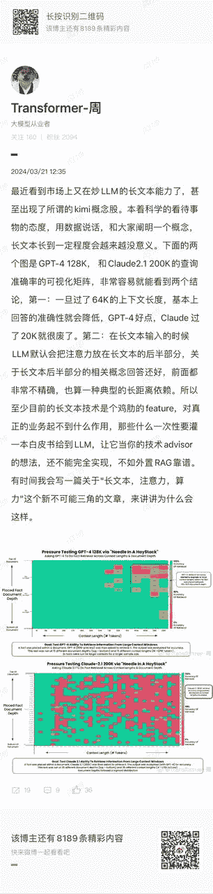

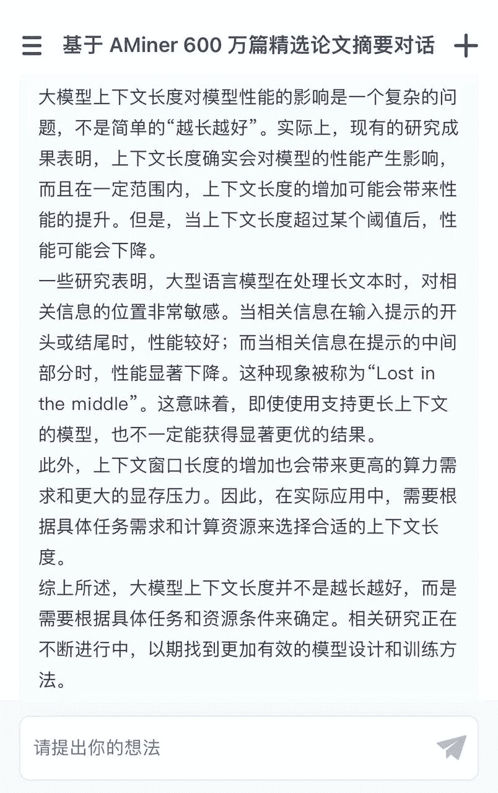

## 密塔

+   秘塔这个研究结果很赞，aminer给的参考论文是错的

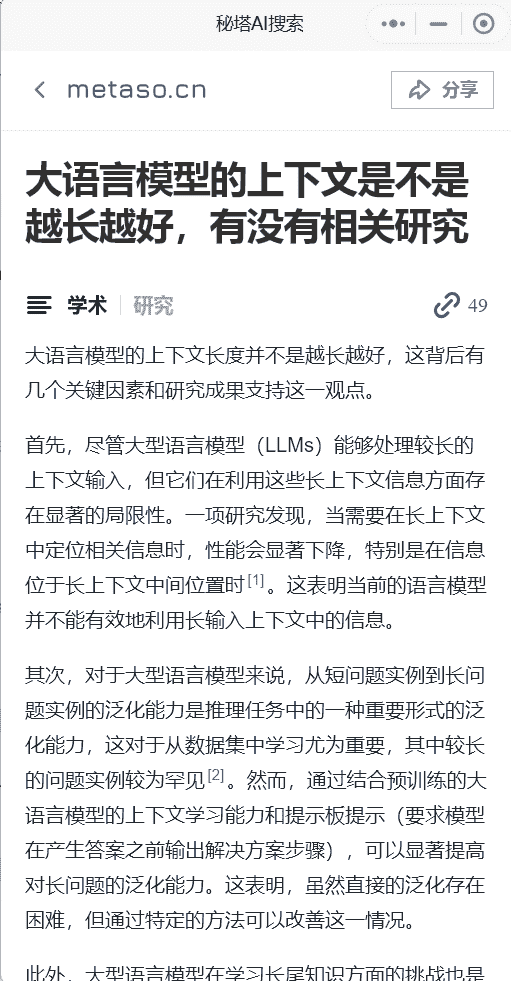

## RAG

+   今天刚好看到这篇论文，评测rag的，https://arxiv.org/abs/2309.15217

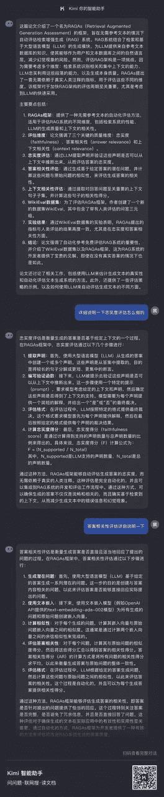

## 测试|大众点评倒过来

+   我们之前测试过三个史诗级中文难题：这句话是几个字？请把 大众点评 倒过来输出，李白乘舟将欲行的第四个字是什么，可以试试，并不是说答对这三题的模型就厉害了，但是在中文领域是厉害的

+   把大众点评四个字换成一个固有名词可能难度更大，原题是攀枝花

+   https://platform.openai.com/tokenizer，转化为 tokens 之后 有的汉字都不成一个字了

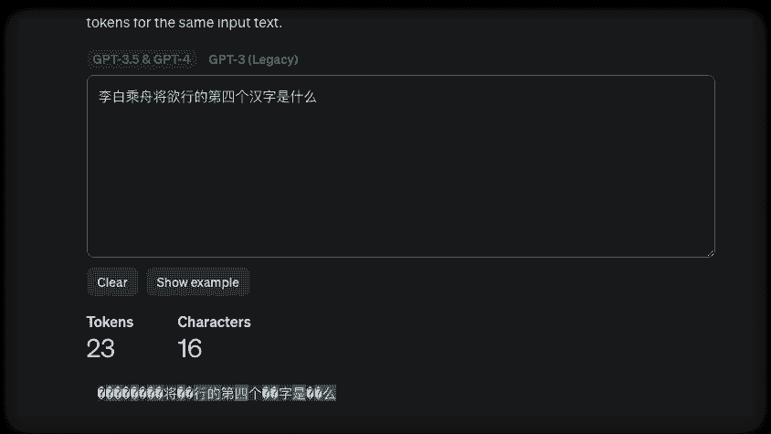

GPT4  1/3

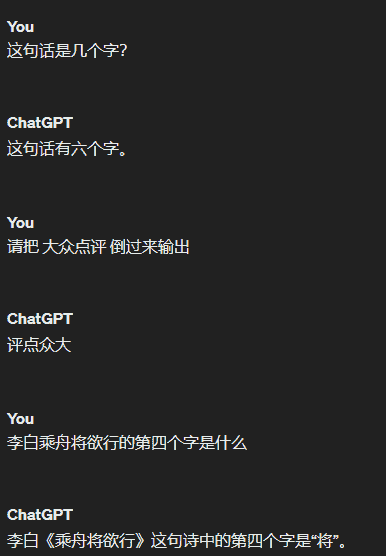

Opus 2/3

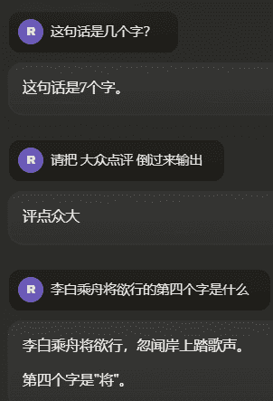

+   Gemini 严格来说中文应该是自动切换Pro？

+   被官方强制加了很多chain of thought，然而并没有提高正确率 （我试过让它少罗嗦点都没用）

+   中文的 tokens化 和英文还是不一样  你说他错吧 他很多意思都可以懂  你说他对吧  第一个词都数不出来  感觉未来还是要优化

+   是不是和kimi的tokenization的方式有关系，这个理论上不能用tokenizer来解决，因为tokenizer永远都不会跟字数对齐

+   Gemini是我见过最奇怪的tokenization方式，也是错的最彻底的，他的token会比中文字数少

+   不是，大模型推理的时候不知道什么是token，我们甚至都不能认为它懂得控制和利用来思考

+   类似于，推理用的是脑子，而token是你的神经突触放，你脑子思考的时候，不知道自己有多少神经在放电

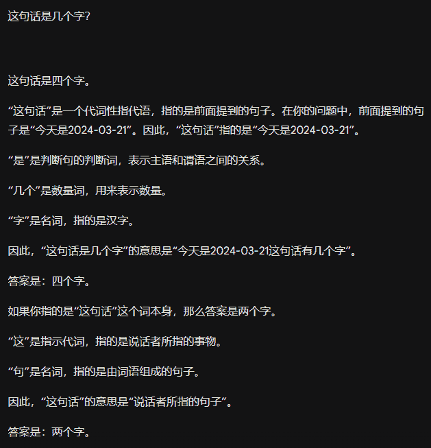

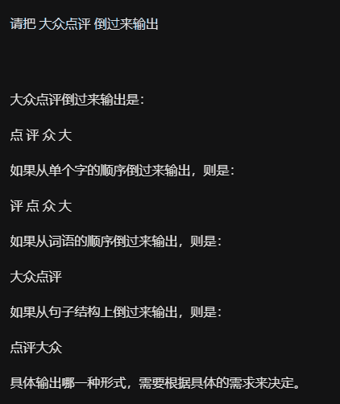

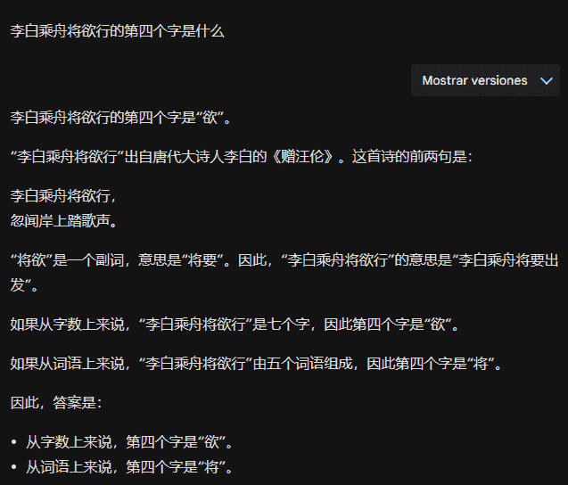

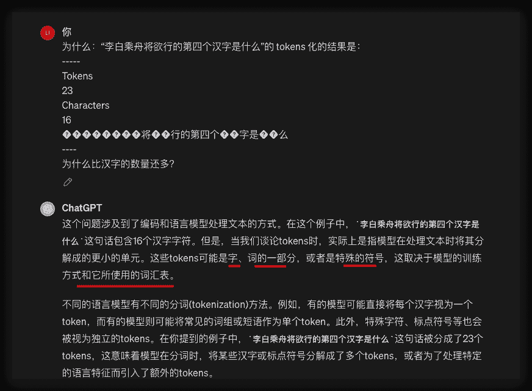

为了处理特定的语言特征而引入额外的tokens

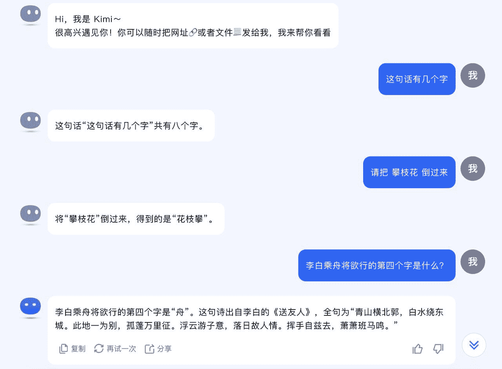

第一个题错了，这是kimi

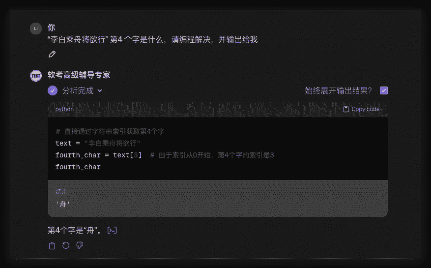

其实目标是要答对， token 化只是之前采用的手段   未来肯定要优化

## lost in the middle

+   lost in the middle，今天刚看了这篇论文https://mp.weixin.qq.com/s/rvLa6HAuXYFpl3c5PwDkCg

+   我感觉人类也是这样，太长不看

+   对，这篇论文说和人的艾宾浩斯遗忘曲线一致

+   那么是不是可以使用人类的学习曲线

+   结果发现如今的大语言模型原来都是外包给印度的实习生

+   我算了一下好像kimi最近缩水了一下上下文

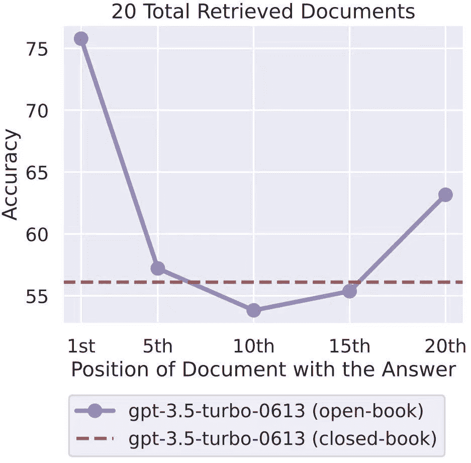

## 超长上下文/人均百万上下文

+   压力给到OpenAI

+   我怎么怀疑他们搞了 RAG

+   应该就是rag，实际上rag包装一下，应该也能做到让你感受不到

+   好像现在有obsedian+搜索，或者notion他们在做的Q&A

+   obsidian 上有上一个 connect 插件，smart connect 就可以链接笔记的关联性

+   obsidan是个笔记吗？就是类似于一个开源的笔记软件

+   我的天用AI真的是爽，有好多几年前读的书，模糊记得有提到某个信息，但是记不清具体细节，以前经常就ctrl+f等方法找不到最后不了了之，甚至自我怀疑是不是自己的大脑在幻觉，捏造了实际上并没有的内容，现在通通都能找回了

+   之前读托尼罗宾的书，唤醒内心的巨人，想起来书里有个概念大概是，每天都进步一点点

+   相当于，把大模型作为了知识快速提炼储备库

+   我一直在想，如果把学到的内容记成笔记，然后让大模型从已学知识中检索，让大模型成为人类第二大脑不知道是否可行

+   四舍五入是个智商不太行，但是干事勤快且吃苦耐劳的小助手

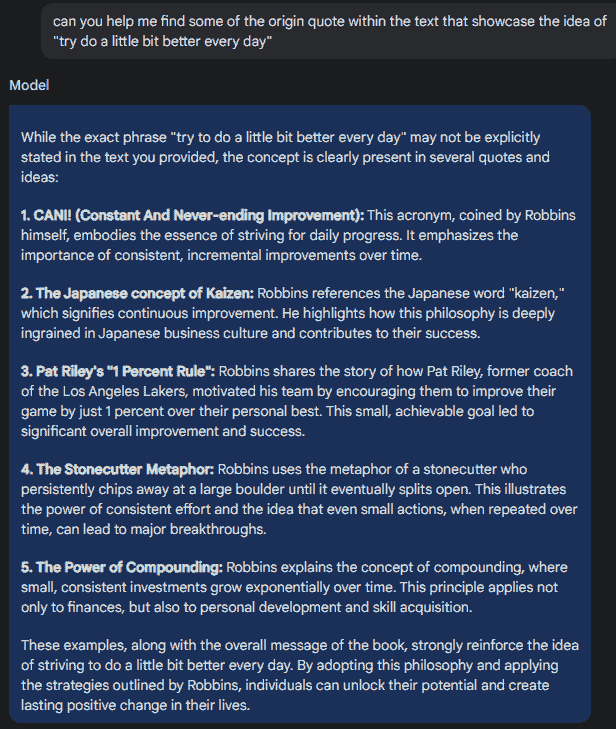

消息称百度文心一言下月将免费开放 200 万-500 万长文本能力

3 月 22 日消息，据科创板日报报道，知情人士消息，百度文心一言下个月将进行版本升级，届时也将开放长文本能力，文字范围会在 200 万-500 万。目前，文心一言的文本上限大致在 2.8 万字。

此前，百度创始人、董事长兼首席执行官李彦宏在财报会议上指出，「2023 年第四季度，大模型为云业务带来约 6.6 亿元收入」。

这意味着，在文心一言发布后的首个财年，与智能云业务结合的 AI 大模型，为百度带来了不错的增量收入。

## 卷起来

+   今日份AI+搜索思考🤔https://m.okjike.com/originalPosts/65e2b31336246663244257b1?s=eyJ1IjoiNjNmMzIxNGRhZjkwMGY0OGQyZjEwYWZiIiwiZCI6MX0%3D&utm_source=wechat_session

+   天工搜索把自己的copilot搜索（深入搜索模式）改成无限次数了

+   如果360再不把逐句引用链接的功能加回来，我就真的要放弃360搜索了

+   太卷了，这就是中国

+   不过最后肯定是赢家通吃，如果一家比其他家强很多，大家只会选最好的付费

+   太强了cursor，直接把别人整个github项目都读了一遍

+   这个思路其实超级好，因为代码等于是非常精华的语料和ref

+   但是代码向量模型不知道是不是需要是特制的

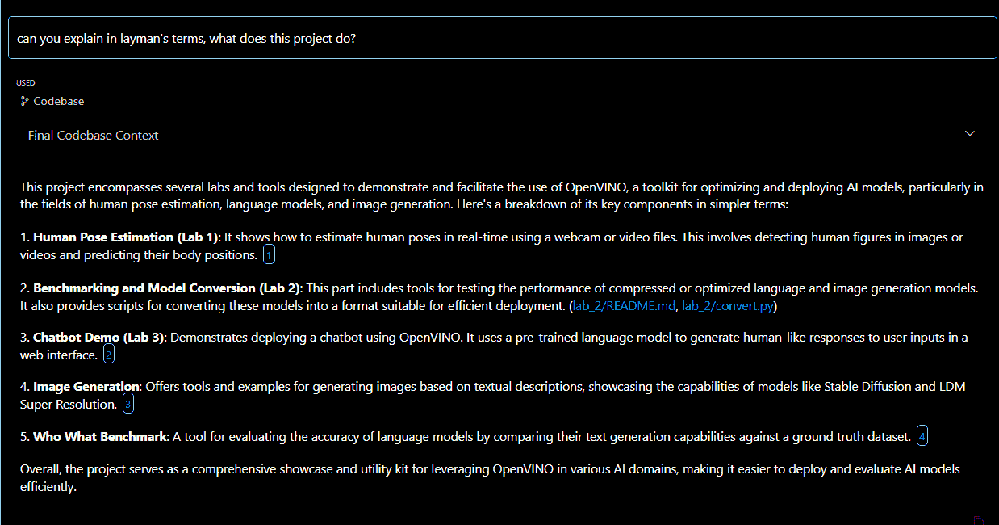

## 智谱青少年模式/风险监管

+   没关系 metaso也有同样的问题

+   只能说，kimi真的是很强的模型，所以是自己做的搜索？

+   应该不可能自己做搜索

+   像是调用 api 实现的

+   随着模型越来越能优秀地执行用户命令，也会带来更多的挑战，到时候又要加一大堆的安全设置，OpenAI那边就有时候加太多开始傻傻的

## 李洛云获奖

+   @不辣的皮皮 的李洛云获奖了https://mp.weixin.qq.com/s/U9PsxKi_2aGDvGwPcozKog

## 短视频AI化程度已经很高了

+   我们公司最近开始让我们做短视频，我最近在摸索各种软件，然后才发现在短视频创作这个领域，AI化的程度已经很厉害了

+   AI修复人声，AI美颜，AI剪辑，AI修改说错的字，AI配综艺效果，不是简单地搞概念，是真正的原来需要在Adobe Premiere 和Lightroom这种需要哼哧哼哧搞1-2小时的东西，这些就是点点手指就搞定

+   换脸，对口型，基本上是很简单的了

+   因为中国用户人口基数大，用户数众多，每天投诉建议很多，他们产品迭代进步很快