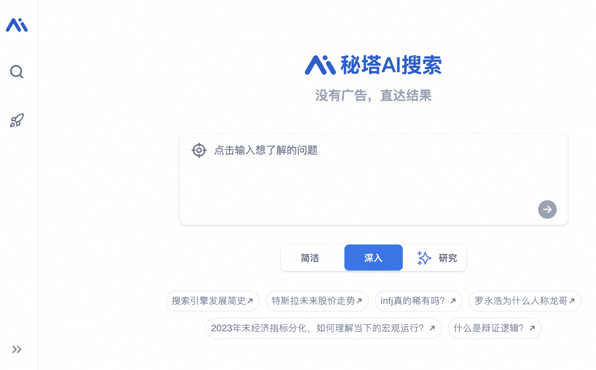
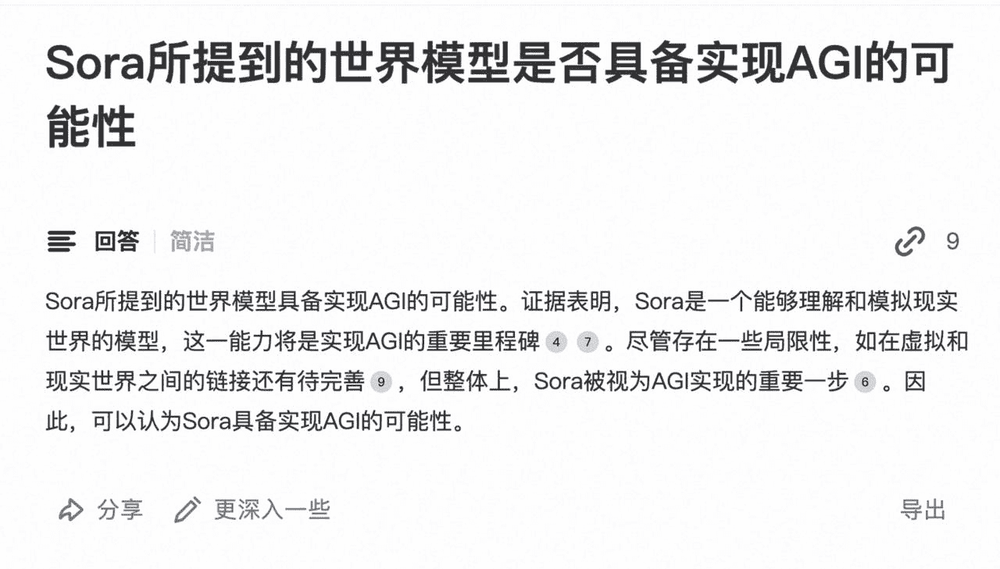
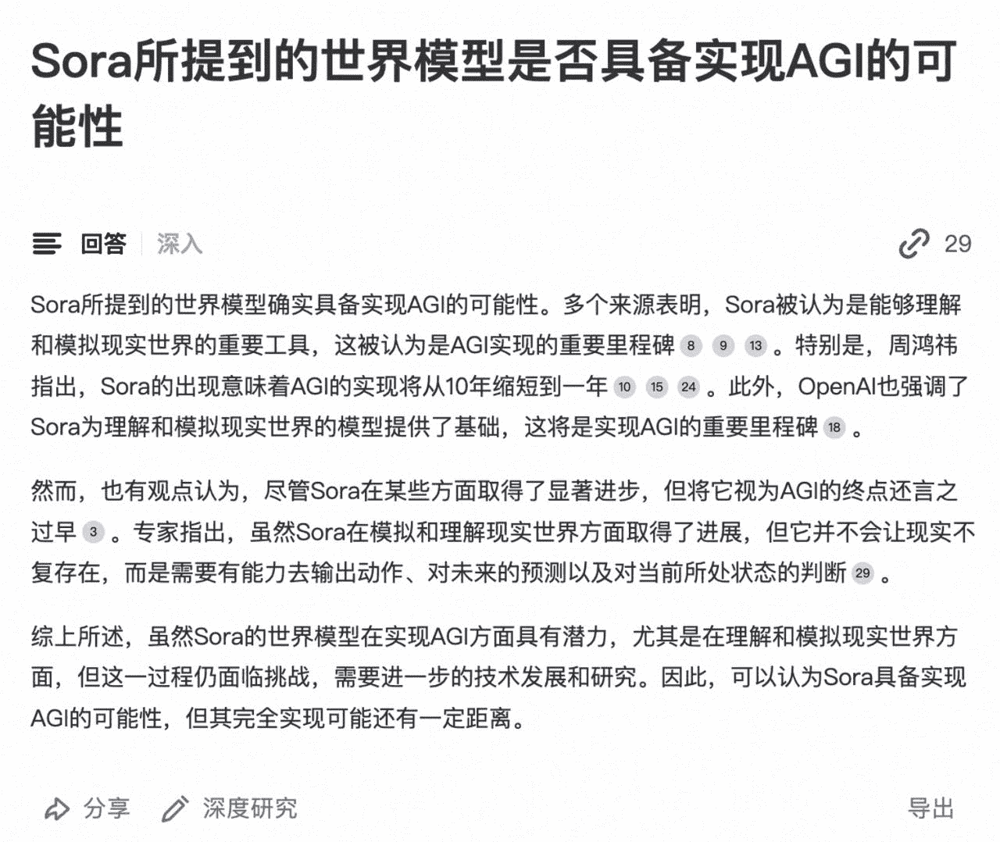
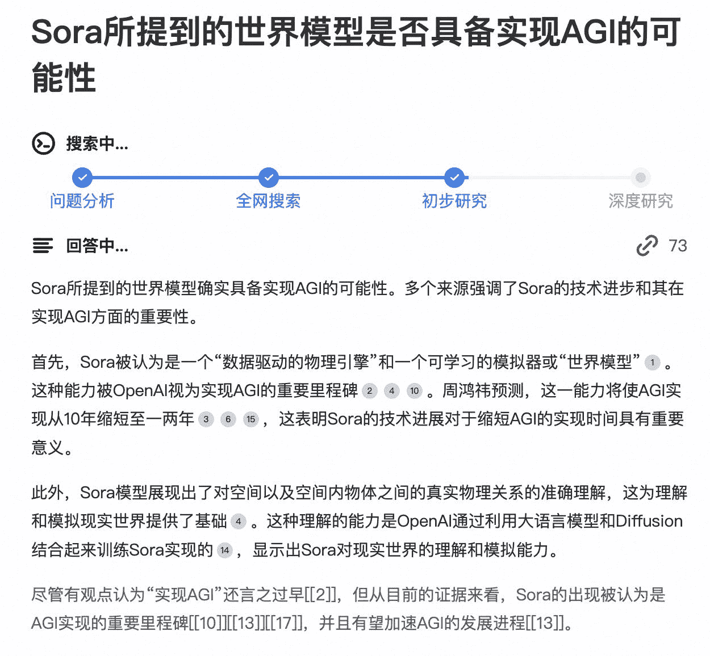
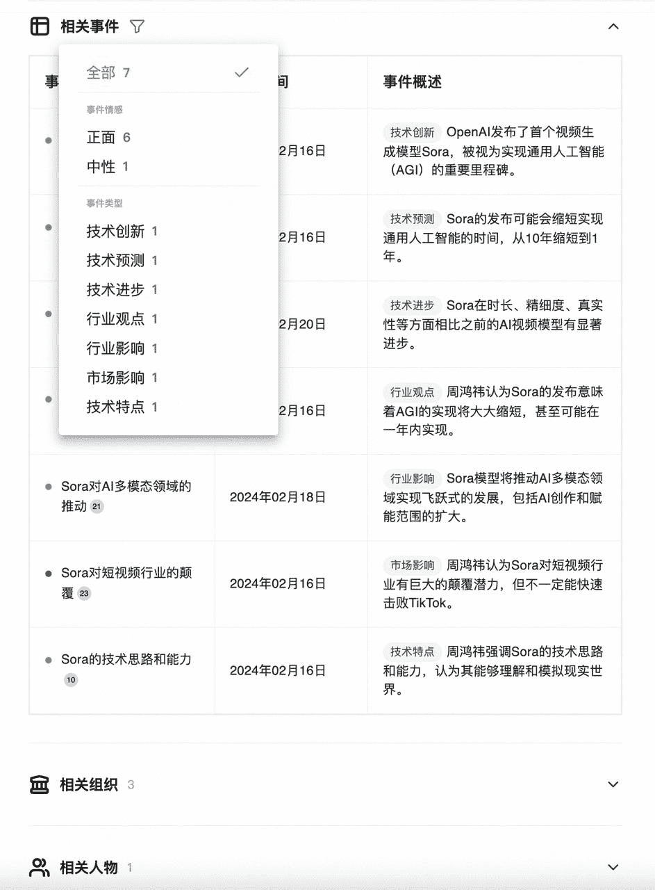
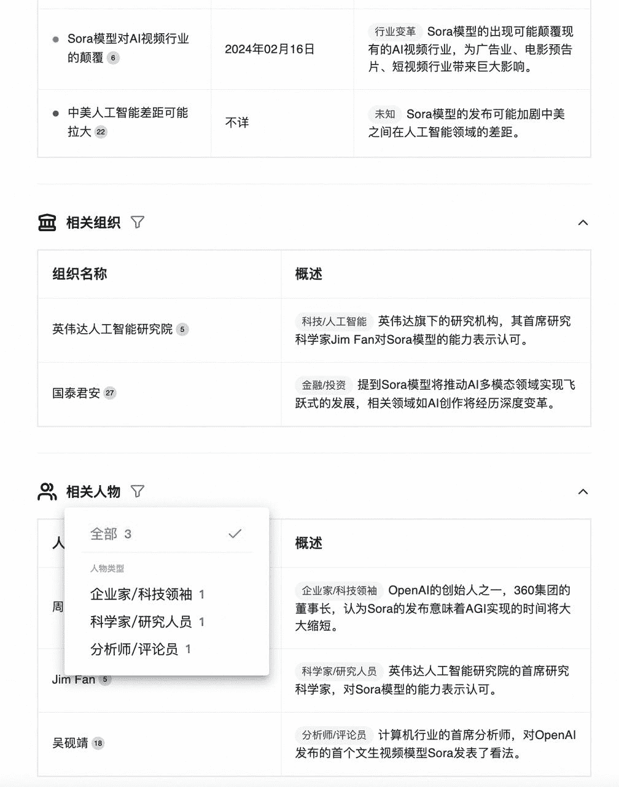
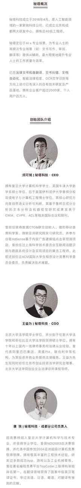
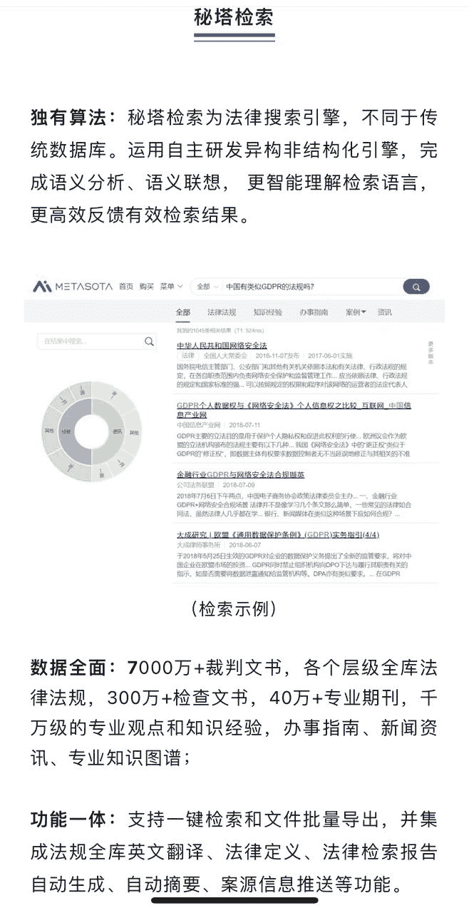
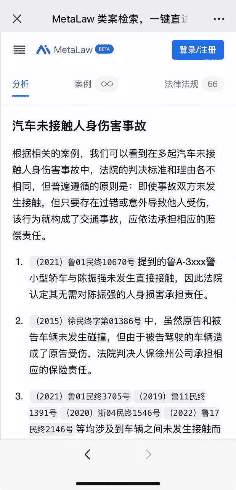
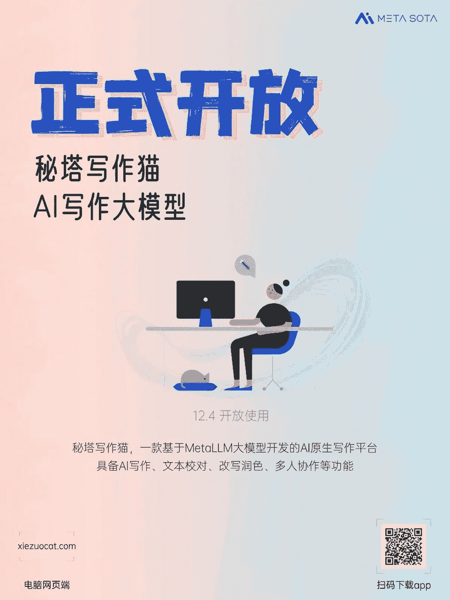

# 秘塔AI

> 来源：[https://hqexj12b0g.feishu.cn/docx/W8iPdYuA4oCJKkxEEENcpxpCnJc](https://hqexj12b0g.feishu.cn/docx/W8iPdYuA4oCJKkxEEENcpxpCnJc)

今天要推荐的是一个AI搜索工具：秘塔AI搜索。简单体验了下速度和效果非常好，所以写一篇小文做个介绍，推荐大家都去用用，一定超出期望。

# **检索模式**

工具支持三种检索模式，分别是：1）简洁；2）深入；3）研究

主要区别在于信息源的数量，初步测试看简洁10条左右；深入30条左右；研究70条左右。

信息源的数量决定了检索结果的专业性和观点深度。关键是这个不断增加信息源，完善结果的方法非常靠谱，像极了我们的认知过程，由浅入深。

# **搜索关联**

不论是哪种检索模式，都会列出相关事件、相关组织和相关人物，并且自动做了归类支持过滤展示，例如事件情感、组织分类等。

# **结果大纲**

检索结果右侧会利用思维导图的形式列出大纲，方便快速查看，效果如下：

# **一点思考**

最近看了各种AI搜索的产品形态，不禁在想传统搜索其实是个半成品，它应该是一个沉在更底层的服务，AI搜索是一种面向最终用户需求的应用形态，而搜索API相当于数据库。只不过用户的query太长尾，传统搜索list可以满足所有场景，AI搜索加了自然语言理解这一层，可以更好的组织搜索工具。所以AI搜索和传统搜索不是替代关系，而是分层关系。

# **关于秘塔**

好[**奇去了解秘塔AI背后的公司，这里有一篇去年五月对COO王益**](https://mp.weixin.qq.com/s/uxASjJmRYsI27VPlgHwxbA)为的采访《秘塔科技:“中国的Grammarly”如何应对GPT时代的“降维打击”》https://mp.weixin.qq.com/s/uxASjJmRYsI27VPlgHwxbA可以读读。

他们之前的产品主要有两款：metalaw和秘塔写作猫，现在推出秘塔搜索，虽意料之外但也情理之中。

