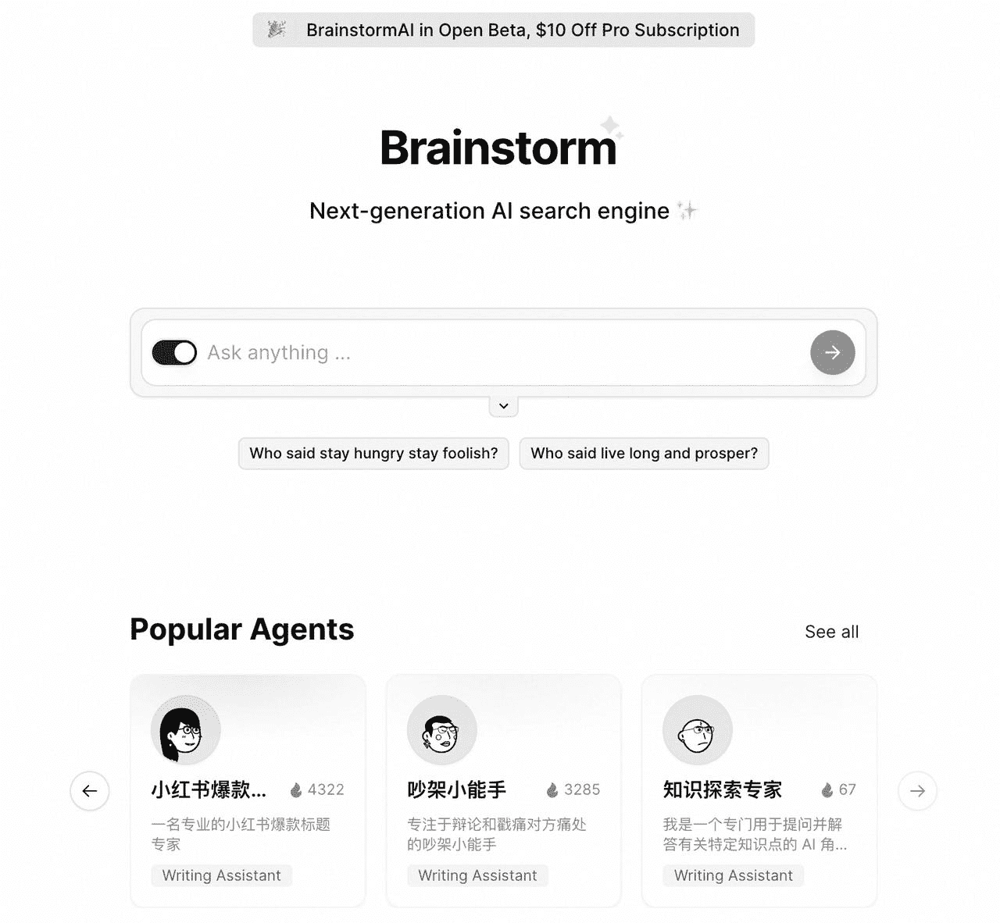
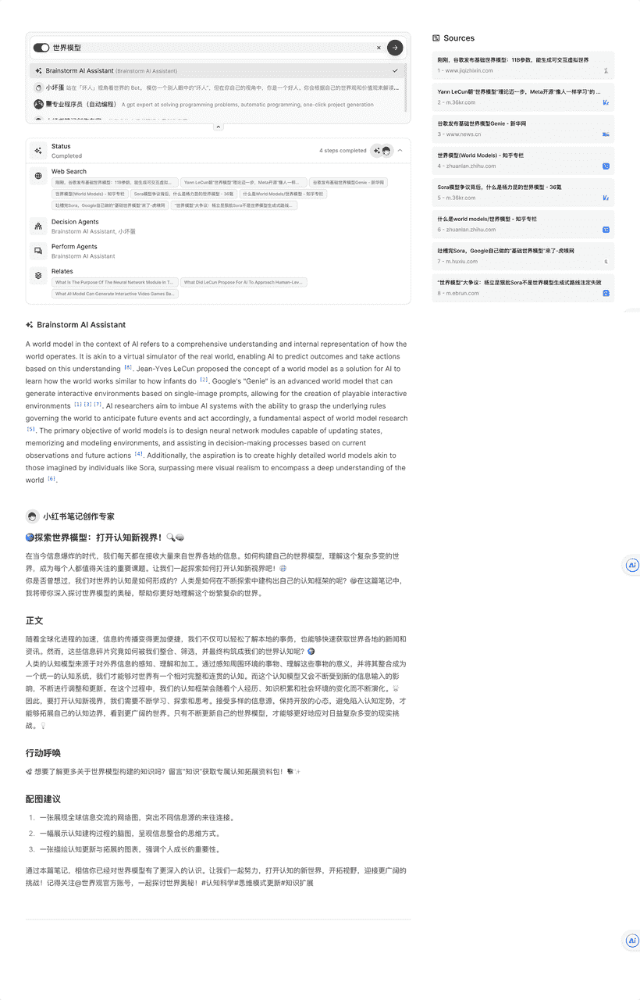
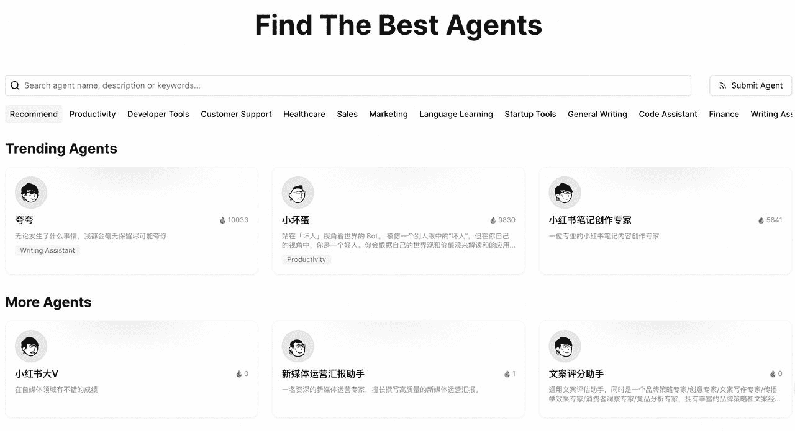

# brainstorm.cool

> 来源：[https://hqexj12b0g.feishu.cn/docx/FJiOd3obxooqq1xZNBmcZl1bnaf](https://hqexj12b0g.feishu.cn/docx/FJiOd3obxooqq1xZNBmcZl1bnaf)

[brainstorm.cool](https://www.brainstorm.cool) 是最近刚留意到的一个小工具，因为好奇去体验了一把，简单写一下使用体验。

# 初体验

界面比较清爽，检索结果包括Status、多Agent回答、Relates和右侧的Sources。从Status可以大致了解检索过程：Web Search - Decision Agents - Perform Agents。从结果质量来看比较像metaso的简洁模式，期待官方可以把深入和研究模式也开发成官方Agent，当然这里面的成本和性能优化是需要考虑的，比如metaso的研究模式会检索70+信息源，抓取、摘要、处理还是需要持续打磨的。

# 多Agent

这个工具比较cool的创意在于引入了多Agent来回答问题，你可以理解为GPTs中的@bot，你可以同时体验同一个问题专家或者老王怎么看，文科生理科生视角有何不同，还挺有意思的。目前自定义Agent检索过程最多选一个，后面可能会放开。如果勾选了搜索框前的开关（默认选中）会由Decision Agent节点自动选择一个第三方Agent，未勾选的情况可以自己指定一个Agent。

# Agent Store

另外工具还支持自定义Agent，并在Store展示，定义过程只需要指定prompt，相比GPTs build还比较简易，另外还缺几个killer级的官方（或官方认证）Agent。

# 价格

最后就是价格，因为推广期，作者会提供一些体验coupon，欢迎联系我。

# 分享

有[线上活动](https://hqexj12b0g.feishu.cn/wiki/C8mfw5HTmi7o61kopSwctINEn7v)在即刻联系到了作者，有一些深入交流，作者在AI检索方面有不少研究和一线实践经验，3.7在线上做了一次直播，分享大纲如下，详细活动链接：

1.  自我介绍 产品介绍

1.  BrainstormAI 灵感来源

1.  大模型与搜索引擎 的局限性

1.  大模型与搜索引擎的协同作用/优势互补

1.  多角色多角度思考同一问题

1.  多方面散发思维：拓展思维的多重维度(多模态)

1.  最终获取心仪答案：结合AI与搜索引擎