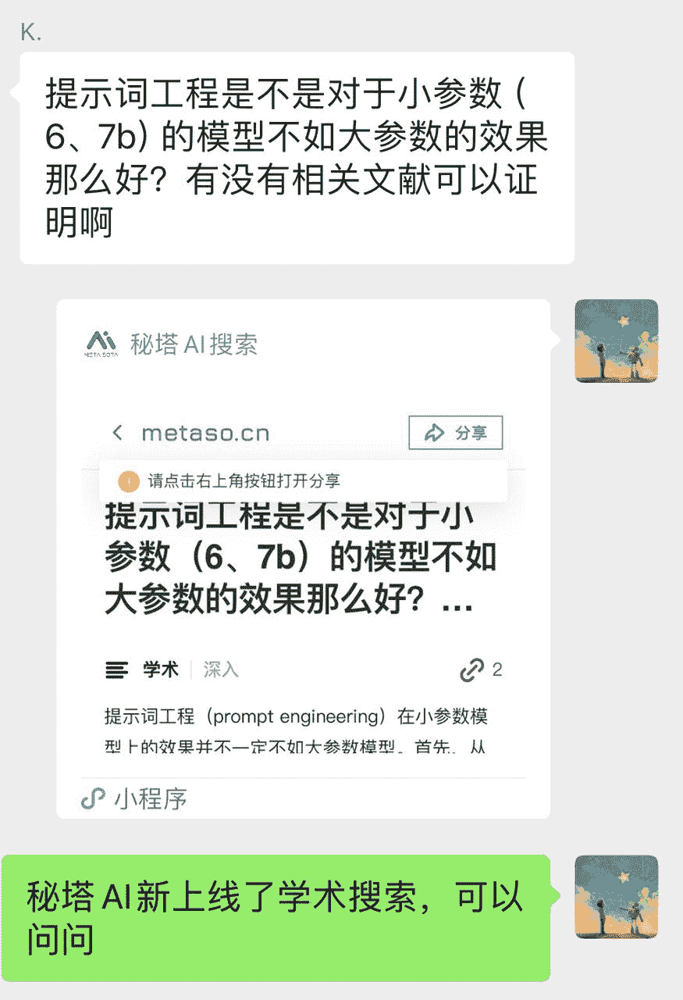
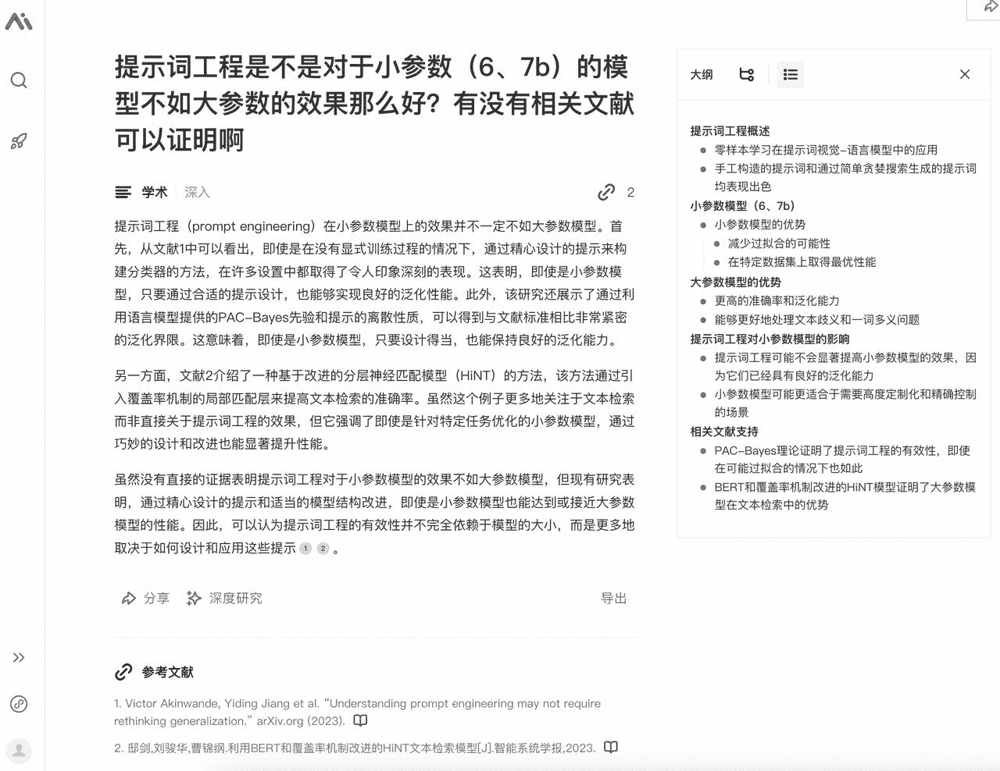
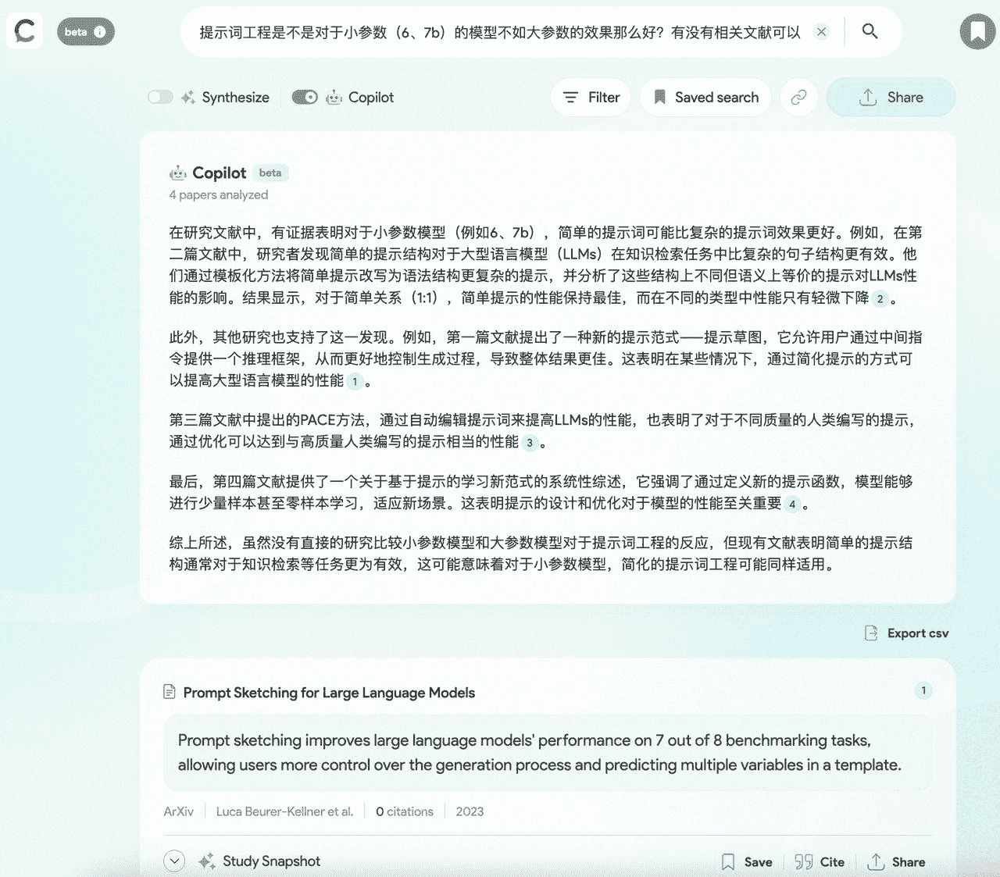
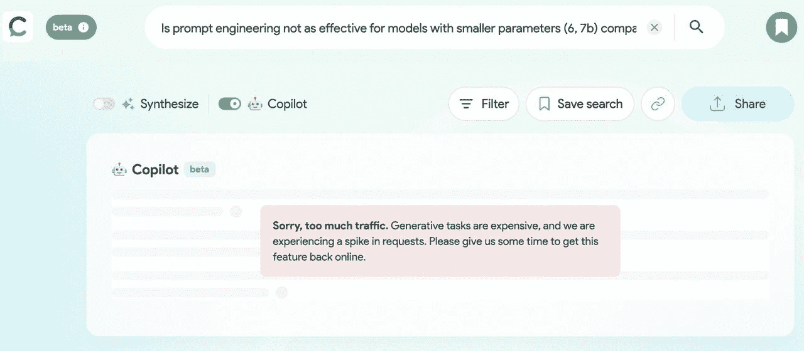
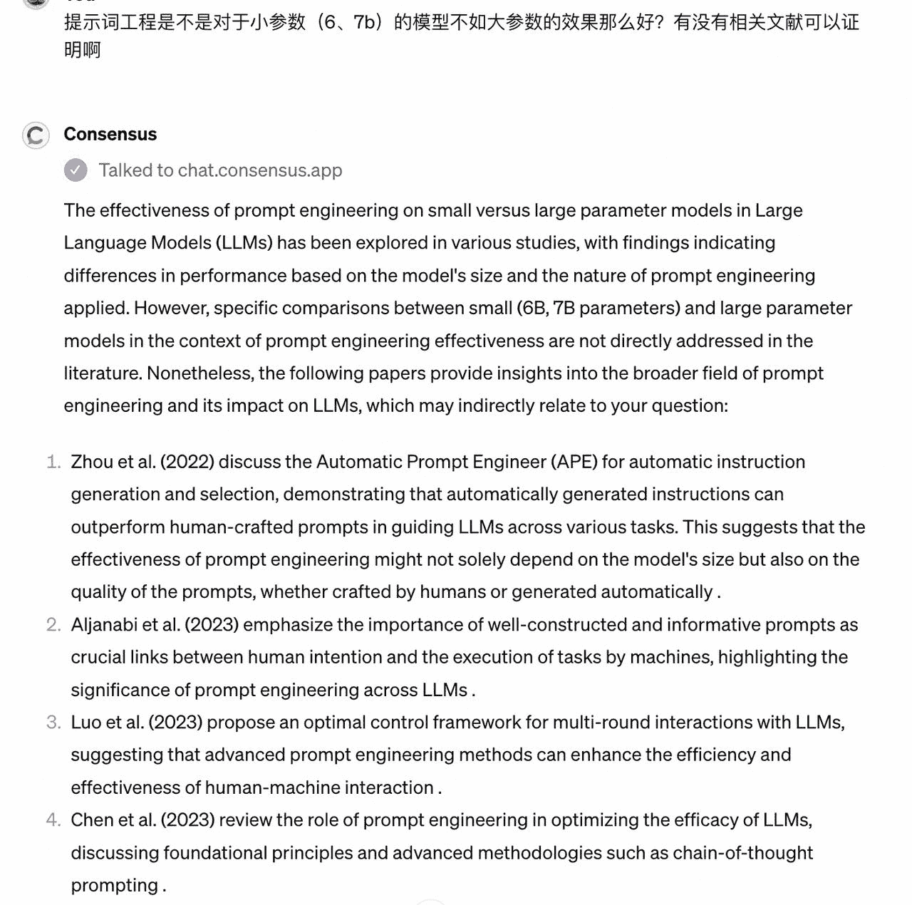
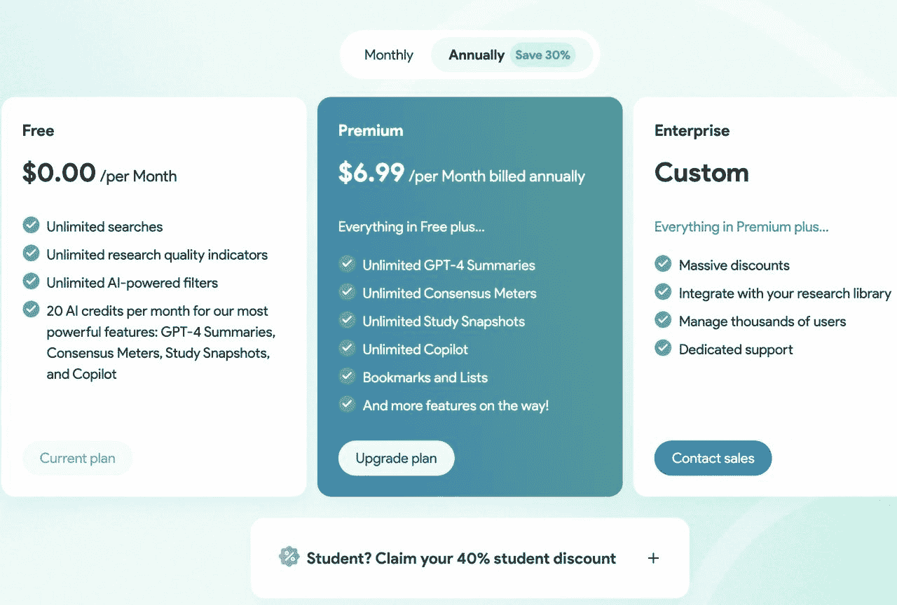
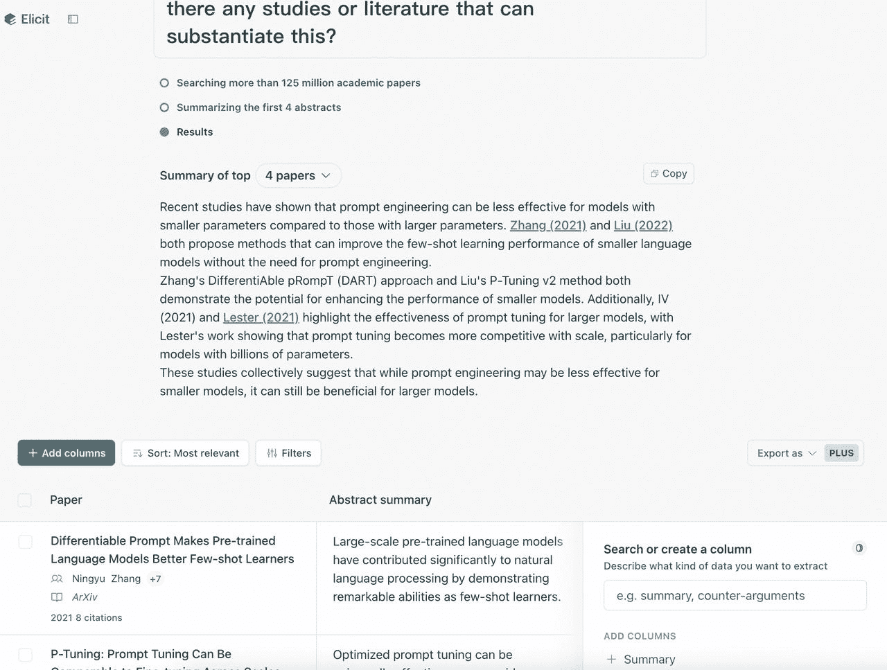
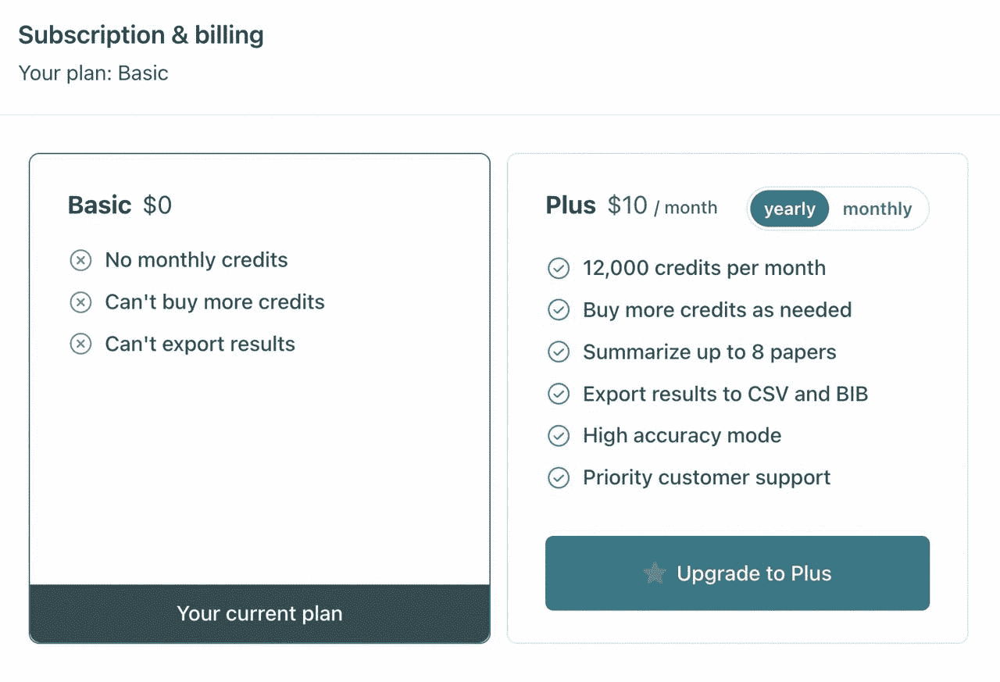
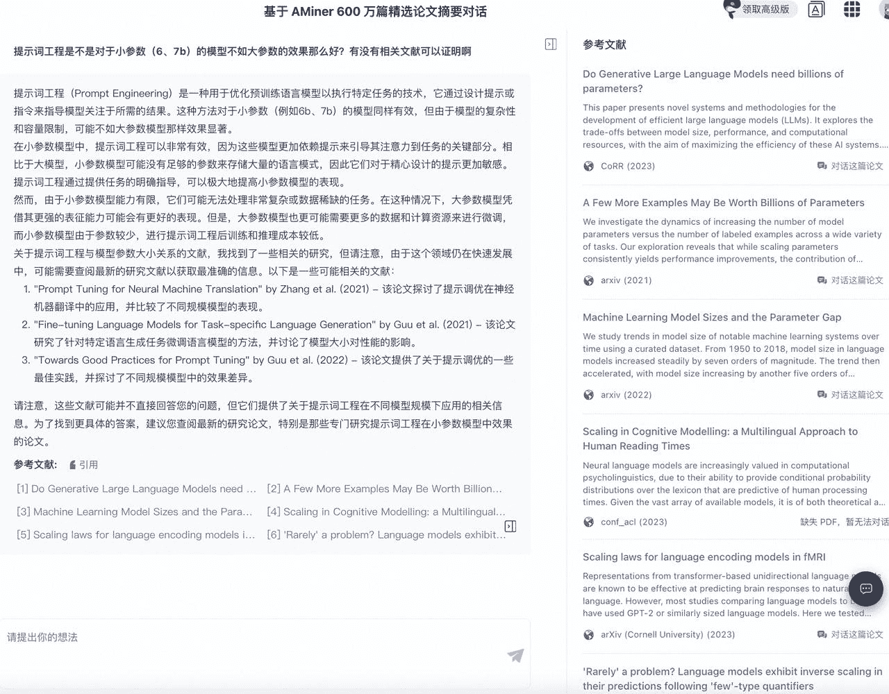
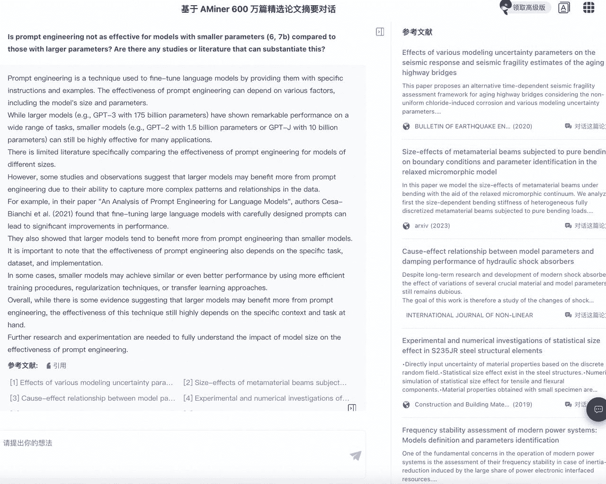

# AI学术搜索工具

> 来源：[https://hqexj12b0g.feishu.cn/docx/HCMcd59Qfo8Lp8x5VQwcooTVnXd](https://hqexj12b0g.feishu.cn/docx/HCMcd59Qfo8Lp8x5VQwcooTVnXd)

# 引子

今天在AI交流群有同学抛了个问题，因为刚好看到秘塔AI推出了学术搜索，体验了一下，感觉效果不是很理想，出于好奇就继续搜索了一把，找找有没有更专业好用的工具，做了个不负责任的小样本测试。

# 产品链接

+   秘塔AI：https://metaso.cn/

+   consensus：https://consensus.app/search/

+   elicit：https://elicit.com/

+   aminer：https://www.aminer.cn/

# 结论

1、学术角度看，Aminer和elicit 效果最好，consensus 其次，秘塔学术最差。

2、从中文友好看，Aminer最好，秘塔学术其次，consensus 也可以用中文但效果没有翻译成英文好，elicit中文完全理解不了。

3、从成本看，秘塔学术目前免费，Aminer论文无限次搜索，但对话20次/天，没法充值只能通过邀请新用户增加（每邀请一位+10次）；elicit 默认5000 credits, 4篇paper，举例搜索一次消耗了16个，plus会员（$10/月）12000 credits, 8篇paper；consensus免费会员20 credits使用copilot和gpt-4总结，Premium（$6.99/月) 无限credits。

4、从学术产品体验看，Aminer最好，elicit和consensus 其次，秘塔学术最差（不支持进一步阅读论文）。

> 注：以上对比对秘塔AI略显不公，毕竟它不是专做这个，但开始涉足了期望后面做得更好。

# 秘塔学术搜索

选择学术搜索，尝试了深入和研究模式，都只检索到两篇论文，相关性不是很强。

# consensus

专业的学术搜索引擎，收录2亿科学研究论文，有500,000+研究人员使用，新增了Copilot功能对检索结果进行总结摘要。但在尝试过程中不太稳定，经常会出现限流。

并且他们在GPT Store也提供了GPTs，一直在趋势榜头部，超过3000,000次对话，位于Research & Analysis类目下TOP1。

# elicit

另一个专业的学术搜索引擎，官网提到超过2亿科学研究论文，同时支持上传论文摘要。

# Aminer

清华大学唐杰博士领导的AMiner项目，旨在为学术社交网络的搜索和挖掘提供最好的服务，收录2.9亿学术论文，提供非常丰富的学术功能，如引用、科研人员、知识图谱等功能。而且有微信小程序版本。

