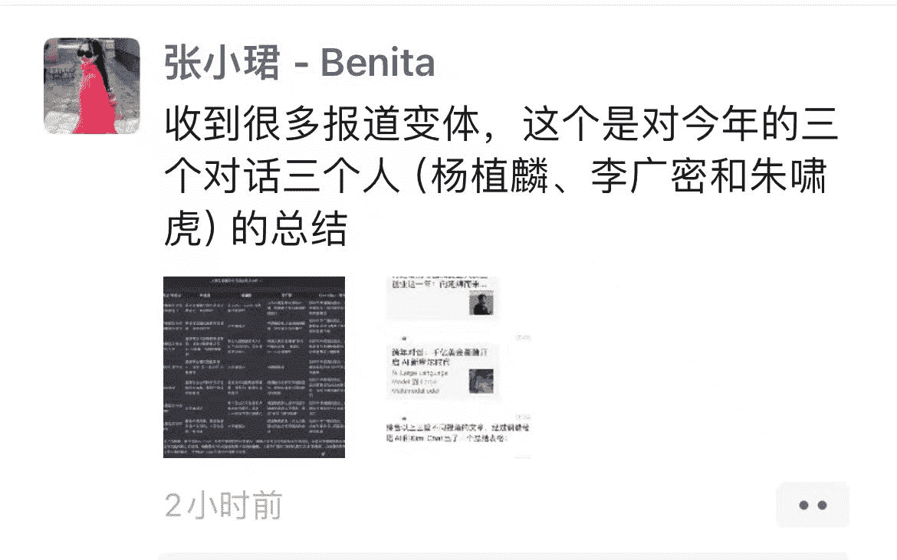
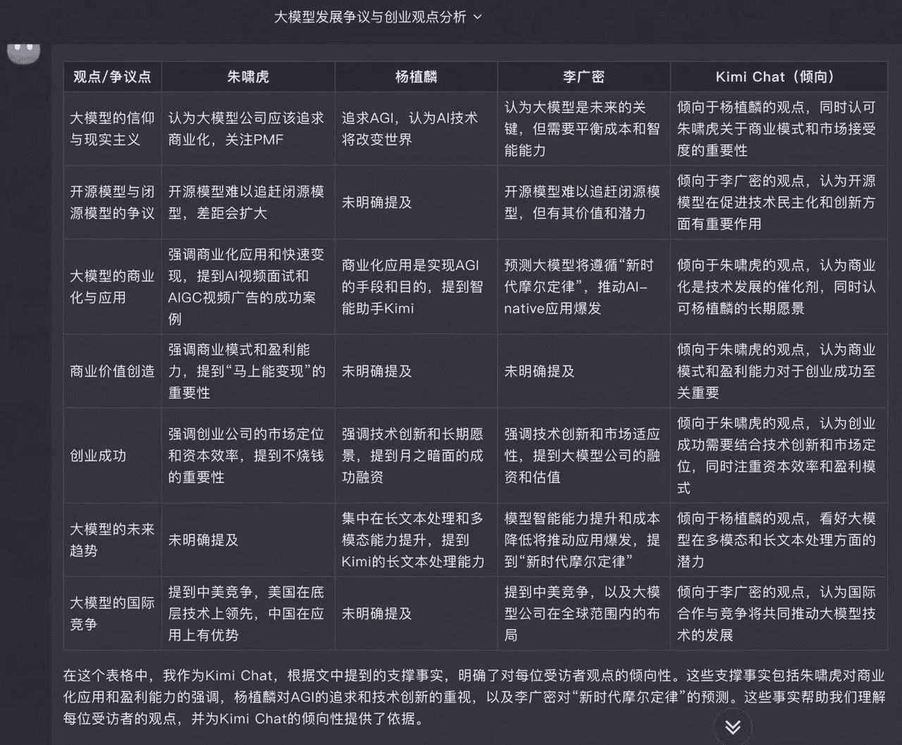
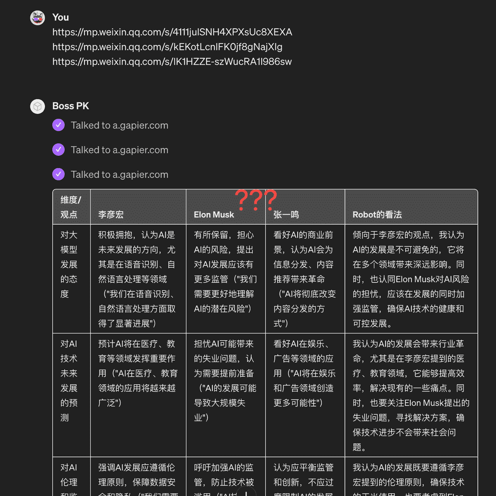

# 一个大佬观点PK Agent

> 来源：[https://hqexj12b0g.feishu.cn/docx/KnuvdYzGBopKIqxI8bpcAikUnyb](https://hqexj12b0g.feishu.cn/docx/KnuvdYzGBopKIqxI8bpcAikUnyb)

> **知识库总目录**

> [AI搜索产品&技术研究](https://hqexj12b0g.feishu.cn/wiki/H36WwziRKizI9mkLTHocpQEjn3d)

> [最新资讯](https://hqexj12b0g.feishu.cn/wiki/SbDNw6DI9iBcs7klaFvck0mDnHb)

> [产品测评](https://hqexj12b0g.feishu.cn/wiki/UKGFw1FlciOpWwkYyR0cgusWnif)

> [技术研究](https://hqexj12b0g.feishu.cn/wiki/JyQ0wVaXJii37Rkt3rBcCBfonEc)

> [实践案例](https://hqexj12b0g.feishu.cn/wiki/VUUSwxGMeid7M9kaqWfcnUMOnNb)

> [更新记录](https://hqexj12b0g.feishu.cn/wiki/XrBQwfUGyiML1GkvcZcc3N00nFc)

> [致谢](https://hqexj12b0g.feishu.cn/wiki/YAe0wxH3tiDqQJk0K48cDOLhnne)

# 想法背景

+   朱啸虎讲了一个中国现实主义AIGC故事

+   月之暗面杨植麟复盘大模型创业这一年：向延绵而未知的雪山前进

+   跨年对谈：千亿美金豪赌开启 AI 新摩尔时代

上周AI圈都在转发投资人朱啸虎和月之暗面创始人杨植麟的专访新闻稿，基于好奇心，我尝试用kimi chat对大佬们的观点进行对比分析，当时发了朋友圈，很快到了下午在好几个AI社群都在传播，包括文章作者张小郡也觉得有趣做了转发。

当时转发的总结表格长这样：

后来有多位同学私信我这么“高级”的功能怎么实现的，其实一点也不高级，我把多步问题整理成了下面prompt：

# Prompt整理

> [请你仔细阅读和理解下面三篇文章中关于大模型技术发展和应用创](https://mp.weixin.qq.com/s/4111julSNH4XPXsUc8XEXA)业的观点[：

> https://mp.weixin.qq.com/s/](https://mp.weixin.qq.com/s/kEKotLcnlFK0jf8gNajXIg)4111[julSNH4XPXsUc8XEXA

> https:](https://mp.weixin.qq.com/s/lK1HZZE-szWucRA1l986sw)//mp.weixin.qq.com/s/kEKotLcnlFK0jf8gNajXIg

> https://mp.weixin.qq.com/s/lK1HZZE-szWucRA1l986sw

> 

> 再通过多个维度全面分析和整理他们的主要观点，然后提取出最多10个问题维度来对比他们的观点异同。

>

> 注意：

> 1、用表格把总结整理出来，以方便对比研究不同人观点的异同，注意从每个人的角色立场出发，但也要考虑到每个人思维的复杂性。

> 2、表格最后加一列，以kimi的身份补充你的看法，注意你的回答要更有个性，必须包括你倾向的当事人名字、观点和原因。

> 3、在每个人的观点末尾用" "括起来原文中的支撑事实，最好是原文片段。

> 4、最后再次对照检查一下你的总结有没有遗漏或者与原文事实不符合的地方，修正后返回最终结果。

> 5、只返回最终结果表格，不要返回其他任何说明和补充文字。

# Agent化

果然大家还是对八卦更感兴趣，我辛辛苦苦写的技术文章转发者寥寥😂，后来我就想这个过程是不是可以自动化，也就是实现这样的目的：扔进去几个链接，AI Agent自动检索总结，最后用表格或思维导图形式列出同一主题下不同大佬的观点异同。

结合对目前市面上大模型和Agent等产品的了解，能实现这个目的的选项包括：

+   方案一：GPTs接入gapier.com等网页访问action

+   方案二：coze.cn 自定义workflow

+   方案三：百度智能体

目前尝试了前两种方案，结合代码节点调优方案二，等可用后放出来。方案一可以看到对大佬识别严重幻觉

