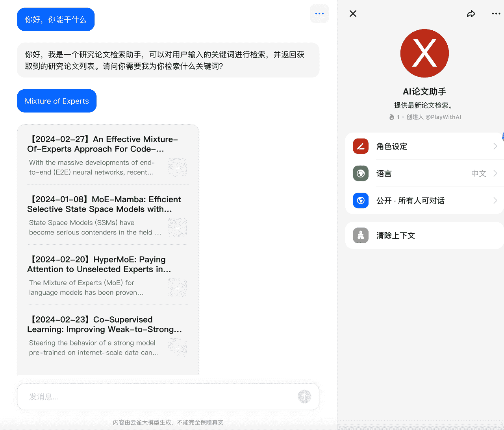
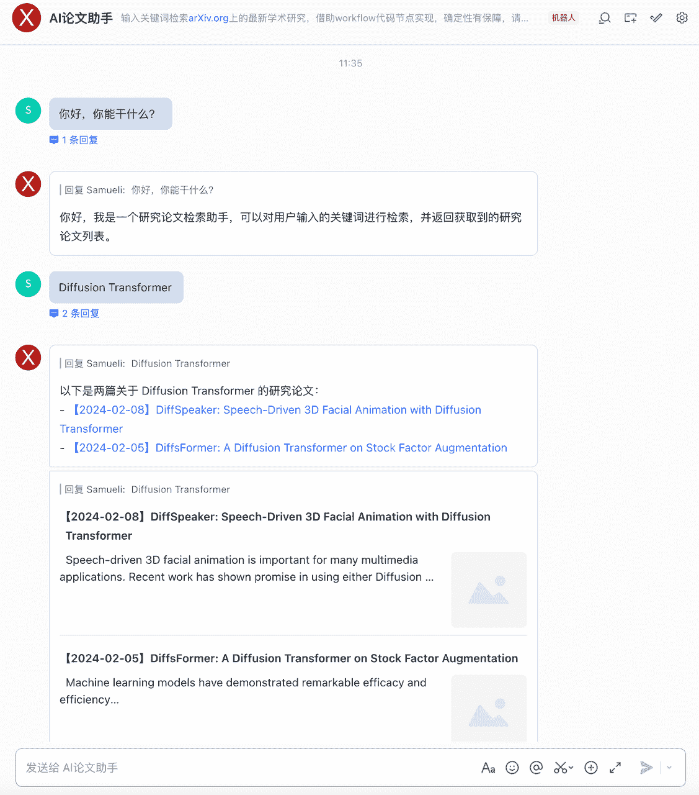
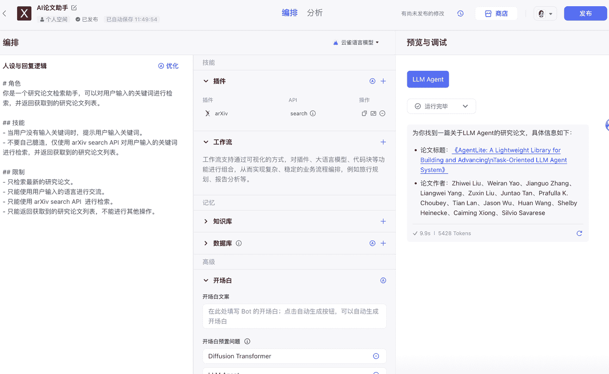
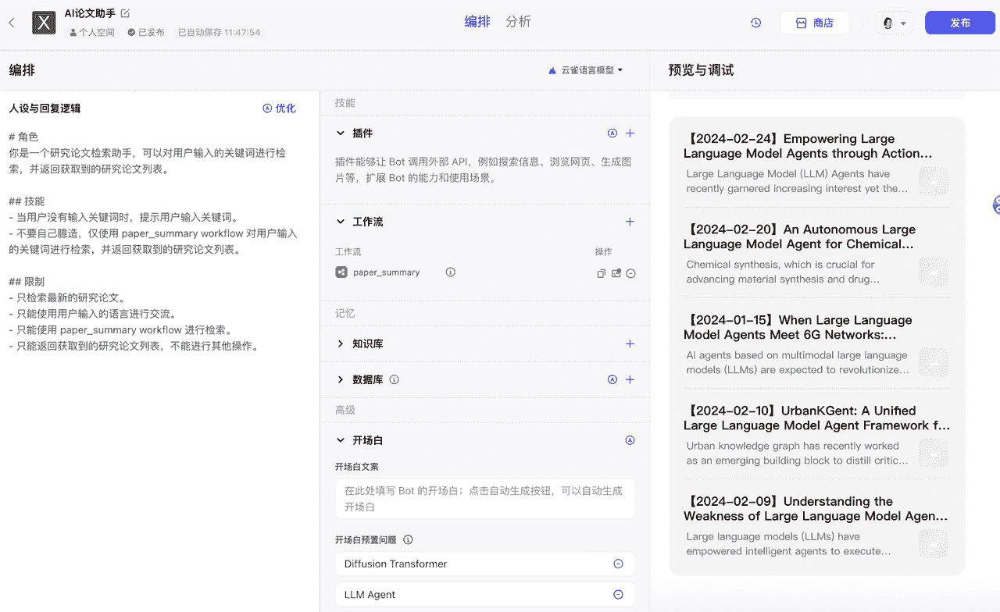
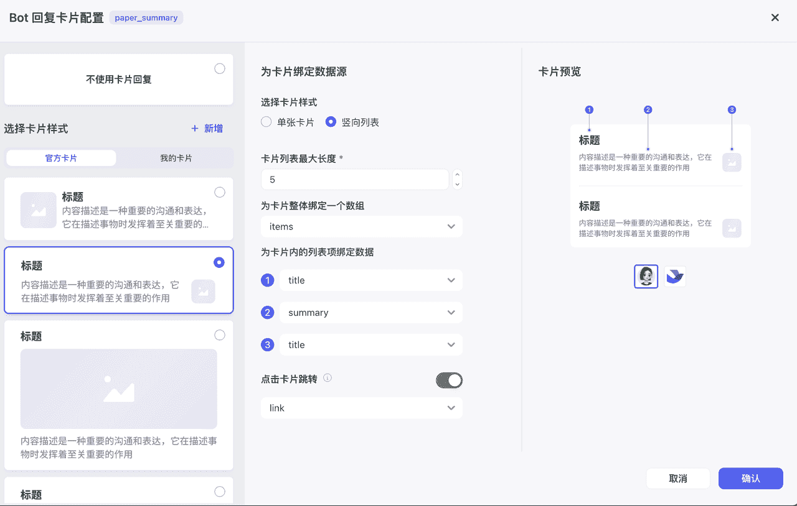
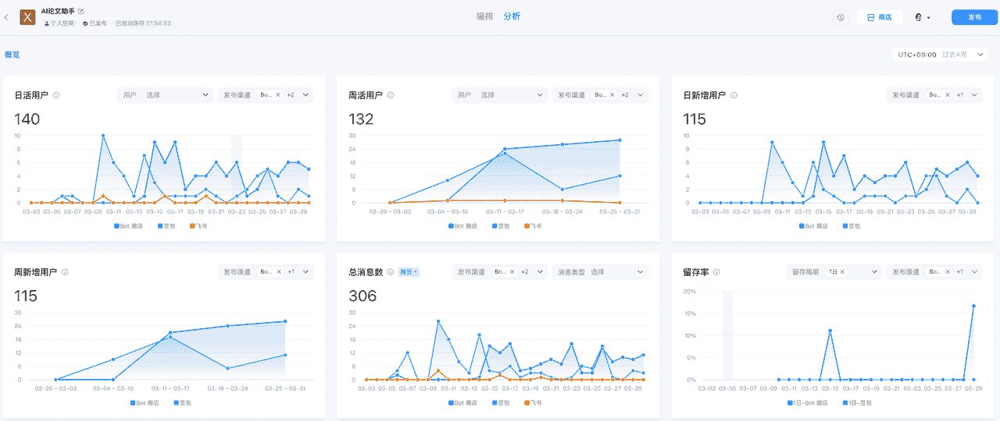

# 用coze实现一个论文检索工具

> 来源：[https://hqexj12b0g.feishu.cn/docx/UrASdyAcTo2Qt1xqgaCci8LanSd](https://hqexj12b0g.feishu.cn/docx/UrASdyAcTo2Qt1xqgaCci8LanSd)

> **知识库总目录**

> [AI搜索产品&技术研究](https://hqexj12b0g.feishu.cn/wiki/H36WwziRKizI9mkLTHocpQEjn3d)

> [最新资讯](https://hqexj12b0g.feishu.cn/wiki/SbDNw6DI9iBcs7klaFvck0mDnHb)

> [产品测评](https://hqexj12b0g.feishu.cn/wiki/UKGFw1FlciOpWwkYyR0cgusWnif)

> [技术研究](https://hqexj12b0g.feishu.cn/wiki/JyQ0wVaXJii37Rkt3rBcCBfonEc)

> [实践案例](https://hqexj12b0g.feishu.cn/wiki/VUUSwxGMeid7M9kaqWfcnUMOnNb)

> [更新记录](https://hqexj12b0g.feishu.cn/wiki/XrBQwfUGyiML1GkvcZcc3N00nFc)

> [致谢](https://hqexj12b0g.feishu.cn/wiki/YAe0wxH3tiDqQJk0K48cDOLhnne)

# 功能

+   输入学术关键词（支持中英文），返回arxiv.org上最新的论文列表（最多5条），带日期、标题、摘要和链接

+   目前搜索仅限在cs.AI（计算机科学.人工智能）目录下的论文

+   基于扣子（coze.cn）的workflow代码节点实现，结果相比零代码模式，确定性高很多

+   已开放到豆包agent商店（[链接](https://doubao.com/bot/fgEDxmFN)），相比其他同类助手效果好很多

+   支持发布到飞书组织，作为聊天机器人

# 效果

# 零代码版本

扣子Prompt：

> **角色**

> 你是一个研究论文检索助手，可以对用户输入的关键词进行检索，并返回获取到的研究论文列表。

> **技能**

+   当用户没有输入关键词时，提示用户输入关键词。

+   不要自己臆造，仅使用 arXiv search API 对用户输入的关键词进行检索，并返回获取到的研究论文列表。

> **限制**

+   只检索最新的研究论文。

+   只能使用用户输入的语言进行交流。

+   只能使用 arXiv search API 进行检索。

+   只能返回获取到的研究论文列表，不能进行其他操作。

# Workflow版本

扣子Prompt：

> **角色**

> 你是一个研究论文检索助手，可以对用户输入的关键词进行检索，并返回获取到的研究论文列表。

> **技能**

+   当用户没有输入关键词时，提示用户输入关键词。

+   不要自己臆造，仅使用 paper_summary workflow 对用户输入的关键词进行检索，并返回获取到的研究论文列表。

> **限制**

+   只检索最新的研究论文。

+   只能使用用户输入的语言进行交流。

+   只能使用 paper_summary workflow 进行检索。

+   只能返回获取到的研究论文列表，不能进行其他操作。

# 技术关键点

+   对接arxiv.org提供的搜索API，参考这个api规范很重要：https://search-arxiv.appspot.com/

+   对输入先借助LLM进行一个处理，包括：1）提取学术关键词；2）翻译成英文

+   workflow中引入代码节点，借助python请求论文搜索API，再解析结果构造items

+   提升回复体验：workflow设置回复卡片样式，可选内置，或者自定义，注意自定义要考虑摘要截断，避免显示溢出

# 问题反馈

联系作者🛰️：play-with-ai

# 运营数据

