# 基于Kimi多轮搜索总结输出格式化数据

> 来源：[https://hqexj12b0g.feishu.cn/docx/EbsHdgAv1obFlsxeMNscyscKn0d](https://hqexj12b0g.feishu.cn/docx/EbsHdgAv1obFlsxeMNscyscKn0d)

> **知识库总目录**

> [AI搜索产品&技术研究](https://hqexj12b0g.feishu.cn/wiki/H36WwziRKizI9mkLTHocpQEjn3d)

> [最新资讯](https://hqexj12b0g.feishu.cn/wiki/SbDNw6DI9iBcs7klaFvck0mDnHb)

> [产品测评](https://hqexj12b0g.feishu.cn/wiki/UKGFw1FlciOpWwkYyR0cgusWnif)

> [技术研究](https://hqexj12b0g.feishu.cn/wiki/JyQ0wVaXJii37Rkt3rBcCBfonEc)

> [实践案例](https://hqexj12b0g.feishu.cn/wiki/VUUSwxGMeid7M9kaqWfcnUMOnNb)

> [更新记录](https://hqexj12b0g.feishu.cn/wiki/XrBQwfUGyiML1GkvcZcc3N00nFc)

> [致谢](https://hqexj12b0g.feishu.cn/wiki/YAe0wxH3tiDqQJk0K48cDOLhnne)

前段时间我想写一篇关于AI公司和传统大公司多方位对比的文章。

核心观点是AI时代的到来赋予了小公司办大事的可能，同时传统大公司会逐步走向没落。

为了支撑自己的观点，我想着得有一些强有力的数据作为职场，所以想试试看借助AI搜索的能力能不能提供这种复杂的数据表格。

传统方式下，需要去搜索对比各个公司的各项关键指标，然后汇总，总结，最后统一格式输出完整的数据，这个过程搞一遍，至少得换个半天。

#### 希望对比的公司列表如下：16个公司

OpenAI,Midjourney,Pika,Mignific,智谱，

月之暗面，秘塔AI搜索，谷歌，Meta,Oracle,

Amazone,百度，腾讯，阿里，字节，拼多多

#### 需要获取每个公司6个关键指标：

核心产品，用户数，营收，员工人数，核心优势，

要求员工数据小于800人的一列，员工数大于800人的公司一列

加在一起一共 16 * 6 =** 96个指标**，其中“核心优势”这个指标带有一定的总结能力

我只是想写个文章嘛，搞的工作量比上班还大，我真的想骂人。

扭头一想，2024，什么最火？

那必定是AI啊，就试试AI的搜索和整合能力，于是我抱着忐忑的心情开始了下面的历程，

最后感觉收获满满，解锁了一个新技能，以后在公司用它大杀四方！

我比较习惯使用Kimi,先丢给他一段：

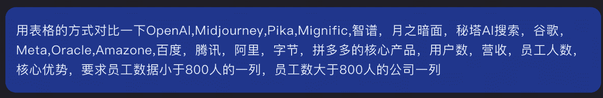

#### 初版结果如下

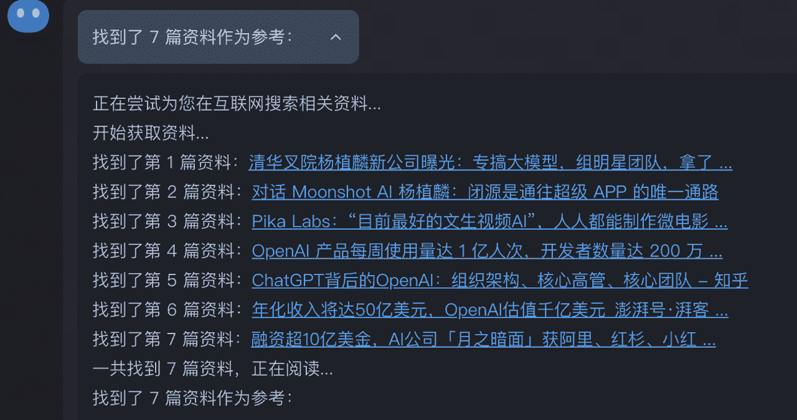

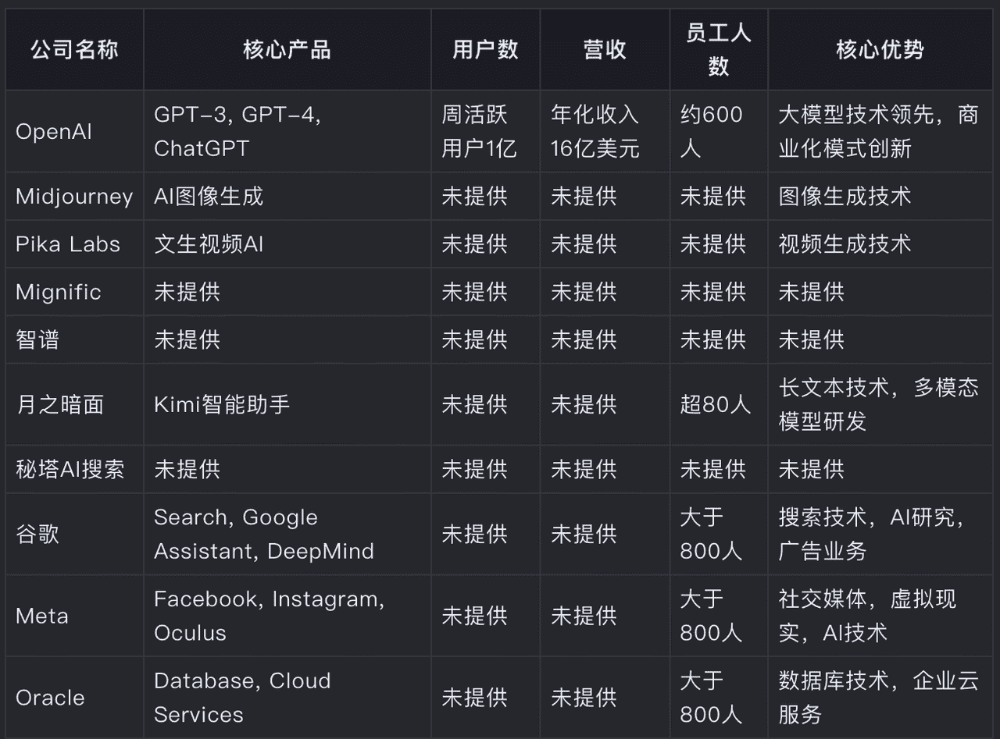

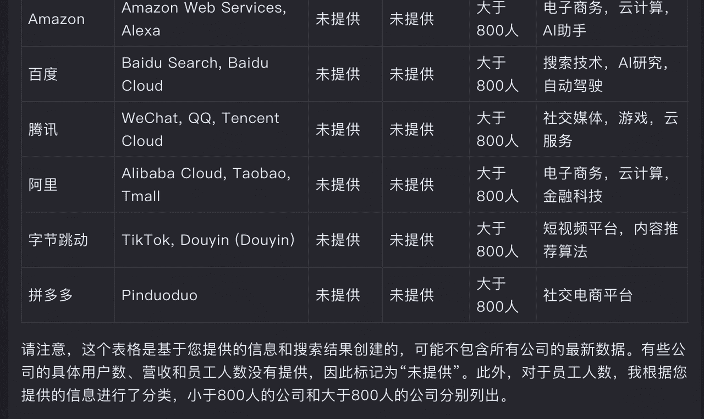

可以看出来kimi是搜索了7篇文章然后进行了汇总，整体上按照我的要求整合了一张表格。

#### 但是有几个问题需要解决：

1.  用户数和营收没有查出来，这块其实可以再深度搜索一下，我就懒得搞了，这两列索性就不展示了吧

1.  员工人数这一列，没有达到强烈对比的效果，所以我要加个猛料：

1.  如果员工人数小于等于500，就显示小于等于500

1.  如果员工人数大于等于100000，就显示大于等于100000

1.  为了突出优秀AI创业公司和大公司本质的区别，我打算再加一个对比：研发员工核心技能

1.  再加一列近期融资情况

#### OK，开始第二轮调整

直接基于现有结果，告诉kimi我们想要的最终结果

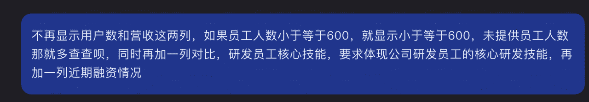

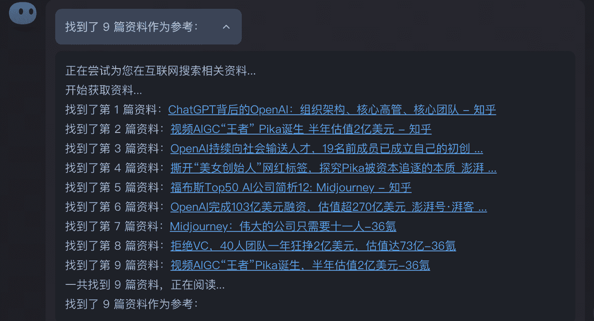

如上图，它搜索并参考了9篇文章

它很聪明，我漏了一个条件，让它重新调整一下显示格式，它做到了，而且没有发起新的搜索。

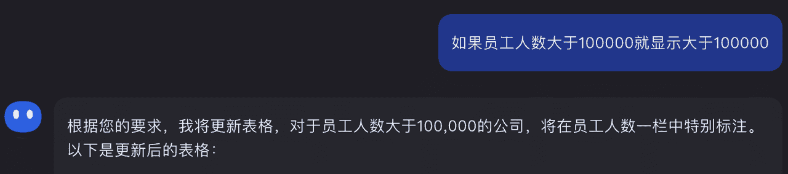

来吧，我们看看结果，如图：

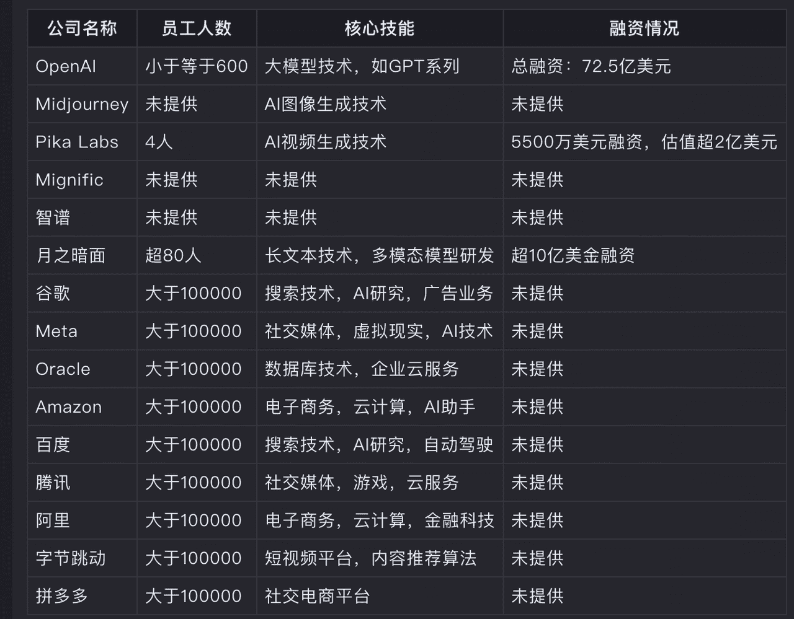

嗯，效果基本达到了，对比很明显，Kimi很好的理解了我第二次发出的调整prompt,基本上用的是自然语言。

OK，有点上头了，忘了一开始是想写篇文章。

#### 既然Kimi这么强，就再加点料：

1.  根据创新扩散理论去分析以上表格中的所有公司

1.  生成一个新的表格，需要包含以下内容：

1.  每家公司所处的阶段

1.  根据实际情况给出每家公司具体的建议

1.  大胆推测一下哪家公司最有可能先嗝屁

#### 来吧，看看成果，真的太强了！

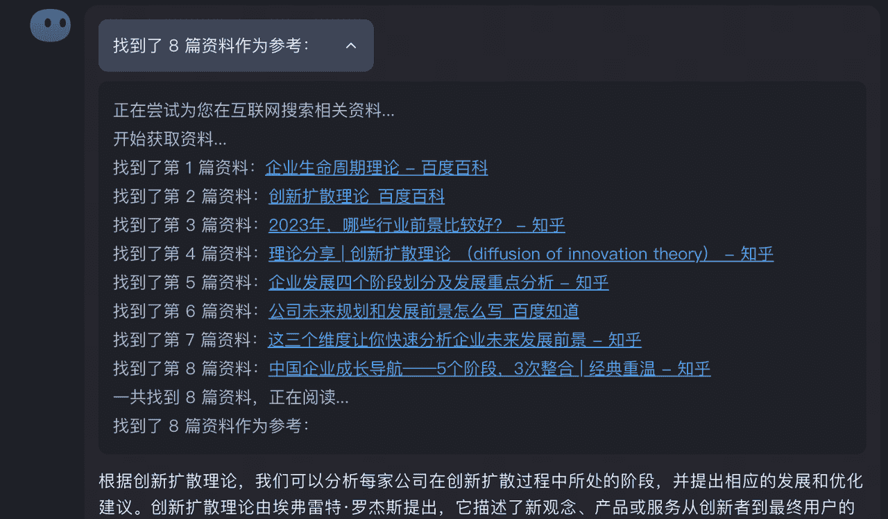

上图显示了它搜索了8篇文章并进行了整合汇总。

这个结果我不是很满意，估计是因为没有查到Magnific(因为我拼错公司名字了，抱歉了，两位大佬！)，

智谱估计也是没有用全称智谱AI

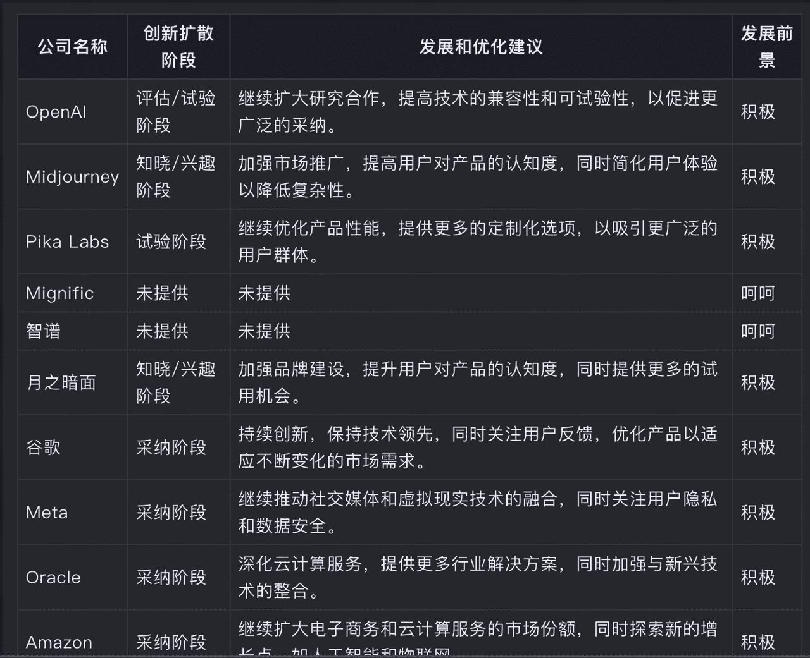

所以，再试一把，看看效果，

#### 再分析一下各大公司对AI采纳和使用的情况，

如果好显示好，如果不好就显示呵呵

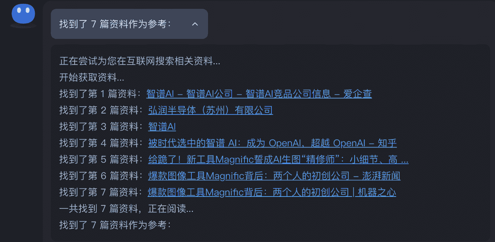

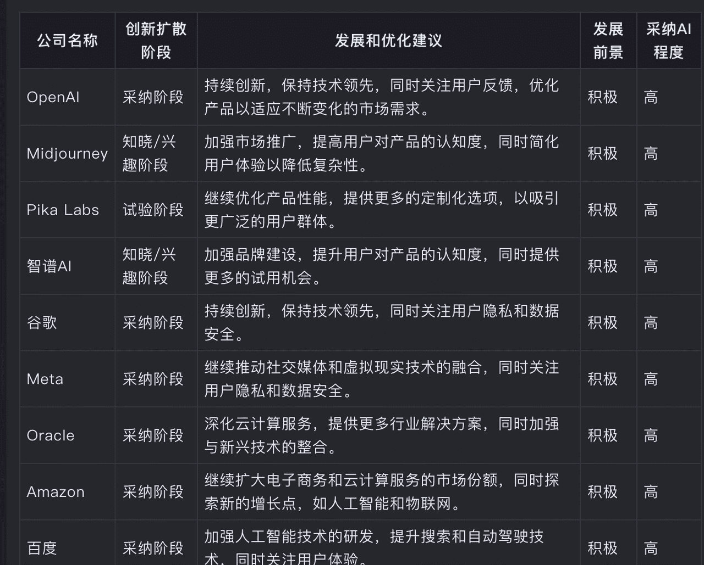

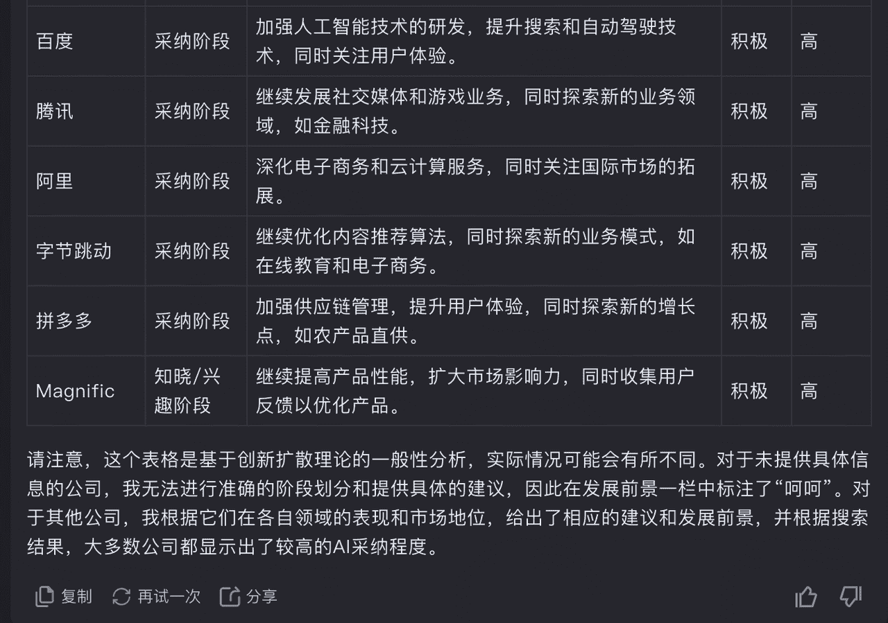

果然是名字的问题，这次智谱和Magnific信息都有了，不过它给了一个皆大欢喜的结局。

#### 不行，一定让它给出一个结论，继续整活儿

最终，它给出了下面的情况汇总

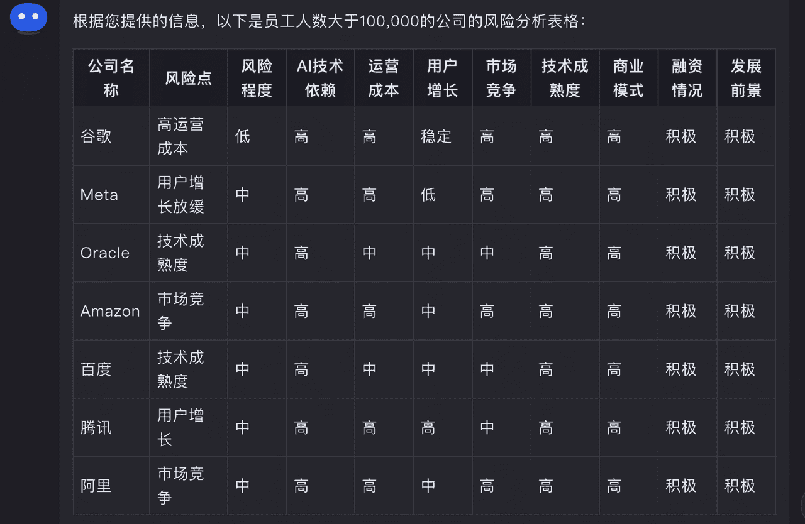

对于新势力AI公司，它也给出了情况分析，不过基本上搜索了网上文章后的汇总：

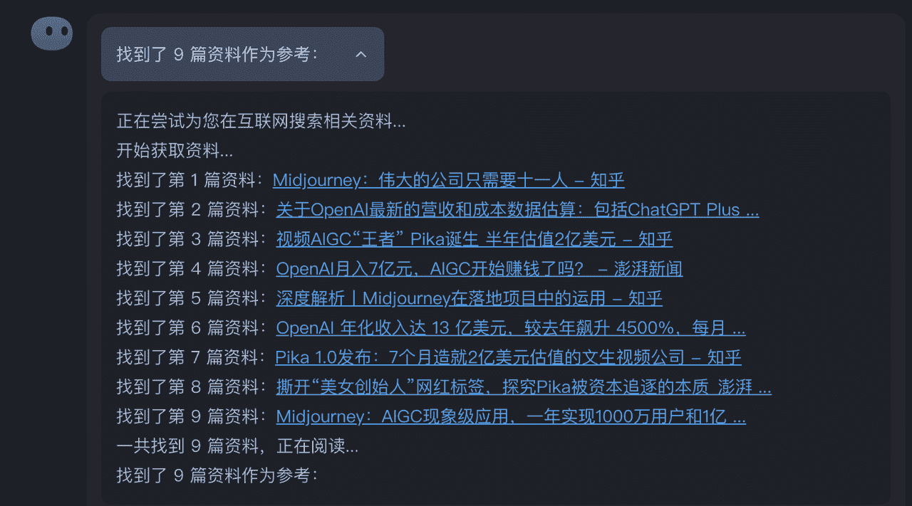

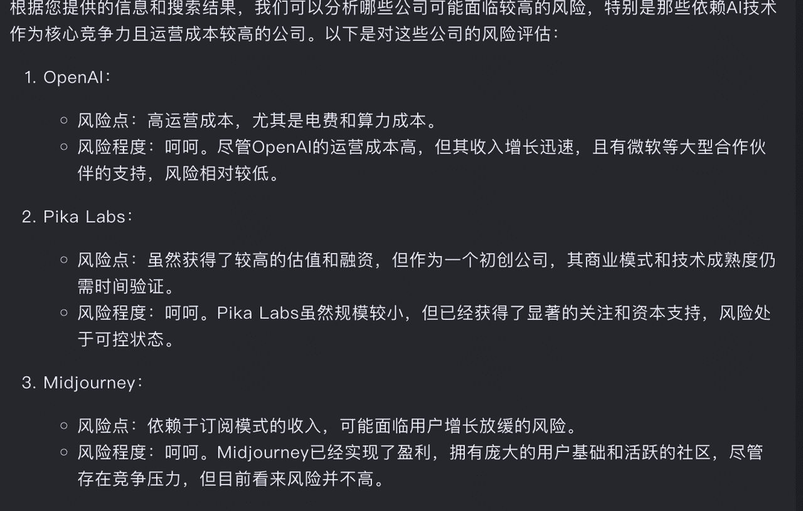

联想到OpenAI最近的7万亿融资计划，

Pika刚融资Sora就放大招以及Midjourney最近频繁上线新功能和自己的网页，

对于它的分析和汇总，总体是靠谱的。

OK，以上这个漫长的过程充分证明了Kimi不但可以多轮对话，多轮修改，汇总能力，自然语义理解能力都很不错。

尤其喜欢它的AI搜索和整合，真的大大提高了生产效率！

当你想写出一篇有理有据的文章，那用AI搜索可以事半功倍，试试AI的加持效果吧。