# AI Agent的起源

> 来源：[https://hqexj12b0g.feishu.cn/docx/NqVFdlxvMoMoxIx9aKqcNAByn5g](https://hqexj12b0g.feishu.cn/docx/NqVFdlxvMoMoxIx9aKqcNAByn5g)

本文来自一个AI Agent学习专栏的第一部分，整体目录如下：

+   Part1: 起源和概述（done）

+   Part2: 开源项目解读

+   Part3: 应用场景案例

+   Part4: 不断补充…

# **一、起源：从一本AI教科书说起**

《人工智能：现代方法》被誉为人工智能领域最受欢迎的教科书，被135个国家的1500多所大学采用（很遗憾计算机专业的我没学过），这本书当前出到了第四版，作者是斯图尔特·罗素（Stuart Russell），加州大学伯克利分校计算机科学家，人类兼容人工智能中心（CHAI）主任，人工智能研究实验室指导委员会（BAIR）成员。世界经济论坛人工智能和机器人委员会副主席，美国科学促进会（AAAS）会士，美国人工智能协会（AAAI）会士。

2023年6月10日，老爷子来北京，在智源大会发表了一个主旨演讲

《AI: Some Thoughts?》，媒体报道：

[https://www.thepaper.cn/newsDet](https://www.thepaper.cn/newsDetail_forward_23451621)ail_forward_23451621

摘录演讲几个核心观点：

1、如果说通用人工智能是一件完整的拼图，大语言模型仅仅只是其中的一块，但我们并不真正了解如何将它与拼图的其他部分连接起来，以真正实现通用人工智能。我相信甚至还有部分缺失的拼图没有被找到。

2、我们正试图从电路中获得高度智能的行为，而电路本身是一种相当有限的计算形式。未来人工智能的发展方向应该是使用基于明确的知识表征的技术。

3、人工智能系统的设计必须遵循两个原则。首先，AI的行为必须符合人类的最大利益（提到孟子的“博爱”）；第二，AI自己不应该知道这些利益是什么。因此，它们不确定人类的偏好和未来，这种不确定性会给人类控制权。

找到了PPT原文，感兴趣进一步阅读：

[https://inst.eecs.berkeley.edu/~cs188/s](https://inst.eecs.berkeley.edu/~cs188/sp23/assets/lectures/cs188-sp23-lec27.pdf)p23/assets/lectures/cs188-sp23-lec27.pdf

回到这本书，作者在第一部分第二节写了：Intelligent Agents（中文译作智能体），因为历经多次改版，比较好奇这个概念最早是哪一版提出的呢？较真去找了英文原文，只找到第二版，从序言可见该部分内容应该是从第一版就存在，也就是1994年。所以AI智能体并不是什么新概念（其他传统行业的智能体概念提出更早）。

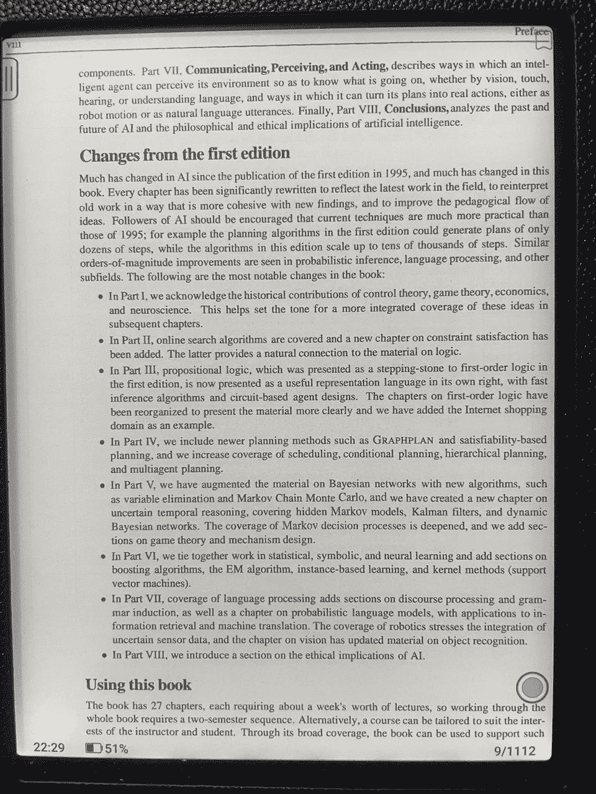

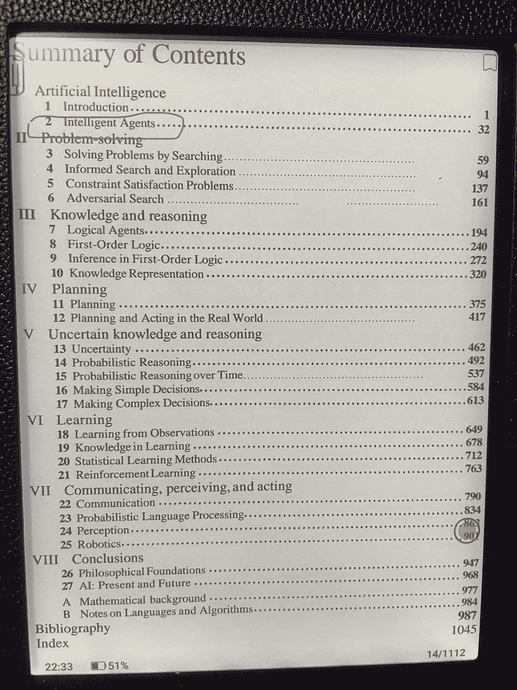

摘录原书核心观点：

任何通过传感器(sensor)感知环境(environment)并通过执行器(actuator)作用于该环境的事物都可以被视为智能体(agent)。

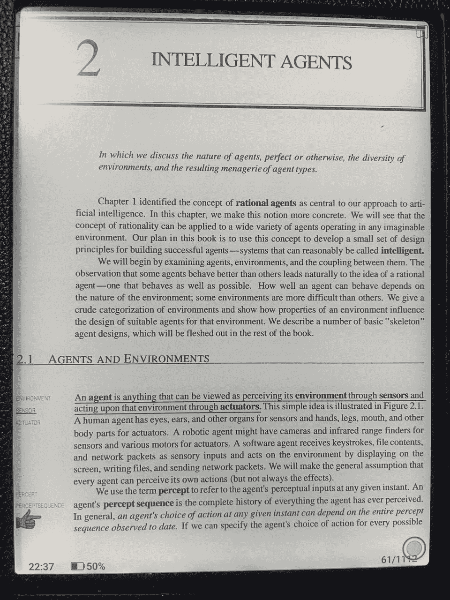

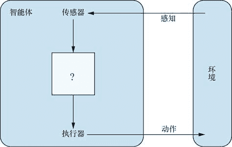

一个智能体在任何给定时刻的动作选择可能取决于其内置知识和迄今为止观察到的整个感知序列，而不是它未感知到的任何事物。所以作者提首先出了理性智能体的定义：对于每个可能的感知序列，给定感知序列提供的证据和智能体所拥有的任何先验知识，理性智能体应该选择一个期望最大化其性能度量的动作。理性使期望性能最大化，但它不是完美、也不是公平问题。因为如果我们期望一个智能体做事后证明是最好的行动，就不可能设计一个符合规范的智能体。

一个理性的智能体应该是自主的，它应该学习如何弥补部分或不正确的先验知识。讨论智能体的理性时，我们必须指定性能度量、环境以及智能体的执行器和传感器。我们将所有这些都归在任务环境的范畴下，基于首字母缩写规则，我们称其为PEAS(Performance，Environment，Actuator，Sensor)描述。例如一个自动驾驶出租车，这几部分描述如下：

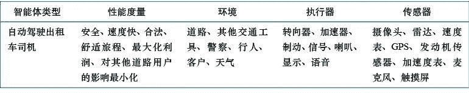

在章节最后作者写道：架构使程序可以使用来自传感器的感知，然后运行程序，并将程序生成的动作选择反馈给执行器，基于此将智能体程序分为以下几类：

● 简单反射型智能体

仅根据当前感知选择动作，忽略历史感知，对感知能力要求极高，需要完全可预测，例如前面的车正在刹车，则启动刹车，这属于习得反应，但如果遇到下雨看不清或者前车刹车灯坏了就无法启动刹车，而另一些则是先天反射，如在有东西接近眼睛时眨眼。

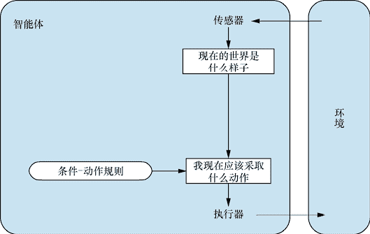

● 基于模型的反射型智能体

组合转移模型（世界如何运转的常识）和传感器模型（世界状态如何反应在感知上）。

● 基于目标的智能体

目标包含了搜索和规划，相比规则稳定性更高。

● 基于效用的智能体

选择最大化其动作结果期望效用的动作，属于多目标优化。

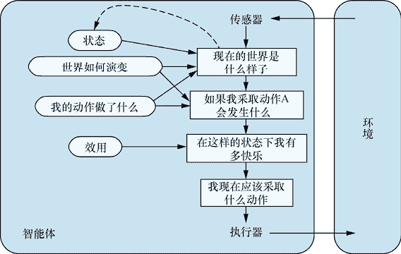

● 通用学习型智能体。

学习型智能体可分为4个概念组件，如图所示。最重要的区别在于负责提升的学习元素(learning element)和负责选择外部行动的性能元素(performance element)。性能元素是我们之前认为的整个智能体：它接受感知并决定动作。学习元素使用来自评估者(critic)对智能体表现的反馈，并以此确定应该如何修改性能元素以在未来做得更好。

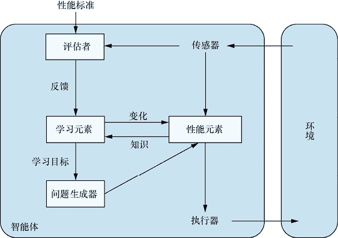

# 二、概述：AI Agents综述论文

论文1:《A Survey on Large Language Model based Autonomous Agents 》

注：来自人大高瓴AI学院

写得比较概要，核心内容两张图已经很清楚，按照Profile-Memory-Planning-Action对当前大部分Agents进行了特性归类和说明。

最后列了各行各业的应用场景和效果评估方法。

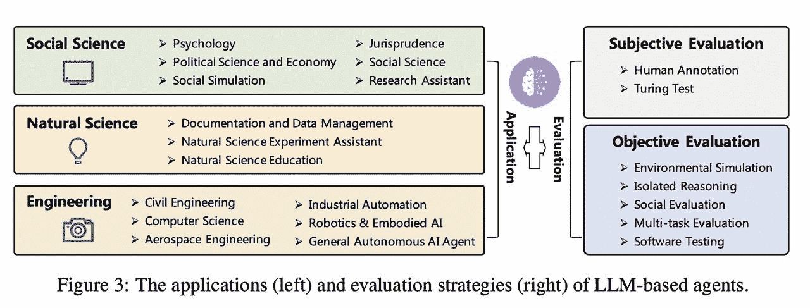

论文2:《The Rise and Potential of Large Language Model Based Agents: A Survey》

注：来自复旦NLP Group

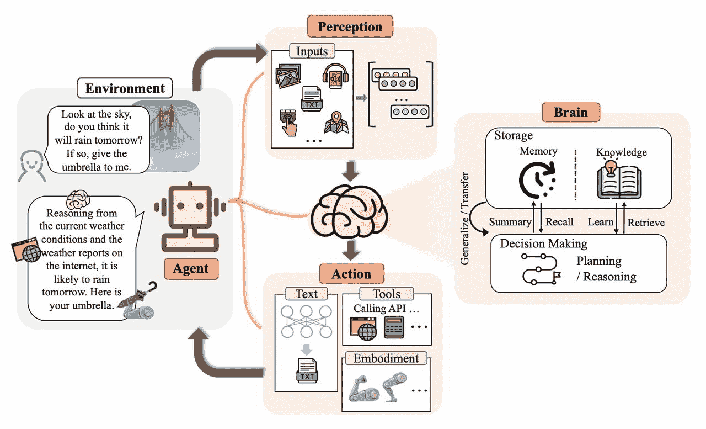

论文开头背景部分回顾历史，概要介绍了不同 AI 技术发展阶段 Agents 的实现方式演进，具体形式可以翻到前文对照《人工智能》教科书提到的架构，很类似，原文写得很直观，我直接摘录了关键点：

1、Symbolic Agents: employ logical rules and symbolic representations to encapsulate knowledge and facilitate reasoning processes, e.g. knowledge-based expert systems

局限：uncertainty and large-scale real-world problems; challenge to find an efficient algorithm capable of producing meaningful results within a finite timeframe

2、Reactive agents: focus on the interaction between the agent and its environment, emphasizing quick and real-time responses

局限：require fewer computational resources, enabling quicker responses, but they might lack complex higher-level decision-making and planning capabilities

**3、Reinforcement l**earning-based agents: learn intricate policies from high-dimensional inputs, e.g. AlphaGo, Deep Q-Network

局限：challenges including long training times, low sample efficiency, and stability concerns

**4、Agents with transfer learni**ng and meta learning: reduce the burden of training on new tasks and facilitates the sharing and migration of knowledge across different tasks (including learning how to learn)

局限：When there exist significant disparities between source and target tasks, the effectiveness of transfer learning might fall short of expectations and there may exist negative transfer; substantial amount of pre-training and large sample sizes required by meta learning make it hard to establish a universal learning policy

5、Large language model-based agents: employ LLMs as the primary component of brain or controller of these agents and expand their perceptual and action space through strategies such as multimodal perception and tool utilization

然后论文介绍了Agents的分类，分别从application和society维度归类整理：

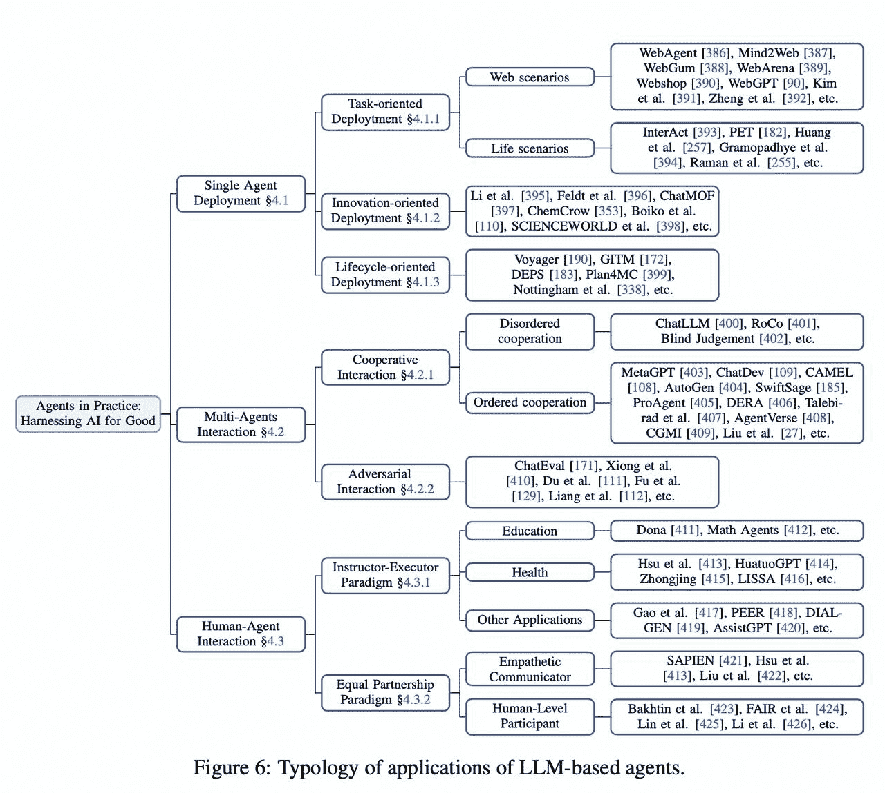

所以LLM与Agent是互相成就，前者能力提升打开了Agent的想象力（例如 对接api抓网页 or 拍照识图），后者应用场景深入提供了LM发展的动力。

**论文提到可以通过四个维度评估Agent能力：效用（如任务成功率）、社交性（语言沟通，合作和谈**判，角色扮演）、价值观（Helpful，Honest，Harmless）以及持续进化（持续学习，自主学习，适应新环境）的能力。

最后是论文展望部分，摘录一下：

鉴于**GPT-4的广泛和深入的能力，支持者认为，由GPT-4代表的大语言模型可以作为AG**I系统的早期版本。按照这种思路，基于LLM构建的代理有潜力带来更先进的AGI系统版本。这个论点的主要支持在于，只要它们可以在足够大和多样化的数据集上进行训练，这些数据集是对现实世界的投影，涵盖了丰富的任务范围，LLM-based代理就可以发展出AGI能力（注：scaling law）。另一个有趣的论点是，自回归语言建模本身会带来压缩和泛化能力：就像人类在生存过程中出现了各种奇特和复杂的现象一样，语言模型在预测下一个标记的过程中也会获得对世界的理解和推理能力。

然**而**，另一组人（被称为反对者）认为，基于LLM构建的代理不能发展出真正[的强人工智能。他们的主要论点集中在这样一个](https://openreview.net/pdf?id=BZ5a1r-kVsf)观念上，即依靠自回归的下一个标记预测，LLM不能生成真正的智能，因为它们不模拟真正的人类思维过程，只是提供反应性的响应。此外，LLM也不通过观察或体验世界来学习世界如何运作，导致许多愚蠢的错误。他们认为，需要采用更先进的建模方法，比如Yann LeCun的世界模型https://openreview.net/pdf?id=BZ5a1r-kVsf 才能发展出AGI。

# **三、社区不同的声音**

在上次推荐的播客节目中JimFan提到一个Agent形态强依赖于大模型的能力，比如访问网页，一种方案是借助crawler tool抓取html解析；另一种方案是截屏用多模态理解，更高效。

最近看到一篇论文《GPT-4V(ision) is a Generalist Web Agent, if Grounded》中提出了SEEACT，一个可以利用GPT-4V强大多模态能力进行集成视觉理解和在网络上行动的通用网络代理（Web Agent），下面录屏是一个demo演示。

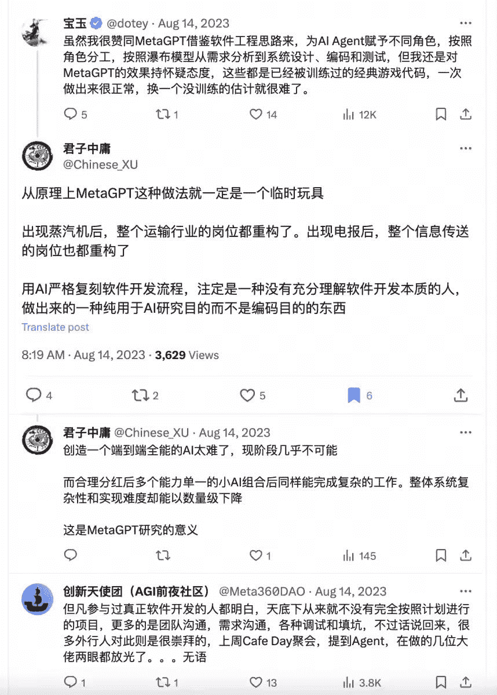

上面是另一些网友对MetaGPT开源框架的评价，在《MetaGPT: Meta Programming for Multi-Agent Collaborative Framework》论文中演示了如何借助MetaGPT实践瀑布式开发模型，通过指定不同角色（开发阶段）来生成阶段性交付物，如PRD、Design、Code等。确实如网友所顾虑的，实际软件开发过程因为有人之间的大量交互，不确定性很强，要不然也不会出现人月神话、敏捷、TDD、CI/CD、DevOps等软件研发运维流程优化方法。MetaGPT只是模拟了最简单最传统最理想的SOP，其适应性严重依赖这个SOP的设计。不过从辅助而非替代的角度来看，MetaGPT裁剪使用还是能够提高交付效率，比如让它理解需求生成story list，或者写code，交付物作为prototpye再交给human去优化维护还是可行的，论文中也有提到这一点。

下图演示了devv.ai作者的另一个观点，他提到了当前基础技术的不成熟和商业化路径不清晰，未来不排除也介入自动化软件开发领域。

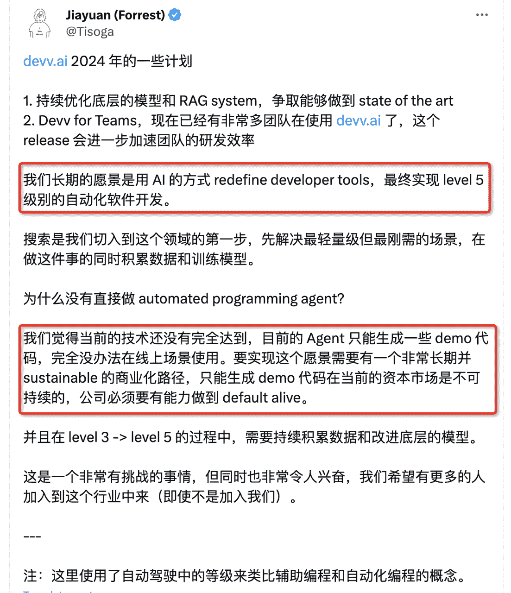

网上被引用比较多的是OpenAI员工@lilianweng 写的LLM驱动的自主代理，探讨了Agents 核心组件和实现细节，值得一读。

[h](https://lilianweng.github.io/posts/2023-06-23-agent/)ttps://lilianweng.github.io/posts/2023-06-23-agent/

另一位对Agents，Web3和未来组织有深入研究的@William同学，在他的文章中从超级个体出发，探讨了未来组织的形态：AI提供生产力，Web3重塑生产关系，Metaverse营造工作空间，这让个人超级IP、小创业、一人企业等新的组织形态建立成为可能，前段时间热议的小作文事件正是这种超级个体对传统组织冲击的案例之一，这样看此文更值得一读，原文链接：

[https://mp.weixin.qq.com/s/Al](https://mp.weixin.qq.com/s/AluYfD6BQOkLo6XpJMyQnQ)uYfD6BQOkLo6XpJMyQnQ

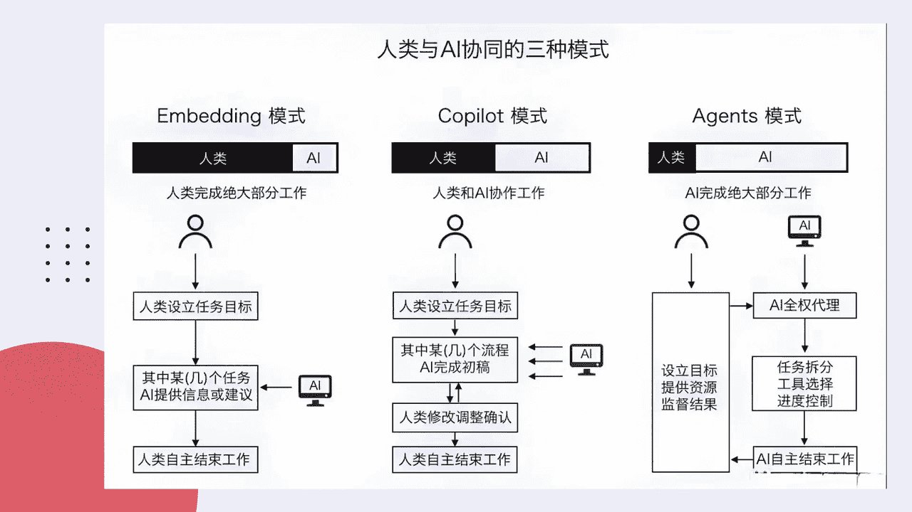

[最近还有一个做家务的机器人出圈文章（https://mp.](https://mp.weixin.qq.com/s/i9VQJXxQI9uXpsrtyAlTOQ)weixin.qq.com/s/i9VQJXxQI9uXpsrtyAlTOQ ），@William 同样有一些思考，转载如下：

我没看过论文，只是echo下工程部分的观点，非常认同威廉的观点，贴近业务的工程创新可以弥补LLMs的不足，例如RAG就是一例。