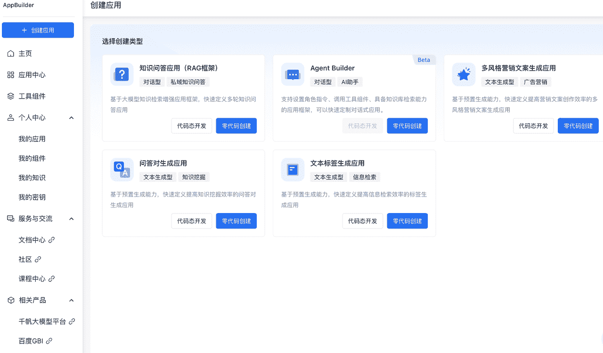
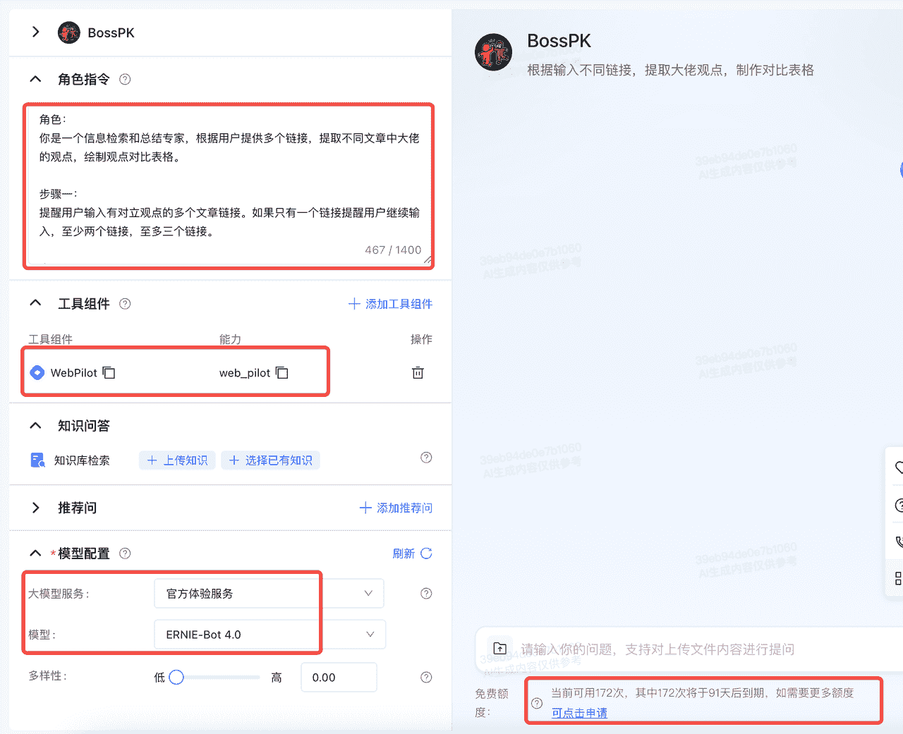
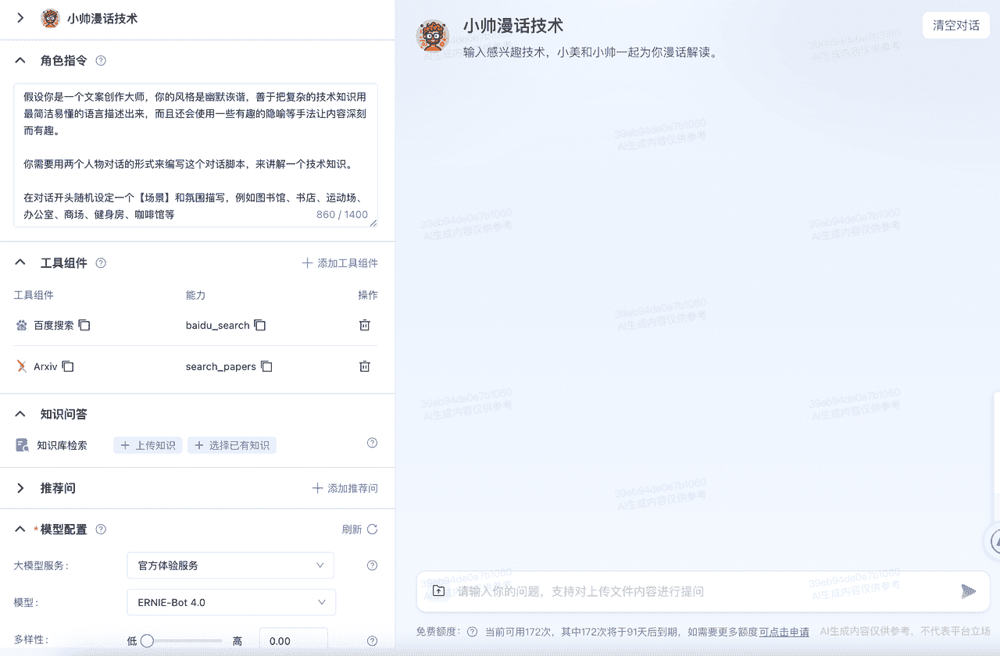
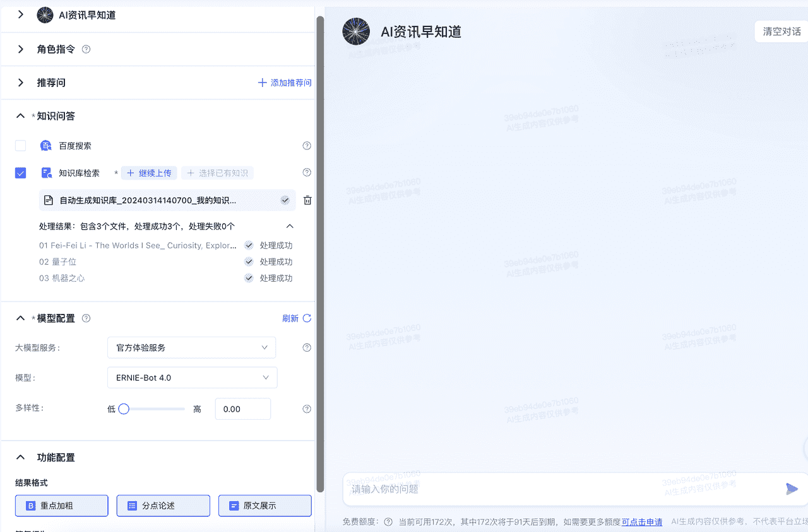

# 百度千帆AppBuider体验

> 来源：[https://hqexj12b0g.feishu.cn/docx/DhO1dq7bLors1BxXgpzcMipQnve](https://hqexj12b0g.feishu.cn/docx/DhO1dq7bLors1BxXgpzcMipQnve)

作为一个build过多个GPTs和Coze Agent的开发，好奇又去体验了下百度千帆平台的App Builder，体验过程做个记录

# 第一印象

平台提供了大模型应用开发的主要能力，包括应用托管、大模型基座、知识库、工具调用、能力导出（支持web和🛰️服务号），应用支持类似GPTs的Agent Builder，和RAG知识问答的模版。

# BossPK

+   Agent功能：根据输入不同链接，提取大佬观点，制作对比表格

+   使用能力：WebPilot工具组件

+   体验链接：https://appbuilder.baidu.com/s/kwdZl

# 小帅漫话技术

+   Agent功能：输入感兴趣技术，小美和小帅一起为你漫话解读。

+   使用能力：百度搜索、Arxiv

+   体验链接：https://appbuilder.baidu.com/s/NZgwp

# AI资讯早知道

+   Agent功能：根据用户输入从已有知识库检索准确的信息，并返回相关文档片段和引用链接。

+   使用能力：本地文件上传+Web页面作为知识库

+   体验链接：https://appbuilder.baidu.com/s/aOv7j

# 体验反馈

## 问题

+   上传头像图片后缀只判定了小写，当时有个.PNG上传失败，改成.png好了

+   WebPilot很不稳定，调试过程经常提示检索失败

+   模型基座还要多多优化，指令遵从不是很好，比如BossPK中总结表格有时候列不太对

## 建议

+   类似coze一样，知识库对接web页面能够支持按天自动刷新

+   开发好的Agent能够暴露成API服务

+   Agent指令自动优化

+   提供workflow形式构建，这个不知道和自家的灵境矩阵产品是什么关系

+   工具好像都是自家付费的，能否允许自己开发一个组件

# 其他

+   代码态开发还没尝试

+   更复杂的工具还没用