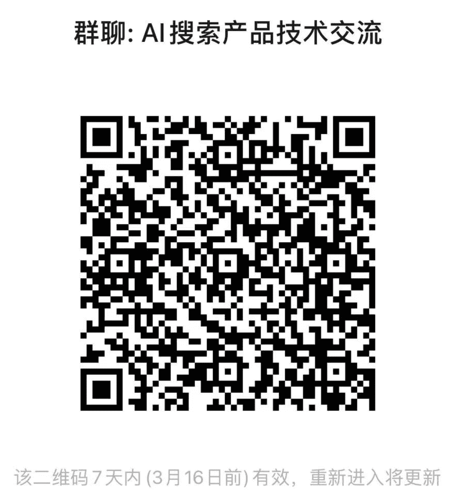
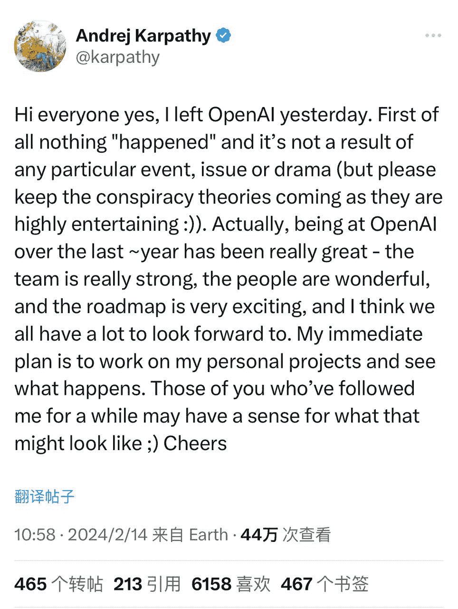
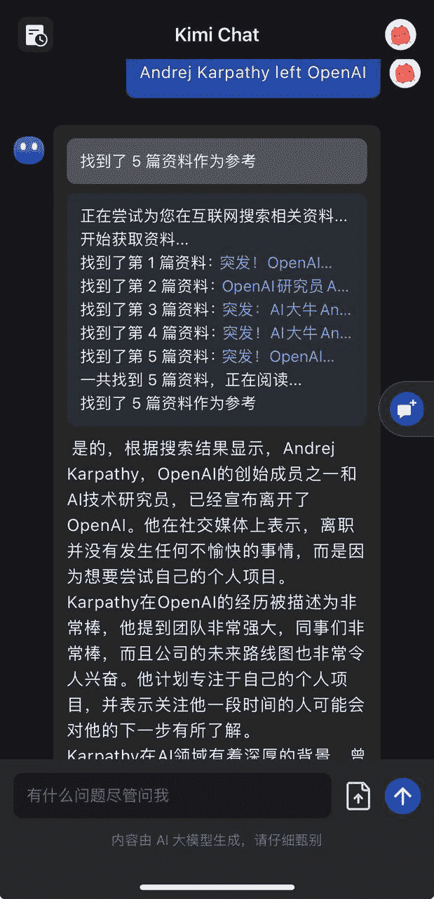
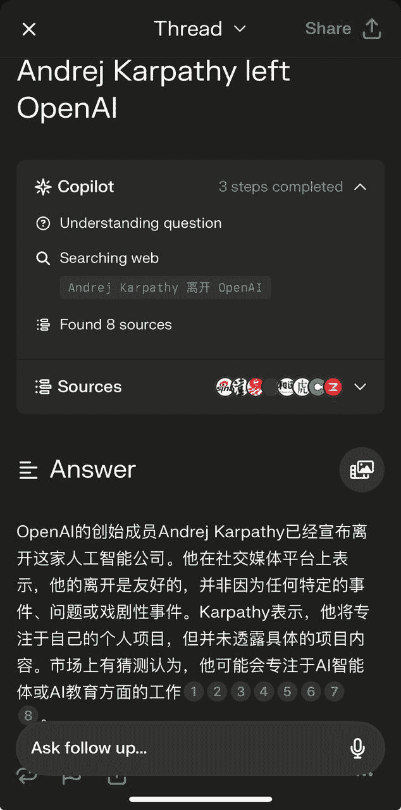

# AI搜索产品&技术研究

> 来源：[https://hqexj12b0g.feishu.cn/docx/XJDddRbzco5FgLxyKKgcnZsQnug](https://hqexj12b0g.feishu.cn/docx/XJDddRbzco5FgLxyKKgcnZsQnug)

# 快速开始

> 知识库总目录

> [最新资讯](https://hqexj12b0g.feishu.cn/wiki/SbDNw6DI9iBcs7klaFvck0mDnHb)

> [群聊精华](https://hqexj12b0g.feishu.cn/wiki/Gju8w4TCsiovIikt86zcGeUanuo)

> [线上活动](https://hqexj12b0g.feishu.cn/wiki/C8mfw5HTmi7o61kopSwctINEn7v)

> [产品测评](https://hqexj12b0g.feishu.cn/wiki/UKGFw1FlciOpWwkYyR0cgusWnif)

> [实践案例](https://hqexj12b0g.feishu.cn/wiki/VUUSwxGMeid7M9kaqWfcnUMOnNb)

> [技术研究](https://hqexj12b0g.feishu.cn/wiki/JyQ0wVaXJii37Rkt3rBcCBfonEc)

> [跑题专区](https://hqexj12b0g.feishu.cn/wiki/RfJNwnvCuiLlSJkYnTicPbHCnrg)

> [更新记录](https://hqexj12b0g.feishu.cn/wiki/XrBQwfUGyiML1GkvcZcc3N00nFc)

> [致谢](https://hqexj12b0g.feishu.cn/wiki/YAe0wxH3tiDqQJk0K48cDOLhnne)

# 愿景

做国内AI搜索领域最具产品洞察力、最了解AI搜索技术的共学共享社区！

# 价值观

共学 共享 面向未来

# 如何贡献

> [嘉宾名单](https://hqexj12b0g.feishu.cn/wiki/RXErwOyJziXMF9kSNP6ccXmKndh)内大佬云集，有很多AI搜索及相关创业者和投资人，详细：

> 为了保持交流质量本群保持小而美，采取邀请制，微信联系： HuggingAIs

# 综述

从用户需求满足角度而言，传统搜索引擎其实是个半成品，基于LLM（Large Language Model）的AI搜索工具提供了一种面向用户最终需求的产品形态。例如你在百度搜“iPhone”，可能背后更深层的需求是“最新款全网最便宜的正品iPhone”，但结果其实是各大电商外投的关于手机的广告链接，你点击搜索结果到了承接页需要逐个查看确认商家资质，用户评价再比价，而面对AI搜索产品，你可以把你的心里话直接作为输入，越详细效果越好。

所以，生成式AI时代传统搜索引擎的定位更多是下沉为一个底层服务。AI搜索和传统搜索不是替代关系，而是分层关系。AI搜索允许用户口喷需求（可以是非常复杂的研究命题），结合RAG（检索增强生成）和AI Agent技术，把整个复杂逻辑封装起来，让结果自动来找人，如果对接了外部API，可以完成非常复杂的业务需求，比如把最新AI资讯整理成一篇飞书文档，把几个产品介绍页直接上架为一个亚马逊可售卖的商品（不是YY，最近看到它们真出了这样的AI 工具）。

但也要看到，目前AI搜索工具并没有好的盈利模式，这也是制约其做大做强的重要原因。不过未来一旦有突破，对靠广告为主要盈利模式的传统搜索引擎而言堪称釜底抽薪。有志于此的同学可以提早关注，深入研究。

[Perplexity CEO采访长文值得一读：https:](https://mp.weixin.qq.com/s/LTvxg2AShH3Pa7MmchMheA)//mp.weixin.qq.com/s/LTvxg2AShH3Pa7MmchMheA

# 缘起

2024.2.24我被一则新闻惊醒：Andrej Karpathy离开了OpenAI公司，当时铺天盖地的解读充斥自媒体，我试图借助自己收集的各种AI检索工具追踪这则新闻。

当时主要使用了三款llm-based的检索工具，并写下了这段简短的总结：

①kimi chat：简洁，中文，5个信息源，速度极快

**②arc search：全面，英文信息源，结果**包含图片视频，按事件来龙去脉整理的非常好

③perplexity：简洁，中文，8个信息源，速度较慢，带引用链接

每个检索工具的表现，截图如下：

Kimi Chat:

Arc Search:

Perplexity:

我突然意识到AI检索是一个很有潜力的领域。虽然颠覆、替换往往是产品PR的噱头，但基于AI技术的检索工具正在渐进式提升过往搜索和知识总结的效率。所以我开始持续关注这个领域的研究进展和产品形态，略有心得，希望把这些记录下来，与感兴趣的朋友一起学习，交流，完善。