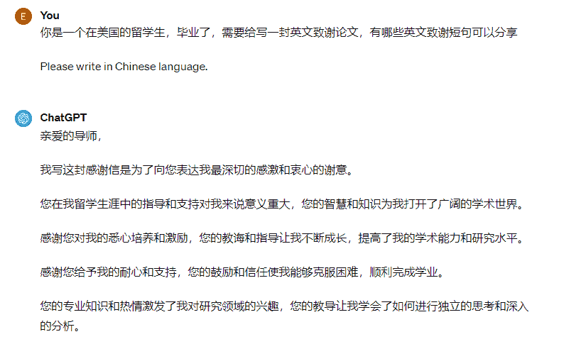
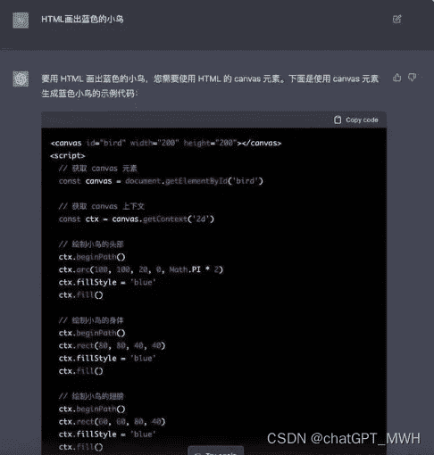
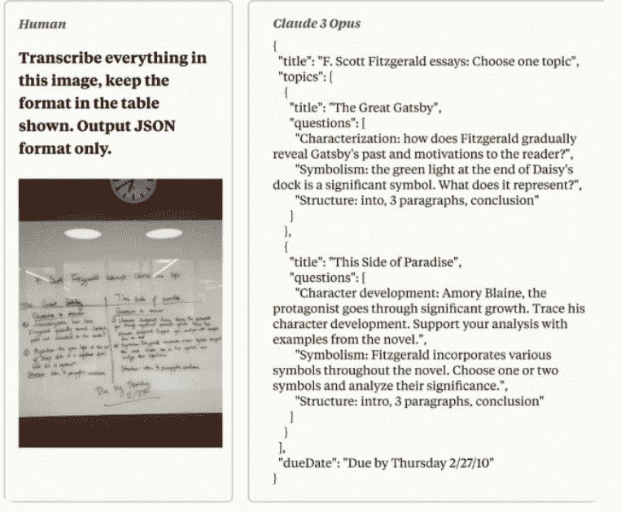
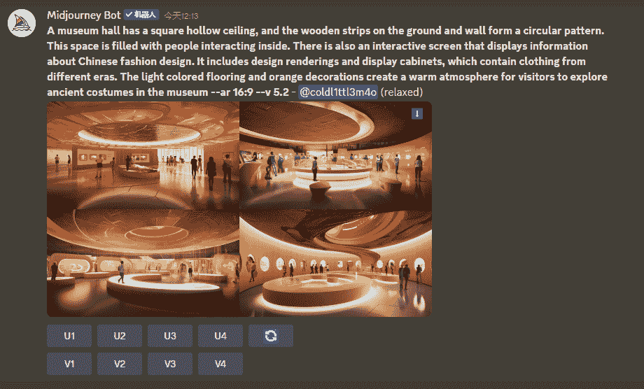
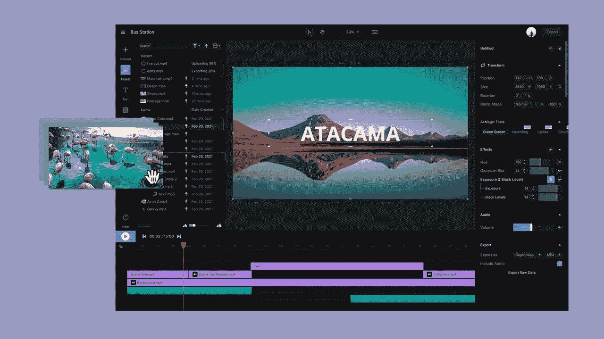

# AI基础能力和工作场景

> 来源：[https://ga67w23t0nn.feishu.cn/docx/VpqYdhIFuopp3ixHcE8c2VPEn1W](https://ga67w23t0nn.feishu.cn/docx/VpqYdhIFuopp3ixHcE8c2VPEn1W)

> 天天听一堆营销号吹牛逼，看看它到底能干什么事儿，先了解下基础能力，后续还有多个能力组合及特殊技巧，每个部分我都会展示大概是如何问的，可以参考着多思考先用起来

# 基础能力1-文**字互动（文生文）**

基于本身的大数据模型，吸收了各行各业一堆文学家、程序员、科学家几百年的经验，通过这些数据自己生成创造。

# 基础能力2-代码编辑器（多模态·计算）

AI编写代码的实现原理基于机器学习技术。通过训练模型，机器学会了从大量的编程示例中提取模式和规律。结合输入的要求，自动生成符合需求的代码。

#### 机器学习

机器学习的核心思想是让计算机系统从数据中学习模式和规律，而不是通过手动编码。这就好比让机器从例子中学习，然后自己去预测未来可能发生的情况。例如，让计算机从历史天气数据中学习，然后能够预测未来某一天的天气。

#### 深度学习

深度学习是机器学习的一种特殊形式，它模拟了人脑中神经元的工作方式。通过构建人工神经网络，深度学习可以处理更加复杂的数据和任务，例如图像识别和自然语言处理。这种方法已经在许多领域取得了巨大成功。

# 基础能力3-图像识别（多模态·识别）

AI的图像识别能力让计算机能够理解和解释图像，就像人类一样。这个过程包括从原始像素数据中提取特征，然后使用这些特征来识别图像中的对象、场景或模式。

#### 卷积神经网络（CNN）

卷积神经网络是一种深度学习架构，它在图像识别领域表现出色。这种网络模仿了人类视觉系统的工作方式，通过一系列的卷积和池化操作来提取图像中的特征。例如，通过识别边缘、纹理和颜色等特征，CNN可以准确地识别图像中的物体或场景。

#### 迁移学习

迁移学习是一种利用已有知识来解决新问题的方法。在图像识别领域，迁移学习允许我们使用已经在大规模数据集上预训练好的模型，并通过微调来适应特定的任务和数据集。这种方法大大加速了模型训练的过程，并且通常能够产生更好的结果。

通过这些技术，AI系统能够像人类一样理解和解释图像，这为许多应用如智能安防、医疗影像分析和自动驾驶等提供了强大的支持。

# 基础能力4-文生图（多模态·绘画）

为了更好地理解AI绘画技术，可以将其比喻为一位学习艺术的学生。这位学生通过观察大量的艺术作品，学会了不同艺术家的绘画风格和技巧。当你给他一张图片，并告诉他你想要的艺术风格时，他会运用他所学的知识，将原始图片转换成符合你要求的新风格的作品。这种模仿和创造的过程，就是AI绘画技术的基本原理。

工作原理和流程可以简单描述如下：

1.  **数据准备**：AI绘画系统需要大量的图像数据进行训练。这些图像可以是各种各样的艺术作品或照片。

1.  **特征提取：**系统通过学习大量图像数据，提取图像的特征，比如线条、颜色、纹理等。

1.  **模型训练：**通过训练，系统学会了识别不同的艺术风格和特点。训练过程中，系统调整自身参数，以最大程度地匹配输入的图像数据。

1.  **风格转换：**当用户输入一张图像和想要的艺术风格时，系统会将图像的特征与已学习的风格特征相结合，从而生成一幅新的图像，使其具有所需的风格。

1.  **输出结果：**最终，系统会输出一幅新的图像，它融合了原始图像和用户指定的艺术风格，使得用户可以欣赏到以新风格呈现的图像。

# 基础能力5-语音互动(多模态·听/说）

当我们谈论人工智能（AI）的语音能力时，我们涉及的是AI系统在听和说方面的能力。这项技术背后的工作原理是基于深度学习和自然语言处理技术。下面是它的工作原理和流程：

1.  语音识别（听）：

+   录音输入： 首先，系统接收到来自麦克风或其他录音设备的声音输入。

+   信号处理： 接下来，输入的声音信号被处理和分析，包括去除噪音和进行频谱分析。

+   特征提取： 在信号处理之后，系统提取声音中的关键特征，如声音频率、强度和持续时间。

+   模型匹配： 然后，这些特征与事先训练好的语音识别模型进行匹配，以确定最有可能的语音识别结果。

+   输出结果： 最终，系统输出识别的文本或指令。

1.  语音合成（说）：

+   文本输入： 首先，系统接收到以文本形式输入的信息或指令。

+   语言处理： 系统对文本进行处理和分析，包括语法解析和语义理解。

+   声音生成： 接下来，系统根据文本信息生成相应的声音波形。

+   声音调整： 声音波形可以根据需要进行调整，以提高自然度和流畅度。

+   声音输出： 最终，系统通过扬声器或其他音频输出设备输出生成的声音。

通过这些流程，AI系统能够实现语音的听和说能力，使其能够与用户进行自然的交流和沟通。

# 基础能力6-文生视频(多模态·静态变动态）

AI文生成视频是一种基于人工智能技术的新兴形式，它能够将文本内容自动转化为视频。其工作原理主要包括以下几个步骤：

1.  文本理解： 首先，AI系统会对输入的文本进行深度理解和分析，包括语义、情感等方面的识别。

1.  场景生成： 接着，系统根据文本内容自动生成相应的场景框架，确定视频中的角色、背景等元素。

1.  图像合成： 在确定好的场景框架下，系统利用计算机视觉技术生成相应的图像素材，并进行合成。

1.  语音合成： 同时，系统也会根据文本内容自动生成语音，或是利用语音合成技术，将文字内容转化为自然流畅的语音。

1.  视频输出： 最后，系统将生成的图像和语音合成为最终的视频输出，呈现给用户观看。

# 涉及工作场景

<https://ga67w23t0nn.feishu.cn/sync/NJMgdsnDas6UvFbOFNocTpJUnDe>