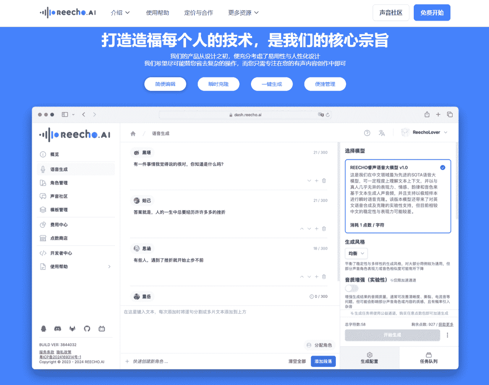
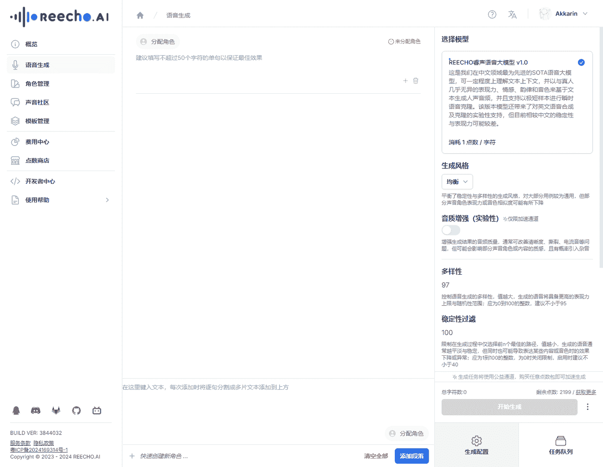

# Reecho睿声 声音克隆

> 来源：[https://ga67w23t0nn.feishu.cn/docx/X9d0d0AEeotQHoxxptrcuXrun1d](https://ga67w23t0nn.feishu.cn/docx/X9d0d0AEeotQHoxxptrcuXrun1d)

虽然网络上有着大量的语音克隆教程，但多用的是本地运行的软件，对于电脑配置低或[电脑操作不大熟练](https://www.reecho.ai/)的朋友挺麻烦的。但总有一些成熟的商业应用能将这些门槛降的更低，而Reecho睿声就是一个成熟且有社区支持的应用。

咱先打开这个网站

https://www.reecho.ai/

这网站排版非常的简洁，功能也非常突出，不需要我过多介绍也能快速摸索出使用方法。

点开创作中心，就能来到控制台。可以先去声音社区找找有没有自己想要的角色，找不到就找一段5~8秒的代表性录音来克隆。

## Tips:

1.  用于克隆的声音样本，需确保包含可被识别的中文或英文语句。

1.  若从已有的音视频中克隆声音，请单独剪辑出该角色的声音，若有背景音乐最好移除掉，人声提取可以试试这个：https://vocalremover.org/zh/cutter