# Suno使用教程|群内案例

> 来源：[https://ga67w23t0nn.feishu.cn/docx/M831dQsQcoNeolxt7cmcB9XmnWh](https://ga67w23t0nn.feishu.cn/docx/M831dQsQcoNeolxt7cmcB9XmnWh)

今天这篇内容，我们从0到1，带大家跑一下 Suno：

✅ 如何注册？

✅ 如何创建自己的第一首音乐？

✅ 用 ChatGPT 一键生成 Suno 歌词

# 新手教程

> 链接入口：https://www.suno.ai/

> 免费用户初始获得150积分试用额度，每天再获得50积分，可用于生成 5次，共获得10首歌。

### 注册登录（非新手可跳过）

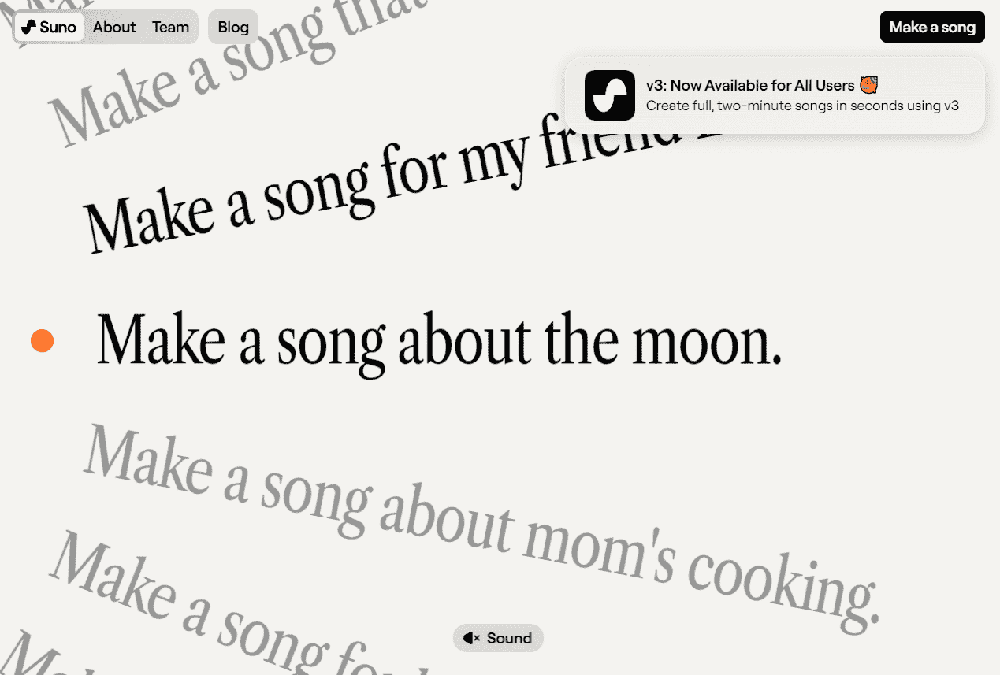

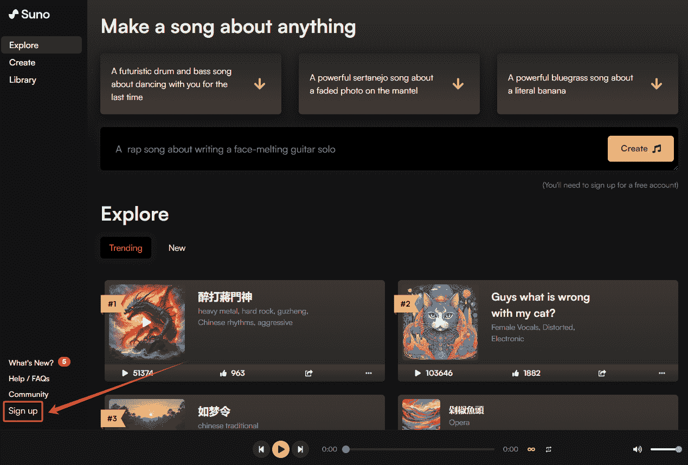

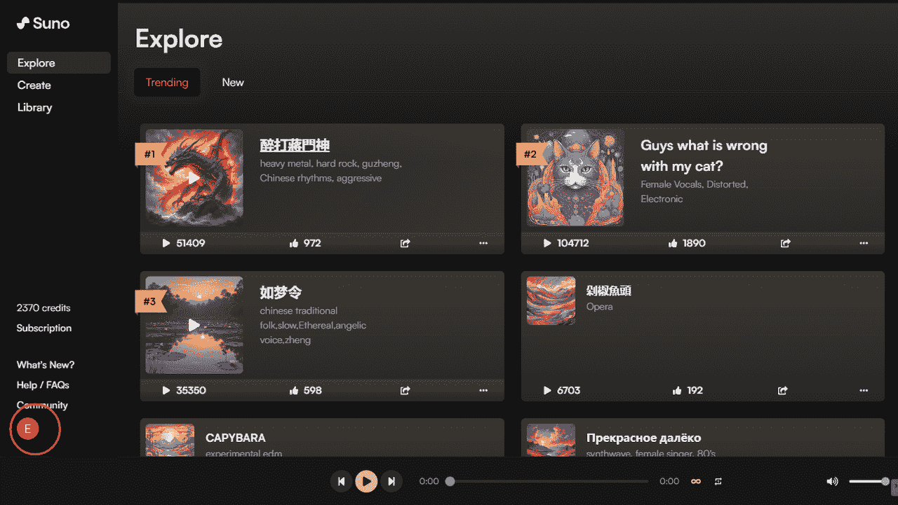

### 菜单介绍（非新手可跳过）

#### **Explore**

Explore是社区首页，里面有创作者创作的音乐

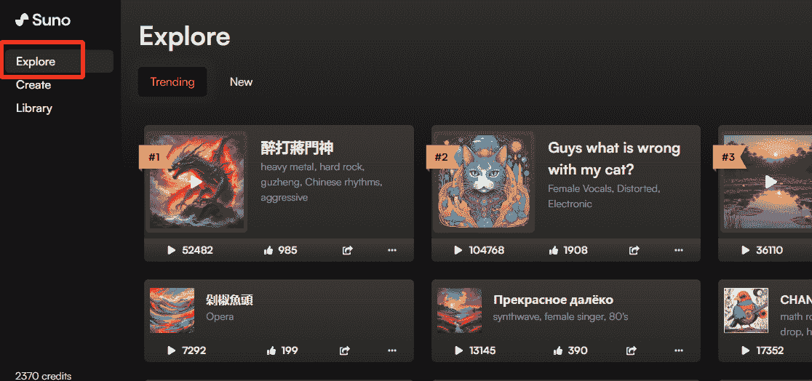

#### **Create**

**Create **新建音乐任务

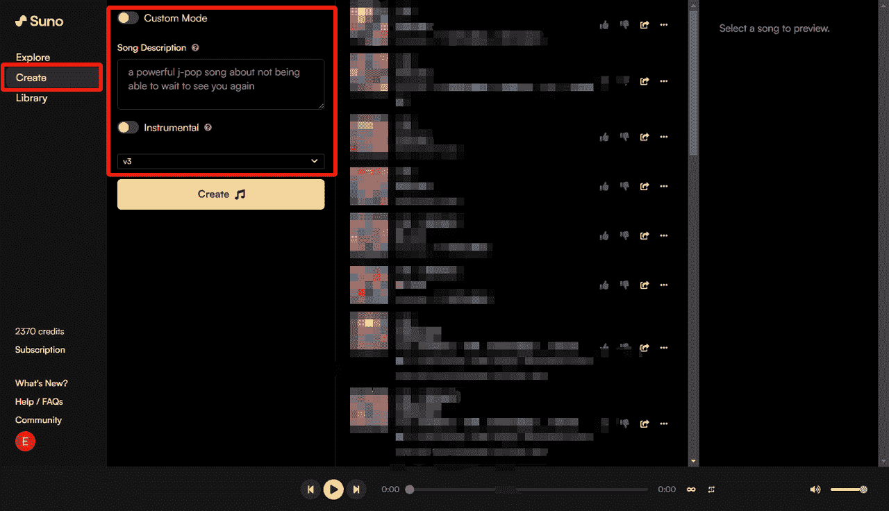

#### **library**

**library是自己的音乐库 **

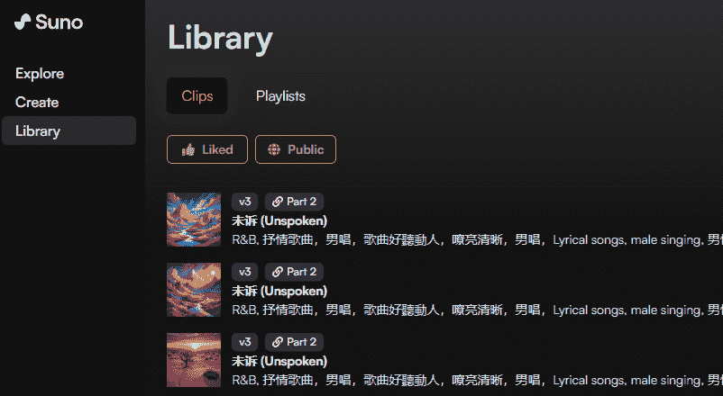

### 如何创建自己的第一首音乐？

#### 模式选择

> **默认模式:  ****文生音频**，通过prompt生成音频。

> Cu**stom Mode (自**定义模式): 通过自定义歌词+prompt去生成音频

> Instrumenta**l (纯音乐**模式): 通过prompt去生成纯音乐的音频

> 每次点生成同时出现2首歌，消耗10积分（每首5积分）

#### **默认模式**

Song Description（歌曲描述），这里主要添加你想要音乐的风格、主题。

比如：摇滚、流行、乡村；

男声、女高音、童声；

中国风、欧美风；

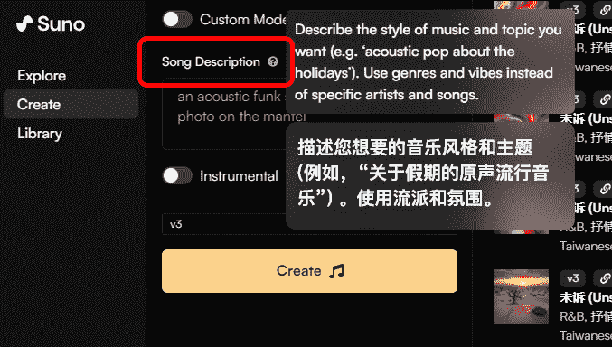

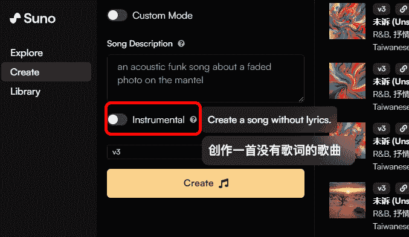

#### **Custom模式**

1.输入自己创建的歌词；

2.为歌曲设置名字（当然，歌名后面也可以修改）

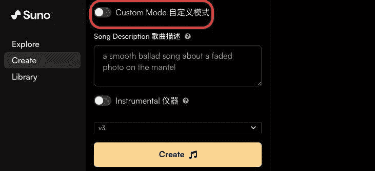

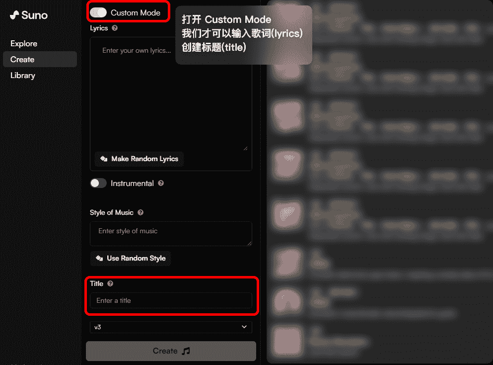

最后一个选项，我们默认选择 V3 即可

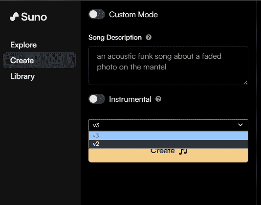

**我们再把上面****几个功能键****汇总到一起，方便大家记忆**：

Lyrics：歌词

Song Description：描述歌曲的主题、风格

Title：歌名

Instrumental：是否创建纯无歌词曲子接下来，就可以开始创建歌曲了。

# 用 ChatGPT 生成 Suno 歌词

**这里需要插入一个用 Sun**o 创作的小技巧：元标签（Metatags）。

我们可以把**元标签（Metatags）**理解为在歌词里写的**提示语（Prompt）**，让AI歌手能基于这些提示语和歌词，结合曲风建议，来更好创作和演绎歌曲。

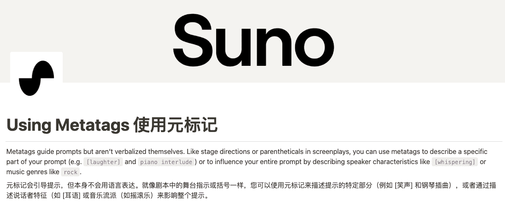

歌曲结构中常见的部分包括：

1.  Verse（诗歌）：歌曲的主体部分，通常包含故事情节和主题。

1.  Chorus（副歌）：歌曲的高潮部分，包含主旋律和主题的重复。

1.  Bridge（桥段）：连接两个不同部分的段落，通常引入新的主题或情感。

1.  Pre-Chorus（前副歌）：在副歌之前出现的部分，为副歌做铺垫。

1.  Outro（尾奏）：歌曲的结束部分，可以逐渐减弱或突然结束。

1.  Intro（引言）：歌曲的开头部分，用于引入主题、旋律或情感氛围。

1.  Interlude（间奏）：在两个主要部分之间的短暂插入部分，通常没有歌词，用于过渡或引入新的元素。

1.  Hook（钩子）：歌曲中最具吸引力的部分，通常是副歌或者重复频率较高的部分。

这里还能让 ChatGPT 这类 AI 工具帮我们进一步总结。

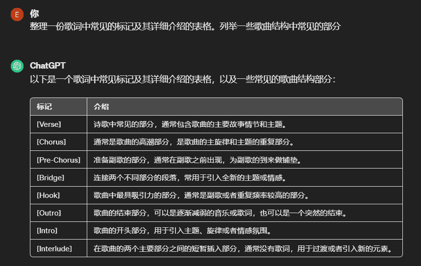

> 结合这些元标签，创建一个标准化 Prompt，让 ChatGPT 能够根据需求，来快速批量化生成符合 Suno 需求的歌词。

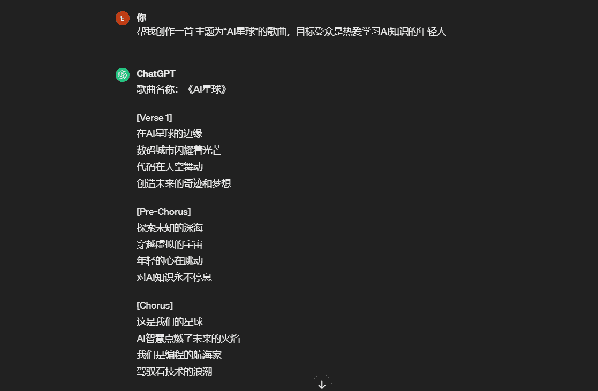

把这个丢进suno里面生成

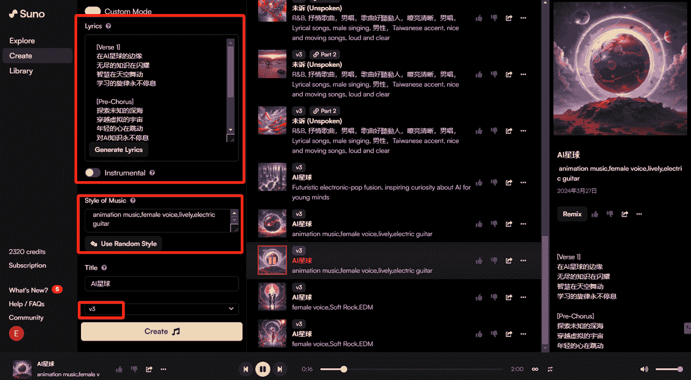

制作完成！试听下demo吧！

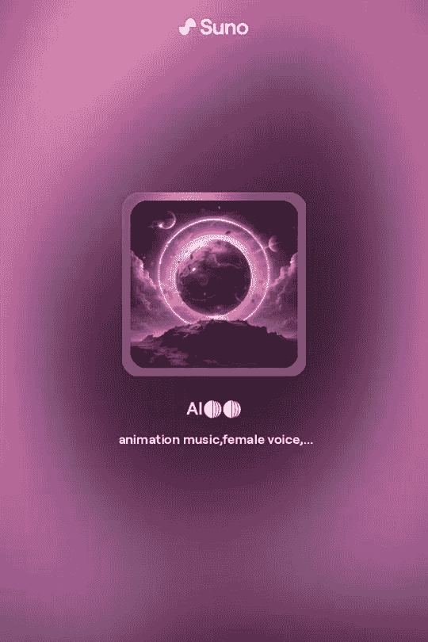

[AI星球.mp4](https://internal-api-drive-stream.feishu.cn/space/api/box/stream/download/all/UhoHb8rqIoxsOjxvskWcwWUdnod)

# 订阅费用

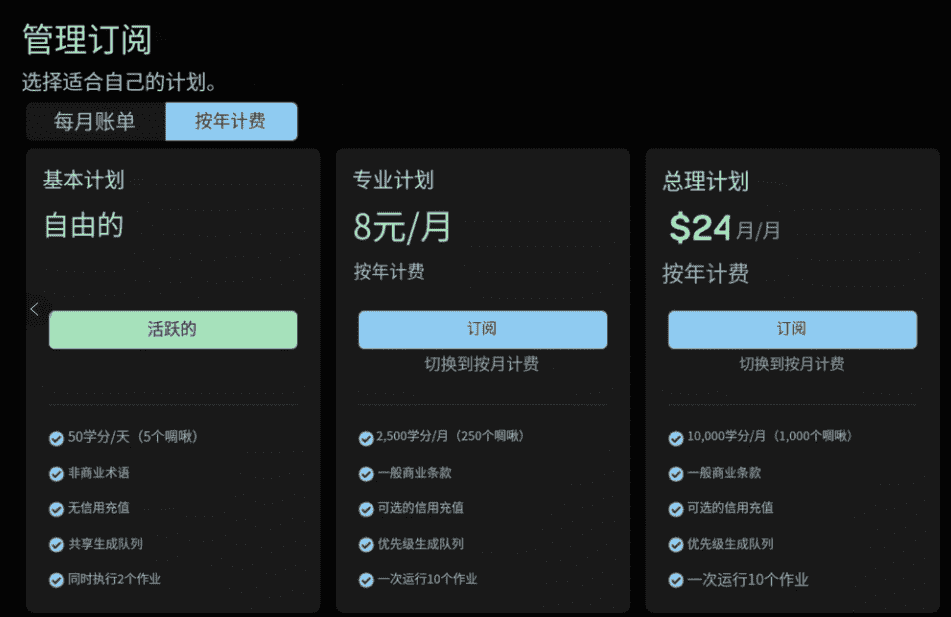

# 媒体报道

卡兹克：Suno正式上线V3版本 [- 这是AI音乐的"ChatGPT"时刻https://m](https://mp.weixin.qq.com/s/ayDIh4Db3ecpDftG7VdQng)p.weixin.qq.com/s/ayDIh4Db3ecpDftG7VdQng

智音Brook ：《滚石》杂志：Suno AI 的独家报道

[https://mp.weixin.qq.com/s/KP](https://mp.weixin.qq.com/s/KPqTwrki7OSVp3auKSle6w)qTwrki7OSVp3auKSle6w

# 群友作品

### **作者：FREESHOW**

**视频号：4DK**

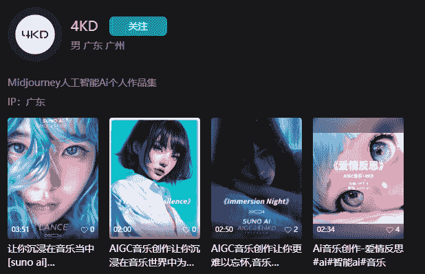

[AIGC音乐-bing-4KD2(1).mp3](https://internal-api-drive-stream.feishu.cn/space/api/box/stream/download/all/OxnXbbA9MoPsxpxRHPTcIONSnid)

[AIGC音乐-bing-4KD.mp3](https://internal-api-drive-stream.feishu.cn/space/api/box/stream/download/all/Q15AbU3jRoAmjixWk1KcI4WUn9f)

[AIGC音乐-打佢老母日本仔-4KD.MP3](https://internal-api-drive-stream.feishu.cn/space/api/box/stream/download/all/Ytk1bRDkpoxyT2xnH8Rc4l7Unag)

---

### **作者：ASKA**

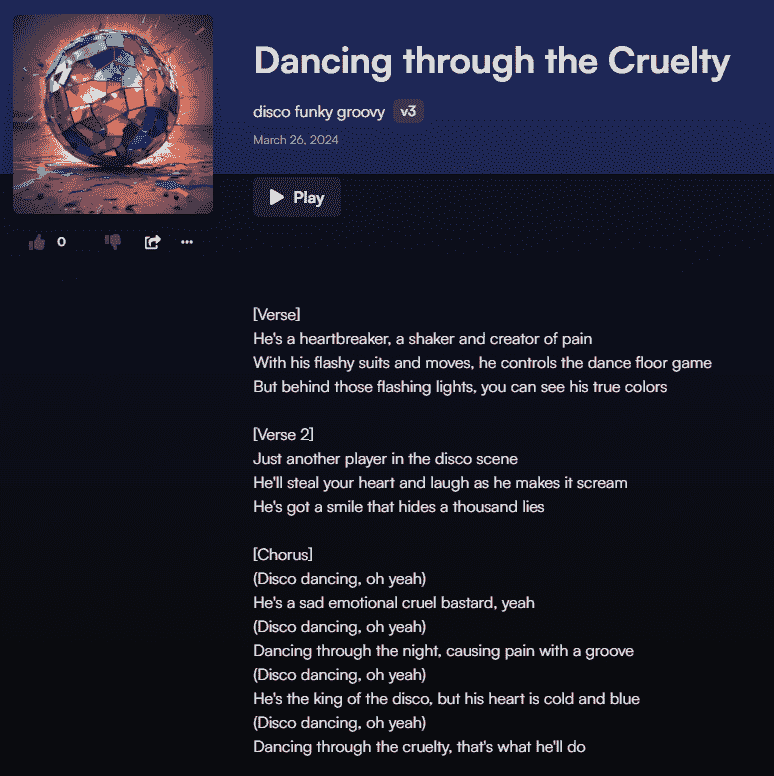

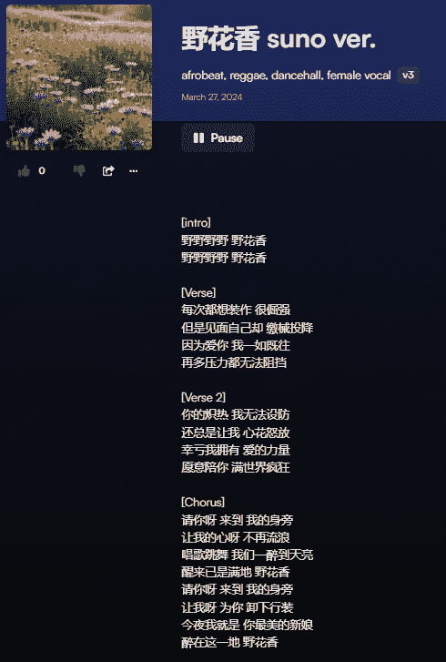

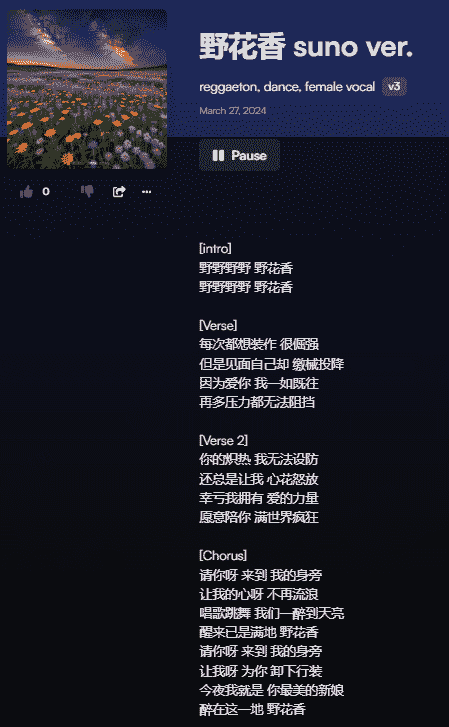

[Dancing through the Cruelty.mp3](https://internal-api-drive-stream.feishu.cn/space/api/box/stream/download/all/IgkJbjlQxoEn3IxUkDJcUl9hnXb)

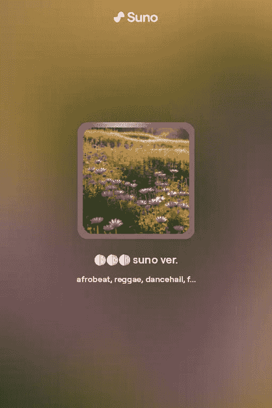

[a06e1167b2af0e527a804ddaa4f682f3.mp4](https://internal-api-drive-stream.feishu.cn/space/api/box/stream/download/all/B4JUbw9Z4opNLbxGu24ci96HnUc)

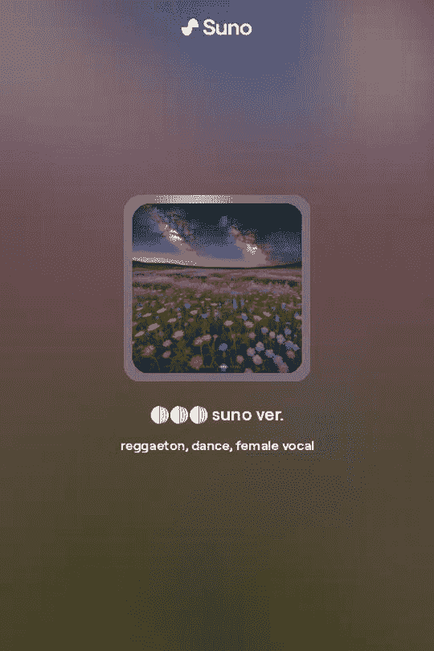

[00718074412515bbf4b6c03272783a90.mp4](https://internal-api-drive-stream.feishu.cn/space/api/box/stream/download/all/TKc5bbwDwoNnq5xbLVTcRkO8nfd)

---

### **作者：ling**

[96812be3e75218937c03020e7d7692f1.mp4](https://internal-api-drive-stream.feishu.cn/space/api/box/stream/download/all/O962bkYypoEIU9xHmeOcVuj9nKh)

[R&B纯净男声.MP3](https://internal-api-drive-stream.feishu.cn/space/api/box/stream/download/all/INJZbV1YUoVhnSxDtz4c3mN3nYB)

[R&B纯净女声.MP3](https://internal-api-drive-stream.feishu.cn/space/api/box/stream/download/all/MZupbO9eVo35nbxlrFkcVFNxnCd)

---

### **作者：6.71**

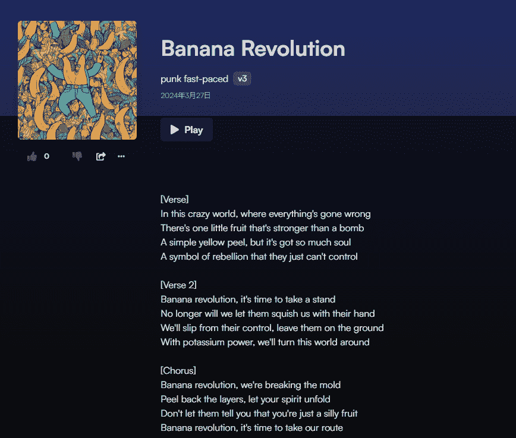

[Banana Revolution.mp3](https://internal-api-drive-stream.feishu.cn/space/api/box/stream/download/all/HkKpbiYaYoW4WIxmGKJc2KKGncg)

[Shred It, Cowboy.mp3](https://internal-api-drive-stream.feishu.cn/space/api/box/stream/download/all/F2B7bUWi8ocruhxR5XEcS2LMnyn)

# 歌曲流派关键词

以下内容来自非官方 wiki ，我将它们翻译并放在这供读者参考。

这里提供了一系列经过测试的音乐流派、子流派、风格用词和歌曲类型。你可以将它们灵活组合，不过，要注意这个列表是永远不会完整的。我们还没能涵盖全球所有的音乐流派和地区特色，更别提那些日常生活中还未被发掘的新鲜风格用词了。

# Genre（流派）

# Styles（风格）

# Song Types（歌曲类型）

## Country（乡村）

+   Blueg+rass（草莓乐）

+   Country（乡村音乐）

+   Folk（民谣）

## Dance（舞曲）

+   Afro-Cuban（阿弗罗-古巴）

+   Dance Pop（流行舞曲）

+   Disco（迪斯科）

+   Dubstep（配音步）

+   Disco Funk（迪斯科放克）

+   EDM（电子舞曲）

+   Electro（电子）

+   High-NRG（高能量）

+   House（浩室音乐）

+   Trance（迷幻舞曲）

## Downtempo（缓拍）

+   Ambient（环境音）

+   Drum'n'bass（鼓与贝斯）

+   Dubstep（配音步）

+   Electronic（电子音乐）

+   IDM（智能舞曲）

+   Synthpop（合成流行）

+   Synthwave（合成波）

+   Techno（技术音乐）

+   Trap（陷阱音乐）

## Jazz/Soul（爵士/灵魂）

+   Bebop（比博普）

+   Gospel（福音）

+   Jazz（爵士）

+   Latin Jazz（拉丁爵士）

+   RnB（节奏蓝调）

+   Soul（灵魂乐）

## Latin（拉丁）

+   Bossa Nova（波萨诺瓦）

+   Latin Jazz（拉丁爵士）

+   Forró（弗约罗）

+   Salsa（萨尔萨舞）

+   Tango（探戈）

## Reggae（雷鬼）

+   Dancehall（舞厅）

+   Dub（配音）

+   Reggae（雷鬼）

+   Reggaeton（雷盖顿）

+   Afrobeat（非洲节奏）

## Metal（金属）

+   Black Metal（黑金属）

+   Deathcore（死亡核）

+   Death Metal（死亡金属）

+   Festive Heavy Metal（节日重金属）

+   Heavy Metal（重金属）

+   Nu Metal（新金属）

+   Power Metal（力量金属）

+   Metalcore（金属核）

## Popular（流行）

+   Pop（流行音乐）

+   Dance Pop（流行舞曲）

+   Pop Rock（流行摇滚）

+   Kpop（韩流音乐）

+   Jpop（日流音乐）

+   RnB（节奏蓝调）

+   Synthpop（合成流行）

## Rock（摇滚）

+   Classic Rock（经典摇滚）

+   Blues Rock（布鲁斯摇滚）

+   Emo（情绪）

+   Glam Rock（华丽摇滚）

+   Indie（独立音乐）

+   Industrial Rock（工业摇滚）

+   Punk（朋克摇滚）

+   Rock（摇滚）

+   Skate Rock（滑板摇滚）

+   Skatecore（滑板核）

## Urban（城市音乐）

+   Funk（放克）

+   HipHop（嘻哈）

+   RnB（节奏蓝调）

+   Phonk（酸音乐）

+   Rap（说唱）

+   Trap（陷阱音乐）

## Danceable（可跳舞的）

+   Disco（迪斯科）

+   Syncopated（切分节奏）

+   Groovy（悠扬）

+   Tipsy（微醺）

## Dark（黑暗）

+   Dark（黑暗）

+   Doom（末日）

+   Dramatic（戏剧性）

+   Sinister（阴险）

## Electric（电子）

+   Art（艺术）

+   Nu（新流行）

+   Progressive（进步）

## Hard（强硬）

+   Aggressive（激进）

+   Banger（热门曲目）

+   Power（力量）

+   Stadium（体育场）

+   Stomp（重踏）

## Lyrical（抒情的）

+   Broadway（百老汇）

+   Cabaret（歌舞表演）

+   Lounge（酒吧歌手）

+   Operatic（歌剧式的）

+   Storytelling（讲故事）

+   Torch-Lounge（酒吧歌曲）

+   Theatrical（戏剧性的）

+   Troubadour（吟游诗人）

+   Vegas（拉斯维加斯风格）

## Magical（神奇）

+   Ethereal（虚幻）

+   Majestic（雄伟）

+   Mysterious（神秘）

## Minimal（简约）

+   Ambient（环境音乐）

+   Cinematic（电影）

+   Slow（缓慢）

+   Sparse（稀疏）

## Party（派对）

+   Glam（华丽）

+   Glitter（闪耀）

+   Groovy（悠扬）

+   Grooveout（活力爆发）

## Soft（柔和）

+   Ambient（环境音乐）

+   Bedroom（卧室）

+   Chillwave（轻松浪潮）

+   Ethereal（虚幻）

+   Intimate（亲密）

## Weird（奇怪）

+   Carnival（嘉年华）

+   Haunted（鬼屋）

+   Random（随机）

+   Musicbox（音乐盒）

+   Hollow（空洞）

## World/Ethnic（世界/民族）

+   Arabian（阿拉伯）

+   Bangra（班格拉舞）

+   Calypso（卡利普索）

+   Egyptian（埃及）

+   Jewish Music（犹太音乐）

+   Klezmer（克莱兹默音乐）

+   Middle East（中东）

+   Polka（波尔卡）

+   Russian Navy Song（俄罗斯海军歌曲）

+   Suomipop（芬兰流行音乐）

+   Tribal（部落）

## BackGround（背景乐）

+   Elevator（电梯音乐）

+   Jingle（广告歌曲）

+   Muzak（环境音乐）

## Call to Prayer（祈祷呼唤）

+   Adhan（安讫）

+   Call to Prayer（祈祷呼唤）

+   Gregorian Chant（格里高利圣歌）

## Character（角色）

+   Strut（趾高气昂地走）

+   March（进行曲）

+   I Want Song（渴望之歌）

## Children（儿童）

+   Children's（儿童的）

+   Lullaby（摇篮曲）

+   Sing-along（合唱歌曲）

## Retro（复古）

+   1960s（1960年代）

+   Barbershop（理发店四重唱）

+   Big Band（大乐队）

+   Classic（经典的）

+   Doo Wop（一种节奏蓝调风格的音乐）

+   Girl Group（女子组合）

+   Swing（摇摆乐）

+   Traditional（传统的）

## Traditional（传统的）

+   Barbershop（理发店四重唱）

+   Christmas Carol（圣诞颂歌）

+   Traditional（传统的）

> 来源：[音乐流派、风格词汇参考](https://i0x94xzpjmh.feishu.cn/docx/S4vwdn9gio8LuCx3ehlcAqfOnSd)

# 赚钱的思路

> 个人思考了一下变现的方法，任何一个领域都有很多细分，让你的爱好变成收入来源：

1.  **音乐创作与销售**：利用 Sonu 创作原创音乐，然后上传到 Spotify、Apple Music 等平台销售。记得注册版权，保护你的作品。

1.  **定制音乐服务**：为需要特别音乐的客户，比如广告公司、视频制作人，提供定制音乐服务。你可以创作符合他们项目主题的音乐。

1.  **音乐教育与工作坊**：开设线上或线下的音乐创作课程，教大家如何使用 Sonu 创作音乐。这样不仅能分享你的知识，还能赚取教学费。

1.  **音乐内容创作者**：在 YouTube 或 TikTok 上发布你的音乐视频，吸引粉丝。随着观看量的增加，你可以通过广告分成或粉丝打赏获得收入。

1.  **音乐版权管理**：创作音乐后，通过版权管理公司注册并管理你的作品。每当有人使用你的音乐时，你都能获得版税。

1.  **音乐比赛与挑战**：参加音乐创作比赛或挑战，用 Sonu 创作符合主题的音乐作品。赢得比赛不仅能获得奖金，还能提升知名度。

1.  **音乐治疗与放松**：开发音乐治疗或放松应用，使用 Sonu 生成有助于减压和放松的音乐。可以通过订阅或一次性购买的方式盈利。

1.  **音乐素材库**：创建一个音乐素材库，出售由 Sonu 生成的音乐片段。音乐制作人和内容创作者可能会购买这些素材用于他们的项目。

1.  **合作与赞助**：与其他艺术家或品牌合作，为他们的项目提供音乐。通过合作，你可以获得赞助或分成协议。

通过这些方法，你可以利用 Sonu 的先进功能，结合自己的创意和市场策略，在音乐产业中开拓新的商机。

随着 AI 技术的不断发展，未来可能会出现更多创新的赚钱方式。保持对行业动态的关注，不断学习和适应，也将有助于你在音乐 AI 领域取得成功。

---

# **免费AI学习交流社群**

### 关于AI星球社群

> **作为多年的互联网从业者，我深知普通**人去学习AI知识的痛点和问题，我希望运用我的一些行业经验，去做一个知识的桥梁，让人人都能看的懂学的起AI，群里会持续关注并更新 AI 的相关资讯动态，研究报告，应用场景，AI变现，技术研究等相关内容，小智的目标是打造免费的一站式开源AI学习社区，帮助大家更好的拥抱AI。

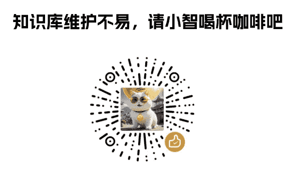