# 写给不会代码的你：20分钟上手 Python + AI

> 来源：[https://ga67w23t0nn.feishu.cn/docx/Gw7pd59jpoEuE5xlnF6cdbflnog](https://ga67w23t0nn.feishu.cn/docx/Gw7pd59jpoEuE5xlnF6cdbflnog)

> 原文链接：https://mp.weixin.qq.com/s/D8YsA5HB2saaLdJA9tIZ4g

> 作者：金色传说大聪明 赛博禅心 2024-03-24 11:02 广东

在深入学习 AI 时，许多朋友发现需要编程，变得头大。

同时，各类教程都默认了你会打命令行，导致入门十分困难。

鉴于此，就有了这份简明入门，旨在让大家更快掌握 Python 和 AI 的相互调用。并使你在接下来的 20 分钟内，循序渐进的完成以下任务：

+   完成一个简单程序

+   完成一个爬虫应用，抓取👸号文章

+   完成一个 AI 应用，为👸号文章生成概述

---

## **一些背景**

知己知彼，百战不殆

### **关于 Python**

Python 就像**哆拉A梦**，它:

+   **拥有一**个百宝袋，装满了各种道具，被称为标准库。当遇到问题时，都可以拿出来直接使用。

+   如果百宝袋里的道具不够用，还可以打电话给未来百货，去订购新道具。在这里：

+   打电话：对应** pip **一类的工具，可以用来订购任何的道具。

+   未来百货：对应** GitHub **一类的分享代码的平台，里面啥都有。

+   被全世界广泛使用，尤其是在 AI 领域，所以遍地是大哥

### **关于 OpenAI API**

OpenAI 通过两种方式提供服务:

+   其一：通过 ChatGPT，提供开箱即用的服务，直接对话即可，简单直观。

+   其二：通过 OpenAI API，提供更加灵活的服务，通过代码调用，来完成更多自动化任务，比如全自动将本地的 1 万本小说，从中文翻译成英文。

**发现了没，这**里的 OpenAI API， 对应着上面未来百货道具。

---

## **组装小哆啦**

千里之行，始于足下

### ** **** 配置环境 ****请不要配置环境**

**在任何教程里**，第一章总是配置环境：等同于组装多啦A梦，包括安装IDE、依赖等等，有些时候甚至得去折腾内核。但对新手来说，这些太过不友好，基本等同劝退。

本着快速上手的目的，**我不建议任何的初学者去尝试**配置环境，毕竟有一些现成的在线平台，比如 Google Colab。这些平台像是野比世修一样，早早就把哆啦A梦组装好了，等你去用。

这里，我们以 Colab 为例，你所要做的事情就是访问 Colab 的网站，并新建一个笔记本，网址是：

https://colab.research.google.com

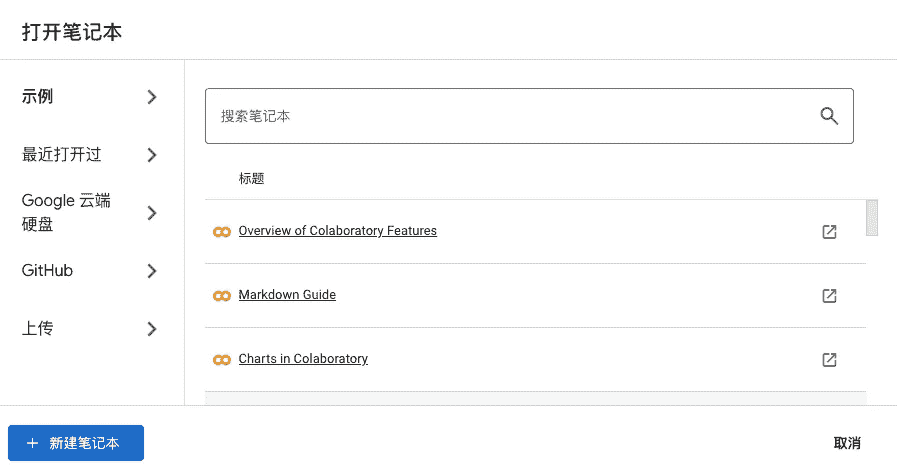

### **完成一个 Python 程序**

接下来，让我们写一个程序试试看：

**任务：输出「大聪明最帅」**

先介绍一个 Python 的重要语法：print()

当需要输出一句话的时，把这句话加上英文引号""，放在 print() 的括号里，如 print("👸号「赛博禅心」最棒了！") 就好了。

在我们的任务中，如果想让 Python** 输出「大聪明最帅」，那么就**告诉编译**器 **print("大聪明最帅")，然后点运行（快捷键：Ctrl/⌘ + Enter）。

你就会得到下图的结果，恭喜成功！

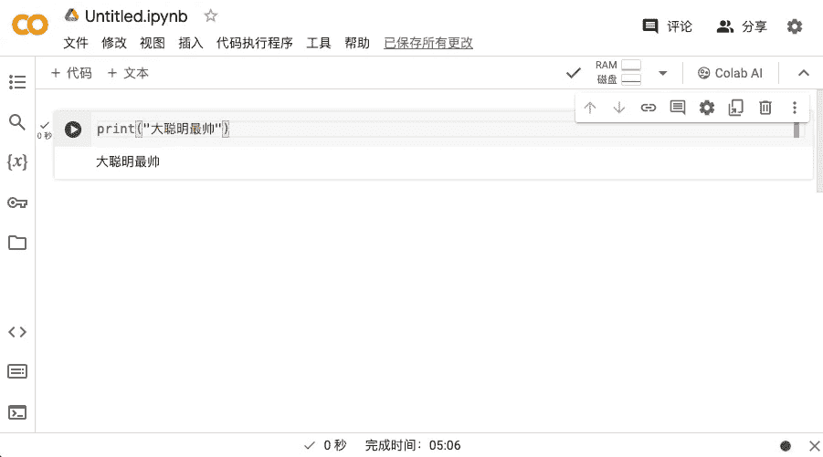

### **Tips**

这里是的在线平台我用的是 Google Colab，提供在线的，类 Jupyter 服务，帮助用户在浏览器中编写和执行Python代码，并且支持代码共享和直接调用一些谷歌的云服务。

访问 Colab 需要一定的网络环境。因此，如果你打不开，也可以尝试一些国产替代，如：

+   阿里云的天池 Notebook：https://tianchi.aliyun.com/notebook-ai

+   腾讯的 Cloud Studio：https://ide.cloud.tencent.com/

+   等等...

可以搜索「在线 IDE」或者「在线 Jupyter」，获取更多类似产品。

---

## **使用百宝箱**

他山之石，可以攻玉

### **完成一个爬虫应用**

很多人对 Python 的最大印象，是写爬虫：帮你自动的从网页上摘取所需的信息。

现在，让我们去写一个爬虫，抓我之前的文章：

🔗 中学生能看懂：Sora 原理解读 🔗

+   已知1：这篇文章的地址是 https://mp.weixin.qq.com/s/KUnXlDlg-Rs_6D5RFpQbnQ

+   已知2：ChatGPT 很会写程序

+   已知3：我们用 Colab

**得出结论：让 ChatGPT 帮我**们写这个程序，然后在 Colab 里运行

### **问问 ChatGPT**

# 大聪明

我使用 colab，请给我写一段代码，用于抓取 https://mp.weixin.qq.com/s/KUnXlDlg-Rs_6D5RFpQbnQ 的正文内容

# ChatGPT

在Colab中抓取网页的正文内容，你可以使用Python的requests库来获取网页的HTML源代码，然后使用BeautifulSoup库来解析HTML并提取所需的正文部分。下面是一个简单的示例代码，演示了如何实现这一过程。请注意，由于🛰️👸号文章可能有一些特殊的反爬措施，这段代码可能需要根据实际情况进行调整。

首先，确保你已经在你的Colab环境中安装了beautifulsoup4和requests库。如果没有安装，你可以使用以下命令安装：

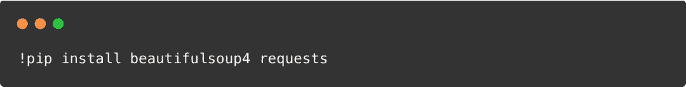

然后，使用以下代码抓取并解析指定的网页内容：

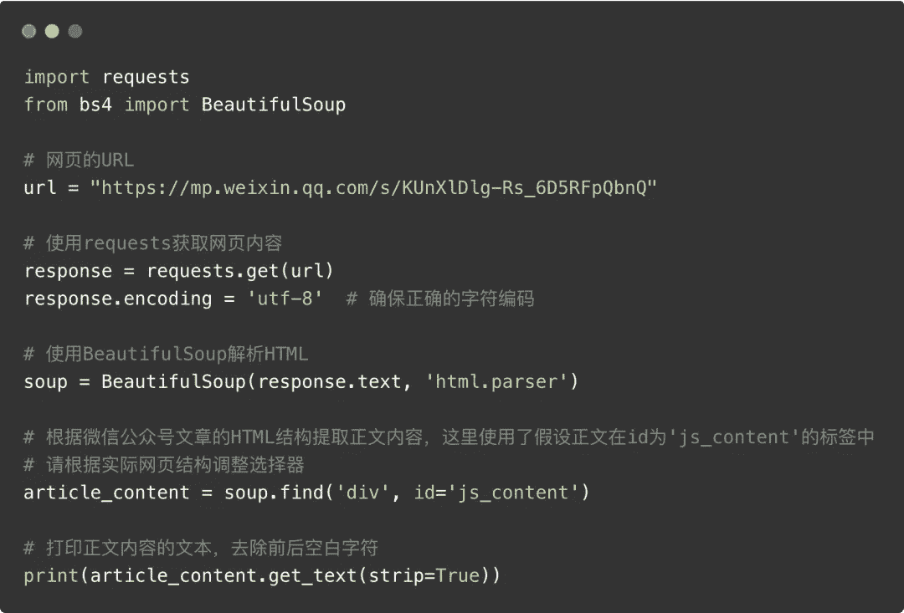

这段代码会打印出你提供的🛰️👸号文章的正文内容。请注意，由于网页的结构随时可能发生变化，所以提取正文内容的部分（即soup.find那一行）可能需要根据实际的HTML结构进行调整。如果文章有反爬虫机制，可能还需要进一步的处理，比如设置请求头模拟浏览器访问等。

### **运行你的代码**

然后，把这两段代码分别复制进去，并运行。

先复制第一段：

!pip install beautifulsoup4 requests

运行后得到下图

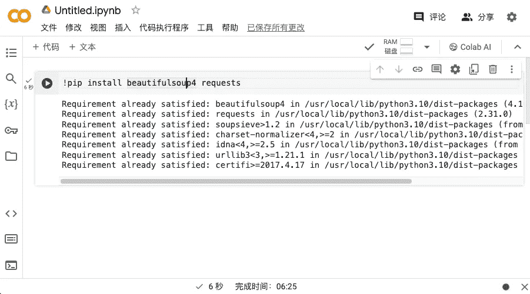

到这里的 pip，就是之前提到的「给未来商店打电话」，用来获取工具

接下来，点击左上方「+代码」按钮，新建一个新的代码块

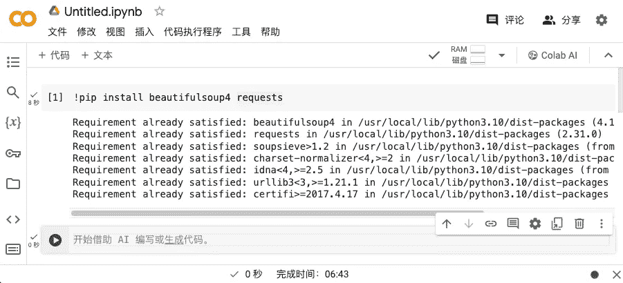

最后，复制后面的代码，并运行，获得下面的结果：

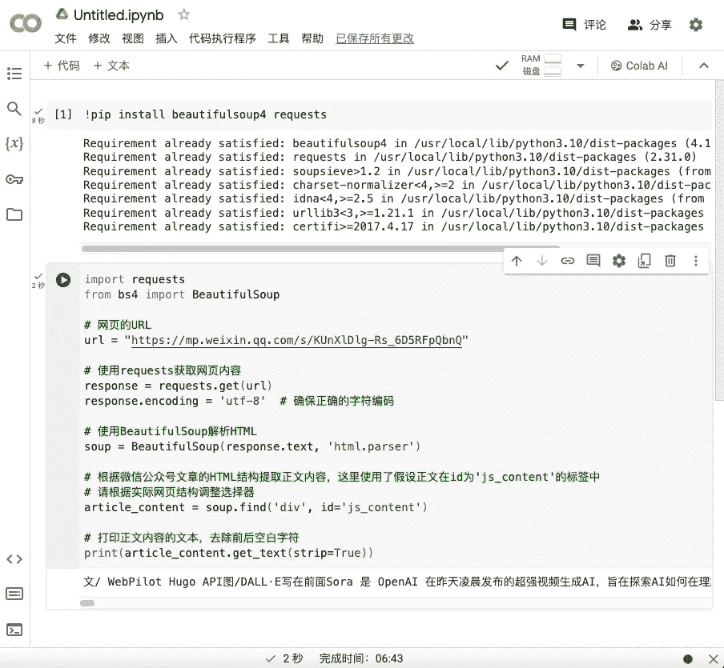

🎉 恭喜你，爬虫写好了 🎉

### **Tips**

在和 AI 配合写代码的过程中，如果你遇到了 Bug，类似：

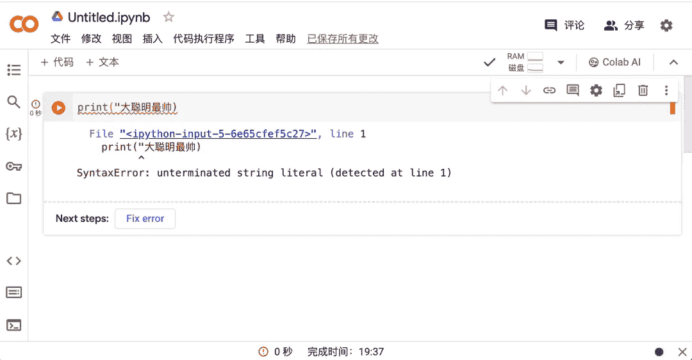

你可以直接将问题报给 ChatGPT，就像我这样

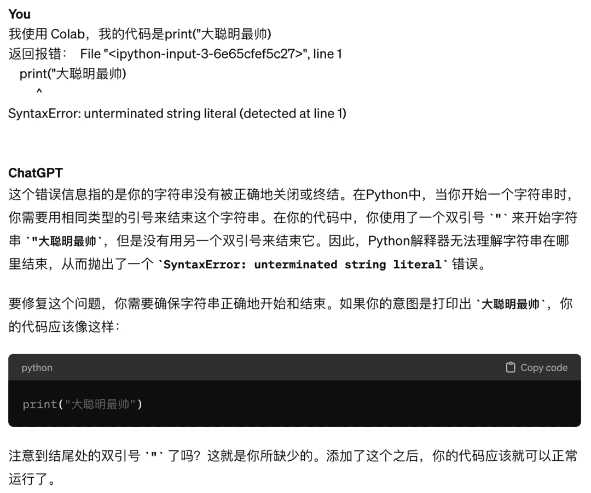

然后再把 ChatGPT 给出来的结果粘贴回去（如果还不行，就反复调试）

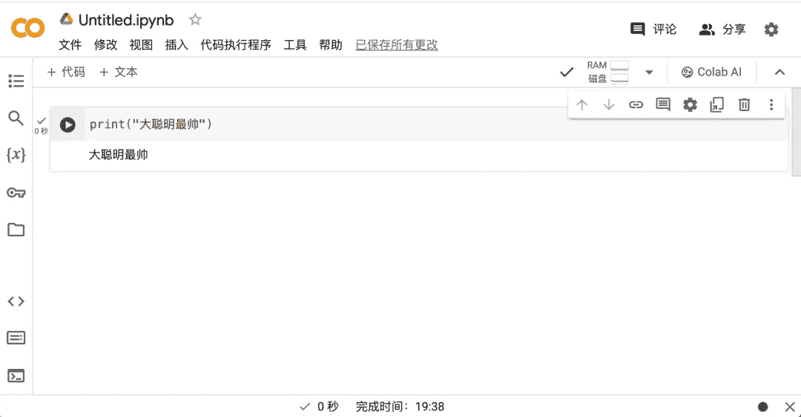

---

## **使用未来百货**

OpenAI API, YYDS

### **完成一个 AI 应用**

在许多的🛰️群里，都有这样一类 bot：你把👸号文章丢给他，他就会自动总结这篇文章。怎么做的呢？

答：通过 OpenAI API（或者其他家的 API）。我们尝试完成的画，做法将包含以下几步：

+   获得 API Key（扣费凭证）

+   获得 API 的示例代码（通常在 Playground 里面）

+   将必要的信息丢给 ChatGPT，让它帮你整合一下

+   复制，站台，运行，然后看看效果

### **获得 API Key**

以 OpenAI API 为例，你可以在这个页面找到 API Key：

https://platform.openai.com/api-keys

打开后，点击「Create new secret key」即可获取

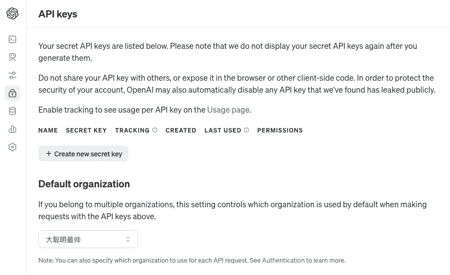

请注意：通常，你需要绑定支付方式，才可以获取有效Key

### **获得 API 使用的示例代码**

以 OpenAI API 为例，你可以在 Playground 这个页面获取 API 调用的示例代码：

https://platform.openai.com/playground

并且可以将你和 GPT 的对话，转换成代码

注意，这里有两个值可以定义，一个是:

+   **SYSTEM**：对应 ChatGPT 里的 Instructions，用来定义这个 Bot 的功能/特点

+   **USER**：对应 ChatGPT 里，用户发出的信息

这里，我将 SYSTEM 定义成了缩略信息助手，而在 USER 中输入了文章内容

运行后，结果很令人满意

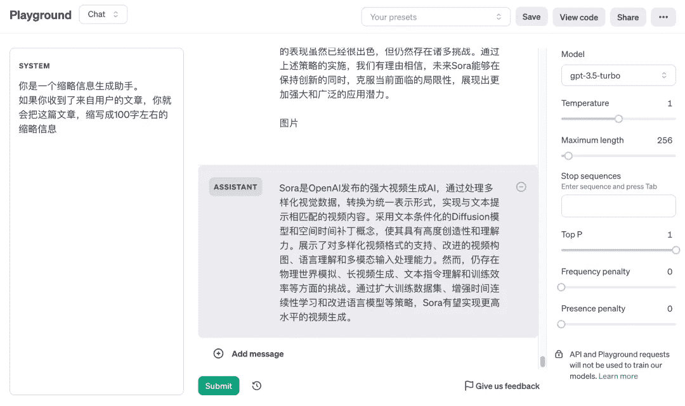

点击右上方 View Code，获取生成这一内容的示例代码

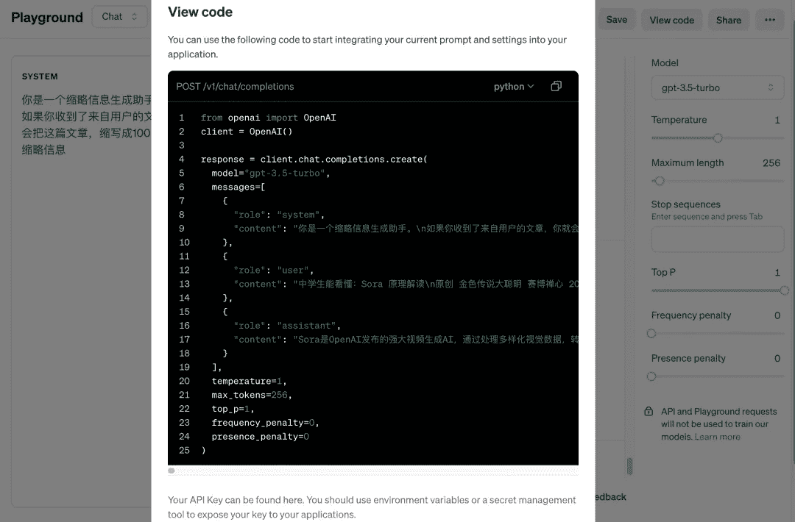

### **再问 ChatGPT**

顺着之前的对话，让 ChatGPT 帮我们继续写代码吧！

... 继续前文的对话 ...

# 大聪明

帮我升级一下这个代码，完整重写：

你不需要输出这篇文章的原始内容，而是通过 OpenAI 的 API，生成这篇文章的缩略信息，并打印

你假定我的 OpenAI API key 是（我这是一个假的 Key）：Craze-Thursday-Vivo-50

这是示例代码：

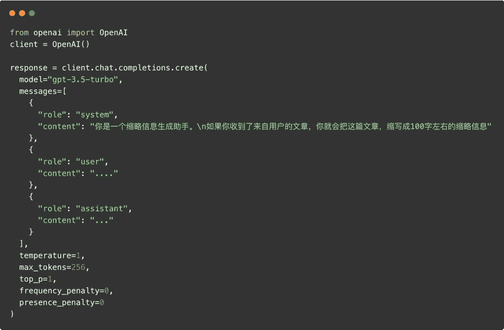

# ChatGPT

为了满足你的要求，我们需要重写上述代码，以便首先抓取文章内容，然后使用假设的OpenAI API key（注意实际操作中需要替换为真实的API key）来生成文章的缩略信息。以下是整个过程的代码：

首先，安装必要的库：

接下来，使用以下代码：

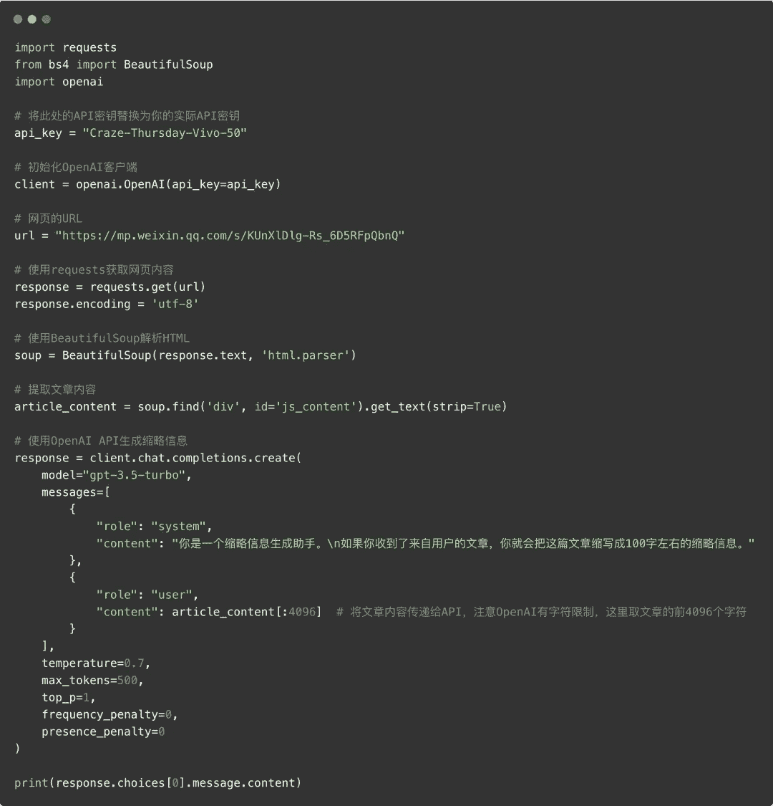

### **运行看看效果**

先复制第一段，运行试试

然后是第二段，记得把 Key 改一下

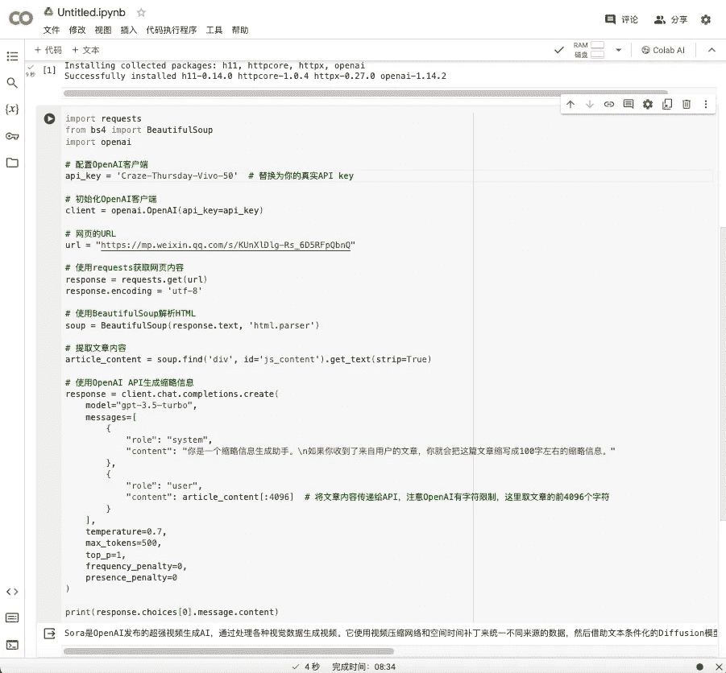

😊 截图的时候我把 key 换成了疯四 😊

看一下生成结果：

Sora是OpenAI发布的超强视频生成AI，通过处理各种视觉数据生成视频。它使用视频压缩网络和空间时间补丁来统一不同来源的数据，然后借助文本条件化的Diffusion模型生成与文本提示匹配的视觉作品。这种方法使Sora能够创造出高度创新和多样化的视频内容，跨越语言和视觉障碍，展现出AI在理解语言和创作视觉方面的强大实力。

### **Tips**

API Key 是你的扣费凭证，请永远妥善保管你的 Key，不要泄漏

各家 AI 最细致的教程，几乎都在他们的官网上，对于 OpenAI 来说：

+   综合文档：https://platform.openai.com/docs/overview

+   API 使用：https://platform.openai.com/docs/api-reference

+   API Playground：https://platform.openai.com/playground

+   API 案例与答疑：https://cookbook.openai.com/

<https://ga67w23t0nn.feishu.cn/sync/NJMgdsnDas6UvFbOFNocTpJUnDe>