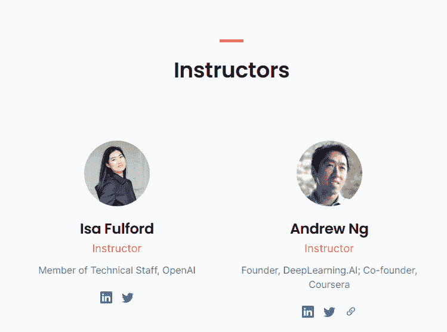

# ChatGPT 提示工程 中文翻译版（仅用于学习分享）

> 来源：[https://ga67w23t0nn.feishu.cn/docx/CinKdSSHuoVDkDxOA5ucXlannqf](https://ga67w23t0nn.feishu.cn/docx/CinKdSSHuoVDkDxOA5ucXlannqf)

本文来自DeepLearning.AI，

课程原文链接：https://www.deeplearning.ai/short-courses/chatgpt-prompt-engineering-for-developers/

[2024 年 AI商业应用 中标风向标](https://fieghf3pzz6.feishu.cn/docx/QZnjdrApIoXWKQxu9z2cC1d6n8g?from=from_copylink)[**，其他翻译请加 AI**](https://immersivetranslate.com/?via=general)同行侠--文卓 的微信：394710556，沉浸式翻译95折会员

## **您将在本课程中学到什么**

在 ChatGPT 开发人员提示工程中，您将学习如何使用大型语言模型 （LLM） 快速构建新的强大应用程序。使用 OpenAI API，您将能够快速构建功能，学习以成本高昂、技术性强或以前根本不可能的方式创新和创造价值。

这个由Isa Fulford（OpenAI）和Andrew Ng（DeepLearning.AI）教授的短期课程将描述LLM的工作原理，提供快速工程的最佳实践，并展示LLM API如何在应用程序中用于各种任务，包括：

+   总结（例如，为简洁起见，总结用户评论）

+   推断（例如，情绪分类、主题提取）

+   转换文本（例如，翻译、拼写和语法更正）

+   扩展（例如，自动编写电子邮件）

此外，您还将学习编写有效提示的两个关键原则，如何系统地设计好的提示，并学习构建自定义聊天机器人。

所有概念都通过大量示例进行说明，您可以直接在我们的 Jupyter 笔记本环境中使用这些示例，以获得快速工程的实践经验。

## **与****OpenAI****合作**

我们很高兴与OpenAI合作提供本课程，旨在帮助开发人员有效地利用LLM。本课程反映了对使用最新LLM模型提示的最佳实践的最新理解。

## **谁应该加入？**

ChatGPT 开发人员提示工程对初学者友好。只需要对Python有基本的了解。但它也适用于想要接近快速工程前沿并使用LLM的高级机器学习工程师。

# 子页面目录