# 【腾讯出版】Stable Diffusion入门手册

> 来源：[https://ga67w23t0nn.feishu.cn/docx/OKtydwyhtofwJax7NlgcnYc7nmb](https://ga67w23t0nn.feishu.cn/docx/OKtydwyhtofwJax7NlgcnYc7nmb)

### 关于AI星球社群

> **作为多年的互联网从业者，我深知普通**人去学习AI知识的痛点和问题，我希望运用我的一些行业经验，去做一个知识的桥梁，让人人都能看的懂学的起AI，群里会持续关注并更新 AI 的相关资讯动态，研究报告，应用场景，AI变现，技术研究等相关内容，小智的目标是打造免费的一站式开源AI学习社区，帮助大家更好的拥抱AI。


> 原文链接：https://mp.weixin.qq.com/s/8czNX-pXyOeFDFhs2fo7HA

> 作者：hking

Stable Diffusion 是 2022 年发布的深度学习文字到图像生成模型。它主要用于根据文字的描述产生详细图像，能够在几秒钟内创作出令人惊叹的艺术作品，本文是一篇使用入门教程。

### **硬件要求**

建议使用不少于 16 GB 内存，并有 60GB 以上的硬盘空间。需要用到 CUDA 架构，推荐使用 N 卡。（目前已经有了对 A 卡的相关支持，但运算的速度依旧明显慢于 N 卡，参见：

[**Install and Run on AMD GPUs · AUTOMATIC1**](https://github.com/AUTOMATIC1111/stable-diffusion-webui/wiki/Install-and-Run-on-AMD-GPUs)111/stable-diffusion-webui Wiki · GitHub

过度使用，显卡会有损坏的风险。

进行 512x 图片生成时主流显卡速度对比：

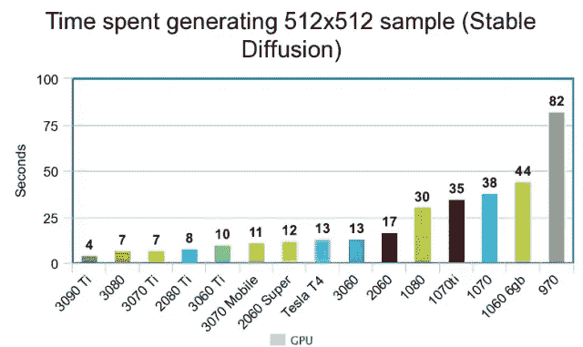

### **环境部署**

#### **手动部署**

[**可**](https://github.com/AUTOMATIC1111/stable-diffusion-webui/wiki)以参考 webui 的官方 wiki 部署：Home · AUTOMATIC1111/stable-diffusion-webui Wiki (github.com)

stable diffusion webui 的完整环境占用空间极大，能达到几十 G。同时，webui 需要联网下载安装大量的依赖，在境内的网络环境下下载很慢，请自带科学上网工具。

1.  安装 Python 安装 [**Python 3.10**](https://www.python.org/downloads/windows/)，安装时须选中 Add Python to PATH

1.  安装 Git 在 [**Git-scm.com**](https://git-scm.com/download/win) 下载 Git 安装包并安装。

1.  下载 webui 的 github 仓库 按下win+r输入 cmd，调出命令行窗口。运行：

```
cd PATH_TO_CLONE
git clone https://github.com/AUTOMATIC1111/stable-diffusion-webui.git
```

1.  请把代码中的

```
PATH_TO_CLONE
```

1.  替换为自己想下载的目录。

1.  装配模型 可在如[**Civitai**](https://civitai.com/)上下载标注有**CKPT**的模型，有模型才能作画。下载的模型放入下载后文件路径下的models/Stable-diffusion目录。

1.  使用 双击运行 webui-user.bat 。脚本会自动下载依赖，**等待一段时间**[**（可能很**](https://km.woa.com/user/hkinghuang/articles/restore_draft/2298930#%E6%A8%A1%E5%9E%8B%E4%BD%BF%E7%94%A8)长），程序会输出一个类似 http://127.0.0.1:7860/ 的地址，在浏览器中输入这个链接开即可。详细可参见模型使用。

1.  更新 按下win+r输入 cmd，调出命令行窗口。运行：

```
cd PATH_TO_CLONE
git pull
```

1.  请把代码中的：

```
PATH_TO_CLONE
```

1.  替换为自己下载仓库的目录。

#### **整合包**

[**觉得麻烦的**](https://space.bilibili.com/250989068)同学可以使用整合包，解压[**即用。比如独**](https://www.bilibili.com/video/BV1ne4y1V7QU)立研究员的空间下经常更新整合包。秋叶的启动器 也非常好用，将启动器复制到下载仓库的目录下即可，更新管理会更方便。

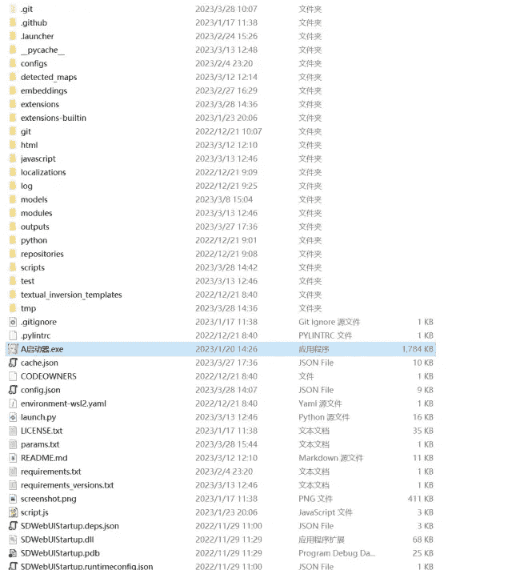

打开启动器后，可一键启动：

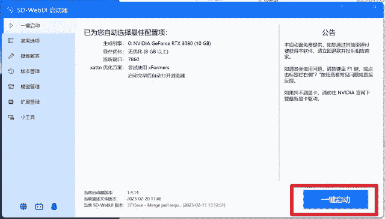

如果有其他需求，可以在高级选项中调整配置。

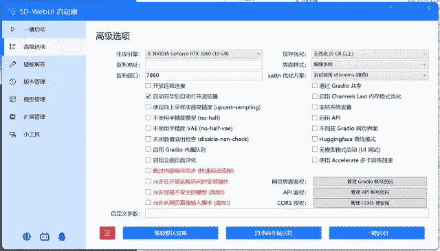

显存优化根据显卡实际显存选择，不要超过当前显卡显存。不过并不是指定了显存优化量就一定不会超显存，在出图时如果启动了过多的优化项（如高清修复、人脸修复、过大模型）时，依然有超出显存导致出图失败的几率。

xFormers 能极大地改善了内存消耗和速度，建议开启。准备工作完毕后，点击一键启动即可。等待浏览器自动跳出，或是控制台弹出本地 URL 后说明启动成功

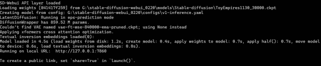

如果报错提示缺少 Pytorch，则需要在启动器中点击配置：

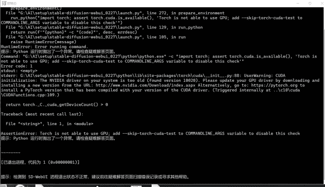

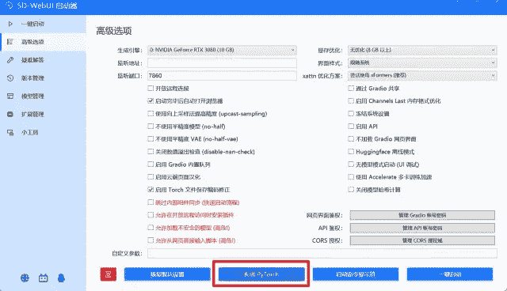

Stable Diffusion webui 的更新比较频繁，请根据需求在“版本管理”目录下更新：

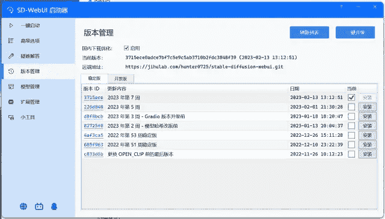

同样地，也请注意插件的更新：

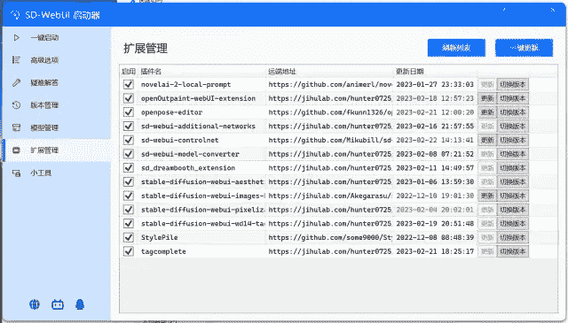

### **关于插件**

Stable Diffusion 可配置大量插件扩展，在 webui 的“扩展”选项卡下，可以安装插件：

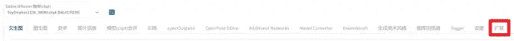

点击“加载自”后，目录会刷新，选择需要的插件点击右侧的 install 即可安装。

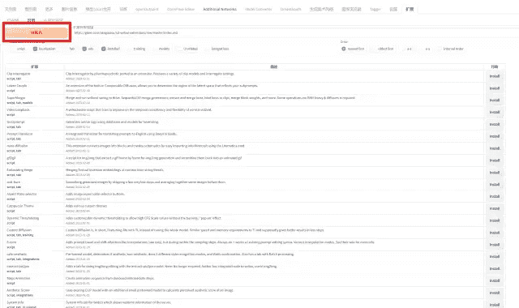

安装完毕后，需要重新启动用户界面：

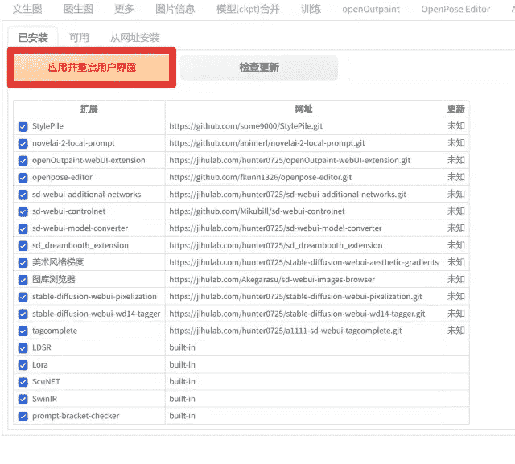

### **文生图最简流程**

1.  选择需要使用的模型（底模），这是对生成结果影响最大的因素，主要体现在画面风格上。

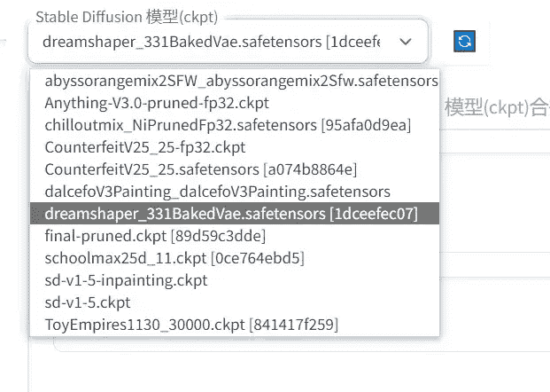

1.  在第一个框中填入提示词（Prompt），对想要生成的东西进行文字描述

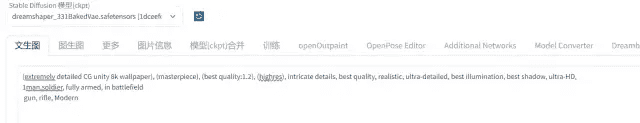

1.  在第二个框中填入负面提示词（Negative prompt)，你不想要生成的东西进行文字描述

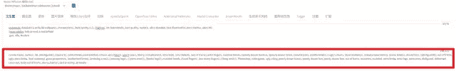

1.  选择采样方法、采样次数、图片尺寸等参数。

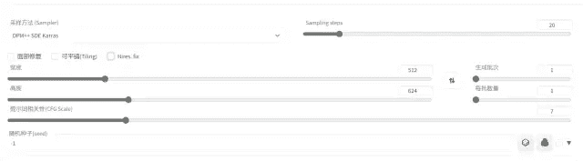

+   Sampler（采样器/采样方法）选择使用哪种采样器。Euler a（Eular ancestral）可以以较少的步数产生很大的多样性，不同的步数可能有不同的结果。而非 ancestral 采样器都会产生基本相同的图像。DPM 相关的采样器通常具有不错的效果，但耗时也会相应增加。

+   Euler 是最简单、最快的

+   Euler a 更多样，不同步数可以生产出不同的图片。但是太高步数 (>30) 效果不会更好。

+   DDIM 收敛快，但效率相对较低，因为需要很多 step 才能获得好的结果，适合在重绘时候使用。

+   LMS 是 Euler 的衍生，它们使用一种相关但稍有不同的方法（平均过去的几个步骤以提高准确性）。大概 30 step 可以得到稳定结果

+   PLMS 是 Euler 的衍生，可以更好地处理神经网络结构中的奇异性。

+   DPM2 是一种神奇的方法，它旨在改进 DDIM，减少步骤以获得良好的结果。它需要每一步运行两次去噪，它的速度大约是 DDIM 的两倍，生图效果也非常好。但是如果你在进行调试提示词的实验，这个采样器可能会有点慢了。

+   UniPC 效果较好且速度非常快，对平面、卡通的表现较好，推荐使用。

+   Sampling Steps（采样步数）Stable Diffusion 的工作方式是从以随机高斯噪声起步，向符合提示的图像一步步降噪接近。随着步数增多，可以得到对目标更小、更精确的图像。但增加步数也会增加生成图像所需的时间。增加步数的边际收益递减，取决于采样器。一般开到 20~30。

+   不同采样步数与采样器之间的关系：

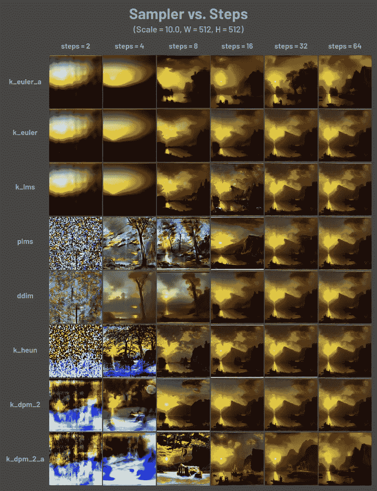

+   CFG Scale（提示词相关性）图像与你的提示的匹配程度。增加这个值将导致图像更接近你的提示，但它也在一定程度上降低了图像质量。可以用更多的采样步骤来抵消。过高的 CFG Scale 体现为粗犷的线条和过锐化的图像。一般开到 7~11。CFG Scale 与采样器之间的关系：

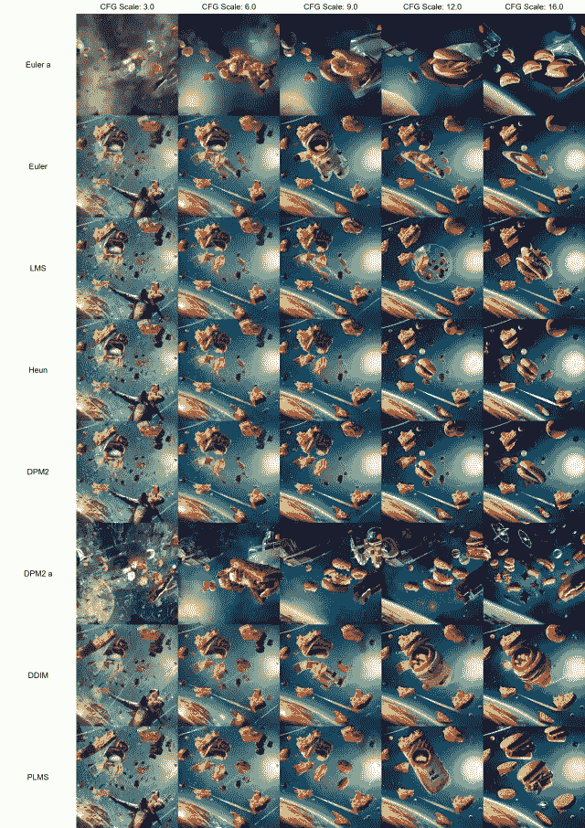

+   **生成批次**每次生成图像的组数。一次运行生成图像的数量为“批次* 批次数量”。

+   **每批数量**同时生成多少个图像。增加这个值可以提高性能，但也需要更多的显存。大的 Batch Size 需要消耗巨量显存。若没有超过 12G 的显存，请保持为 1。

+   **尺寸**指定图像的长宽。出图尺寸太宽时，图中可能会出现多个主体。1024 之上的尺寸可能会出现不理想的结果，推荐使用小尺寸分辨率+高清修复（Hires fix)。

+   **种子**种子决定模型在生成图片时涉及的所有随机性，它初始化了 Diffusion 算法起点的初始值。

理论上，在应用完全相同参数（如 Step、CFG、Seed、prompts）的情况下，生产的图片应当完全相同。

+   **高清修复**

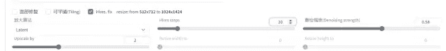

+   通过勾选 "Highres. fix" 来启用。默认情况下，文生图在高分辨率下会生成非常混沌的图像。如果使用高清修复，会型首先按照指定的尺寸生成一张图片，然后通过放大算法将图片分辨率扩大，以实现高清大图效果。最终尺寸为（原分辨率*缩放系数 Upscale by)。

+   放大算法中，Latent 在许多情况下效果不错，但重绘幅度小于 0.5 后就不甚理想。ESRGAN_4x、SwinR 4x 对 0.5 以下的重绘幅度有较好支持。

+   Hires step 表示在进行这一步时计算的步数。

+   Denoising strength 字面翻译是降噪强度，表现为最后生成图片对原始输入图像内容的变化程度。该值越高，放大后图像就比放大前图像差别越大。低 denoising 意味着修正原图，高 denoising 就和原图就没有大的相关性了。一般来讲阈值是 0.7 左右，超过 0.7 和原图基本上无关，0.3 以下就是稍微改一些。实际执行中，具体的执行步骤为 Denoising strength * Sampling Steps。

+   **面部修复**修复画面中人物的面部，但是非写实风格的人物开启面部修复可能导致面部崩坏。

+   **点击“生成”**

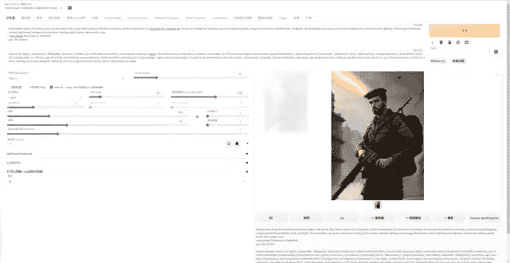

### **提示词**

提示词所做的工作是缩小模型出图的解空间，即缩小生成内容时在模型数据里的检索范围，而非直接指定作画结果。提示词的效果也受模型的影响，有些模型对自然语言做特化训练，有些模型对单词标签对特化训练，那么对不同的提示词语言风格的反应就不同。

#### **提示词内容**

提示词中可以填写以下内容：

+   自然语言 可以使用描述物体的句子作为提示词。大多数情况下英文有效，也可以使用中文。避免复杂的语法。

+   单词标签 可以使用逗号隔开的单词作为提示词。一般使用普通常见的单词。单词的风格要和图像的整体风格搭配，否则会出现混杂的风格或噪点。避免出现拼写错误。可参考Tags | Danbooru (donmai.us)

+   Emoji、颜文字 Emoji (💰👨👩🎅👼🍟🍕) 表情符号也是可以使用并且非常准确的。因为 Emoji 只有一个字符，所以在语义准确度上表现良好。关于 emoji 的确切含义，可以参考Emoji List, v15.0 (unicode.org)，同时 Emoji 在构图上有影响。


+   💐👩💐

对于使用 Danbooru 数据的模型来说，可以使用西式颜文字在一定程度上控制出图的表情。如：:-) 微笑 :-( 不悦 ;-) 使眼色 :-D 开心 :-P 吐舌头 :-C 很悲伤 :-O 惊讶 张大口 :-/ 怀疑

#### **提示词语法**

根据自己想画的内容写出提示词，多个提示词之间使用英文半角符号 [ , ]，如：

masterpiece, best quality, ultra-detailed, illustration, close-up, straight on, face focus, 1girl, white hair, golden eyes, long hair, halo, angel wings, serene expression, looking at viewer

一般而言，概念性的、大范围的、风格化的关键词写在前面，叙述画面内容的关键词其次，最后是描述细节的关键词，大致顺序如：

(画面质量提示词), (画面主题内容)(风格), (相关艺术家), (其他细节)

不过在模型中，每个词语本身自带的权重可能有所不同，如果模型训练集中较多地出现某种关键词，我们在提示词中只输入一个词就能极大地影响画面，反之如果模型训练集中较少地出现某种关键词，我们在提示词中可能输入很多个相关词汇都对画面的影响效果有限。提示词的顺序很重要，越靠后的权重越低。关键词最好具有特异性，譬如 Anime(动漫)一词就相对泛化，而 Jojo 一词就能清晰地指向 Jojo 动漫的画风。措辞越不抽象越好，尽可能避免留下解释空间的措辞。

可以使用括号人工修改提示词的权重，方法如：

+   (word) - 将权重提高 1.1 倍

+   ((word)) - 将权重提高 1.21 倍（= 1.1 * 1.1）

+   [word] - 将权重降低至原先的 90.91%

+   (word:1.5) - 将权重提高 1.5 倍

+   (word:0.25) - 将权重减少为原先的 25%

+   (word) - 在提示词中使用字面意义上的 () 字符

( n ) = ( n : 1.1 ) (( n )) = ( n : 1.21 ) ((( n ))) = ( n : 1.331 ) (((( n )))) = ( n : 1.4641 ) ((((( n )))) = ( n : 1.61051 ) (((((( n )))))) = ( n : 1.771561 )

请注意，权重值最好不要超过 1.5。

还可以通过 Prompt Editing 使得 AI 在不同的步数生成不一样的内容，譬如在某阶段后，绘制的主体由男人变成女人。

语法为：

```
E**xpla****in
[**t**o:wh****en] **在指定数量的 step 后，将to处的提示词添加到提示
[from::when] 在指定数量的 step 后从提示中删除 from处的提示词
[from:to:when] 在指定数量的 step 后将 from处的提示词替换为 to处的提示词
```

例如: a [fantasy:cyberpunk:16] landscape 在一开始，读入的提示词为：the model will be drawing a fantasy landscape. 在第 16 步之后,提示词将被替换为：a cyberpunk landscape, 它将继续在之前的图像上计算

又例如，对于提示词为: fantasy landscape with a [mountain:lake:0.25] and [an oak:a christmas tree:0.75][ in foreground::0.6][ in background:0.25][shoddy:masterful:0.5]，100 步采样， 一开始。提示词为：fantasy landscape with a mountain and an oak in foreground shoddy 在第 25 步后，提示词为：fantasy landscape with a lake and an oak in foreground in background shoddy 在第 50 步后，提示词为：fantasy landscape with a lake and an oak in foreground in background masterful 在第 60 步后，提示词为：fantasy landscape with a lake and an oak in background masterful 在第 75 步后，提示词为：fantasy landscape with a lake and a christmas tree in background masterful

提示词还可以轮转，譬如

```
[cow|horse] **in** a field
```

在第一步时，提示词为“cow in a field”；在第二步时，提示词为"horse in a field."；在第三步时，提示词为"cow in a field" ，以此类推。

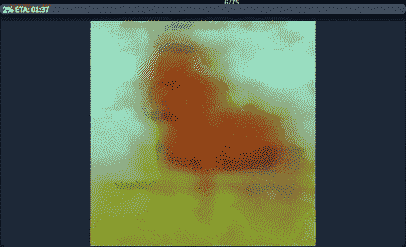

#### **Token**

实际上，程序是将输入的关键词以 Token 的形式传入模型进行计算的：

“ (Medieval astronomer using a telescope with a cosmic starry sky in the background.sketch, hand draw style, con, uncomplicated background )”转换为 Token ID 即：263, 10789, 40036, 1996, 320, 19037, 593, 320, 18304, 30963, 2390, 530, 518, 5994, 8, 11, 263, 5269, 267, 2463, 4001, 1844, 267, 5646, 267, 569, 16621, 5994, 264 。

一个单词可能对应一个或多个 Token，多个单词也可能对应同一个 Token。

#### **提示词模板**

可参考[**C**](https://civitai.com/)ivitai | Stable Diffusion models, embeddings, hypernetworks and more中优秀作品的提示词作为模板。

类似的网站还有：

+   Majinai：[**MajinAI | Home**](https://majinai.art/index.php)

+   词图：词图 PromptTool - AI 绘画资料管理网站

+   Black Lily：[**black_lily**](http://heizicao.gitee.io/novelai/#/book)

+   Danbooru 标签超市：[**Danbooru 标签超市**](https://tags.novelai.dev/)

+   魔咒百科词典：[**魔咒百科词典**](https://aitag.top/)

+   AI 词汇加速器：AI 词汇加速器 AcceleratorI Prompt

+   NovelAI 魔导书：[**NovelAI 魔导书**](https://thereisnospon.github.io/NovelAiTag/)

+   鳖哲法典：[**鳖哲法典**](http://tomxlysplay.com.cn/#/)

+   Danbooru tag：[**Tag Groups Wiki | **](https://danbooru.donmai.us/wiki_pages/tag_groups)Danbooru (donmai.us)

+   AIBooru：AIBooru: Anime Image Board

### **Controlnet**

Controlnet 允许通过线稿、动作识别、深度信息等对生成的图像进行控制。

请注意，在使用前请确保 ControlNet 设置下的路径与本地 Stable Diffusion 的路径同步

#### **基本流程**

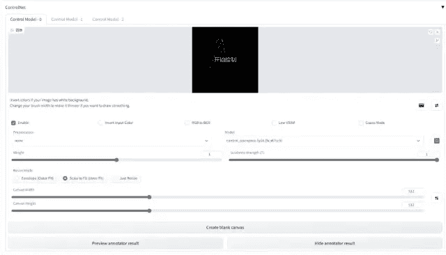

+   点击 Enable 启用该项 ControlNet

+   Preprocessor 指预处理器，它将对输入的图像进行预处理。如果图像已经符合预处理后的结果，请选择 None。譬如，图中导入的图像已经是 OpenPose 需要的骨架图，那么 preprocessor 选择 none 即可。

+   在 Weight 下，可以调整该项 ControlNet 的在合成中的影响权重，与在 prompt 中调整的权重类似。Guidance strength 用来控制图像生成的前百分之多少步由 Controlnet 主导生成，这点与[:]语法类似。

+   Invert Input Color 表示启动反色模式，如果输入的图片是白色背景，开启它。

+   RGB to BGR 表示将输入的色彩通道信息反转，即 RGB 信息当做 BGR 信息解析，只是因为 OpenCV 中使用的是 BGR 格式。如果输入的图是法线贴图，开启它。

+   Low VRAM 表示开启低显存优化，需要配合启动参数“--lowvram”。

+   Guess Mode 表示无提示词模式，需要在设置中启用基于 CFG 的引导。

+   Model 中请选择想要使用解析模型，应该与输入的图像或者预处理器对应。请注意，预处理器可以为空，但模型不能为空。

#### **可用预处理/模型**

+   canny 用于识别输入图像的边缘信息。

+   depth 用于识别输入图像的深度信息。

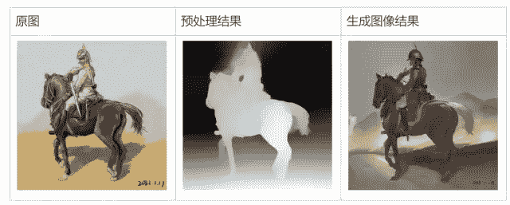

+   hed 用于识别输入图像的边缘信息，但边缘更柔和。

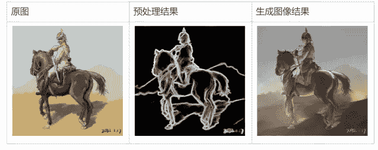

+   mlsd 用于识别输入图像的边缘信息，一种轻量级的边缘检测。它对横平竖直的线条非常敏感，因此更适用于于室内图的生成。

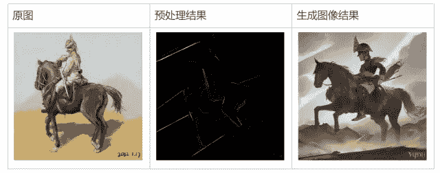

+   normal 用于识别输入图像的法线信息。

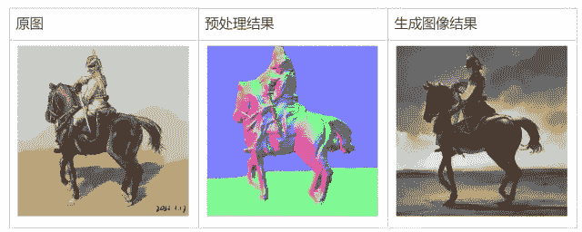

+   openpose 用于识别输入图像的动作信息。

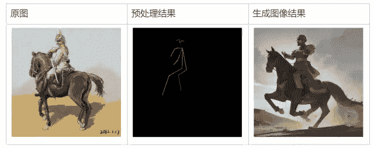

+   OpenPose Editor 插件可以自行修改姿势，导出到文生图或图生图。

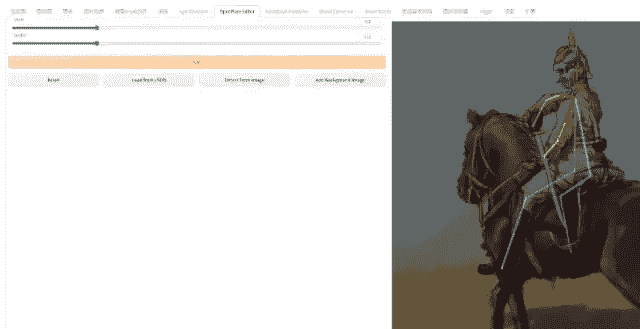

+   scribble 将输入图像作为线稿识别。如果线稿是白色背景，务必勾选“Invert Input Color”

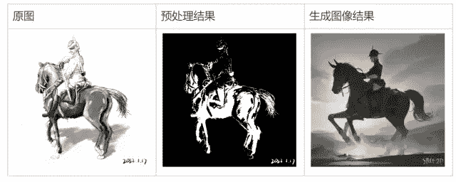

+   fake_scribble 识别输入图像的线稿，然后再将它作为线稿生成图像。

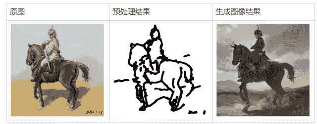

+   segmentation 识别输入图像各区域分别是什么类型的物品，再用此构图信息生成图像。

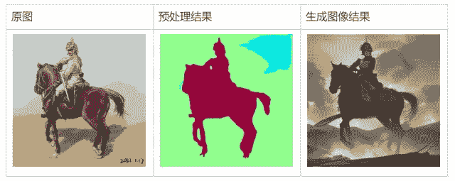

+   如果想绘制一张符合 segementati[**o**](https://docs.google.com/spreadsheets/d/1se8YEtb2detS7OuPE86fXGyD269pMycAWe2mtKUj2W8/edit#gid=0)n 规范的图像，可以使用以下色表绘制。color_coding_semantic_segmentation_classes - Google 表格

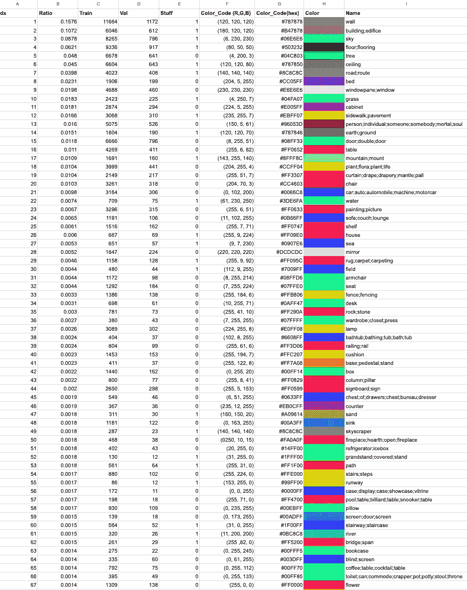

#### **多 ControlNet 合成**

在 ControlNet 的设置下，可以调整可用 ControlNet 的数量。

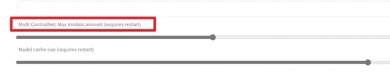

在多个 ControlNet 模式下，结果会将输入的信息合并生成图像：

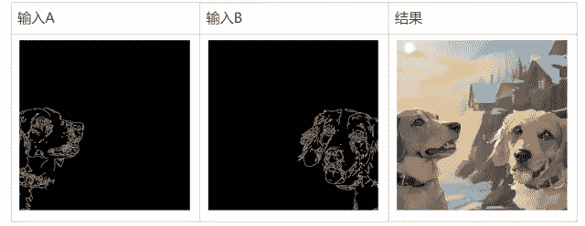

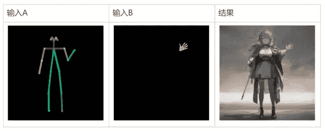

### **模型**

#### **模型下载**

模型能够有效地控制生成的画风和内容。常用的模型网站有：

[**C**](https://civitai.com/)ivitai[** | Stable Diff**](https://www.123114514.xyz/models/ckpt)usi[**on models, embeddings, hyp**](https://aiguidebook.top/index.php/model/)ernetworks and more > Models - Hugging Face > SD - WebUI 资源站 > 元素法典 AI 模型收集站 - AI 绘图指南 wiki (aiguidebook.top) > AI 绘画模型博物馆 (subrecovery.top)

#### **模型安装**

下载模型后需要将之放置在指定的目录下，请注意，不同类型的模型应该拖放到不同的目录下。模型的类型可以通过Stable Diffusion 法术解析检测。

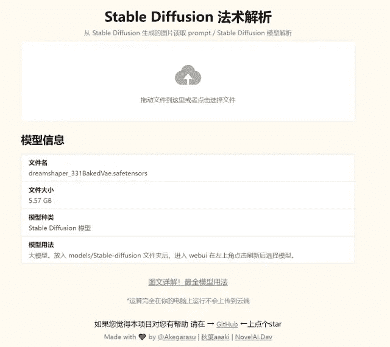

+   大模型（Ckpt）：放入 models\Stable-diffusion

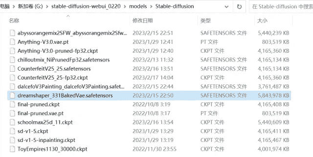

+   VAE 模型：一些大模型需要配合 vae 使用，对应的 vae 同样放置在 models\Stable-diffusion 或 models\VAE 目录，然后在 webui 的设置栏目选择。


+   Lora/LoHA/LoCon 模型：放入 extensions\sd-webui-additional-networks\models\lora，也可以在 models/Lora 目录

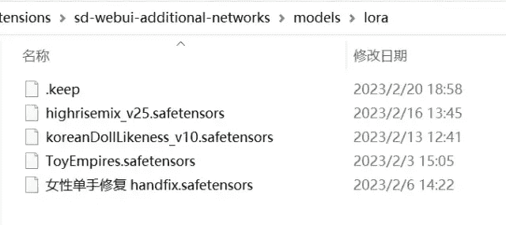

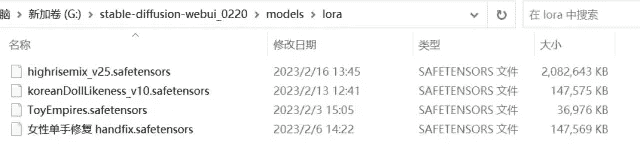

+   Embedding 模型：放入 embeddings 目录


#### **模型使用**

+   Checkpoint(ckpt)模型 对效果影响最大的模型。在 webui 界面的左上角选择使用。

一些模型会有触发词，即在提示词内输入相应的单词才会生效。

+   Lora 模型 / LoHA 模型 / LoCon 模型

对人物、姿势、物体表现较好的模型，在 ckpt 模型上附加使用。在 webui 界面的 Additional Networks 下勾线 Enable 启用，然后在 Model 下选择模型，并可用 Weight 调整权重。权重越大，该 Lora 的影响也越大。不建议权重过大（超过 1.2），否则很容易出现扭曲的结果。

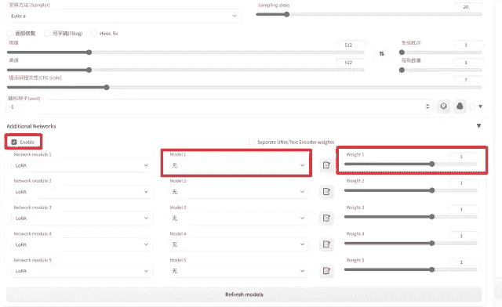

多个 lora 模型混合使用可以起到叠加效果，譬如一个控制面部的 lora 配合一个控制画风的 lora 就可以生成具有特定画风的特定人物。因此可以使用多个专注于不同方面优化的 Lora，分别调整权重，结合出自己想要实现的效果。

LoHA 模型是一种 LORA 模型的改进。

LoCon 模型也一种 LORA 模型的改进，泛化能力更强。

+   Embedding

对人物、画风都有调整效果的模型。在提示词中加入对应的关键词即可。大部分 Embedding 模型的关键词与文件名相同，譬如一个名为为“SomeCharacter.pt”的模型，触发它的关键词检索“SomeCharacter”。

#### **模型训练**

##### **环境搭建**

以GitHub - bmaltais/kohya_ss为例，它提供了在 Windows 操作系统下的 GUI 训练面板。

[**如果需要**](https://github.com/P2Enjoy/kohya_ss-docker)在 Linux 上部署且需要 GUI，请参考GitHub - P2Enjoy/kohya_ss-docker: This is the tandem repository to exploit on linux the kohya_ss training webui converted to Linux. It uses the fork in the following link

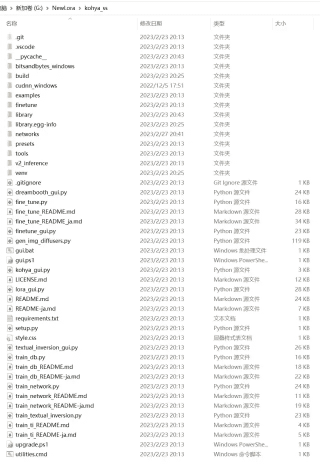

需要保证设备拥有 Python 3.10.6 及 git 环境。

1.  首先，以管理员模式启动 Powershell，执行“Set-ExecutionPolicy Unrestricted”命令，并回答“A"。然后可以关闭该窗口。

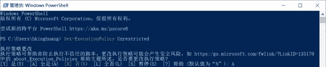

1.  启动一个普通的 Powershell 窗口，在需要克隆该仓库的路径下，执行以下命令：

```
Explain
git clone https://github.com/bmaltais/kohya_ss.git
cd kohya_ss

python -m venv venv
.\venv\Scripts\activate

pip install torch==1.12.1+cu116 torchvision==0.13.1+cu116 --extra-index-url https://download.pytorch.org/whl/cu116
pip install --use-pep517 --upgrade -r requirements.txt
pip install -U -I --no-deps https://github.com/C43H66N12O12S2/stable-diffusion-webui/releases/download/f/xformers-0.0.14.dev0-cp310-cp310-win_amd64.whl

cp .\bitsandbytes_windows\*.dll .\venv\Lib\site-packages\bitsandbytes\
cp .\bitsandbytes_windows\cextension.py .\venv\Lib\site-packages\bitsandbytes\cextension.py
cp .\bitsandbytes_windows\main.py .\venv\Lib\site-packages\bitsandbytes\cuda_setup\main.py
accelerate config
```

在执行“accelerate config”后，它将询问一些设置选项。请按照以下选项依次选择：

> This machine No distributed training NO NO NO all fp16

30 系、40 系显卡可选择安装 CUDNN：

```
.\venv\Scripts\activate
python .\tools\cudann_1.8_install.py
```

##### **环境更新**

如果需要更新仓库，请执行以下命令：

```
git pull
.\venv\Scripts\activate
pip install --use-pep517 --upgrade -r requirements.txt
```

##### **界面启动**

在 Powershell 中执行：

```
.\gui.ps1
```

双击 gui.bat 也可以。弹出以下界面后，直接访问 URL 即可。

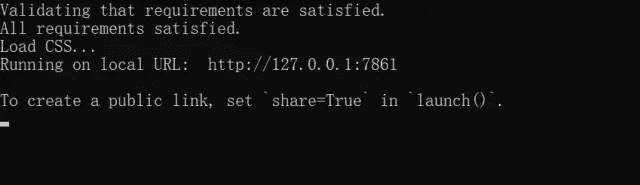

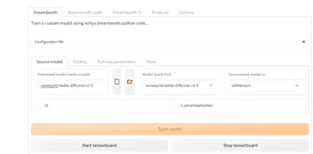

##### **训练流程**

模型训练主要有三种结果：欠拟合，效果好，过拟合。欠拟合：模型完全没有从数据集中学习到经验，对各种输入都得出差距很大的结果。效果好：模型不仅对训练集中的输入有接近的结果，对不来自训练集中的输入也有接近的效果。过拟合：模型只训练集中的输入有非常非常接近的结果，对不来自训练集中的输入给出差距很大的结果。

1.  **准备训练集**

图片尽可能高清，风格统一但内容形式多样（譬如动作多样、服装多样）。

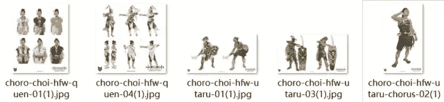

样本数量可能影响到拟合结果。

样本量太少，模型可能欠拟合；样本量过大，模型可能过拟合。

> 譬如让一个人学习英语，只给他几条例句去看，他可能什么都没学会【欠拟合】；给了它几十亿条例句去看，他可能只会根据别人说的话查字典一样回话，如果字典里没有就完全不会说了【过拟合】

1.  **图片裁剪**

将训练集裁剪为多个尺寸相同的图片。可以在 SD webui 界面中自动裁剪，也可以手动裁切。

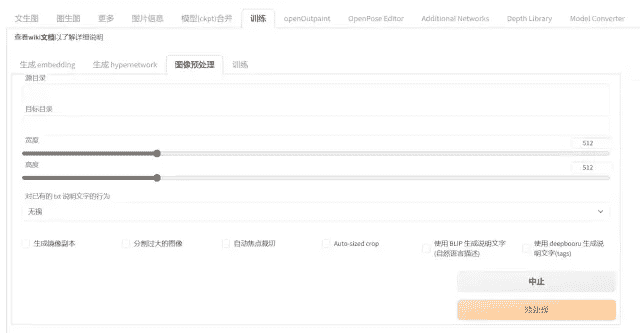

一般使用的图片尺寸是 512*512，也可更换为其他尺寸，尺寸越大占用显存越高，但对细节的捕捉也会越好。

1.  **图片打标**

+   关键词生成 可以在训练环境的页面下打标：

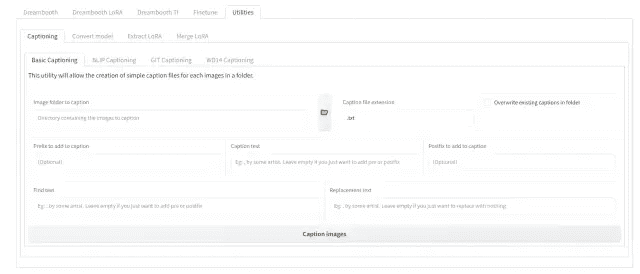

也可以在 sd webui 的页面下打标：

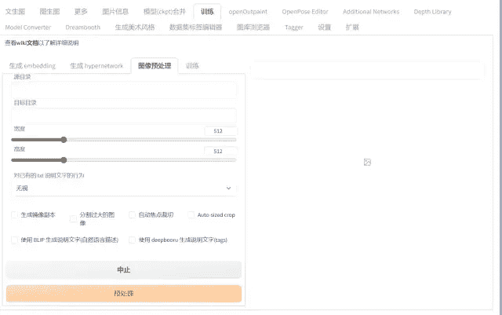

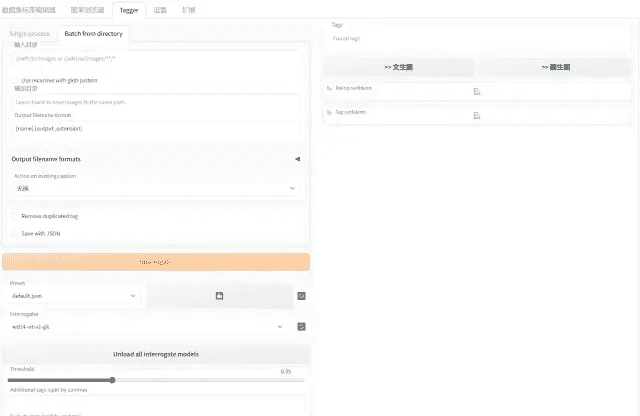

比较这几种不同的打标器的效果，在同一输入下：

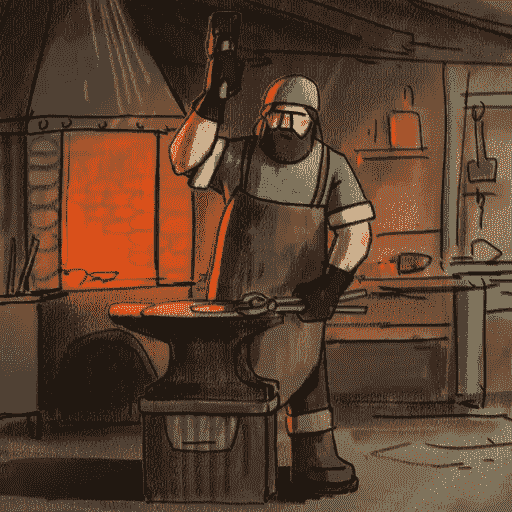

【本义：一个在铁匠铺里打铁的男铁匠】

打标对图片的描述越准越好，如果条件允许，尝试人工打标。

+   关键词合并 在生成出的关键词中，我们需要把与训练目标强相关的关键词划为一个统一的特征表述。以"1boy, cooking, frying pan, male focus, solo, gloves, apron, fire, brown footwear, black gloves, boots, stove, kitchen, holding, facial hair, bandana, blue shirt, shirt"为例，假如我们的训练对象就是一个男性大胡子，那么他必然始终携带着”男人、胡子“这两个要素，那么我们可以用一个词总结这个角色，例如用”Smith“替代”1boy,facial hair"，整条句子将变为：

以此类推，我们需要为目标绑定什么要素，就将它从关键词中删去。而类似于动作、背景这种与对象绑定关系不紧密，在日后生成图期间需要改变的，就保留在关键词中。

+   编组 一些具有同组关系的图片可以利用关键词引导 AI 去归纳它们。譬如，我们训练的对象 Smith 有三张图，分别是全图、背景、前景，那么我可以如此处理：


1.  **正则化**

训练集中的每张图片通常能被分解为两大部分：“训练目标+其他要素”，依然以 Smith 为例：

其中，”铁匠铺、打铁、铁匠“都是模型中已有的内容，称为“先验知识”。我们需要将这部分知识为 AI 指明，省去重新学习这部分内容的时间；也能引导 AI 明确学习的目标，让模型具有更好的泛化性。

正则化通过降低模型的复杂性提高泛化能力。模型越复杂，模型的泛化能力越差，要达到相同的泛化能力，越复杂的模型需要的样本数量就越多，为了提高模型的泛化能力，需要正则化来限制模型复杂度。

正则化的标签需要与训练集中的 Class 相对应，图片数量也要一致。正则化不是必须的，可以根据训练集的情况和训练目的的不同来调整。同一张图片不允许在训练集和正则化中同时出现。

1.  **文件路径组织**

在训练前，我们需要用特定的方式组织文件路径：譬如，训练目标是一群女孩，其中有一位名为 sls 的女孩好一位名为 cpc 的女孩，那么文件路径应该为：

●train_girls ----○10_sls 1girl ----○10_cpc 1girl

●reg_girls ----○1_1girl

其中，traingirls 目录下放置的是训练集，命名规则是“训练次数<标识符> <类别>”，如“10_sls 1girl”表示“名为 sls 的对象，她是一个女孩（类别），这个文件夹下的训练集每个训练 10 次”。

reggirls 目录下放置的是正则化内容。命名规则是“训练次数<类别>”，如“1_1girl“表示”文件夹下的图片都是一个女孩，不重复使用数据“。*需要日后补充

1.  **训练参数**

在 kohya webui 界面训练时，ckpt 与 lora 训练方法类似。

**a. 底模**


它表明我们此次训练将以哪个模型为基础进行训练。这个模型需要根据自己的需求选择。如果很明确自己的目标是属于某一大类下的分支，那么可以用接近这一大类的模型进行训练。譬如想训练一个二次元角色，那么可以使用二次元的底模（如 NovelAI）进行训练。如果自己的像训练的目标需要比较好的泛化性，可以使用 sd 模型，因为它包含的人物、物品、风格最多。如果模型为 sd2.0，则需要勾选 v2 和 v_parameterization


b. 最大分辨率 Max resolution

Training parameters 下的 Max Resolution 用于指定当前输入训练集图片的分辨率，请与文件夹内的保持一致。如果尺寸不一会被裁切。


**c. Epoch**


Epoch 是指一次将训练集中的所有样本训练一次（即对每个样本完成一次正向传播与一次反向传播）的过程。有时，由于一个训练样本过于庞大，它会被分成多个小块分批学习，每个小块就叫 batch。

在深**度学习**中**，程序**通过不断地将数据集在神经网络中往复传递来更新网络中的权重，以此建立对目标的拟合关系，因此只有反复地迭代才能增强数据集的拟合度。随着** e**poch 的增加，模型将从欠拟合（右一，表示即便是来自于数据集中的输入，模型也很难达到它应该有的结果，类似于“只做题库里的题都做不对的差生”）变为过拟合（左一，表示模型对于来自于数据集中的输入，总能精确地达到对应的对结果，但是如果输入一旦有些许偏差，比如输入一些不是训练集中的输入，那结果就会很差，类似于“只会做题库里的题的书呆子”）。我们希望能达到中间的效果，即对训练集输出相对准确的结果，又对不在训练集里的输入也有较好的表现。这种特征就叫泛化。


因此，我们需要不少于一个 epoch 才能建立起较好的拟合关系，当然也不能太多。对于不同的数据集，使用的 epoch 都可能有所不同。

**d. Batch size**


batch size 表示训练时的批量大小，也就是一次训练中选取的样本数量。这个参数对性能有一定要求，如果性能足够，增加 batch size 在理论上会提高模型的准确性。如果数据集样本量较小，Batch Size 可以等于样本数量，即把所有数据集一起输入网络进行训练，这样做的效果也很好；但是如果样本量较大，这肯定让设备吃不消，因此需要减小 Batch Size。但是，如果 Batch Size 太小，那么意味着在一个 Epoch 中迭代的次数也会减小，训练时权重的调整速度变慢，为了抵消这种影响，还得提高 epoch 才能有更好的效果。所以 Batch Size 与 Epoch 参数二者是相辅相成的，他们二者的关系就好比一次刷多少题和总共刷多少次题。合适的 batch size 应该让 GPU 正好满载运行。

e. Save every N epochs


每 N 个 Epoch 保存一次

f. 学习率 Learning Rate


学习率指的是一次迭代（即输入一个样本对它学习，并用此次学习的经验调整神经网络）的步长。这个值越大，表明一次学习对模型的影响越大。为了让学习循序渐进，学习率不应该太高，我们需要 AI 在训练中反复总结一点点经验，最后累积为完整的学习成果。合理的学习率会让学习过程收敛，Loss 达到足够低。

学习率太低，容易出现局部最优解，类似于“一个开车的 AI 稀里糊涂地开完全程，车技很菜”；学习率太高，容易使得模型不收敛，找不到解，类似于“一个开车的 AI 完全不会开车，只会原地打圈瞎操作”。

g. 学习率调度器 Learning Rate Scheduler


学习率**调度**器**是一**种用于动态调整学习率的技术，它可以在训练过程中根据模型的表现自动调整学习率，以提高模型的训练效果和泛化能力。通常，学习率在训练开始时设置为比较高的值，允许 AI“在一次训练中学得更多更快”。随着训练的进行，学习率会降低，逐步收敛到最优。在训练过程中降低学习率也称为退火或衰减。

+   adafactor：自适应学习率。

+   constant ：恒定，学习率不变。

+   constant_with_warmup：恒定预热。学习率在开始会增大一点，然后退回原学习率不变。

+   Cosine：使用余弦函数来调整学习率，使其在训练过程中逐渐降低。常被称为余弦退火。

+   cosine_with_restarts：余弦退火重启。在 consine 的基础上每过几个周期将进行一次重启，该值在选择后可以设定。

+   linear：线性。学习率线性下降。

+   Polynomial：使用多项式函数来调整学习率。

h.学习率预热比例 LR warmup

刚开始训练时模型的权重是随机初始化的，如果此时选择一个较大的学习率，可能会带来模型的不稳定。学习率预热就是在刚开始训练的时候先使用一个较小的学习率，先训练一段时间，等模型稳定时再修改为预先设置的学习率进行训练。

例如，假设我们在训练神经网络时设置了一个学习率为 0.1，预热比例为 0.1。则在训练的前 10% 的迭代次数中，我们会逐渐将学习率从 0.01 增加到 0.1，然后在剩余的训练迭代次数中使用设定的学习率 0.1。

i. 优化器 Optimizer


在训练神经网络时，我们需要在反向传播中逐步更新模型的权重参数。优化器的作用就是根据当前模型计算结果与目标的偏差，不断引导模型调整权重，使得偏差不断逼近最小。Adafactor 和 Lion 是推荐使用的优化器。

+   Adam：一种常用的梯度下降算法，被广泛应用于神经网络模型的优化中。它结合了动量梯度下降和自适应学习率方法的优点，既可以加快收敛速度，又可以避免学习率调整不当导致的振荡和陷入局部最优解。并且对于不同的参数有不同的学习率，更加适用于高维度的参数空间。

+   AdamW：对 Adam 算法的改进方案，对惩罚项参数进行控制，能更好地控制模型的复杂度，防止模型过拟合，提高泛化性能。

+   AdamW8bit：8bit 模式的 AdamW，能降低显存占用，略微加快训练速度。

+   A[**d**](https://wandb.ai/yepster/tpu-t5-base/reports/Adafactor-learning-rate-0-005-seems-best-for-t5-base-training--VmlldzoxNTgyODIw)afactor：自适应优化器，对 Adam 算法的改进方案，降低了显存占用。参考学习率为 0.005 1 。

+   DAdaptation[**2**](https://arxiv.org/pdf/2301.07733.pdf)：自适应优化器，比梯度下降（SGD）方法更加稳定有效、使用时请将学习率设置为 1。

+   Lion[**3**](https://github.com/google/automl/tree/master/lion)：自适应优化器，节省更多显存、速度更快，与 AdamW 和 Adafactor 相比有 15%左右的加速。参考学习率为 0.001。

+   SGDNesterov：一种常用的优化算法，基于梯度下降（SGD）方法进行优化，通过引入动量的概念加速收敛速度。

+   SGDNesterov8bit：8bit 模式的 SGDNesterov，能降低显存占用，略微加快训练速度。

j. Text Encoder 与 Unet


机器不[**能**](https://medium.com/analytics-vidhya/nlp-text-encoding-a-beginners-guide-fa332d715854)直接识别人类的语言，Text Encoder 是一种用于将文本数据转换为机器可读形式的模型或算法。对于输入的一串提示词，程序会将它们分解为一个个标记（Token）输入给 Text Encoder（一个 Token 通常代表着一个特征），这样一句话就能被转为一个向量为机器所识别 4

Unet 是一种用于图像分割的深度学习模型，它的作用是将图像分割为多个不同的构[**成**](https://medium.com/analytics-vidhya/painting-sketches-with-ml-33a3ece74d31)部分。经过训练后，它可以来填充图像中缺失或损坏的部分，或者对灰度草图进行着色。5


我们可以为它们设置不同的学习率，分别对应了“识别文字描述”和“识别图片”的能力。

> 在原版 Dreambooth 训练中，我们只能让 AI 学习 UN[**E**](https://github.com/XavierXiao/Dreambooth-Stable-Diffusion/)T 模型，XavierXiao 改进添加了额外训练 Text Encoder 6 ，在本文使用的仓库中就沿用了这种改进。

k. Network Rank(Dimension)


表示神经网络的维度，维度越大，模型的表达能力就越强。如果训练 lora，该值不要超过 64；如[**果训**](https://github.com/KohakuBlueleaf/LyCORIS)练 loha，该值不要超过 32；如果训练 locon，该值不要超过 12 参考 ，但还是要根据具体的训练目标来定，如果目标比较简单，就完全不需要太高的 Rank。

> 在神经网络中，每一层都由许多个神经元节点构成，它们纵横交错构成了一个 N 维空间。维度越大，代表模型中就越多的神经元节点可以处理各种要素。——当然，这也意味着模型的训练难度就越大，也可能变得更容易过拟合，它可能需要更多的、更准确的数据集，更大的迭代次数。

l. Network Alpha


对模[**型过**](https://github.com/KohakuBlueleaf/LyCORIS)拟合的惩罚权重。它表示对模型在训练时出现完全拟合（即输出结果与样本一致）时的惩罚的权重，适当提高它可以增加模型的泛化能力（当然也不能太高）。目前经验认为设置为 alpha 设置在 1 以下效果更好 参考。

> 举一个通俗的例子，一个学生在抄学霸的作业，为了不与学霸的结果完全相同，他需要对每个答案做一些小小的改动。对老师而言，一个完全照抄答案的学生约等于一个只会抄不会想的学生，而能稍作修改的学生说明还有对题目思考理解的能力。所以我们要稍微地“惩罚”那些只会照抄的学生，引导学生自己思考。因此这个值不能太低（完全不惩罚照抄），也不能太高（太大的惩罚让学渣完全不能从学霸的答案里获得参考）。

m. Caption Dropout


Dropout 是在深度学习中一种防止过拟合的技术，在训练中，可能模型会反复计算某些节点，随着训练的进行，这可能导致错误的路径依赖，即模型会变得总是依赖这些节点解决问题，就像某个学生碰巧刷到了几道解题方法相似的题目，就误认为所有的题目都要用这种解题方法。Dropout 的解决方法是随机关闭某些神经元，迫使模型在训练时减少神经元之间的依赖关系，从而让神经网络的泛化能力更强。当然，在实际使用模型的时候，Dropout 是关闭的。

在训练中，我们也可以随机将一些训练集的标记（Caption）剔除。在 Drop out caption every n epochs 中，我们可以指定每隔多少 epoch 就剔除一些标记；在 Rate of caption dropout 中，我们可以指定剔除几成的标记。

**n. Noise Offset**

在原版的 Stable Diffusion 中，模型得出的图片在亮度上总是很平均，[**亮**](https://www.crosslabs.org//blog/diffusion-with-offset-noise)的场景不够亮，暗的场景不够暗，而且用传统的训练方法也无法让它学会避免这个问题 7 。一般输入 0.1。

通过 Noise Offset，我们可以让图像在亮和暗上的表现更加明显（右图）。


**o.xformers**


Xformers 是一个用于加快图像生成速度并减少显存占用的库。

p. Gradient checkpointing


梯度检查点（Gradient checkpointing）是一种在训练模型时减少显存占用的方法，但是会增加训练时长。它避免在训练期间一次计算所有权重，而是逐步计算权重，从而减少训练所需的显存量。关闭它不会影响模型的准确性，但打开它后我们可以使用更大的 Batch Size。

> 虽然单次训练的时长可能增加了我们单次训练的时长，但如果我们增大了 Batch Size，总的学习时间实际上可能会更快。

q. shuffle caption


打开它，可以让训练时训练集的标签被打乱（Shuffle，洗牌）。如输入"铁匠铺，工人，打铁"，可能被转换为”铁匠铺，打铁，工人“或”工人，铁匠铺，打铁“。

这种操作通常用于增强模型对于不同文本顺序的鲁棒性，从而提高模型的泛化能力。打乱操作可以多次进行，从而更大程度地增加数据的随机性。

Shuffle caption 可以在多种相似的图像中使用。如果差异较大，就不要使用了。

> 在每一个 epoch 中，输入的前 4 个 token 会被当做触发词，此外的 token 会被当做排除集。ai 会将排除集中的元素在素材中删除后，把素材的剩余部分学进前 4 个 token 中。因此，如果不开启 keep tokens，在进行打乱后，打标中的每一个 tag 在足够多的 epoch 后，都将成为触发词。


**r. Token**


如果你的 Caption 比较长，那么可以扩充一次输入允许的 Token 量。如果不是必要，保持默认值 75。

**s. Clip Skip**


Clip 是一个转换提示词为 Token 形式的神经网络，是模型理解文字的源头。

它开启与否与底模有关。譬如，一些模型在第一层的神经网络将输入的词转换为 Token 读取，传输给下一层网络，但是通过 Clip **Skip**，我们可以手动控制跳过 Stable Diffusion 的 Clip 阶段，直接使用模型的 Tokenizer 对某些层级直接传输 Token 进去。有些时候调整这个参数可以让结果更好。

默认情况下 SD2.0 使用倒数第二层接收 Token，因此不要在 SD2.0 学习中指定。

##### **风格训练**

训练集尽可能包含该画风对不同事物的描绘。

> ●尽可能对训练集进行正则化。如果数据足够大，可以将数据二分，一部分作为训练集，一部分作为正则化图集。如果数据不够大，可以先用高学习率快速训练出一个临时模型，用它产出接近于该画风的图片，然后将它投入训练集。

> ● 如果是小模型，可以在生成时变更大模以调整生成效果；如果是大模型，可以通过模型融合以调整效果。

> ● 模型效果不好不一定是模型不好，提示词与最终的效果有非常大的关系。

##### **人物训练**

训练集尽可能包含人物在不同角度的画面。

> 如果人物图像很少，可以通过一下方式扩充训练集：

> ● 镜像

> ● 用高学习率快速训练出一个临时模型，用它产出人物的新图，将新图投入训练集

---

# **免费AI学习交流社群**

### 关于AI星球社群

> **作为多年的互联网从业者，我深知普通**人去学习AI知识的痛点和问题，我希望运用我的一些行业经验，去做一个知识的桥梁，让人人都能看的懂学的起AI，群里会持续关注并更新 AI 的相关资讯动态，研究报告，应用场景，AI变现，技术研究等相关内容，小智的目标是打造免费的一站式开源AI学习社区，帮助大家更好的拥抱AI。

