# 大白话讲透AI画图：Stable Diffusion

> 来源：[https://ga67w23t0nn.feishu.cn/docx/T87UdLrzuoYAAXxX93XcTc2mnre](https://ga67w23t0nn.feishu.cn/docx/T87UdLrzuoYAAXxX93XcTc2mnre)

> 原文：https://mp.weixin.qq.com/s/tNlKWd1YrkmHnfeytFhGbg

> 作者：小明爱提问

### 关于AI星球社群

> **作为多年的互联网从业者，我深知普通**人去学习AI知识的痛点和问题，我希望运用我的一些行业经验，去做一个知识的桥梁，让人人都能看的懂学的起AI，群里会持续关注并更新 AI 的相关资讯动态，研究报告，应用场景，AI变现，技术研究等相关内容，小智的目标是打造免费的一站式开源AI学习社区，帮助大家更好的拥抱AI。

Stable Diffusion 是一种从文本生成 AI 图像的潜空间扩散模型，它不是在高维图像空间中操作，而是首先将图像压缩到潜在空间（latent space）中。

我们将深入了解它的工作机制。知道工作机制有什么用？除了其本身就是个非常值得了解的内容外，理解它的内部运作也将会使你成为一个更好的AI绘画()艺术家。你将可以合理地运用这个工具来得到更加精确的图像。文生图（text-2-image）和图生图(image-2-image)有什么不同？什么是CFG值？什么是降噪强度(denoising strength)？你将在本文中找到答案

## Stable Diffusion能做什么

简单地说，Stable Diffusion是一种文本到图像的模型。给它一个文本提示，它将返回与文本匹配的AI图像。

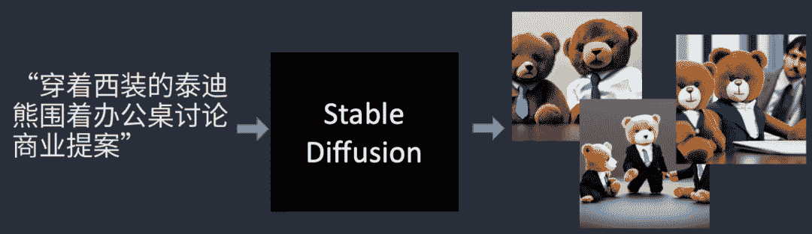

Stable diffusion将文本指令转化为图像

### 扩散模型（Diffusion Model）

稳定扩散模型（Stable Diffusion）属于深度**学习模型中**的一个大类，即扩散模型。它们是生成式模型，这意味着它们旨在生成类似于它们在训练中看到的新数据，在 Stable Diffusion中，新数据是新图像。为什么叫扩散模型？因为它的数学看起来很像物理学中的扩散。我们来了解一下这个模型的理念。

### 前向扩散（Forward diffusion ）

假设我训练了一个只有两种图像的扩散模型：猫和狗。在下图中，左边的两个峰值（红色箭头标注）代表猫和狗的图像组。

前向扩散过程将图片变成噪声图所谓前向扩散（forward diffusion）过程就是向训练图像中不断地添加噪声，从而使其逐渐变为一张毫无意义的纯噪声图。在我们的例子中，正向过程将任何猫或狗图像转换为噪声图像。最终，你将无法分辨它们最初是狗还是猫。（这很重要）这就像一滴墨水滴进一杯水里。墨滴在水中扩散。几分钟后，它会随机分布在整个水中。你再也无法分辨它最初是落在中心还是边缘附近。下面是图像进行前向扩散的示例，猫的形象变成了随机噪音。

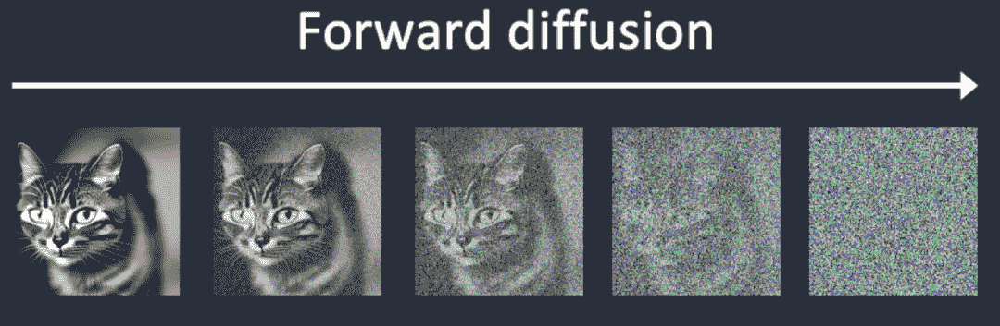

一张猫图的前向扩散过程

### 逆向扩散（Reverse diffusion）

现在是令人兴奋的部分。如果我们能逆转扩散呢？就像向后播放视频一样，时光倒流。我们将找到最初添加墨滴的位置。

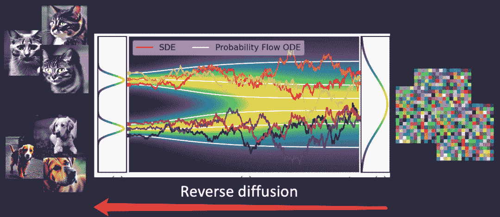

**逆**向扩散过程将图片从噪声图中还原从充满噪音、无意义的图像开始，逆向扩散可以恢复猫或狗的图像。这是**你**想扩**散**的核心概念。从技术上讲，每个扩散过程都有两个部分：（1）漂移drift和（2）随机运动random motion。逆向扩散会最终结果会导向(drift torwards)猫或者狗，但并不会是二者之间的图像。

## **训练是如何完成的？**

逆向扩散的理念无疑是聪明而优雅的，但是真正有价值的问题是“怎么实现它？”为了逆转扩散，我们需要知道图像中增加了多少噪声。**答案是，将会由**一个经过训练的神经网络模型来预测添加的噪声。在Stable Diffusion模型中，这个模块被称为噪声预测器（noise predictor），它是U-Net架构的卷积神经网络模型。其训练过程如下：

1.  选择一张训练图像，比如一张猫的照片

1.  生成随机噪声图像

1.  将噪音图像添加到训练图像中

1.  通过不断与正确结果对比，并自动调整参数，最终让噪声预测器识别出添加了多少噪声

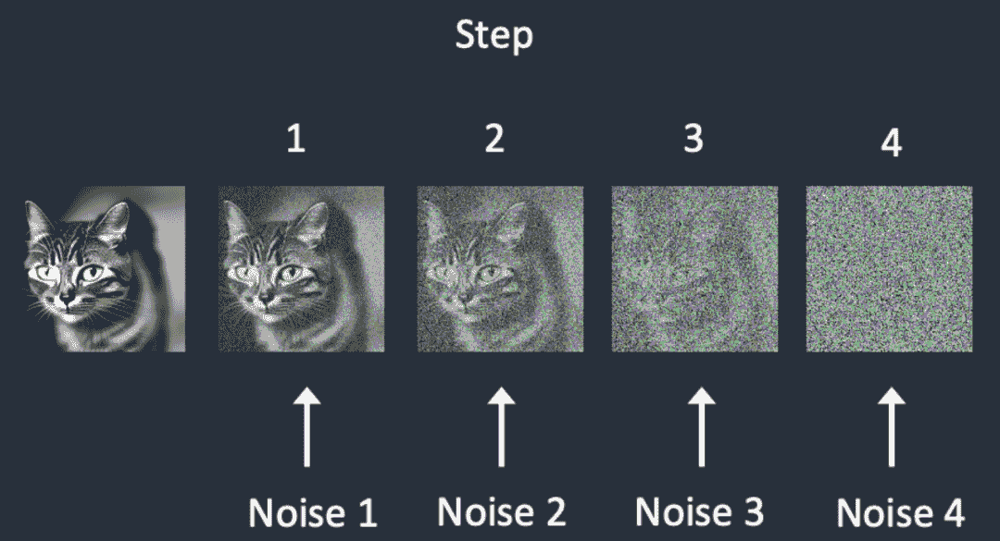

噪声是逐步添加到图像中**的，噪声预**测器将预估每一步中累计被添加噪声的总和经过训练后，我们有一个噪声预测器，能够估计添加到图像中的噪声。

### 逆向扩散（Reverse diffusion）

现**在我们有了一个噪声预测器，我们**将如何使用它呢？我们首先生成一个完全随机的图像，并要求噪声预测器告诉我们噪声。然后，我们从原始图像中减去这个估计的噪声。重复此过程几次，将获得猫或狗的图像。

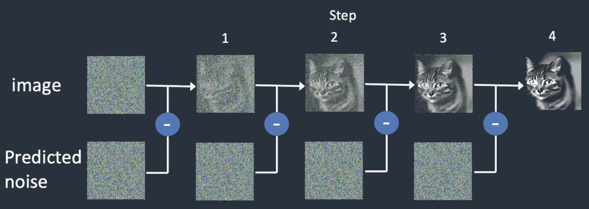

逆**向扩散的工作原理是从图像**中**连续减去预测**的噪声你可能注意到了，按上面的描述，我们所实现的逆向扩散过程没法控制最终结果是一只猫还是一只狗的图像。在后面的conditioning（添加限定条件）章节中我们会着重来论述这一点。就目前我们所介绍的内容来说，图像的生成是不受限定的(unconditioned)

## 稳定扩散模型（Stable Diffusion Model）

坏消息是：我们刚才谈论的不是Stable Diffusion的工作原理！原因是，以上所描述的扩散过程都是在图像（像素）空间（image space）进行的。它的计算量是非常巨大的，因而生成的速度**会非常****慢。而且你不**可能在任何一个单一的GPU**中跑通这个过**程，更别说那些笔记本电脑上的差GPU了。图像空间是巨大的。想想看：一个 512×512 的图像有3个颜色通道（红色、绿色和蓝色）空间为3x512x512=786,432，意味着为了生成一张图，你需要确定768,432个值。像谷歌的 Imagen 和 Open AI 的 DALL-E 这样的扩散模型都在像素空间中进行的，那是因为他们使用了一些技巧来使模型加速，但仍然不够。

### 潜空间扩散模型（Latent diffusion model）

稳**定扩散****模型（Stable D****iff**u**sion）的设计目的就是**要解决速度的问题。方法如下：Stable Diffusion模型实际上是潜空间扩散模型。它不是直接在高维的图像空间(image space)中处理像素数据，而是首先将图像压缩到潜空间(latent space)中，处理潜空间中的低纬度数据。表示同一张图像，潜空间相较于像素空间小了48倍。计算相比之下小了很多，也因此它比标准的扩散模型快了非常多。

### 变分自动编码器（Variational Autoencode）

实现**图像空间**到**潜空间**转换的技术叫做**变分自动编码器**，是的，就是那个你在SD工具中需要加载的VAE文件。变分自动编码器(VAE)神经网络有两个部分：（1）编码器；（2）解码器。编码器将图像压缩为潜在空间中的较低维表示形式。解码器从潜在空间恢复图像。

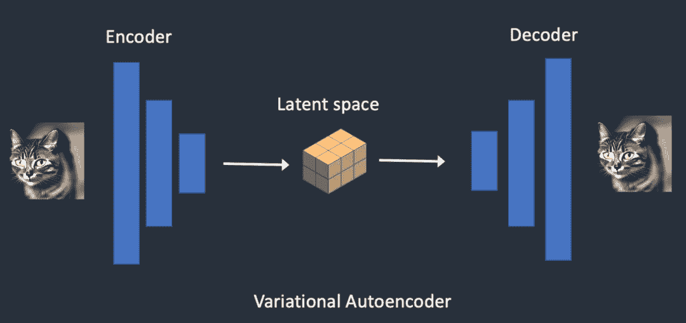

**变分自动编码器**将图像转入以及转出潜空间**Stable Di**ffusion使用的潜空间大小是4x64x64，相较于图像的像素空间(3x512x512)而言**小了****48倍**。我**们谈到的所有正向和**逆向扩散实际上都是在潜在空间中完成的。因此，在训练过程中，它不会生成噪声图像，而是在潜空间（潜噪声 latent niose）中生成随机张量（tensor）。它不是用噪声破坏图像，而是用潜噪声破坏潜空间中图像的表示。这样做的原因是它要快得多，因为潜空间更小。

### **图像分辨率**

分辨率为512×512的图像对应的潜图像的大小为4x64x64，分辨率为768×512的图像对应的潜空间大小是4x96x64。图像越大，需要的潜空间也越大。这就是为什么需要多的内存来生成更大的图像。要生成大尺寸的图像，有两个办法：1）生成512x512的图像，再用AI放大工具进行放大；2）用SDXL模型，生成的图像可以达到1024x1024的分辨率。

### 为什么图像能压缩至潜空间(latent space)？

你**可能想知道为什么V**AE可以在不丢失信息的情况下将图像压缩到更小的潜在空间中。原因不出所料，现实中的图像不是完全随机的。我们所说的一张图像有3x512x512种可能性，是基于每个像素都完全随机的假设。然而自然界中图像它们具有很高的规律性，每个像素不是完全随机的：脸部遵循眼睛、鼻子、脸颊和嘴巴之间的特定空间关系。狗有 4 条腿，它有着特定的形状。因此自然图像可以很容易地压缩到更小的潜在空间中而不会丢失任何信息。这在机器学习中被称为manifold hypothesis。

### **在潜空间中做逆向扩散**

以下是Stable Diffusion中潜空间逆向扩散的工作原理：

1.  生成随机潜在空间矩阵（4x64x64)

1.  噪声预测器估计除潜空间矩阵的噪声

1.  从原始潜空间噪声中减去预测出的噪声

1.  重复2到3步指定的采样次数（sampling steps）

1.  VAE的解码器将得到的潜空间矩阵数据还原为最终的像素图像。

### **什么是VAE文件？**

VAE**文件 在 St**abl**e Diff****usion **v1中用于提升眼睛与面部的绘画结果。正如前面讲的，它们是自动编码器所对应的解码器。通过对解码器进行fine-tuning(微调)，模型的生成图像可以有更优秀的细节表现。你可能会意识到之前提到的并不完全正确。将图像压缩到潜空间中确实会丢失信息，因为VAE编码器无法100%保留所有细节。然而，VAE解码器可以重新绘制出精细的细节。

## 条件限定（Conditioning）

以**上关于模型的描述仍然是不完**整的：当我们使用SD时所传入的文字指令是如何起作用的呢？没有指令的存在，SD并不是一个完整的text-to-image模型。你没有办法控制SD最终为你生成一张猫的图片还是一张狗的图片。这时候我们就需要引入“条件限定（Conditioning）”了。条件限定的目的是引导噪声预测器，以便预测的噪声在从图像中减去后，会使图像朝着我们想要的结果演变。

### 文本指引 (text-to-image)

下图展现了文字指令（Text Prompt）如何经过处理并送入噪声预测器的过程。分词器（Tokenize**r）首先将指令中的每个单词**转化为一个数字表示的词元（token）。每个词元随**后将**转换为一个长度为768的向量，我们称之为嵌入（Embedding），这与你在 AUTOMATIC1111（Stable Diffusion开源包） 中使用的嵌入相同。文本转换器(text transformer)对嵌入进行处理，并准备好供噪声预测器使用

**文本指令被处理并送入噪声预测**器以控制图像生成的过程分词器（tokenizer）

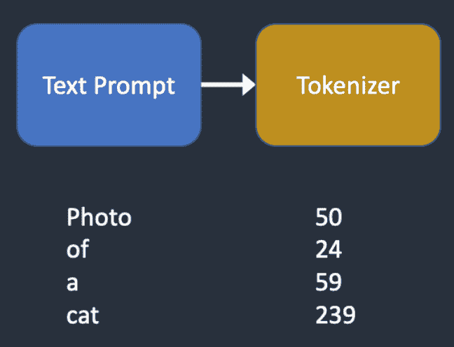

文本指令将会首先被一个CLIP分词器分解为一组**词元。**CLIP是一个由OpenAI()开发的深度学习模型，被用于生成对任意图像的文本描述。Stable Diffusion v1使用的是CLIP分词器。将文本词元化，是使其可以被计算机所理解的第一步。我们人类可以阅读文字，但是计算机只能阅读数字，这就是文本指令处理过程中首先被转换成一组词元所对应的数字的原因。分词器只能**对它在训练期间看到的单词进**行分词。例如，CLIP 模型中有“dream”和“beach”，但没有“dreambeach”。Tokenizer 将“dreambeach”这个词分解为两个token：“dream”和“beach”。所以一个单词并不总是等价于一个token.另一个细则是，空格也是词元的一部分。“dream beach"这个单词将会生成两个词元dream与[空格]beach。这些词元实际上与上个例子中由dreambeach解析出来的两个词元是不一样的（前面例子中的词元是不带空格的）。Stable Diffusion模型所使用的指令长度被限制为75个token。嵌入（Embedding）

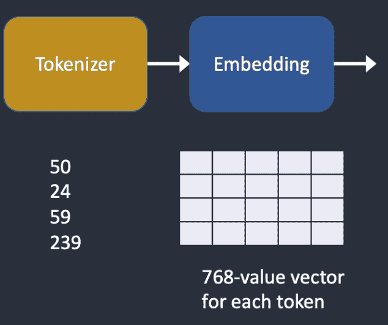

Stable Diffusion v1使用的是OpenAI的ViT-L/14 CLIP模型。在这个模型中每个embedding的向量的长度是768。每个token都有其唯一对应的embedding向量。这些embedding向量的值在CLIP模型中是固定的，通过训练所得到的。我们为什么需要embedding？这是因为不同的单词之间可能会有很强的关联性。我们需要使用到这种关联性的信息。举例来说，man(男人)/gentleman(绅士)/guy(男的)这几个词对应的embedding值几乎是一样的，因为这些单词在文字中大多情况是可以相互替换的。Monet/Manet/Degas都是印象派的画家，但各自风格又有显著区别，所以这几个名字所对应的embedding向量有相近的部分，但又不完全一样。这里我们所讨论的Embedding与在使用SD时用于触发某种风格的关键词是一个东西。embedding可以发挥魔力。科学家们已经证明，找到适当的embedding可以触发任意对象和样式，这是一种称为文本反转的微调技术（textual inversion）。将embeddings喂给噪声预测器(noise predictor)

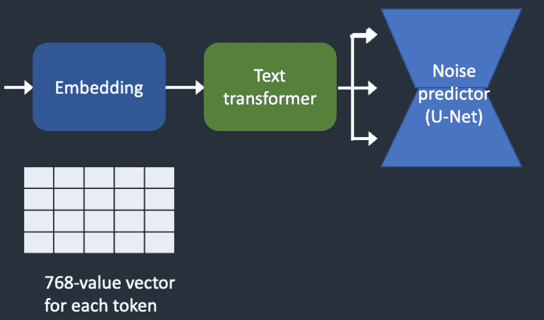

文本输入数据由标签转为噪声预测器输入上一步得到的那些embedding在传入噪声预测器前，还需要先交由文本转换器(text transformer)做进一步处理。transformer**类似于一个通用的条**件限定词适**配器。在这个情况中，输入**给转换器的是embedd**ing向量，但**实际上也可以将其他种类的数据如：类型标签、图像、深度图等作为输入传入这个模型中。transformer存在的意义，不仅仅是需要其作为数据处理的一个环节，更在于它可以提供一个能包含不同条件限定方式的数据处理机制。经由transformer输出的数据，将在后面的U-Net神经网络中被噪声预测器多次使用。而U-Net使用一种叫做交叉注意力（cross-attention）的机制来使用这些数据。正是这个机制使得在前面步骤中被拆散的单词指令能够被正确的组合关联起来。以“A man with blue eyes”为例。Stable Diffusion 将“blue”和“eyes”这两个词配对在一起（提示中的self-attention），这样它就会生成一个蓝眼睛的男人，而不是一个穿蓝色衬衫的男人。补充：Hypernetwork是一种微调技术，它劫持了交叉注意力网络来插入风格。LoRA模型()通过修改交叉注意力模块的权重以更改样式。仅修改此模块即可微调Stable Diffusion模型，这也告诉我们此模块的重要性。

### **其他类型的指引**

文本指令并不是唯一能够调节Stable Diffusion的方式。在depth-to-image功能中，文本与深度图都可以作为调节参数来使用。ControlNet通过轮廓线、人物姿态等来控制噪声预测器，在对于生成图像的控制上取得了非常卓越的效果。

## Stable Diffusion 绘图过程

现在，你已经知晓了Stable Diffusion全部的运作机制了，接下来我们继续逐一详述下Stable Diffusion的各个功能的实际运作过程。

### 文本生成图像（Text-to-image）

在使用文本到图像功能时，你通过给SD传入一个文本指令，使其返回一张图像。

+   **第一步。**Stable Diffusion生成一个潜空间的随机张量。这个随机张量的生成是受你在SD中设置的随机种子（seed）的值所控制的。如果你将随机种子设置成了一个固定值，那SD将始终使用同样的初始随机张量。不要忘了，这个随机张量就是你图像在潜空间中的表达形式，只不过目前他还只是完全的噪声。

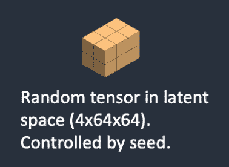

在潜空间生成一个随机的张量（即一组随机数）

+   **第二步。**噪声预测器的U-Net网络会将这个初始随机张量与文本指令作为输入传入其中，并预测出应移除的噪声，当然其也是个潜空间的张量。

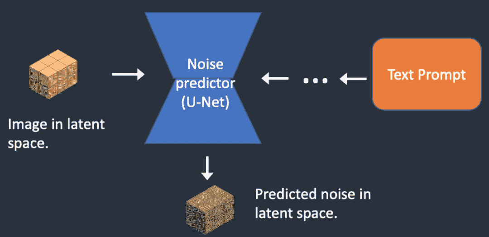

+   **第三步。**将这个潜空间噪声从潜空间初始图像中减去，得到潜空间中新的图像。

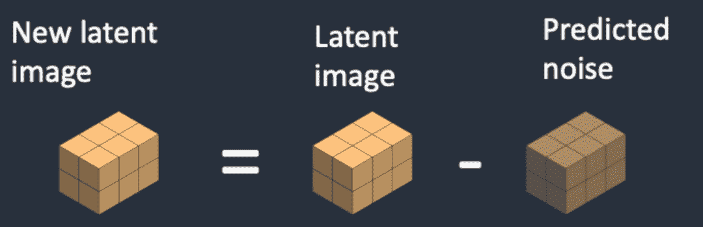

第二步与第三步将根据你设置的采样步数（sampling steps）重复特定次数，比如20次。

+   **第四步。**VAE解码器将最后得到的潜空间图像恢复为像素空间的图像，这也是你在Stable Diffusion工具中最终得到的图像。

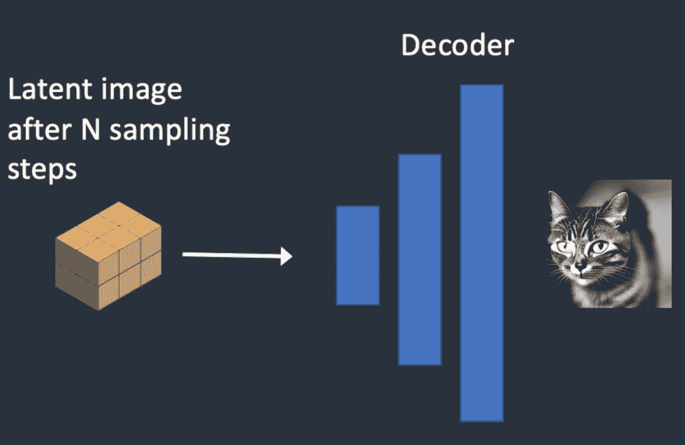

以下是图像在每个采样步骤中的演变过程：

图像从充满噪音变地干净。实际上我们每一步并不是线性地去除噪音，而是有一个噪音去除计划，决定了每一步去除多少噪音，下图是一个示例。噪音时间表是我们定义的。我们可以选择在每一步减去相同数量的噪声。或者我们可以在开始时减去更多。

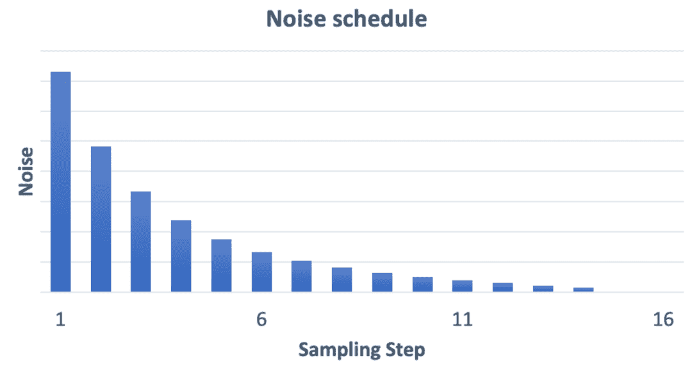

15 个采样步骤的噪声计划

### 图生图（Image-to-image）

图生图方法首先是由 SDEdit 所提出的。SDEdit可以应用于任何的扩散模型。因此我们在Stable Diffusion中也有了图生图的功能。图生图功能使用一张图片与一段文字指令共同作为输入。生成的图像将受到这两个输入的共同调节作用。比如，使用下面这张初级草图以及一段指令 ”photo of perfect green apple with stem, water droplets, dramatic lighting" 作为输入，图生图功能会将其转化为一张很专业的绘画：

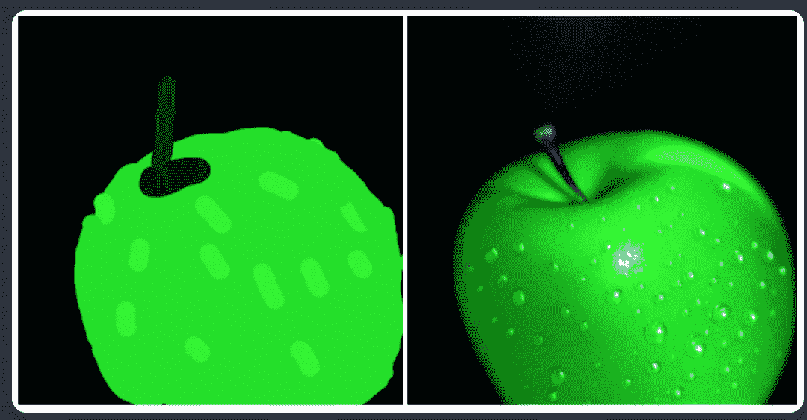

下面介绍其具体生成的过程：

+   **第一步 **输入的图片会被编码至潜空间中

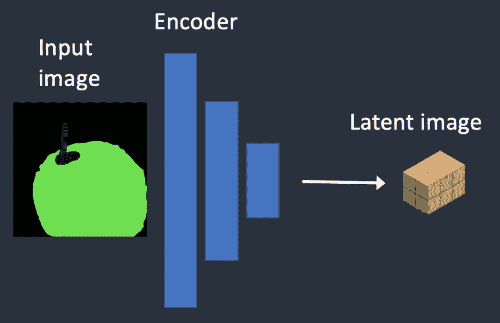

+   **第二步 **我们会向其添加噪声。通过在SD工具中设置降噪强度（Denoising strength）可以控制究竟要添加多少噪声到原始输入图像中去（在潜空间）。如果这个值设置为0，不会有任何噪声添加进去，如果是1则会向其添加最大量的噪声以使其成为一个在潜空间中完全随机的张量。

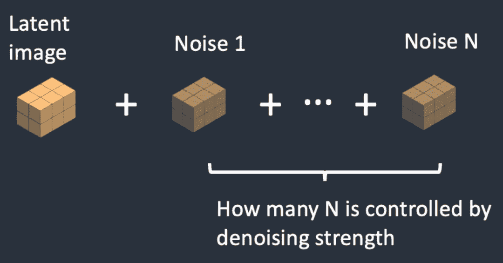

+   **第三步 **噪声预测器将上一步处理后的潜空间图像与文字指令作为输入传入其U-Net网络，并给出预测应减去的潜空间噪声张量。

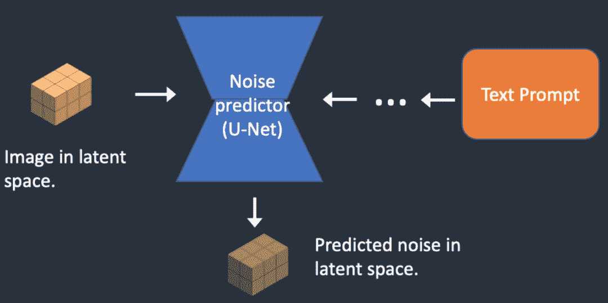

+   **第四步，**将这个潜空间噪声从潜空间初始图像中减去，得到潜空间中新的图像。

第三步与第四步将根据你设置的采样步数（sampling steps）重复特定次数，比如20次。

+   **第五步 **VAE解码器将最后得到的潜空间图像恢复为像素空间的图像，这也是你在image-to-image工具中最终得到的图像。

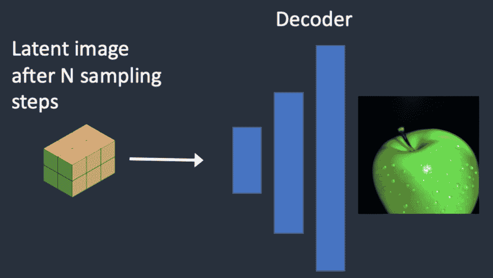

所以现在你知道图生图究竟是什么了，他所做的就是将初始的潜空间图像设置为输入图片与一些噪声的混合。如果你将降噪强度（denoising strength）设置为1，那你获得的图片其实就等价于纯粹使用文本指令运行文本生成图片工具所得到的结果，因为此时这两种功能使用的初始潜空间图像都是一个完全随机的噪声图。

### **修图（Inpainting）**

修图其实只是图生图的一种特殊形式。噪声将仅被添加到图中你希望修改的部分。噪声的添加量同样是使用降噪强度这个参数来控制。

### **Depth-to-image**

Depth-to-image是image-to-image的增强；它使用深度图生成具有附加条件的新图像。

+   **第一步 **输入图像被编码到潜空间

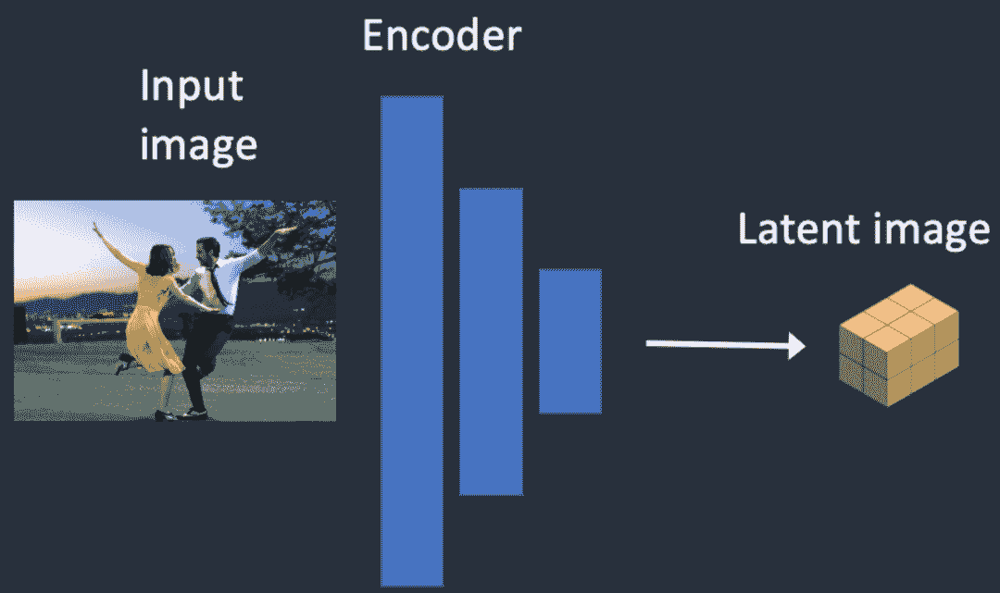

+   **第二步 **MiDaS (一个AI模型) 根据输入图像来分析其深度信息。

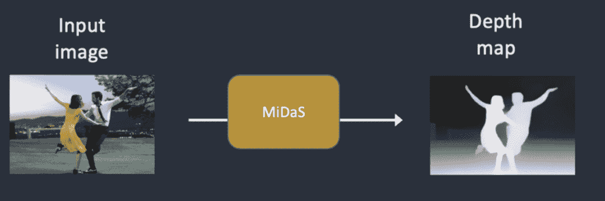

+   **第三步 **我们会向潜空间的原始输出图像添加噪声。通过在SD工具中设置降噪强度（Denoising strength）可以控制究竟要添加多少噪声到原始输入图像中去（在潜空间）。如果这个值设置为0，不会有任何噪声添加进去，如果是1则会向其添加最大量的噪声以使其成为一个在潜空间中完全随机的张量。

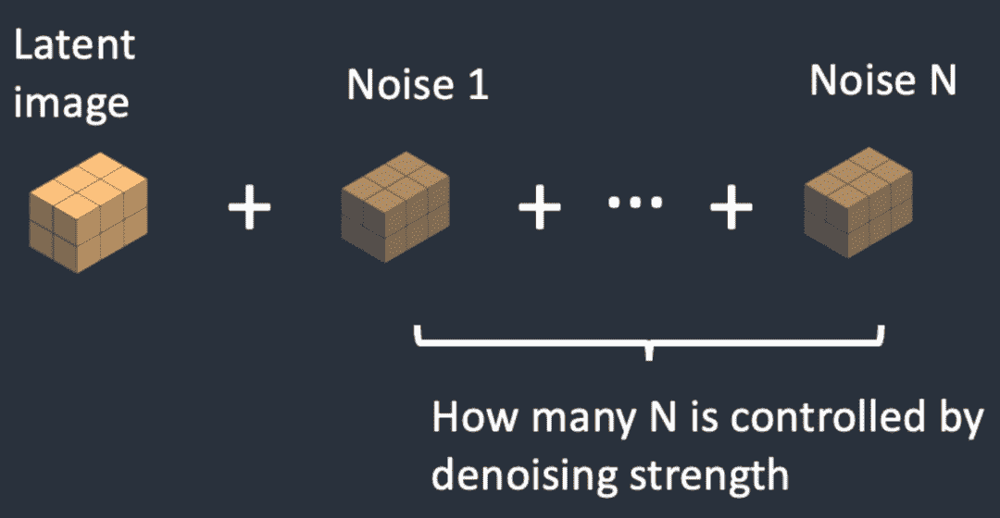

+   **第四步 **噪声预测器将预估应移除的潜空间噪声，并受到文本提示输入和深度图输入的共同调节。

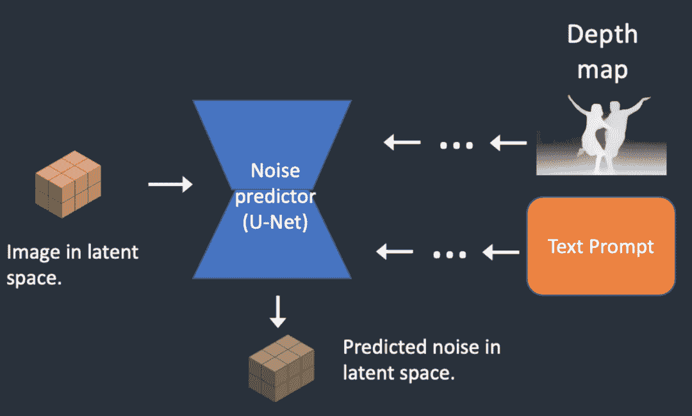

+   **第五步，**将这个潜空间噪声从潜空间初始图像中减去，得到潜空间中新的图像。

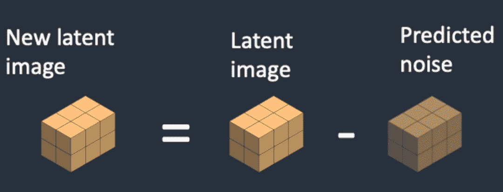

第四步与第五步将根据你设置的采样步数（sampling steps）重复特定次数，比如20次。

+   **第六步，**VAE解码器将最后得到的潜空间图像恢复为像素空间的图像，这也是你在depth-to-image工具中最终得到的图像。

## **什么是CFG值？**

关于Stable Diffusion还有一个重要的概念需要介绍，那就是无分类器引导（Classifier-Free Guidance，CFG）。这个参数相信是每个使用SD的美术每天都在不停调试的值。为了能够较好的理解这个概念，我们先来介绍一下它的前身，即分类器引导（Classifier Guidance）。【译注：尽管我都翻译了，但这部分对于非专业人士来说，理解起来还是比较困难，推荐只看最后一节总结就行了】

### 分类器引导（Classifier Guidance）

分类器引导是一种能够将图像标签（label）信息包含于Stable Diffusion模型中的方法。你可以使用一个标签来引导扩散过程。举个例子，“猫”这个标签可以引导逆向扩散过程使其生成一张关于猫的图像。分类器引导值（classifier guidance scale）是一个用于控制扩散过程应该多贴近于给定标签的一个变量。假设有 3 组数据集，标签分别为“猫”、“狗”和“人”。如果没有分类引导，模型可能会在一幅图中绘制出符合多个标签的图像，如：一个人牵着一条狗。分类引导值越大，绘制结果也明确（如右图所示，三种类型的图像边界会很清晰）。

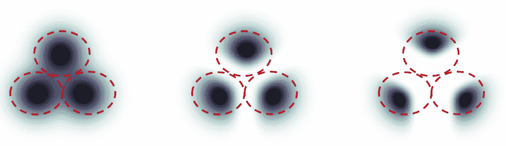

分类器引导。左：无引导。中间：低强度引导。右：高强度引导。在高分类器引导值作用下，模型生成的图像将偏向于极端或明确的结果。如果你要求模型绘制一只猫，它将返回一个明确的图像，该图像是一只猫，没有别的。分类器引导强度（classifier guidance scale）控制扩散过程与指导目标的贴近程度。在上图中，右边的样本比中间的样本具有更高的分类器引导强度。实际上，这个比例值只是扩散模型计算中的一个漂移变量的乘数。

### 无分类器引导（Classifier-free Guidance）

尽管分类器指导为扩散模型带来了突破性的效果提升，但它需要一个额外的模型来提供该指导。这给整个模型的训练带来了一些困难。无分类器引导（Classifier-free Guidance)是一种实现“没有分类器的分类**器引导”**的方法。不同于前面所说使用标签和一个单独模型用于引导，他提出使用图像的描述信息并训练一个带条件的扩散模型（conditional diffusion model）。在text-to-image功能中，这种引导就由文本指令来提供。CFG值无分类器引导 (CFG) 强度是一个值，它控制文本指令（prompt）对扩散过程的影响程度。当将其设置为 0 时，图像生成是无引导的（即忽略提示），而较高的值会使扩散过程更贴近于文本指令。

## **AI绘图的版权问题**

与其他 AI 模型一样，Stable Diffusion 需要大量数据进行训练。它的第一个版本使用了没有版权许可的图像。虽然这对研究来说可能是可以的，但它的商业受欢迎程度引起了版权所有者和律师的注意。2023 年 1 月，三位艺术家对 Stable Diffusion 的商业合作伙伴 Stability AI() 提起集体诉讼。次月，影像巨头Getty又对其提起了诉讼。法律和道德问题很复杂。计算机通过模仿艺术家风格创作新作品是否算作侵犯版权，尚无定论。