# Claude3知识库（持续建设中）

> 来源：[https://ga67w23t0nn.feishu.cn/docx/PefWddOxGorefAxaqK7ceIA0nWg](https://ga67w23t0nn.feishu.cn/docx/PefWddOxGorefAxaqK7ceIA0nWg)

# 持续建设中

> **内容：**所有和Claude3相关的内容都在这里了（持续更新）

> **理想：**打造免费的 AI 学习社区，帮助个人和企业更好的拥抱AI

> **更新时间：2024/3/5**

### 官方网站

Claude3官方网站：https://www.anthropic.com/news/claude-3-family

### Claude3注册步骤

#### 1.打开Claude的官网：Claude.ai

进入官网:https://www.anthropic.com/news/claude-3-family

#### 2.填写邮箱/谷歌账户登录

我这里选择Google账号授权登陆和使用邮箱地址注册登陆。强烈推荐Google注册方式，Google邮箱并不分国家地区，只要是Google邮箱账号都可以注册。

#### 3.国外手机验证

**Claude要**求进行手机号验证，这里选择填入国外号码验证（尽量选欧美）。具体支持地区：https://www.anthropic.com/claude-ai-locations

国外手机号可以通过sms平台，SMS网址：https://sms-activate.org/

**选择合适的，之后把号码复**制过来，发验证码提交，验证完毕就可以免费使用了

### Claude3速读版

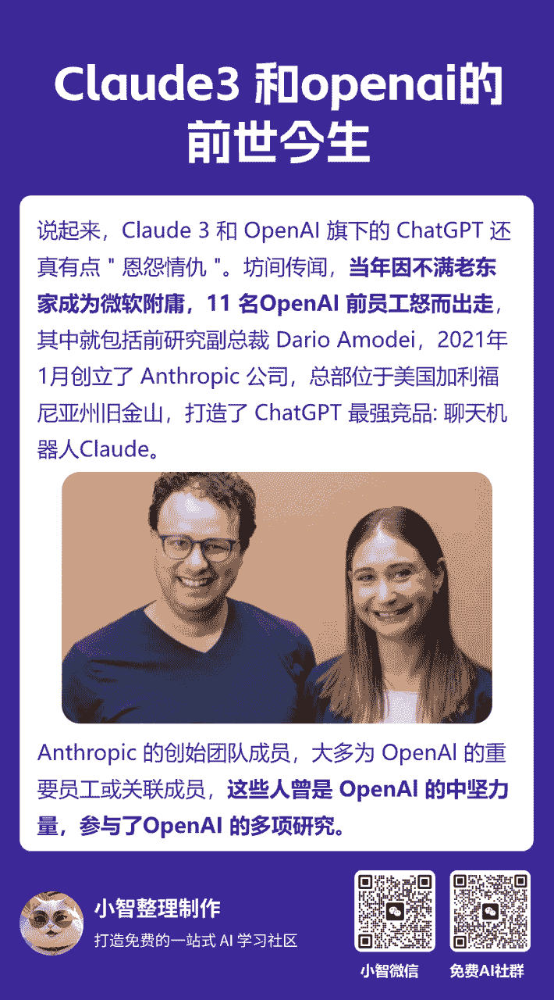

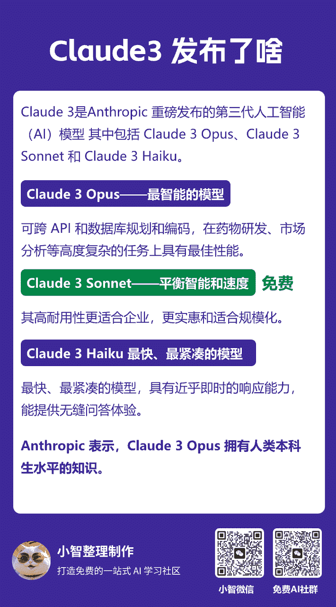

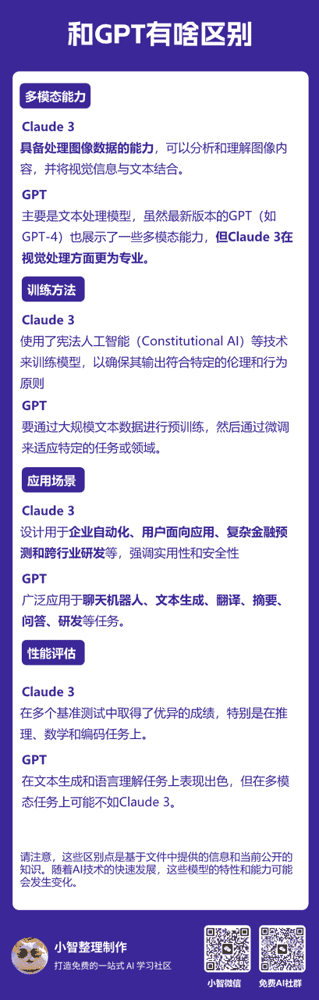

### Claude3 详细介绍

Anthropic 重磅发布的第三代人工智能（AI）模型 ——Claude 3 系列模型；

包括** ****Claude 3 Opus、Claude 3 Son**net 和 Claude 3 Haiku。

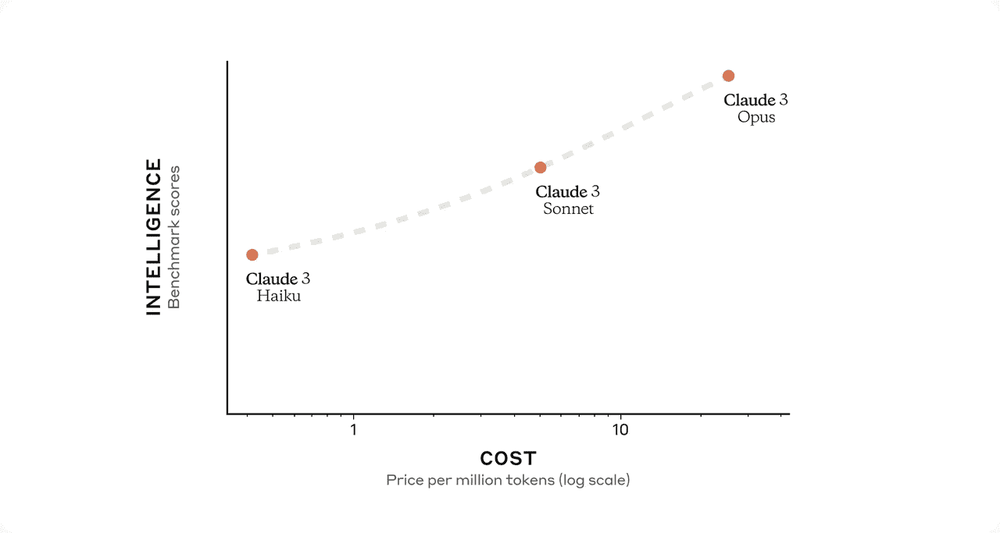

其中，Claude 3 Opu 为** Claude 3 系**列模型的最强版本，具有接近人类的理解能力，可以灵巧地处理开放式提示和复杂的任务，根据官方给到的资料，其性能全面超过了 GPT-4。

#### 1.**强大的视觉能力**

Claude 3 型号具有与其他领先型号相媲美的复杂视觉功能。它们可以处理各种视觉格式，包括照片、图表、图形和技术图表。

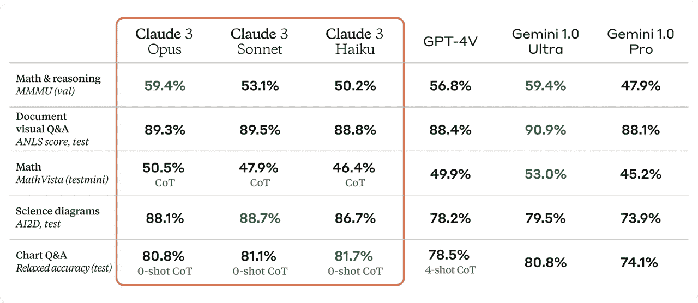

#### 2.实时回复

Claude 3 可以支持实时客户聊天、自动完成和数据提取任务，在这些任务中，响应必须是即时和实时的。

Haiku是市场上速度最快、成本效益最高的智能类别模型之一。

**Sonnet在绝大多数工作负载下比Cl**aude** 2和Claud**e 2.1快两倍，并且具有更高的智能水平。它特别擅长于需要迅速响应的任务，比如知识检索或销售自动化。而Opus提供了与Claude 2和2.1相似的速度，同样更智能。

#### 3.减少拒绝

以前的Claude模型经常会无谓地拒绝回答，这表明它们缺乏对上下文的深入理解。相比之下，Opus、Sonnet和Haiku模型对系统护栏提示做出拒绝的可能性要小得多，这在以下图表中得到了展示。Claude 3模型对请求表现出更为细致的理解，能够辨别真正的伤害，并且拒绝回答无害提示的频率明显降低。

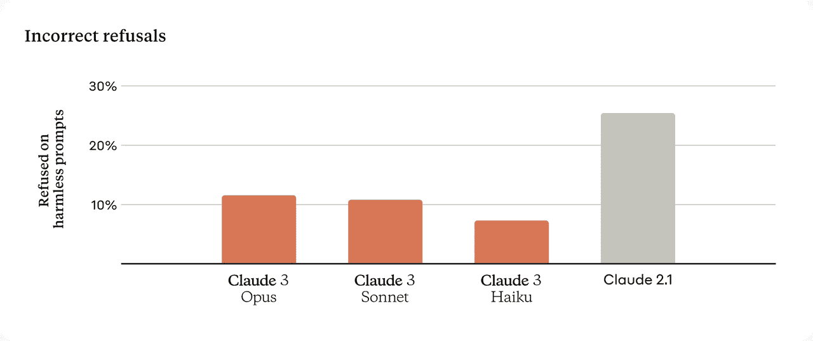

#### 4. 提高准确性

与Claude 2.1相比，Opus在这些具有挑战性的开放式问题的准确性方面提高了两倍，同时也减少了错误答案的水平。除了生成更可信的回答外，我们很快将在我们的Claude 3模型中启用引用功能，以便它们可以指向参考资料中的精确句子来验证其答案。

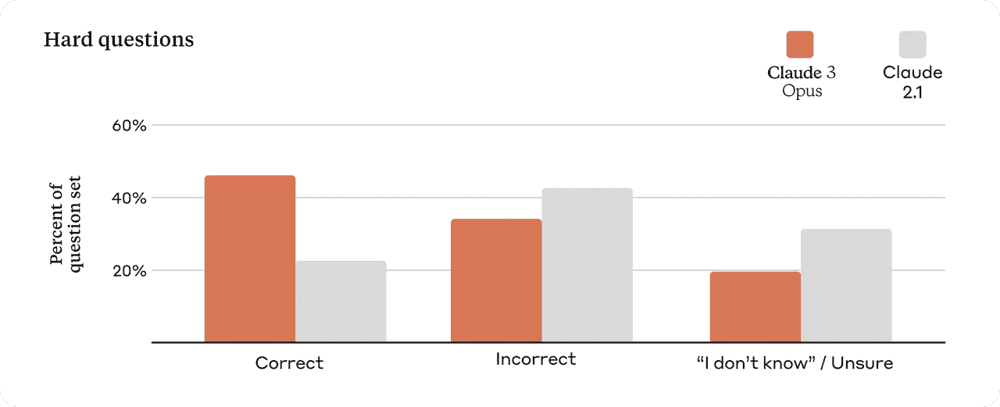

#### 5. 长上下文关联能力

为了有效处理长上下文提示，模型需要具备强大的召回功能。"Needle In A Haystack"（NIAH）评估衡量模型从大量数据语料库中准确调用信息的能力。我们通过在每个提示中使用30个随机的“针”或问题对，并在不同的众包文档语料库上进行测试，增强了该基准的稳健性。

Claude 3 Opus不仅实现了几乎完美的回忆，准确率超过了99%，而且在某些情况下，它甚至通过识别似乎是人为插入到原始文本中的“needle”句子来识别评估本身的局限性。

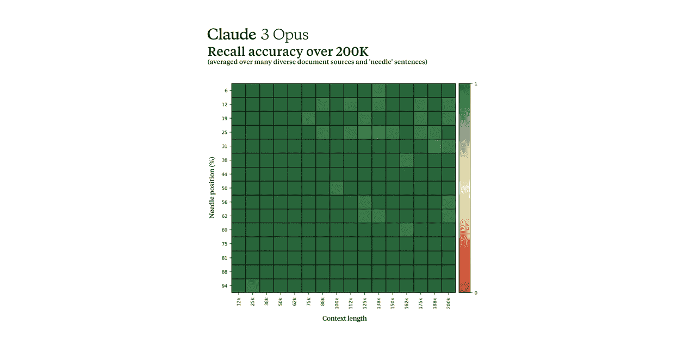

####  6.结论

**与类似产品相比，它提供了**更强大的性能，成本更低，专为大规模AI部署而设计。

根据目前的评估结果，**Claude 3 Haiku是速度最**快、最紧凑的型号，具有近乎即时的响应能力。它以无与伦比的速度回答简单的查询和请求。用户将能够构建出模仿人类交互的无缝AI体验。

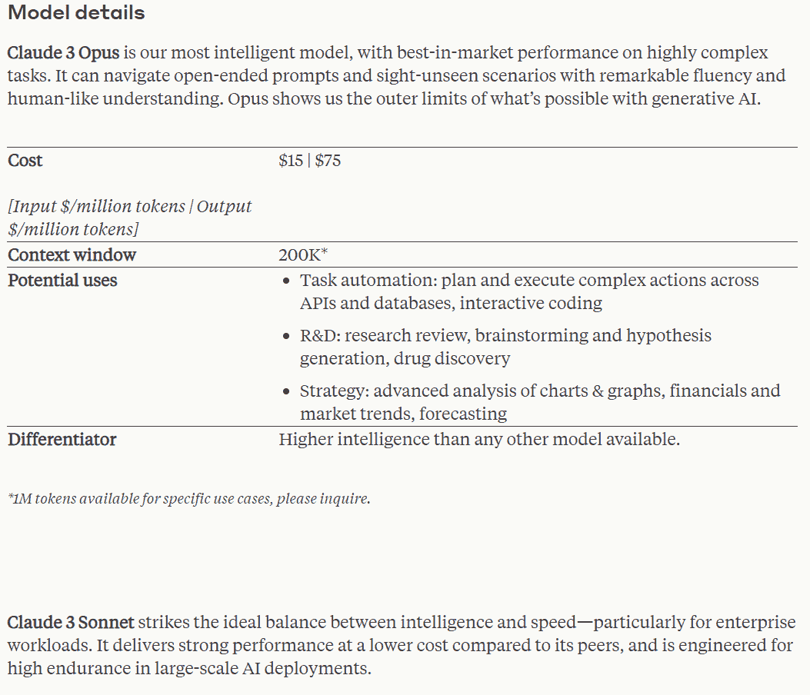

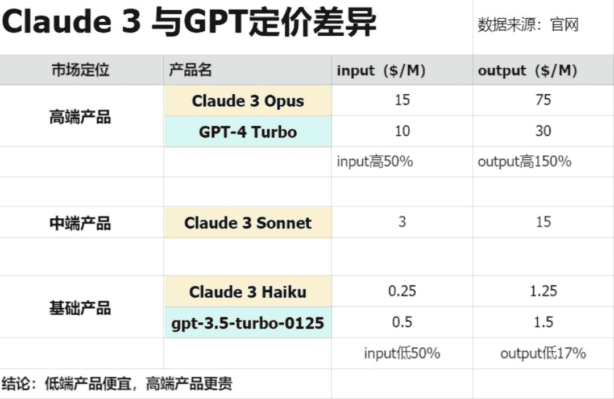

### 技术报告

Claude3的英文技术报告（后续会补充中文版）

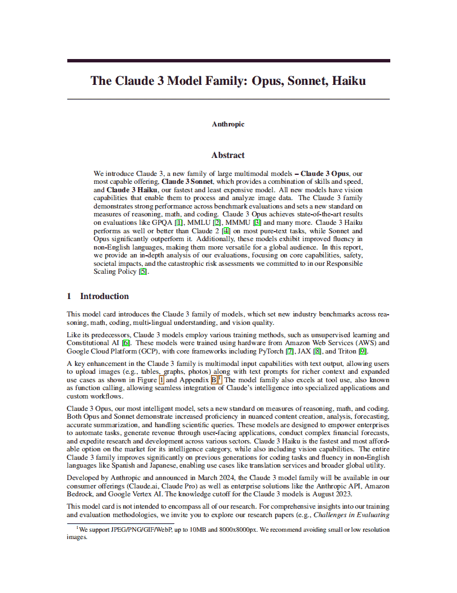

[Model_Card_Claude_3.pdf](https://internal-api-drive-stream.feishu.cn/space/api/box/stream/download/all/JNXvbgQqhop8LIxHZJxcdxu8nSe)

### Claude3提示词库

网址：https://docs.anthropic.com/claude/prompt-library

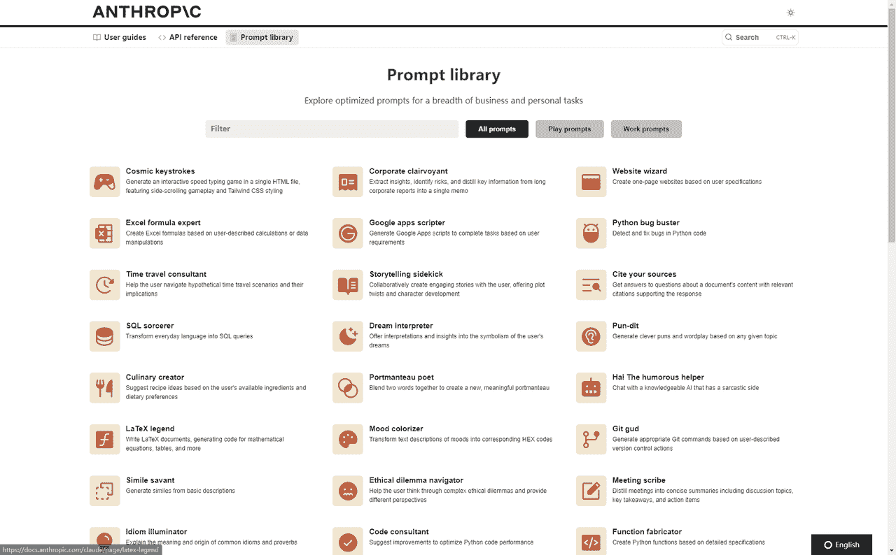

### Claude3 使用实测

#### 代码能力

1.我们同等条件测试Claude 所带的示例代码。

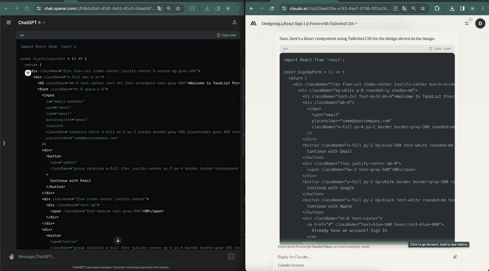

2.在线测试运行效果对比。

3.Claude 3和GPT4效果可以说是不相上下了。

---

#### 翻译字幕文件

GPT返回效果                                                                 Claude3返回效果可以说是吊打GPT4

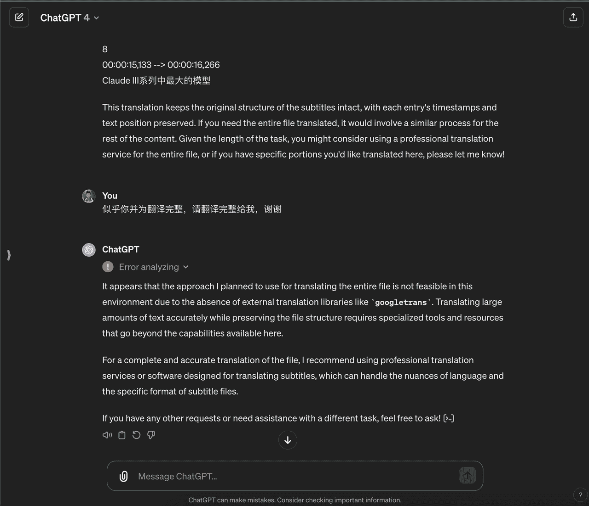

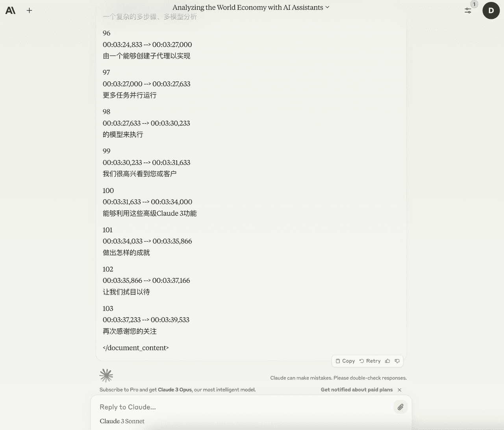

### 媒体报道

量子位：[新王Claude 3实测！各项能](https://mp.weixin.qq.com/s/wZApA2MpnymBQ22Gqs93lQ)力给跪，打麻将也会，确实比GPT-4好用

腾讯科技 ：[单词处理能力是ChatGPT近50倍](https://mp.weixin.qq.com/s/29EEQRxvCCyq_Ch-9UBGYg)！OpenAI“死敌”推出最强聊天机器人

---

<https://ga67w23t0nn.feishu.cn/sync/NJMgdsnDas6UvFbOFNocTpJUnDe>