# KimiChat知识库（持续建设中）

> 来源：[https://ga67w23t0nn.feishu.cn/docx/A7USdnQgFo56vDx5ccrcFsDenWd](https://ga67w23t0nn.feishu.cn/docx/A7USdnQgFo56vDx5ccrcFsDenWd)

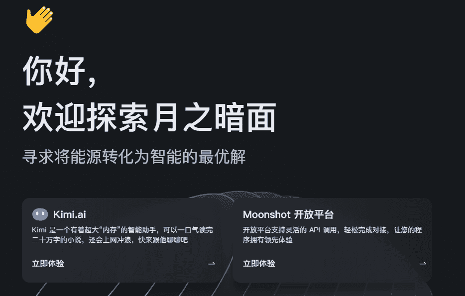

## **Kimi智能助手**简介

**Kimi智能助手**是**由月之暗面科技有限公司（Mo**onshot AI）开发的一款创新的人工智能对话助手，自2023年10月初次亮相以来，以其约20万汉字的无损上下文能力，迅速获得了用户的认可和市场的积极响应。Kimi智能助手的应用场景广泛，包括但不限于专业学术论文的翻译与理解、法律问题分析、发票整理、API开发文档的快速理解等，极大地提升了用户的工作效率和学习效率。

**    目前，Kimi智能**助手已启动200万字无损上下文的内测。随着内测的进行，月之暗面科技有限公司计划逐步向更多用户开放这一具备超长无损上下文能力的Kimi智能助手，以期与用户共同探索和创造更多的智能化应用可能。

> **产品使用地址：**https://kimi.moonshot.cn/

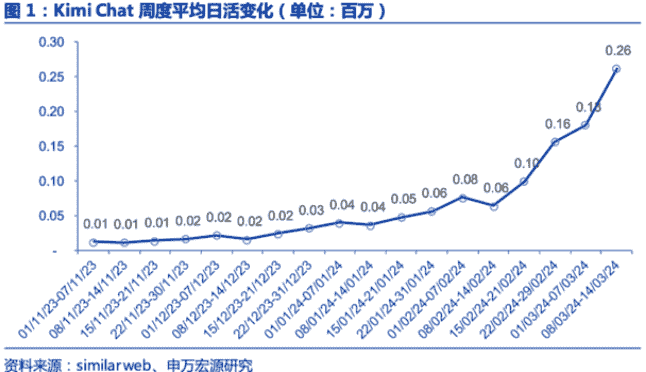

## **Kimi产品特点**

1.  **多语言对话能力**：Kimi Chat支持中文和英文等多种语言的对话，能够理解和回应用户的多样化需求。

1.  **文件阅读与理解**：用户可以上传TXT、PDF、Word文档、PPT幻灯片和Excel电子表格等格式的文件，Kimi Chat能够阅读并理解文件内容，以便更好地回答用户的问题。

1.  **互联网访问能力**：Kimi Chat具备访问互联网的能力，可以解析用户提供的网址内容，并结合这些内容来回答问题。

1.  **搜索功能**：当用户的问题需要通过搜索结果来回答时，Kimi Chat可以利用搜索功能，为用户提供最新的信息和数据。

1.  **大容量文本处理**：Kimi Chat能够处理最多20万字的输入和输出，适合处理大量信息。

1.  **安全性和准确性**：Kimi Chat致力于提供安全、有帮助且准确的回答，同时避免涉及不当内容。

1.  **用户指令遵循**：Kimi Chat会遵循用户的指令，尽可能在一次回复中解决用户的问题。

1.  **政治敏感性**：在回答可能涉及政治敏感的问题时，Kimi Chat会站在中国立场，维护国家主权和领土完整。

1.  **幽默与简洁**：在介绍自己和与用户交流时，Kimi Chat会保持幽默和简洁的风格，以提升用户体验。

1.  **不支持文件创建**：Kimi Chat无法创建文档，但会通过文字回复帮助用户解决问题。

## 团队介绍

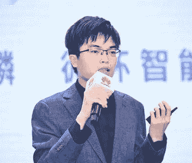

**创始人杨植麟**

杨植麟是清华大学交叉信息研究院的助理教授，同时也是清华教授唐杰的学生，杨植麟曾在FacebookAIResearch、GoogleBrain工作。

联合创始人周昕宇（算法团队负责人）

清华大学2011级本科生，和杨植麟韬同为计算机系的学生。周昕宇在毕业后选择加入旷视，工作内容是算法量产。就职期间，他和旷视研究院基础科研负责人、ResNet作者之一张祥雨合作研究移动端模型，以共同一作的身份撰写ShuffleNet论文，被CVPR接受。这项工作后来影响了包括苹果3D人脸解锁在内的各种手机毫秒级人脸解锁技术。

**联合创始人吴育昕**

毕业于清华和CMU，研究方向为计算机视觉中的检测和识别问题。毕业后他先是在Meta的FAIR工作，曾和AI大神何恺明共同提出组归一化（GN）的方法。期间，他还创建了detectron2，这是Meta最受欢迎的AI项目之一。在Google Scholarship上，吴育昕的被引次数超过了19000次。

## 模型测评对比

根据内部测评，**国产大模型Kimi文字能力全面达到GPT-4水平。Ki**mi中英文生成能力已经接近GPT-4水平，尽管逻辑推理能力仍有差距，且主打文字生成、目前无多模态能力；Cluade3中英文生成、理解、推理，多模态图片理解能力均与GPT-4接近，效果好于Gemini，且实际使用中生成速度快于GPT-4和Gemini。

kimi 在长文本单点能力上实现突破，精准定位办公人群。Kimi支持200万汉字的长文本输入，对比来看，GPT-4Turbo-128k的能力是约10万汉字，Claude3200k上下文是约16万汉字。因此，Kimi更适用于高效阅读、专业文件解读、资料查询、资料整理总结等方面。

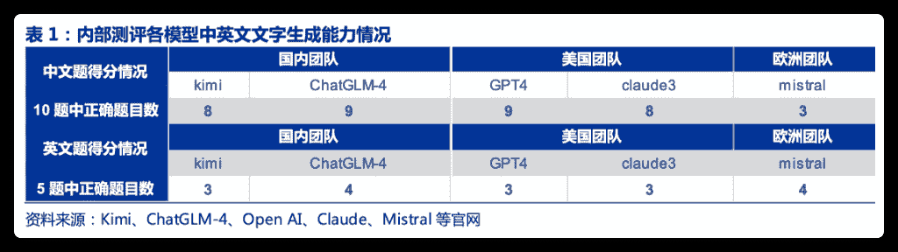

**1）专业论文要点归纳总结任务的表现和GPT4大致相同，响**应迅速，约10秒可以读完论文并给出回答。回答内容简要，并能够根据文档回答追问。

专业论文要点归纳总结任务的表现和GPT4大致相同，响应迅速，约10秒可以读完论文并给出回答。回答内容简要，能够根据文档精准回复追问，体现了模型较好的逻辑推理能力。

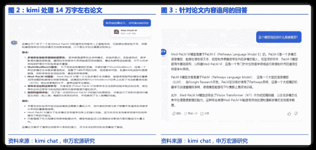

2）资料整理总结方面kimi在会议纪要总结能力上具有优势，选取一场会议的录音转录文本（分成两份pdf）给到模型进行文本纠错和全文总结，kimi的纠错能力和总结能力强于GPT4，例如kimi能根据上下文将“贝尔BT这个T23，T五”这个乱码纠正为“BERT”,并告知可能指BERT模型，其全文总结结果也比GPT4结果更具可用性。

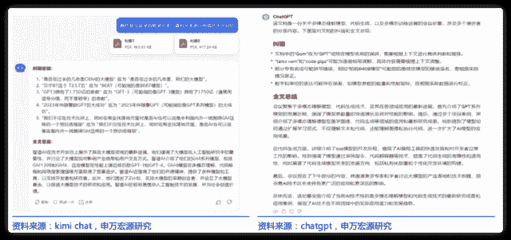

3）能够针对提问自动联网搜索总结回答，答案提供信息来源，更具可靠性。例如下图问kimi关于谷歌2024的最新新闻，基本涵盖了所有要点新闻，总结也到位。

总体来说，我们认为kimi的优势在语言理解、长文本处理、逻辑推理能力上，数学解题和多模态能力暂缺或稍弱。其长文本处理能力让论文总结、会议纪要变得更具可用性，加上联网搜索功能，对于需要查阅大量信息和处理会议纪要的办公人群有极大助力，未来办公类AI应用或将受益。

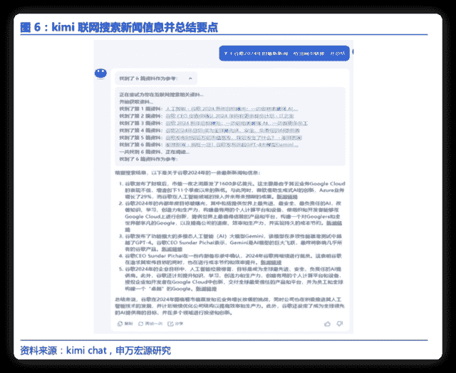

> 测评内容来源：申万宏源：KIMI确认爆款！国内语言大模型正式达到GPT-4水平

##  Kimi功能概览

### 主界面栏使用

#### **上传文件**

**支持的文件格式、大小与数量限制：目前支持上传文件(最多 50 个，每个 100 MB)**， 接受 pdf、doc、xlsx、ppt、txt、图片等，点击这个按钮后选择文件或者拖拽文件进入窗口以上传文件

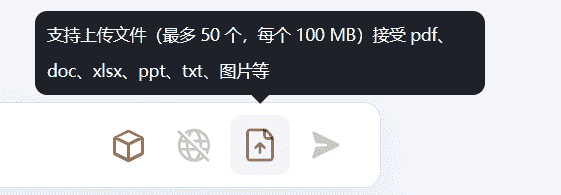

#### 常用语功能

点击这个立方体，选择添加常用语；设置唤醒词后只要输入就会触发提示词连招

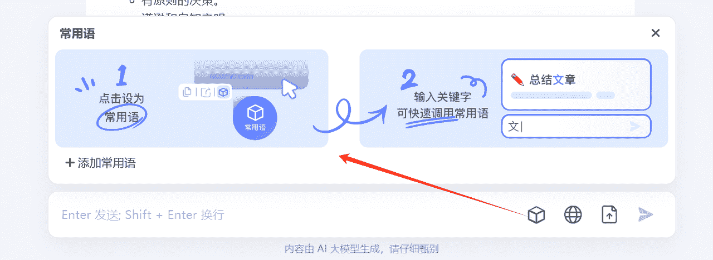

### 长文本处理能力（绝活）

目前可以读取20万字的文章，超过了以后会告诉你只读取了多少%的内容。

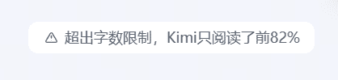

请注意，就算文件数没有到50个的上限，如果上下文超过了也会显示无法读取！

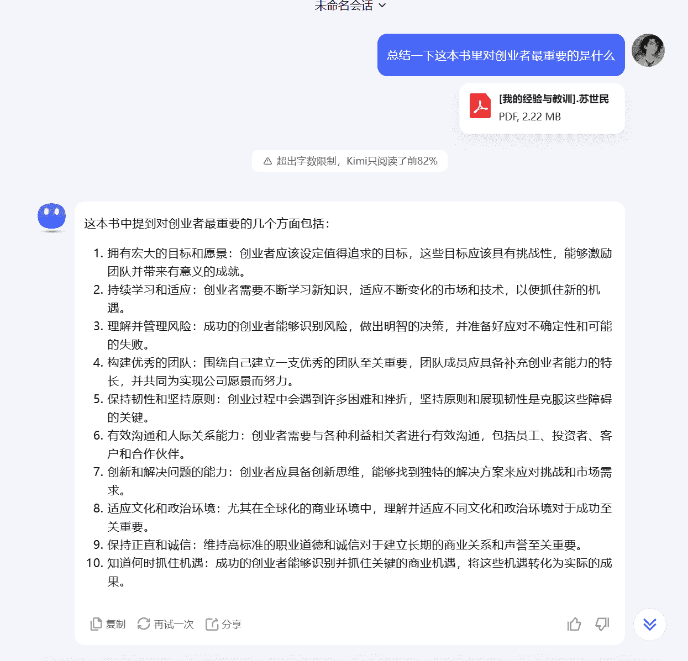

**长文本总结分析如下**：

可以说，这一点上**革命了“搜索引擎”的功能。**

过往你需要从海量的信息中翻找并自己总结...

现在，你可以让kimi去读取并总结提炼，把有用的部分呈现给你。

####    二、 资料来源的提供与查看

###   D. 文档校对功能（一个文档，一个要求，全盘扫描）

#### I have a request！

<https://ga67w23t0nn.feishu.cn/sync/NJMgdsnDas6UvFbOFNocTpJUnDe>

##