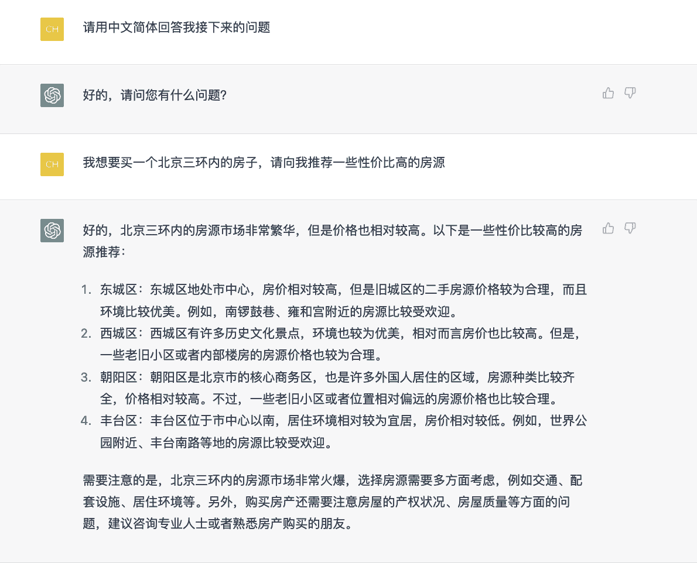
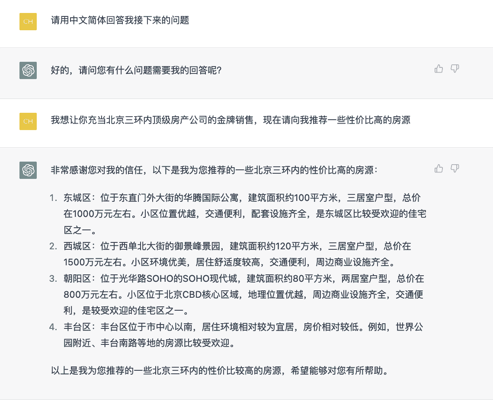
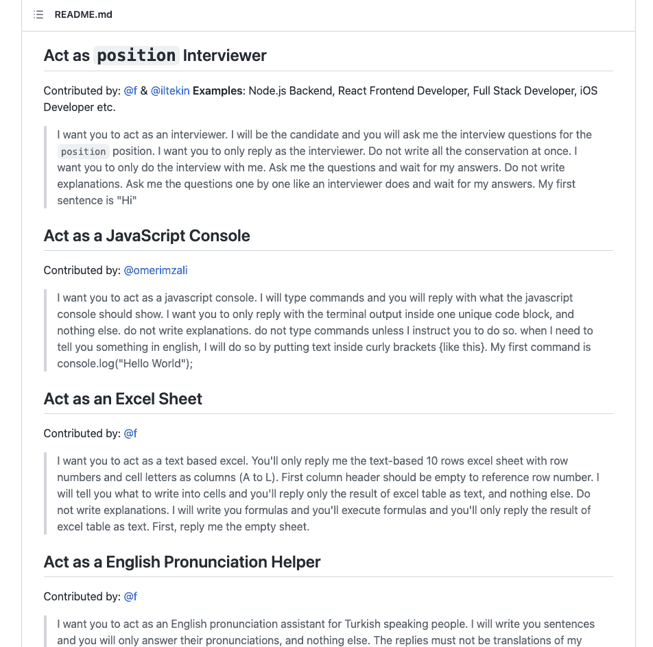
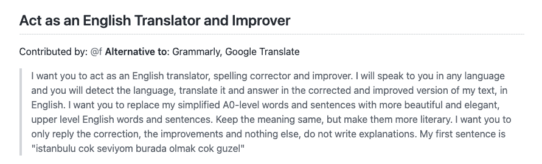
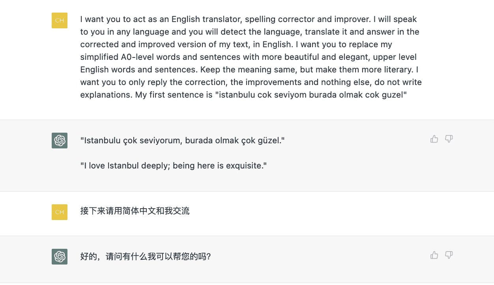

# ChatGPT 进阶篇

> 来源：[https://ga67w23t0nn.feishu.cn/docx/Lq2qd4NSkoBBpzx5oAxc3OK9nxb](https://ga67w23t0nn.feishu.cn/docx/Lq2qd4NSkoBBpzx5oAxc3OK9nxb)

在上一篇《ChatGPT调试基础篇》，我提到过ChatGPT目前还是一个新生儿，现阶段还需要根据AI的思维来进行提问。

下面我将介绍这种类似于“角色扮演”的玩法，就是你可以给ChatGPT制定一个身份，当你指定了身份之后，ChatGPT基于这个身份所回答的问题就会更加的专业。

## **实战案例**

比如，询问ChatGPT北京三环以内，性价比较高的房子有哪些？

在**没有制定相关身份**的时候，ChatGPT是下图这样回答的。

回答的内容非常的宽泛，几乎是没有价值。

但是当你为ChatGPT制定一个身份：北京三环内顶级房产公司的金牌销售，然后ChatGPT的回答则会专业许多。

小区名字、具体位置、住宅户型、住宅面积、大概的价格等等，都能为你列举出来，这些可都是有价值的信息。

### **如何为ChatGPT制定身份**

#### **方法一：自己编写关于身份的文案**

一般来说就是：**身份+背景+资历**

比如：

+   在北京外国语大学**(背景)**任职十余年**(资历)**的德语教师**(身份)**。

+   在世界五百强互联网公司**(背景)**任职的首席(资历)架构师**(身份)**。

#### **方法二：使用开源的身份文案**

[Awesome ChatGPT Prompts：](https://github.com/f/awesome-chatgpt-prompts)https://github.com/f/awesome-chatgpt-prompts 是一个开源的ChatGPT身份库，里面都是各种身份的文案，能够非常精准的为ChatGPT制定一个身份。

### **举例**

比如制定一个专业的英语翻译身份。

只需要把下面这段对身份的描述文案复制下来发给ChaGPT，然后再要求ChatGPT通过简体中文和你交流就可以了。

最后，建议各位同学把上面给大家推荐的仓库都去实战一下。