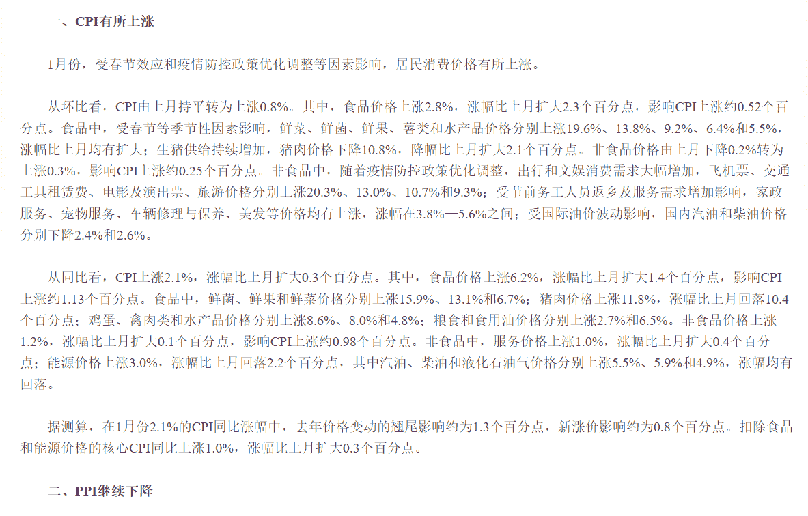
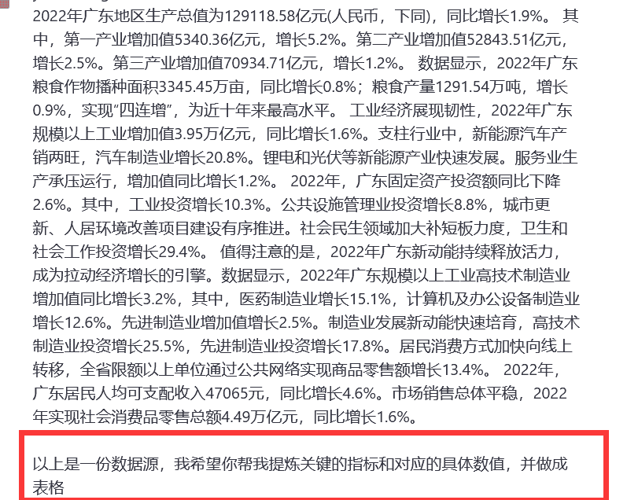
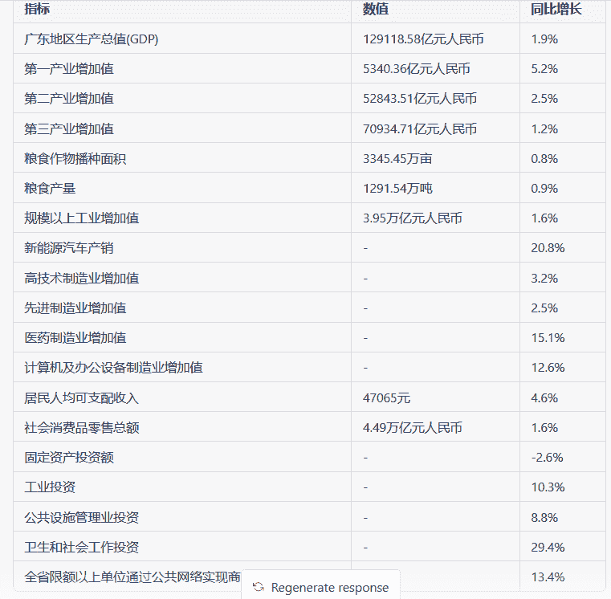
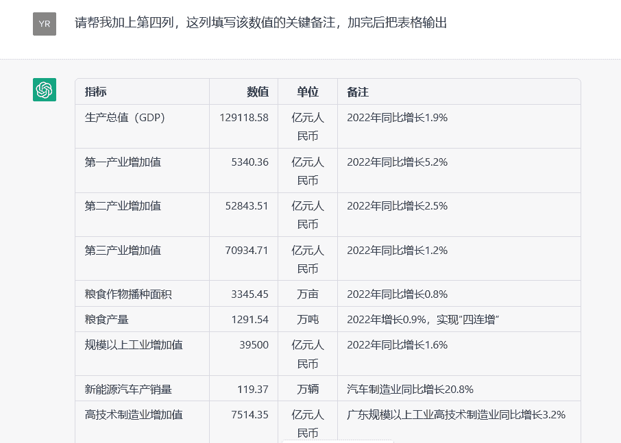
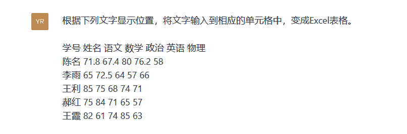
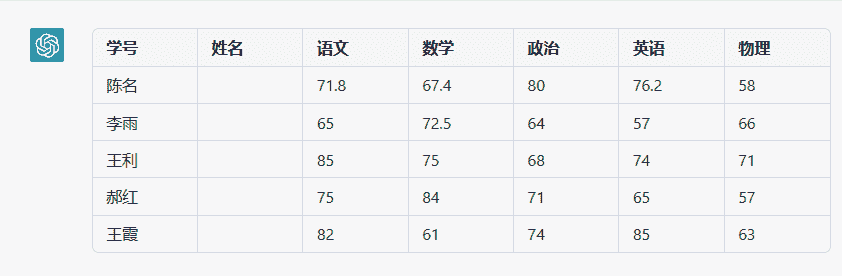

# 如何使用ChatGPT统计数据

> 来源：[https://ga67w23t0nn.feishu.cn/docx/NJZ6dZ0LJo6x7sxboSxcyaHenCc](https://ga67w23t0nn.feishu.cn/docx/NJZ6dZ0LJo6x7sxboSxcyaHenCc)

对于不擅长统计数据的人来说，数据统计是一项非常耗时耗精力的工作，特别是有大量的数据且没有规律的情况下，大多数人都会很头大。

比如给你一篇文章，里面有大量的数据让你统计，光找数据就会让人崩溃……

如下面这篇文章的数据

如果以上数据要人工统计并细化为表格，是需要耗费一定时间的

但是chatgpt是可以直接复制整篇文章，并提出数据整理的需求的。

总共流程不超过1分钟，并且还能提出优化需求进行优化。

**ChatGPT统计数据步骤：**

1.  首先，你需要准备好你想要统计的数据，比如一组数字或者一张表格。

1.  然后，你需要输入你想要做的操作，比如求和、求平均、求最大值等等。

1.  接着，ChatGPT会根据你的输入生成一个公式，并将其填入相应的单元格。

1.  最后，你可以复制粘贴生成的表格到Excel或者其他软件中。

**案例1**

以下是一份数据源，我希望你帮我提炼关键的指标和对应的具体数值，并做成表格（数据源来源与统计网站，直接复制的)

**生成表格：**

**增加内容，优化表格**

**案例2**

[根据下列文字显](https://www.zhihu.com/search?q=Excel%E8%A1%A8%E6%A0%BC&search_source=Entity&hybrid_search_source=Entity&hybrid_search_extra={:,:})示位置，将文字输入到相应的单元格中，变成Excel表格。

**chatgpt得出表格如下：**

有没有发现，ChatGPT处理这种数据表多的文章，简直就是神器啊，特别是那些财报文章，有了ChatGPT读起来再也不用那么吃力了！