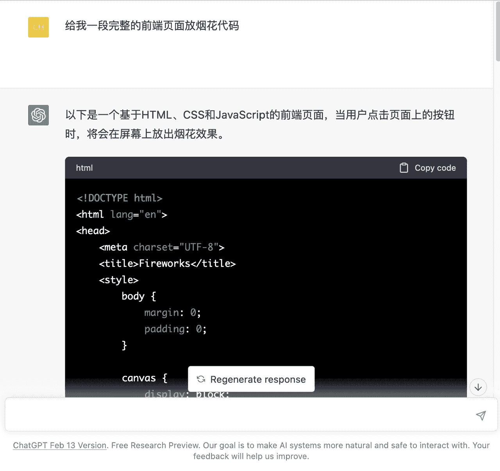
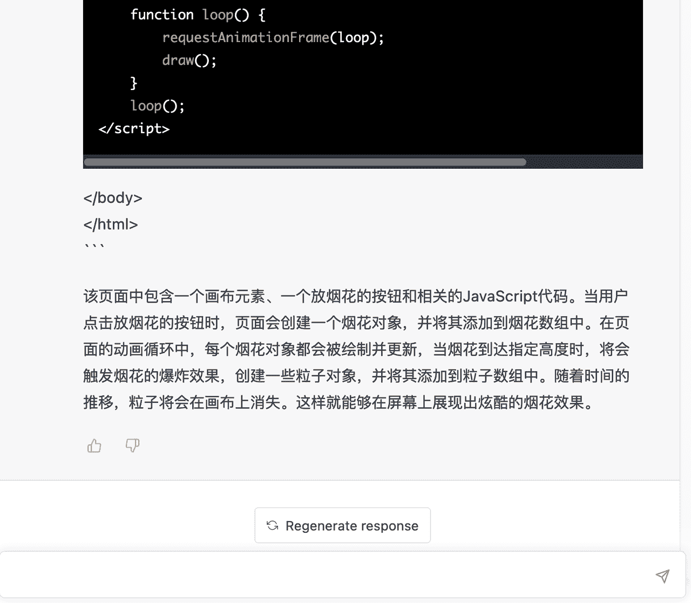
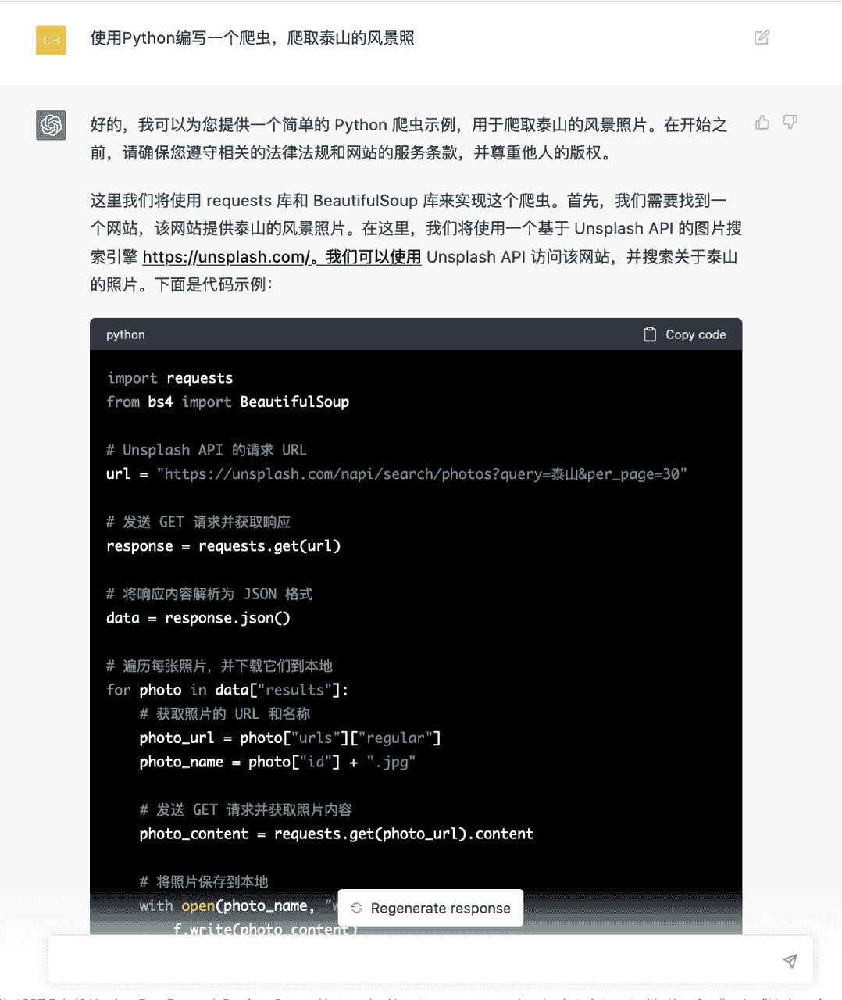
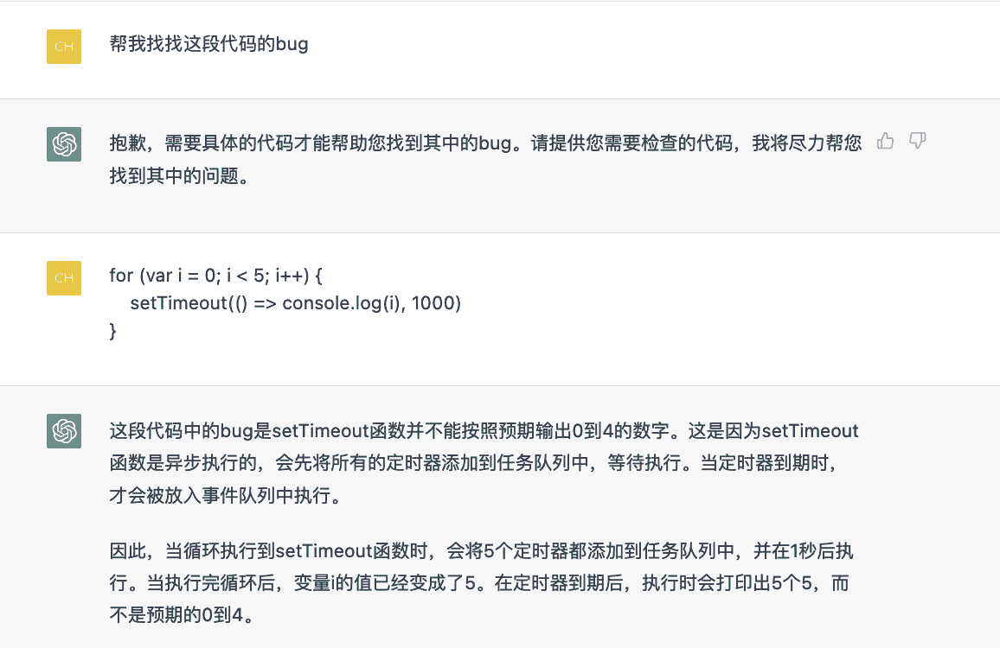
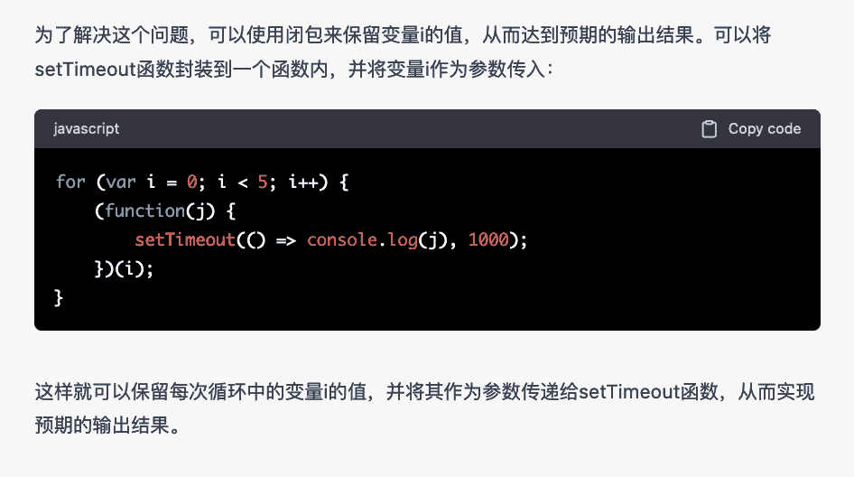
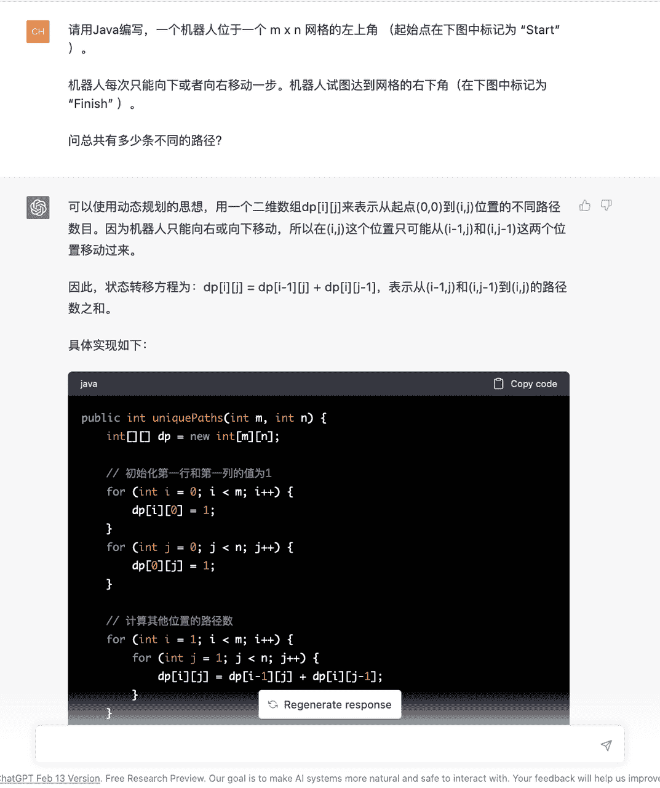
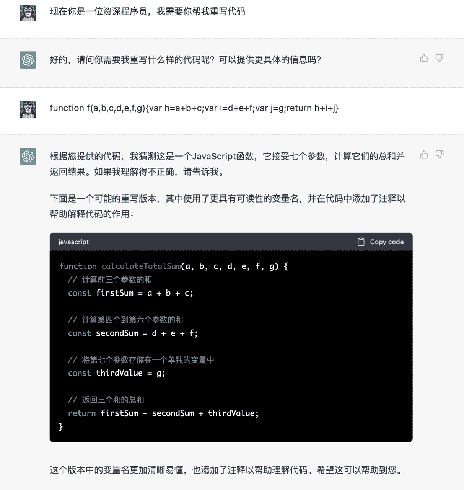
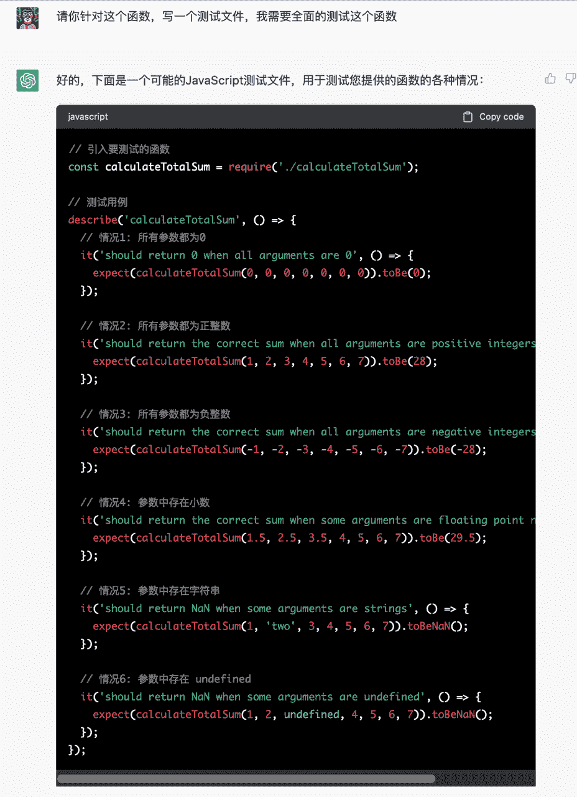
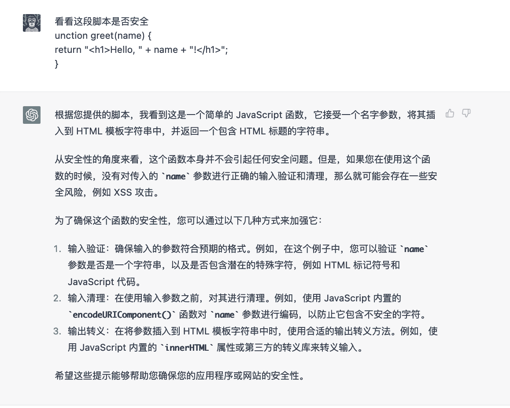

# 如何使用ChatGPT写代码

> 来源：[https://ga67w23t0nn.feishu.cn/docx/VOefd1n87o8hDOxNTQLc7yiTnbf](https://ga67w23t0nn.feishu.cn/docx/VOefd1n87o8hDOxNTQLc7yiTnbf)

以往大家总是调侃说程序员只要会用Google就好了，直接搜对应的代码然后复制粘贴就可以了。但是只有程序员才知道真要找到可用的代码是不容易的，经常是找很久都没有合适的代码。

ChatGPT在编程方面拥有着不可忽视的优势，能够生成高质量的程序代码，现在成为了众多程序员的开发必备工具。能够轻松解决各种编程问题，输出对应的代码甚至是帮你找到自己代码中的Bug。

下面通过一些实际需求和案例为大家讲解：

## **一段完整的烟花特效的前端代码**

你可以直接对ChatGPT输入：给我一段完整的前端页面放烟花代码。

ChatGPT就会输出对应的代码，并且在代码输出后对代码进行讲解。

## **Python语言写爬虫**

需要使用Python编写爬虫代码的时候，也可以通过ChatGPT来生成代码。

输入：使用Python编写一个爬虫，爬取泰山的风景照

## **找Bug**

讲自己的代码输入之后，ChatGPT很快就找到了Bug所在，然后非常详细的解释Bug出在哪，代码运行会导致什么错误。

紧接着告诉我该如何修改这段代码，以及为什么要这么改，真的很棒！

## **算法题**

如**果你正**在学习编程算法题，同样可以通过ChatGPT来编写算法、讲解算法。甚至可以将你编写的算法代码输入，让ChatGPT找出代码潜在的问题。算法题

一个机器人位于一个 m x n 网格的左上角 （起始点在下图中标记为 “Start” ）。机器人每次只能向下或者向右移动一步。机器人试图达到网格的右下角（在下图中标记为 “Finish” ）。

问总共有多少条不同的路径？

**答**

# **提高代码质量**

## 生成代码注释，提高代码的可读性和可维护性

下面这段js代码的可读性非常差，

function f(a,b,c,d,e,f,g){var h=a+b+c;var i=d+e+f;var j=g;return h+i+j}

首先告诉ChatGPT，让ChatGPT成为一名资深程序员，然后帮我们重写代码。然后将代码发给ChatGPT就可以了。

重写的代码添加了注释，这样更方便大家理解这段代码的作用。

如果觉得重写的代码不够好，可以继续让ChatGPT按照你的要求重写。

## 生成测试用例，更好的发现和修复代码中的错误以及缺陷

ChatGPT给出的这个测试用例，包含了各种输入和输出：

+   所有参数都为0

+   所有参数都为正整数

+   所有参数都为负整数

+   参数中存在小数

+   参数中存在字符串

+   参数中存在 undefined

只要能通过这个测试用例，那就说明这个函数没问题。

## 进行代码评审，提高代码的质量和可靠性

这里我们让ChatGPT检查下面这段js代码是否有安全问题。

unction greet(name) {

return "<h1>Hello, " + name + "!</h1>";

}

既然这段脚本有问题，那就让ChatGPT帮你重写吧。

最后，在代码方面ChatGPT已经非常智能了。AI背后收集了大量的数据，所以在某些场景下，ChatGPT通过AI方式回答的内容体验已经超过相同问题在Google搜索的返回内容。

如果你是一位程序员，还没将ChatGPT融入到自己的工作当中，那可得赶紧呦～

<https://ga67w23t0nn.feishu.cn/sync/W0Jwd4LY7sxxCTbfUDMcZ55Xnbd>

<https://ga67w23t0nn.feishu.cn/sync/NJMgdsnDas6UvFbOFNocTpJUnDe>