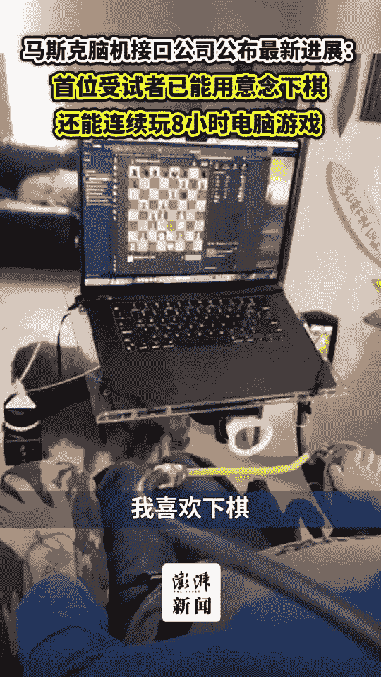
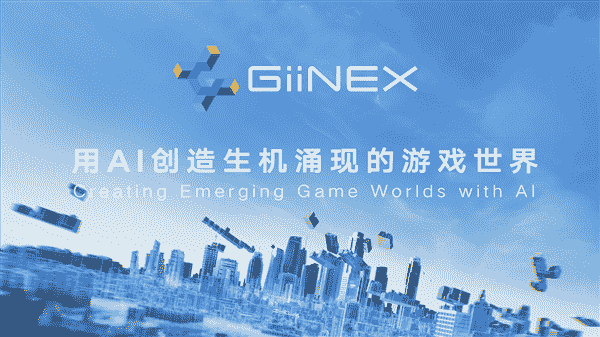
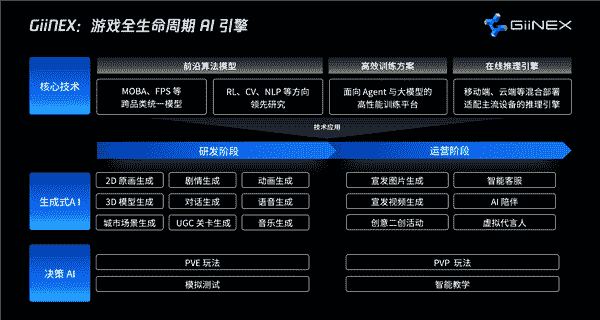
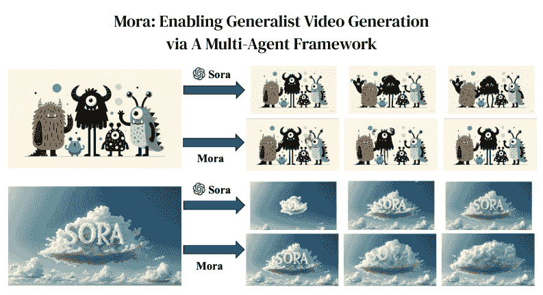
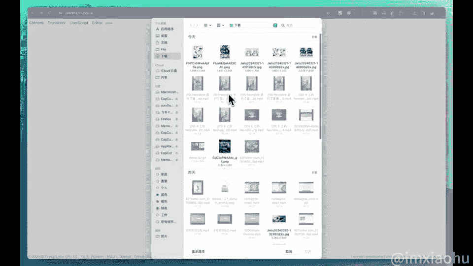
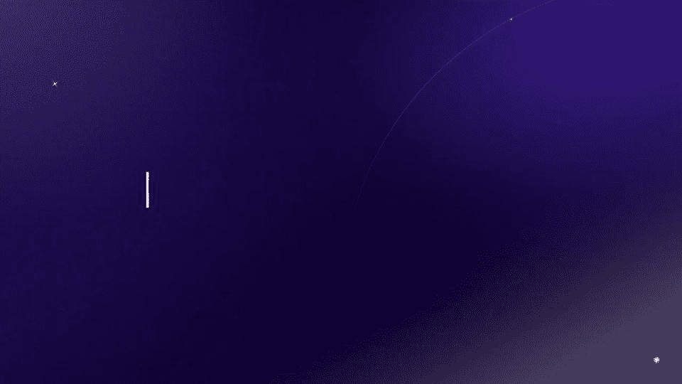

#  AI 星球 | 日报3.21

> 来源：[https://ga67w23t0nn.feishu.cn/docx/Ru0ddSvdIotkfrxy7yGcWRNmnri](https://ga67w23t0nn.feishu.cn/docx/Ru0ddSvdIotkfrxy7yGcWRNmnri)

### 关于AI星球社群

> **作为多年的互联网从业者，我深知普通**人去学习AI知识的痛点和问题，我希望运用我的一些行业经验，去做一个知识的桥梁，让人人都能看的懂学的起AI，群里会持续关注并更新 AI 的相关资讯动态，研究报告，应用场景，AI变现，技术研究等相关内容，小智的目标是打造免费的一站式开源AI学习社区，帮助大家更好的拥抱AI。

### 1. AI 网站生成平台 Dora Al 宣布即日起开启全面公测

3月21日，开发平台 Dora 宣布，首个生成式 A网站开发平台 Dora AI结束候补内测全面开启公测。据悉，用户可以像ChatGPT那样，只使用文本就能通过 Dora A1，端到端地快速开发商务、科技、营销、动漫等几十种类型网站，页面、功能编辑支持可视化拖拽操作。

体验网址：https://www.dora.run/ai?ref=ai-bot.cn

### 2.马斯克旗下脑机接口公司新进展:首位受试者直播靠意念移动光标玩游戏

当地时间3月20日，特斯拉CEO埃隆:马斯克旗下脑机接口公司Neuralink披露了首位脑机芯片植入受试者的最新情况，并表示这位四肢瘫痪的男子已经能够通过意念玩游戏和在线国际象棋。视频显示，病人Noland Arbaugh能够使用电,脑下国际象棋、玩游戏《文明V》。他在直播中一边移动棋子一边说，"如果你们都能看到光标移动，没错，那就是我，这很酷吧?"

来源：https://www.thepaper.cn/newsDetail_forward_26758321

[20240321100347629b2973350-acbc-4c5c-9967-73b843b87d9b-15c00788-4d8d-fde3-068e-35a4bbcd3515.mp4](https://internal-api-drive-stream.feishu.cn/space/api/box/stream/download/all/PSl2b18tEohMUfxCdCvcOqyxnQd)

### 3.腾讯发布GiiNEX游戏AI引擎 用AIGC助力游戏研发运营

3月20日，在2024全球游戏开发者大会(GDC)上，腾讯发布了自研游戏AI引擎-GiiNEX。基于生成式AI和决策A1技术，GiNEX将为游戏全生命周期提供丰富的AI解决方案。借助大模型等生成式AI技术，GiNEX面向AI NPC、场景制作、内容生成等场景，提供了包括2D图像、动画、3D城市、剧情、对话、关卡以及音乐等多样化的AIGC能力，帮助开发者提升高质量内容生成的效率。

### 4.微软等推出的可生成12秒视频的多AI智能体框架

Mora是由来自微软和理海大学的研究人员推出的一个多智能体(A Agents)框架，专门用于通用视频生成任务，目标是模拟并扩展OpenAl的Sora视频生成模型。该框架的核心理念是通过多个视觉智能体的协作来生成高质量的视频内容，Mora通过分解视频生成过程为多个子任务，并为每个子任务分配一个专门的智能体，从而实现了各种视频生成的功能。

Mora的主要功能

文本到视频生成:Mora可以根据用户提供的文本描述自动生成相应的视频内容，能适用于从简单的场景描述到复杂故事情节的视频创作。

图像到视频生成:除了直接从文本生成视频，Mora还能够结合用户提供的初始图像和文本提示，生成与之相匹配的视频序列，增强内容的丰富性和细节，

扩展生成视频:Mora不仅可以从头开始生成视频，还能够对现有的视频内容进行扩展和编辑，增加新的元素或延长视频的持续时间。

视频到视频编辑:Mora具备高级编辑功能，能够根据用户的文本指令对视频进行编辑，如改变场景、调整对象属性或添加新元素。

连接视频:Mora能够将两个或多个视频片段无缝连接起来，创造出流畅的过渡效果，适用于制作视频合集或剪辑。

模拟数字世界:Mora还能够创建和模拟数字世界，可根据文本描述创造出具有数字世界风格的视频序列，如游戏场景或虚拟环境。

Mora的官网入

GitHub地址:https://github.com/lichao-sun/Morac(源码和模型待开源)

arXiv研究论文:http://arxiv.org/abs/2403.13248区

### **5.Manga-ima**ge-Translator: 一键翻译各类图片内文字

一个开源工具，专门用于翻译漫画或**图片中的文字**。

利用高效的OCR和AI**翻译技术，它能够自动**识别和翻译任何图片中的文字，并支持多种语言。

不仅翻译文字，还可以对去除文字后的区域进行修复和上色，以及重新渲染翻译后的文本。

主要功能：[

1、自动翻译图片中的文本：使用先进的OCR技术自动识别图](https://t.co/iE3nvHROPj)[片](https://t.co/iE3nvHROPj)或漫画中的文字，并将其翻译成用户指定的语言。

2、支持多种语言：虽然最初设计是为了翻译日语文本，项目也支持中文、英文、韩文等多种语言的翻译，满足不同用户的需求。

3、文本修复与上色：在移除原始文本后，能够对相应区域进行修复和上色，保持图片的整体美观。

4、文本渲染：翻译完成的文本不仅仅是以简单文本形式呈现，还会根据原图的风格进行渲染，使翻译后的文本自然融入图片中。

5、支持命令行界面（CLI）和Web界面：用户可以通过命令行界面批量处理图片翻译任务，或者通过Web界面进行单个图片的翻译和预览。

6、一键去除漫画中的所有文字，支持多种翻译服务或模型

项目地址：https://github.com/zyddnys/manga-image-translator…

官方演示： https://touhou.ai/imgtrans/

来源：https://twitter.com/imxiaohu/status/1770700877172736238

[Manga-image-Translator.mp4](https://internal-api-drive-stream.feishu.cn/space/api/box/stream/download/all/PaKxbI9vPo6eSLxrH8lcc4cDnDe)

### 6.HeyGen 发布5.0版本 以创建自己的实时视频聊天机器人

5.0推出了全新的用户界面设计，使用户能够更容易地导航和使用平台的各项功能。

引入了全新的视频编辑工作室，提供编辑灵活性和更多控制权，让视频制作变得更加容易。

同时实时数字人聊天功能上线，可以创建自己的实时视频聊天机器人！视频翻译等功能也全面上线！

来源：https://twitter.com/imxiaohu/status/1770818572337500272

[HeyGen 5.mp4](https://internal-api-drive-stream.feishu.cn/space/api/box/stream/download/all/E24PbRy2noQ9ONxsnmccnnlwnAg)

拓展阅读：

[[视频教程] Midjourney视频教程，从入门到精通](https://ga67w23t0nn.feishu.cn/wiki/XYmxwS9LLirOEkkriNjcThlonJb?fromScene=spaceOverview)

---

# **免费AI学习交流社群**

### 关于AI星球社群

> **作为多年的互联网从业者，我深知普通**人去学习AI知识的痛点和问题，我希望运用我的一些行业经验，去做一个知识的桥梁，让人人都能看的懂学的起AI，群里会持续关注并更新 AI 的相关资讯动态，研究报告，应用场景，AI变现，技术研究等相关内容，小智的目标是打造免费的一站式开源AI学习社区，帮助大家更好的拥抱AI。

