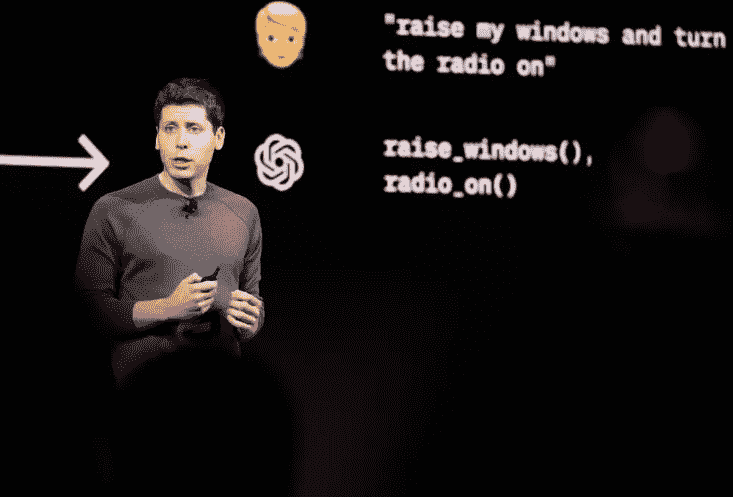
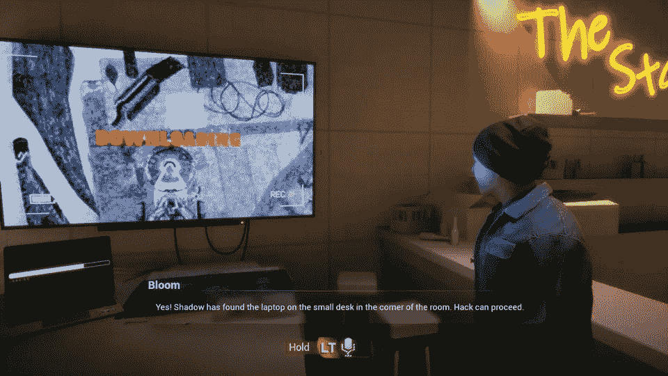
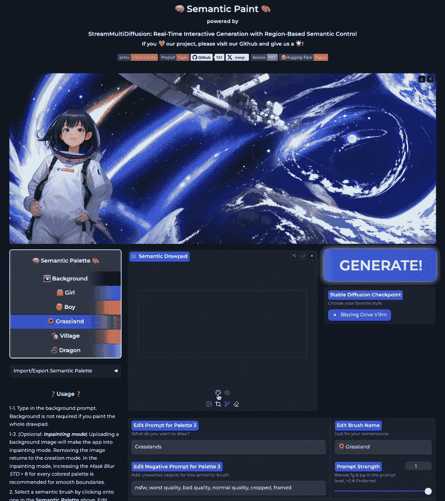
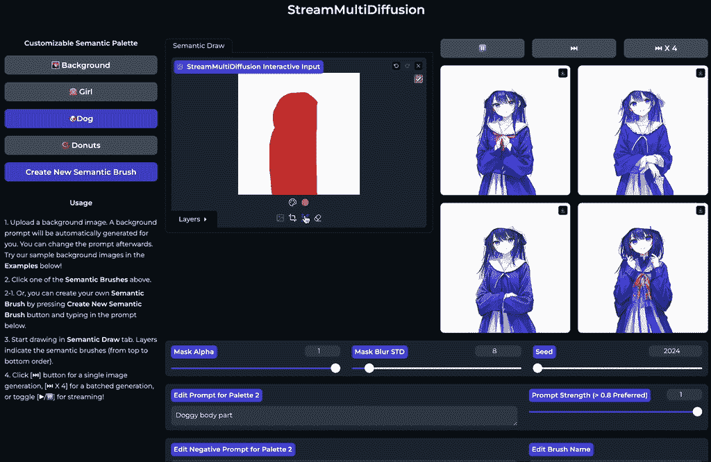

#  AI 星球 | 日报3.20

> 来源：[https://ga67w23t0nn.feishu.cn/docx/D3hbdhN2IojKMkxgiwGc9HWrnth](https://ga67w23t0nn.feishu.cn/docx/D3hbdhN2IojKMkxgiwGc9HWrnth)

### 关于AI星球社群

> **作为多年的互联网从业者，我深知普通**人去学习AI知识的痛点和问题，我希望运用我的一些行业经验，去做一个知识的桥梁，让人人都能看的懂学的起AI，群里会持续关注并更新 AI 的相关资讯动态，研究报告，应用场景，AI变现，技术研究等相关内容，小智的目标是打造免费的一站式开源AI学习社区，帮助大家更好的拥抱AI。

### **1. 消息称 OpenAl 将在今年年中发**布 GPT-5 大模型，或在今年夏天期间

知情人士称，OpenAl将在今年年中的某个时候发布GPT-5，很可能是在今年夏天期间。一些企业客户最近已经收到了GPT-5大模型及其对ChatGPT相关改进的演示。“它的性能非常棒，提升很大。"一位看过GPT-5大模型演示的CEO表示。该CEO表示，OpenAI使用他的公司独有的用例和数据展示了GPT-5。他说，OpenA!还提到了该模型尚未发布的其他功能，包括调用OpenAl正在开发的AI代理来自主执行任务。

来源：https://www.businessinsider.com/openai-launch-better-gpt-5-chatbot-2024-3

### 2.育碧展示生成式 AI 原型项目，游戏 NPC 可自由即兴对话

育碧今日展示了其巴黎工作室最新的生成式 AI原型项目 NEO NPC，令 NPC 实现以自发的行动和反应进行对话，而非遵循对话树中的设定。该项目应用了英伟达的 Audio2Face 与Inworid 的 LLM 大语言模型技术。育碧表示，所有生成式 AI 项目的目标都是为玩家带来价值，开发过程始终以玩家和开发人员的创造力为重点。

NEO NPC 项目只是一个原型，距离在游戏中实现还有一段路要走。其最终目标是成为一个灵活的工具，育碧内部的小型项目与 3A 级项目均可运用。

**团队于正在举行的 GDC 2024** 游戏开发者大会上年展示该项目。开发团队强调，在生成式 AI 领域还留有创造力的空间，数据和叙事可以并存。

来源：https://www.ithome.com/0/756/838.htm

### 3.360发布国内首个实现AI实战应用安全大模型

3月20日下午消息，360公司今日发布安全大模型3.0，系国内首个实现AI实战应用的安全行业大模型。360称，以大语言模型为代表的的AI技术，不仅要为安全防护提供技术支撑，同时也要推动安全领域的创新与发展。

### 4.知乎发布全新AI发现搜索功能，周源:做AI时代可信赖的社区

“2024知乎发现大会"上，知乎公布了首届灯塔计划的创作成果，发布了“海盐计划6.0:航海家""DEEP TRUST营销体系”"短篇故事3A计划"多项新产品和举措。值得一提的是，知乎创始人、董事长兼CEO周源带来了知乎大模型的最新进展，发布了全新AI功能“发现·AI搜索”，该功能以社区可信赖内容为来源，给用户带来集搜索、实时问答和追问功能于一体的全新体验。周源表示:“当社区成为可信赖的家园，就有机会不止于社区。

### 5.Freepik推出了一款名为Reimagine AI工具

Reimagine允许用户上传图片，自动生成提示词，无需手动输入文字。

该工具最引人注目的特色之一是它能够实时提供无限滚动的结果展示。随着用户的操作，窗口将持续生成图像，为用户呈现无尽可能性。

此外，用户还可以通过调整提示词来动态修改图片细节，实时切换各种风格！

体验地址：https://www.freepik.com/pikaso/reimagine

[twittervid.com_imxiaohu_162bcb.mp4](https://internal-api-drive-stream.feishu.cn/space/api/box/stream/download/all/LH4DbyzKzoUWcTxFrjrc3535nzb)

### 6.StreamMultiDiffusion：一个使用区域文本提示来实时生成图像的项目。

也就是你可以通过在多个特定区域内分别输入不同的文本提示来指导AI画图

一个提示负责一个区域，精准控制，而且这个过程是交互式的，实时完成，你能立马看到生成效果！这是真神笔马良！

论文：https://arxiv.org/abs/2403.09055

GitHub：https://t.co/h7MOFzzkEA

体验网址：https://huggingface.co/spaces/ironjr/SemanticPalette

来源：https://twitter.com/imxiaohu/status/1770371036967850439

### 7.字节跳动的AnimateDiff-Lightning发布

+   A**nimateDif**f**-Lightning能够更****快地根据文本描述生成**视频，比起原来的AnimateDiff模型，速度提升十倍以上。
除了能够根据文本生成视频之外，AnimateDiff-Lightning还可以进行视频到视频的生成，比如可以将现有视频转换成不同风格的视频。

与多种风格的基础模型兼容：还可以与多种不同风格的基础模型结合使用，包括真实风格和动漫卡通风格，这样可以生成各种不同风格的视频。

支持多步骤蒸馏模型：提供1步、2步、4步和8步的蒸馏模型，用户根据自己的需求，在生成视频的速度和质量之间做出选择，以平衡生成速度和视频质量。

+   模型下载：[h](https://t.co/84VB85hXE3)[t](https://t.co/84VB85hXE3)tps://huggingface.co/ByteDance/AnimateDiff-Lightning…
论文：https://arxiv.org/abs/2403.12706

+   来源：https://twitter.com/imxiaohu/status/1770279651652632810

[animatediff_lightning_samples_v2v.mp4](https://internal-api-drive-stream.feishu.cn/space/api/box/stream/download/all/PLArbmENiovEMWxEtx6cSZgJnob)

[animatediff_lightning_samples_t2v.mp4](https://internal-api-drive-stream.feishu.cn/space/api/box/stream/download/all/QuJPbkbiEoL5b6xhQxqcSyqRnie)

拓展阅读：

[[视频教程] Midjourney视频教程，从入门到精通](https://ga67w23t0nn.feishu.cn/wiki/XYmxwS9LLirOEkkriNjcThlonJb?fromScene=spaceOverview)

---

# **免费AI学习交流社群**

### 关于AI星球社群

> **作为多年的互联网从业者，我深知普通**人去学习AI知识的痛点和问题，我希望运用我的一些行业经验，去做一个知识的桥梁，让人人都能看的懂学的起AI，群里会持续关注并更新 AI 的相关资讯动态，研究报告，应用场景，AI变现，技术研究等相关内容，小智的目标是打造免费的一站式开源AI学习社区，帮助大家更好的拥抱AI。

