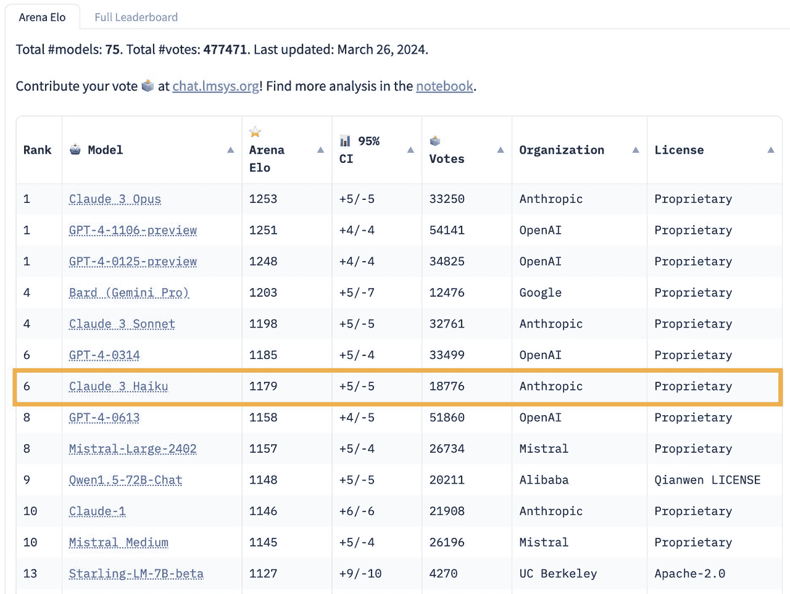

#  AI 星球 | 日报3.2

> 来源：[https://ga67w23t0nn.feishu.cn/docx/SkbodzUmPoQr8qxucy9cZtE1nBh](https://ga67w23t0nn.feishu.cn/docx/SkbodzUmPoQr8qxucy9cZtE1nBh)

### 关于AI星球社群

> **作为多年的互联网从业者，我深知普通**人去学习AI知识的痛点和问题，我希望运用我的一些行业经验，去做一个知识的桥梁，让人人都能看的懂学的起AI，群里会持续关注并更新 AI 的相关资讯动态，研究报告，应用场景，AI变现，技术研究等相关内容，小智的目标是打造免费的一站式开源AI学习社区，帮助大家更好的拥抱AI。

### **1. Claude 3 Opus**在 7 万人的竞技场投票中超越GPT 4

甚至连Claude-3 Haiku 在用户偏好中都达到了GPT-4的水平，其速度、能力和上下文长度在模型市场上无出其右！

Starling-LM-7B-beta，经过34B奖励模型的PPO（近端策略优化）处理，在排行榜上迅速上升。现在是最佳的7B开放模型！超越GPT 3.5…

OpenAI开始全面落后…

最近很多人都叛变投靠了Claude！

但也预示着GPT 5要来了…

排行榜：https://huggingface.co/spaces/lmsys/chatbot-arena-leaderboard

来源：https://twitter.com/imxiaohu/status/1772789352311189988