# AI 绘画搞钱案例

> 来源：[https://ga67w23t0nn.feishu.cn/docx/WACkdsXM3oLYm2xNsrLcoTbWnwd](https://ga67w23t0nn.feishu.cn/docx/WACkdsXM3oLYm2xNsrLcoTbWnwd)

### 关于AI星球社群

> **作为多年的互联网从业者，我深知普通**人去学习AI知识的痛点和问题，我希望运用我的一些行业经验，去做一个知识的桥梁，让人人都能看的懂学的起AI，群里会持续关注并更新 AI 的相关资讯动态，研究报告，应用场景，AI变现，技术研究等相关内容，小智的目标是打造免费的一站式开源AI学习社区，帮助大家更好的拥抱AI。

> 知识库内容会持续更新，**点赞.收藏** 是我们提供优质资源的动力！

> [**→查看知识库首页**](https://ga67w23t0nn.feishu.cn/wiki/XLZrwVcT9iJbUZk14Wzc8vU6n2e?fromScene=spaceOverview)** **

# 《动物时装秀》，抖音号14天粉丝增长11万

## 赚钱思路：

抖音号“陈导不挑食”通过AI绘画技术创作独特的《动物时装秀》内容，结合社交媒体平台的运营策略，实现粉丝快速增长和内容变现。

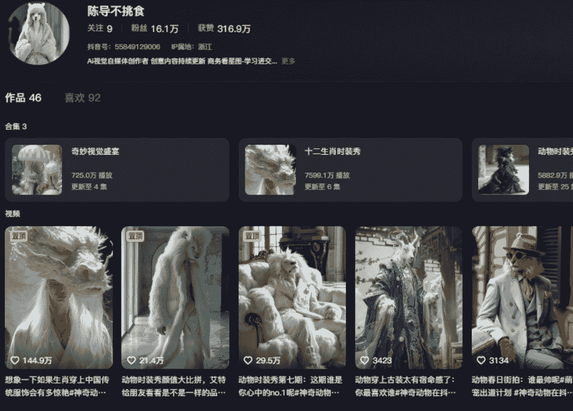

## 适合人群:

此项目适合对AI绘画和社交媒体营销感兴趣的个人或团队，尤其是那些希望在艺术创作和内容创作领域实现快速增长的创作者。

## 上手难度：

中等。需要掌握AI绘画工具的使用，如DALL·E或MJ，并具备一定的视频编辑和社交媒体运营技能。

## 操作流程方法：

1.  确定选题，如《动物时装秀》，并进一步细化为具体的系列主题，如奇幻兽界时装展、萌宠时尚派对等。

1.  使用GPT+AI绘画工具（如DALL·E或MJ）根据选题创作图片，利用提示词生成具有时尚感的动物形象。

> 这里用dall举例：

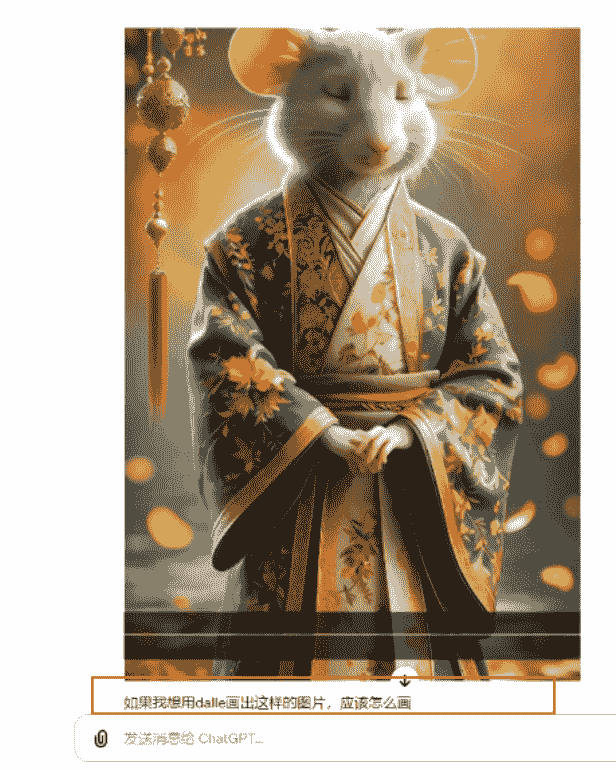

丢给GPT识别，并要求生成类似的图片

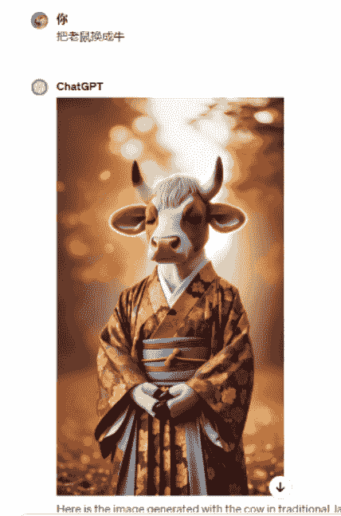

画面微调，告诉dall把老鼠换成牛

1.  将生成的图片通过视频生成工具**（如Runway）**转换成视频格式。

1.  使用视频编辑软件**（如剪映）**对视频进行剪辑，添加背景音乐、转场动画和开场文字。

1.  在社交媒体平台**（如📕、抖音等）**发布视频内容，吸引粉丝关注和互动。

# 🛰️“小绿书”红利：AI美女组图变现 纯流量主日赚50+

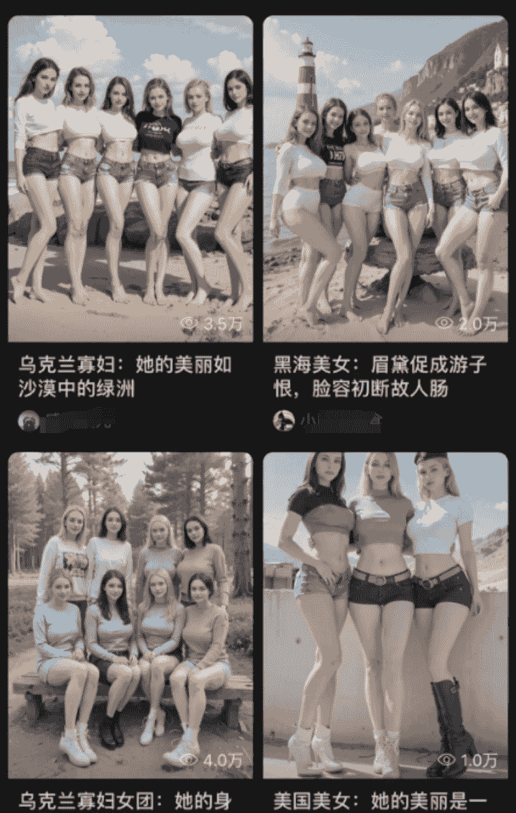

## 赚钱思路：

利用AI美女组图搭配简短文案在🛰️👸号的“小绿书”发布内容，通过平台推荐流量和多种变现方式实现收益。

适合人群:

此项目适合对社交媒体营销和内容创作感兴趣的个人或团队，尤其是那些希望利用🛰️平台进行商业变现的内容创作者。

## 上手难度：

较低。需要了解🛰️👸号“小绿书”的发布规则和变现方式，以及掌握AI绘画平台的使用。

## 使用工具：

🛰️👸号平台：用于注册账号和管理内容发布。

AI绘画平台（如哩布哩布AI、MJ、SD）：用于生成或寻找美女图片。

GPT等AI写作工具：用于创作或修改文案。

## 操作流程方法：

1.  注册🛰️👸号并选择“订阅号”选项，填写个人信息并设置昵称、头像和简介。

1.  了解并开通“流量主功能”和“返佣商品功能”。

1.  使用AI绘画平台（如哩布哩布AI、MJ、SD）生成美女图片或从Ins收集高质量图片。

1.  编写简短吸引人的文案，可以从📕上复制或使用GPT创作。

1.  在🛰️👸号发布AI美女组图和文案，添加返佣商品和地点标签。

1.  通过流量广告收入、返佣商品销售、私域流量转化等方式实现变现。

## 案例点评：

🛰️👸号图文模式提供了一个新的内容发布方式，尤其适合那些希望利用视觉内容吸引流量的创作者。通过AI技术生成的美女图片和精心编写的文案，即使是新账号也能快速获得高曝光量。

此外，平台的流量扶持和多种变现方式为创作者提供了稳定的收入来源。然而，创作者需要注意内容的原创性和合规性，避免侵犯他人版权。

# **利用AI绘画+📕壁纸营销**

## 项目说明

📕作为一个汇聚年轻人创意和生活方式分享的平台，提供了一个展示和销售AI创意壁纸的绝佳场所。通过每日更新AI生成的手机壁纸，吸引爱好个性化和高颜值手机壁纸的年轻用户，逐步建立起品牌认知和用户群体。

## 账号案例

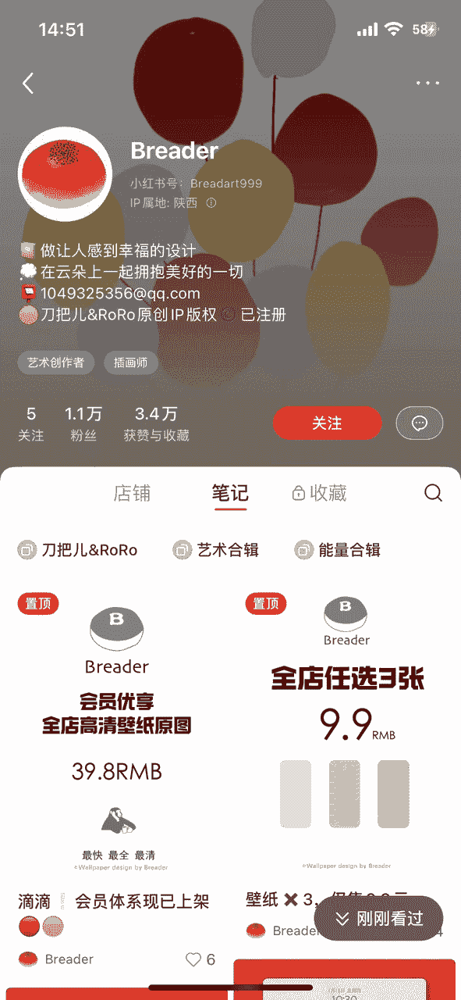

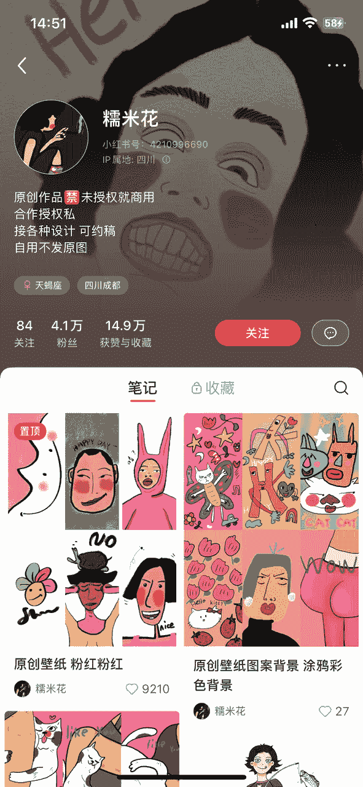

## 使用的工具

用 Midjourney/SD+ChatGPT，生成手机壁纸

## 基本玩法

**1、开通📕店铺**

账号搭建：账号名称以@XX 兔、XX 视界为例，每天 1-2 更，笔记直接发壁纸成品图，一般以风格各异的风景图、动漫、二次元人物等为主，一定要高颜值、吸睛。

**开通📕店铺：**一机一号，开店账号无粉丝量要求，每张身份证能开 1 家店，每张营业执照能开 3 家店。

账号主页创作中心→更多服务→开通专业号→选择个人/企业，个人号免费认证，企业号需缴纳 600 元年费。

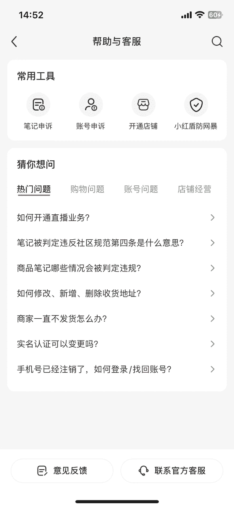

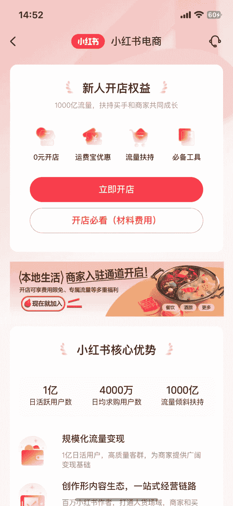

**【个人店】**

开通个人店需进行实名认证，再认证个人专业号，才能开店。

**【企业店】**

包括个体店/普通企业店/专卖店/旗舰店，企业店能卖的类目多，营销权益更多（设置快捷自动回复、可使用投放工具等）。

**2、制作内容，每天 1-2 更**

用 Midjourney+Chat GPT 自动生成 AI 图片。

AI 绘画工具可用 Midjourney，操作简单，输入提示词（图片尺寸、绘画风格、效果等）+图片描述词（画面场景），即可生成图片。

**3、规模放大多账号矩阵操作**

**我们可以同时**多做几个账号，每天早中晚都各发一条笔记，达到量变引起质变的效果。

**坚持下去，保持日更是非常重要的**。只要长期坚持，成功的概率就会非常大，只要这几个账号其中的一条笔记火了，就可以进行变现操作了。

# **AI绘画+📕家居家装**

## **项目说明**

基于📕平台，利用 Stable Diffusion 对毛坯房进行 Instagram 和国内内家居应用获取的家居图片进行内容创作，通过精准关键词和简介吸引用户，实现引流并变现。

## 账号案例

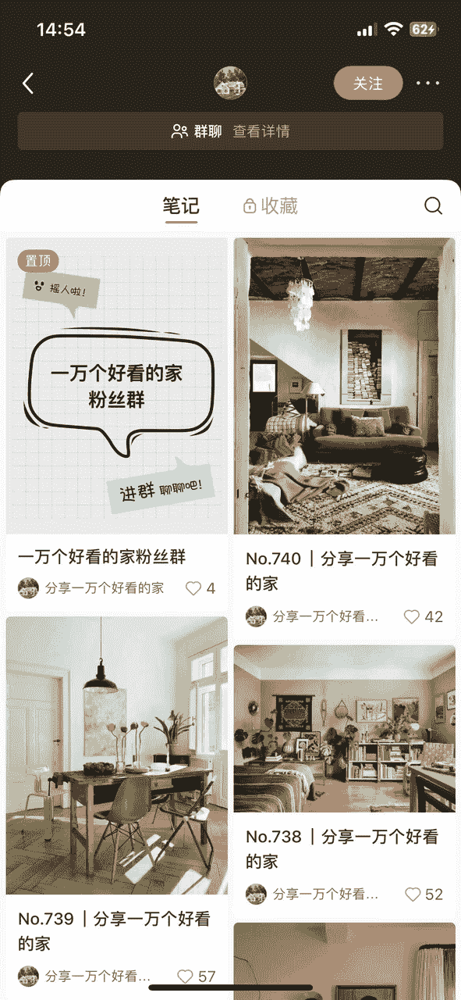

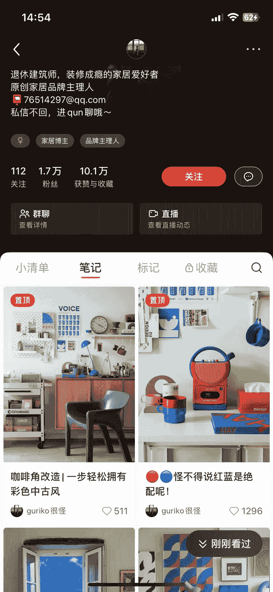

## 涉及工具

Stable Diffusion

## 基本玩法

1．注册📕账号，可以进行矩阵的配合。在个人简介中提供联系方式或者在评论区进行引流到私域流量中，注意不要违规。

2．训练相关的 Stable Diffusion 模型（或者在网上进行搜索下载），进行绘画后发布；也可以定期从国外 Instagram 和国内家居应用中搜索高质量家居图片。

3．结合热门话题和关键词进行内容创作和发布。

# **AI绘画+LOGO 设计**

**项目说明**

将众所周知的公司 LOGO 设计需求一直都有。通过做账号引导评论以及回复粉丝来获得更多评论，从而涨高账号杈重来达到快速起号的目的。后面可以通过定制化设计、Al 绘画培训等进行变现。到私域进行定制化的设计方案或者进行相关培训收费，质量只要过关有很多的转介绍和复购。

## 案例

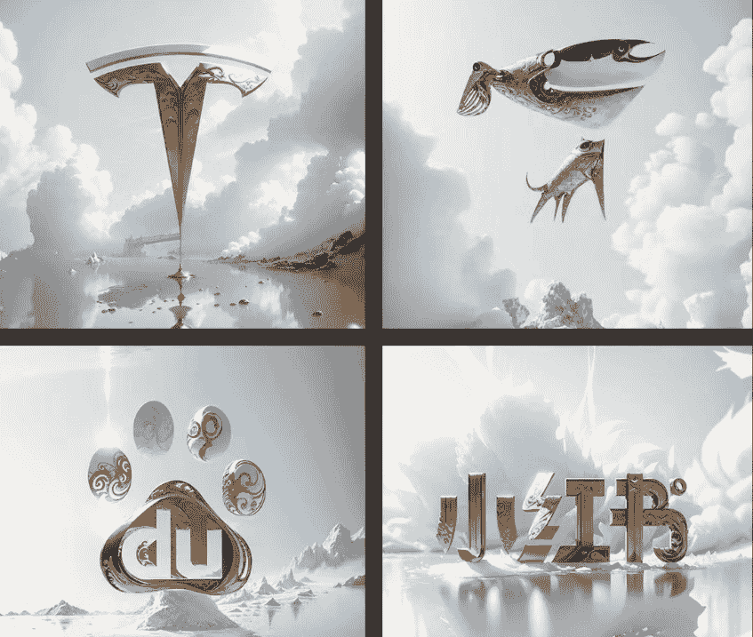

## 涉及工具

Stable Diffusion

## 基本玩法

1.本地部署 Stable Diffusion 或者进行云端部 Stable Diffusion

2.将相应要转换的 LOGO 进行抠图处理

3.然后用到 Stab Diffusion 中的 segment anything 进行处理，或者使用局部重绘

4.进行📕的专题号发布，可以对标下方的账号

---

延展阅读：

[[视频教程] Midjourney视频教程，从入门到精通](https://ga67w23t0nn.feishu.cn/wiki/XYmxwS9LLirOEkkriNjcThlonJb)

[【腾讯出版】Stable Diffusion入门手册](https://ga67w23t0nn.feishu.cn/wiki/WLzTwARJQi9hZnknKy3cqpgNnDb)

[AI视频搞钱案例](https://ga67w23t0nn.feishu.cn/wiki/PRcFwE7lsici0tk0MPgc3EV4nLc)

<https://ga67w23t0nn.feishu.cn/sync/NJMgdsnDas6UvFbOFNocTpJUnDe>