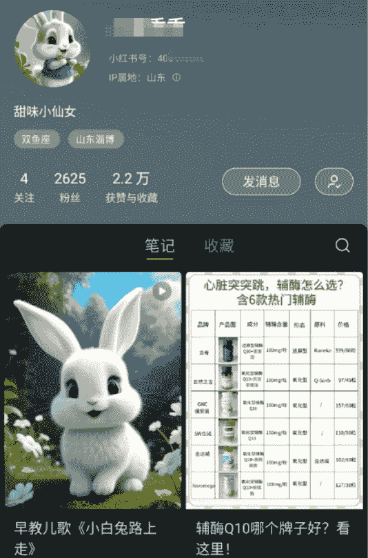
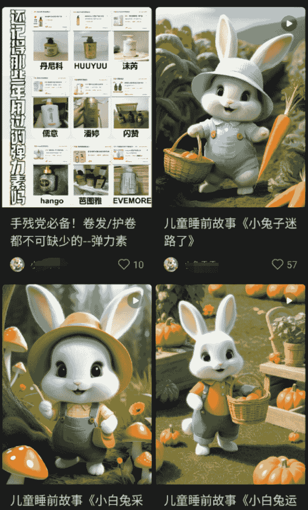
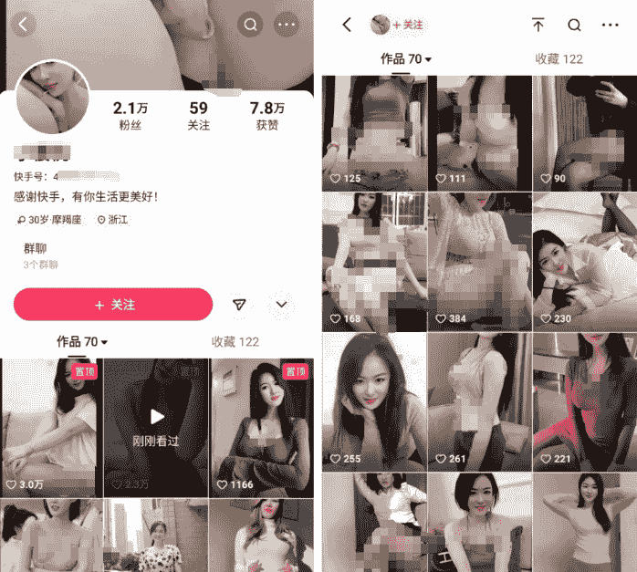
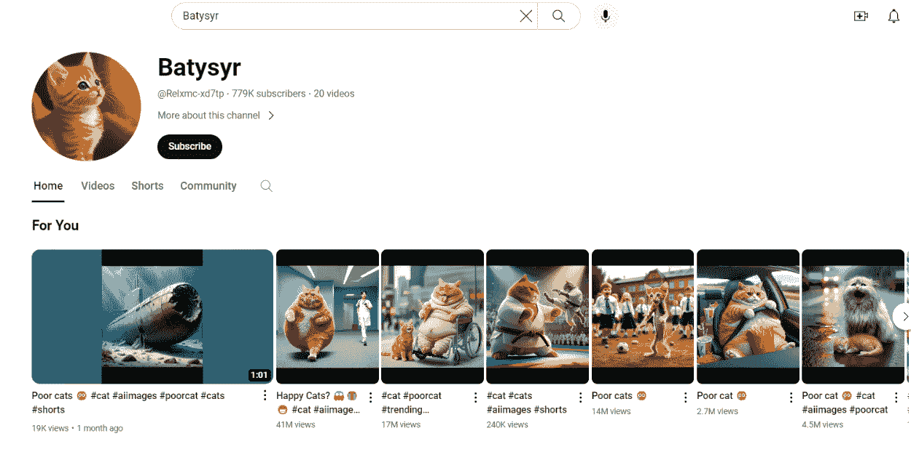
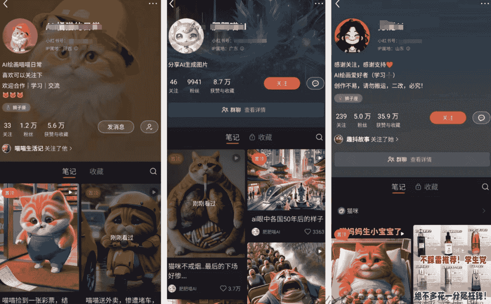
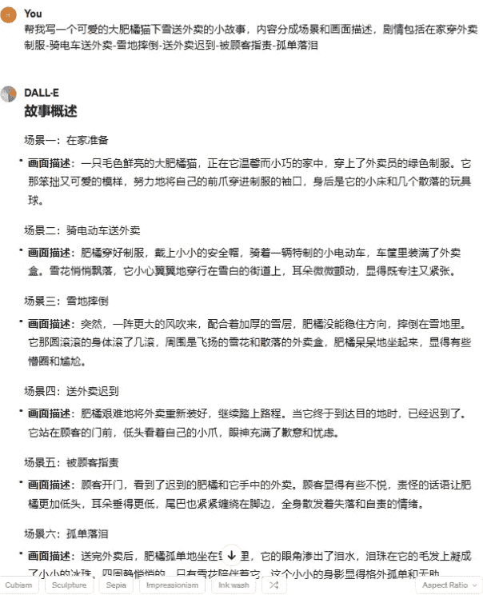

# AI视频搞钱案例

> 来源：[https://ga67w23t0nn.feishu.cn/docx/C4XVd4cARogPhSx92x3cLhV6nnd](https://ga67w23t0nn.feishu.cn/docx/C4XVd4cARogPhSx92x3cLhV6nnd)

<https://ga67w23t0nn.feishu.cn/sync/POD4dHVejsy34ab2aKicDH4Gnae>

# **小红书AI幼儿早教账号新玩法**

## 赚钱思路：

近期发现一个特别有意思小红书账号，这个账号专注输出儿童早教视频，短短起号40天内，就获得了16个广告合作商单。深入分析这个账号，我发现它的成功逻辑很简单，但广告变现能力很强，这样的账号案例对于想做小红书商单变现的小伙伴们非常值得借鉴。

## 适合人群:

此项目适合对AI绘画和社交媒体营销感兴趣的个人或团队，尤其是那些希望在艺术创作和内容创作领域实现快速增长的创作者。简单的剪辑后就能制作出成品。大多数人只要熟悉AI图形工具，就能轻松上手这个项目。

## 操作流程方法：

这个账号定位精准，以“小兔子”这一形象为核心，围绕其创作了一系列儿歌和早教故事视频。

1.  **聚焦选题，**需要了解小红书上年轻父母的关注点，找出他们关心的关键词，如启蒙教育、幼儿园教育等。通过这些关键词做为词根，延伸出与这些词根相关联的关键词。

1.  使用GPT+AI绘画工具（如DALL·E或MJ、SD）根据选题创作图片，利用提示词生成可爱的动物形象。

1.  使用视频编辑软件**（如剪映）**对视频进行剪辑，添加背景音乐、转场动画和开场文字。

1.  在社交媒体平台**（如小红书、抖音等）**发布视频内容，吸引粉丝关注和互动。

## 案例点评：

在小红书上做早教类内容是有其优势的，许多年轻父母都会选择这个平台来寻找育儿知识，因为这里的用户群体庞大且粘度高。

小红书平台对自媒体创作者十分友好，只要拥有1000个粉丝，就可以开始变现。希望大家都能通过AI掌握流量的秘诀，迅速取得项目成果。

# 在快手做AI美女跳舞视频，涨粉引流好绝！

## 赚钱思路：

快手上做AI美女跳舞视频，涨粉不愁，变现周期还很快。在之前的分享中，主要分享的是以图文为主的美女账号。来给大家分享一个美女跳舞视频内容玩法案例

美女主题的视频在各大短视频平台上总是能吸引大量关注，尤其是男性用户，特别是年龄在30到50岁之间的中年男性，这部分人群更愿意为自己喜爱的内容付费，如文玩、数码产品、茶酒、钓鱼装备等。

## 操作流程方法：

对于这种类型的视频账号，不需要真人出镜，不需要使用SD工具，只需利用AI工具来生成一张原创的美女图片，然后将网络上的视频进行换脸

1.  **搜集美女视频素材**

在各大短视频平台上使用“美女”关键词进行搜索，挑选出播放量高且点赞多的视频，然后下载并去除视频水印。在这个过程中，建议先分析3-5个类似的账号，注意视频的内容尺度，避免内容过度暴露而导致违规或被封号。通过对标账号的学习，可以更好地掌握运营技巧。

1.  **使用AI工具进行美女视频换脸 **[**（换脸工具推荐直达→）**](https://ga67w23t0nn.feishu.cn/wiki/II8JwXJ0xiVav7kN0dacz02On4A?fromScene=spaceOverview&table=tbloLLdarNFHvLxK&view=vewIx2BHRl)

市面上有许多AI换脸工具，对于新手而言，可以考虑使用门槛较低的在线服务，如海艺AI，无需安装，在线即可进行换脸，非常方便。

1.  **使用剪映进行后期处理**

将换脸后的视频导入剪映，添加合适的背景音乐、特效和转场效果，确保视频内容新颖独特，避免被平台判定为重复内容而影响推广效果。编辑时，可以参考成功账号的剪辑风格，以此来提高视频的吸引力和观看度。

## 案例点评：

关于项目变现点

**（1）私域流量变现：**这类账号特别适合用来做私域流量的变现。只有内行人才知道其变现能力()有多强。通过私域销售特定商品赚取佣金，这些商品通常非常吸引男性粉丝。

**（2）直播打赏：**针对精准的目标粉丝群体（如宅男大叔），通过直播接受打赏，可以尝试不同的互动方式，促使粉丝大手笔打赏。

**（3）账号小程序推广：**小程序推广，如soul或舞蹈秀等，这些广告的转化率通常很高。在视频中展示这些广告，可以获得不错的广告收入。

**

（4）磁力万合**：如果账号粉丝数量达到或超过1万，完成实名认证，近30天的累计播放量达到或超过4万，且账号符合平台规范，就可以申请开通，有播放量就有收益，而已快速的创作者收益比其他平台更高些。

**（5）卖账号：**通常一个美女账号在10到20天内，粉丝数量可以轻松突破5万+，可以考虑卖账号，粉丝数越高，转让费就越高。

# 2个月猛涨77万粉丝，用AI做喵咪剧情视频详细教程！

一个AI做喵咪剧情视频账号，30天时间仅仅发布20条视频，就猛涨77万粉丝，播放量更是高达1个亿！

## 赚钱思路：

现在国内已经有聪明的小伙伴开始模仿这种玩法了！在小红书上发类型的内容视频，看看这些账号，它们也在短时间内迅速走红，甚至开始销售课程，价格高达399到699不等！

## 操作流程方法：

这类视频通常由5-6张分镜图组成，根据故事情节进行编排，并配上魔性的喵喵叫背景音乐。因此，要创作这样的视频，步骤可以拆解成：

1.**精彩且容易引起共鸣的故事情节 **

利用GPT，让它帮我们写一个猫咪下雪送外卖的故事，要注意突出可爱和大肥橘猫的形象，并确保剧情包含以下内容

**2.配套的分镜图**

我们直接让Chat生成对应的画面。提示词加上超逼真的风格，让猫咪和动作拟人化，然后将每一个画面的描述复制进来生成就可以了。

> 提示词：生成分镜图，超级逼真的风格，猫咪表情和动作拟人化，夸张的手法，逐一将图片生成发送给我。

**3.使用视频编辑软件（如剪映）对视频进行**剪辑，添加背景音乐、转场动画和开场文字。

<https://ga67w23t0nn.feishu.cn/sync/NJMgdsnDas6UvFbOFNocTpJUnDe>