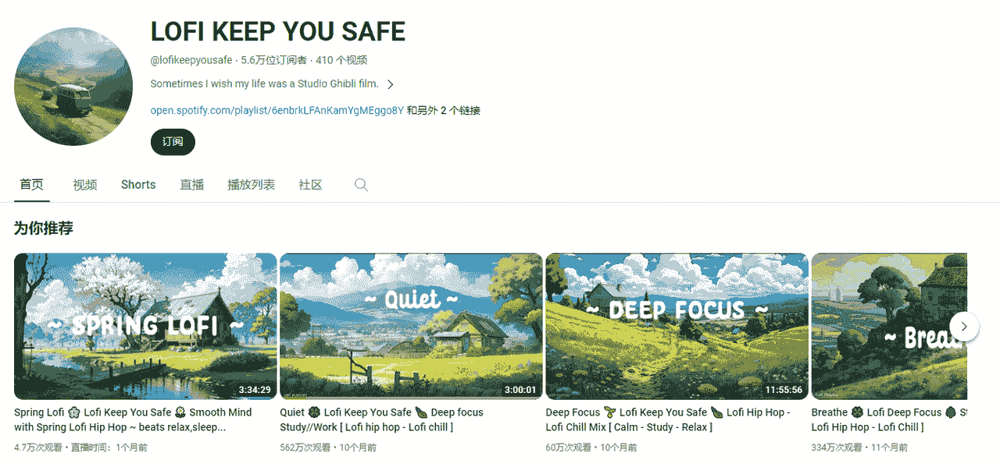
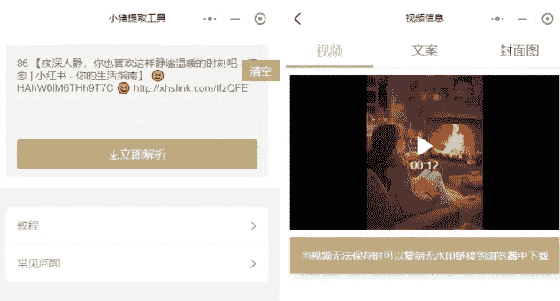
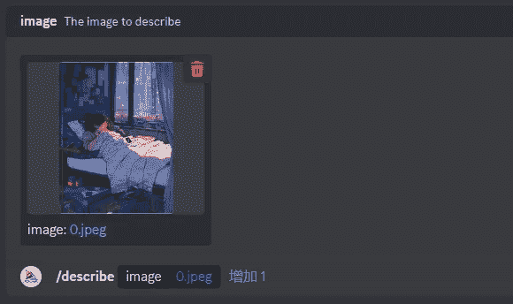
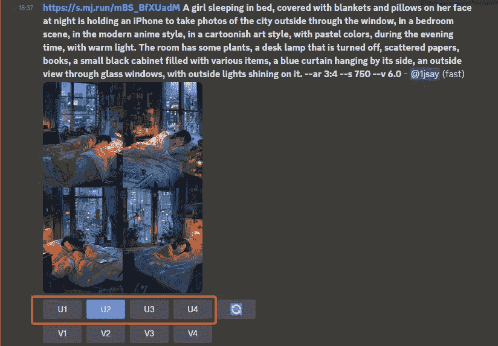

# AI音频搞钱案例

> 来源：[https://ga67w23t0nn.feishu.cn/docx/N18ed1HOAoIzK7xSDGRc75Lpn0g](https://ga67w23t0nn.feishu.cn/docx/N18ed1HOAoIzK7xSDGRc75Lpn0g)

<https://ga67w23t0nn.feishu.cn/sync/POD4dHVejsy34ab2aKicDH4Gnae>

# 利用AI声音克隆复兴经典曲艺作品

## 赚钱思路：

B站UP主@说书猿运用SoVits AI将自创相声剧本与马三立等艺术家的原声相结合，创作出全新的单口相声作品《逛商场》，给人耳目一新的感觉。这支视频最终吸引了30万次播放，观众纷纷点赞，称赞它为‘老艺术家重获新生’。一些网友甚至提出，这项技术或许可以用来修复失传的戏曲和曲艺遗产。随后，@说书猿又尝试了更多创意，让AI ‘单田芳’ 来解说柯南的故事，以及让AI ‘马三立’ 和 ‘刘宝瑞’ 进行对口相声表演。他们的作品《论网红》更是获得了94万次的播放量。

## 操作方法：

+   1)创作剧本、策划情节

+   2)收集目标艺术家的原声表演

+   3)将自创内容和艺术家原声输入AI声音克隆工具

+   4)调试、修音,生成新作品

+   5)在视频平台发布作品,通过流量变现

## 涉及使用的工具：

-声音克隆AI工具 如SoVits等 音频编辑软件、 视频拍摄、剪辑工具

## 案例点评：

AI声音克隆技术的出现,让创作者有机会赋予经典曲艺作品以"数字新生"。2023年,AI"孙燕姿"通过翻唱撼动乐坛,声音克隆技术也逐渐渗透到鬼畜、配音等领域。大家借助AI声音克隆技术,将自创内容与经典艺术家原声结合,生成全新的"数字艺术品",吸引流量获得收益。

---

# 结合suno用AI做Lofi治愈音乐视频，多平台分发变现赚收益

### **赚钱思路：**

通过AI工具制作Lofi治愈音乐视频，发布到YouTube、小红书等平台吸引大量粉丝，并通过多平台分发实现高收益。

### **适合人群：**

此项目适合对音乐和视频制作感兴趣的个人或团队，尤其是那些希望在社交媒体上快速增长粉丝并通过内容变现的创作者。

### **上手难度**

中等。需要掌握AI音乐生成和插画制作工具的使用，以及视频剪辑技能。

### **操作流程方法：**

1.  **收集免费的无版权Lofi背景音乐**、或者用suno等AI生成类似音乐作品。

**可以在平台上搜索对标账**号，把他们爆款的视频下载后，放到剪映里面去提取音乐。无须担心版权问题，因为他们能发布，代表我们也能用。

1.  使用AI工具（如Midjourney）生成治愈系插画。

截取参考视频的画面作为垫图，打开Midjourney，输入【/describe】指令，上传垫图，按回车键【Enter】，得到4组提示词。

1.  利用视频剪辑工具（如剪映）制作动画视频，添加背景音乐和特效。

接着把图片导入剪映，添加动画效果和其他视频素材，比如下雨、小猫、咖啡，手机播放音乐等，添加上背景音乐，检查没有问题后，导出即可。

### **案例点评：**

AI Lofi治愈音乐视频项目充分利用了AI技术在音乐和视觉艺术创作上的能力，为观众提供了舒缓压力的内容。这种类型的视频在快节奏的现代社会中具有很高的需求，尤其是在YouTube等国际平台上。通过多平台分发，创作者能够有效地触及更广泛的受众，并有机会通过广告、商业合作等方式实现收益。然而，成功的关键在于持续创作高质量的内容，以及有效地管理和维护多个社交媒体账号。

### **使用的工具：**

+   AI音乐生成工具suno：用于制作Lofi背景音乐。

+   AI插画生成工具（如Midjourney）：用于创造视觉上吸引人的治愈系插画。

+   视频剪辑软件（如剪映）：用于合成视频、添加动画效果和背景音乐。

<https://ga67w23t0nn.feishu.cn/sync/NJMgdsnDas6UvFbOFNocTpJUnDe>