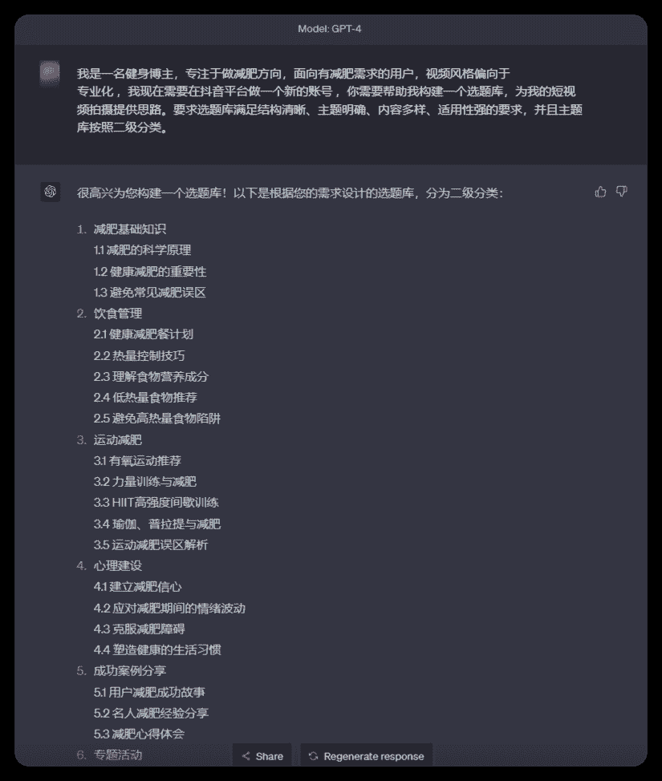
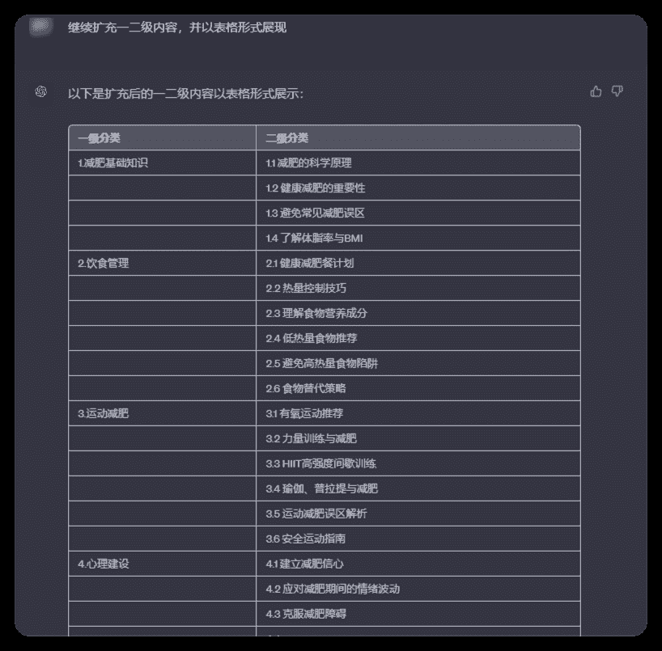
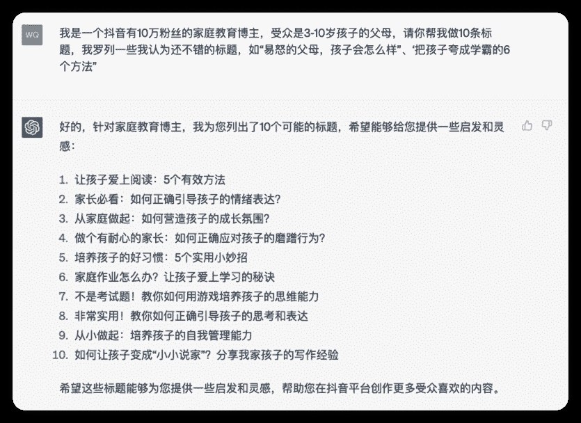
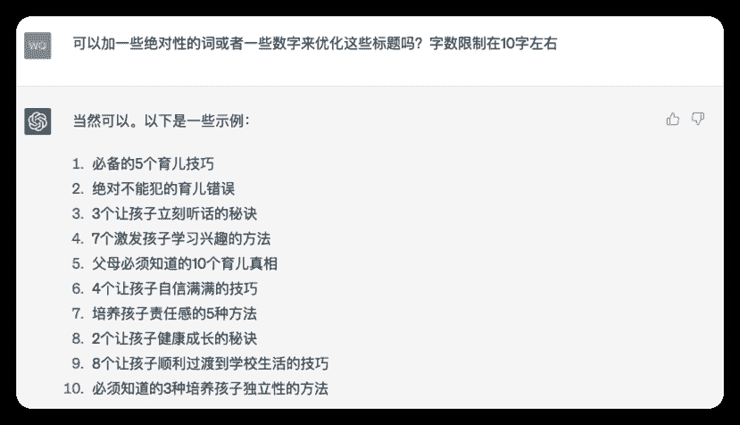
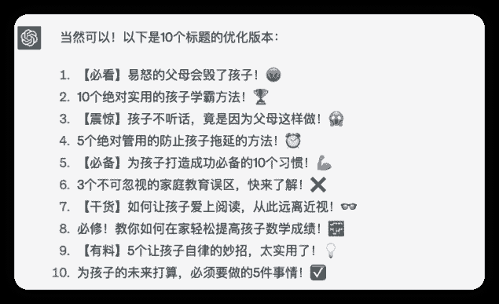

# 【选题库】场景

> 来源：[https://zcareers.feishu.cn/docx/FXEidvao5o8qhnxZHvHcv4HSnwg](https://zcareers.feishu.cn/docx/FXEidvao5o8qhnxZHvHcv4HSnwg)

# 【选题库】场景

## 可以解决的问题：

1.  搭建选题库

1.  选题优化

## 问题1：搭建选题库

案例：我是一名短视频博主，想要在平台上做一个新的账号，需要构建一个选题库，为我的短视频拍摄提供思路。

### 提问思路（提示词）

【B：Background背景】

1.  擅长领域（舞蹈、知识、游戏、美妆、健身、音乐等，最为关键的部分，描述越具体越垂直越好）

1.  目标受众（希望吸引哪些人观看短视频）

1.  视频风格（娱乐类、励志类、专业类、记录类等，风格并不是完全独立）

1.  所在平台（不同平台的算法和推荐机制都不同）

1.  具体要求（预期的选题库规模、几级分类、排列方式等）

【O：Objective**目标**】构建一个选题库

【K：Keyresult关键结果】 结构清晰（清晰的组织结构，能够将各个选题归类和整合）、主题明确（能够准确地反映出选题的范围和方

向）、内容多样（能够提供不同类型和风格的选题）、适用性强（能够适用于不同的用户和场景）

### 案例讲解：

【B】我是一名健身博主，专注于做减肥方向【擅长领域】，面向有减肥需求的用户【目标受众】，视频风格偏向于

专业化 【视频风格】，我现在需要在抖音平台做一个新的账号 【所在平台】

【o】你需要帮助我构建一个选题库，为我的短视频拍摄提供思路。

【K】要求选题库满足结构清晰、主题明确、内容多样、适用性强的要求，并且主题库按照二级分类【具体要求】。

能够看到ChatGPT基本按照我们的要求，完成了一个二级分类的选题库，整体来看，基本上满足了我们结构清晰、主题明确、内容多样、适用性强的要求；

ChatGPT在很多情况下，也许不能做到完美，但可以提供给我们足够多的內容或者方向，来为我们找到一些灵感，依

照这个思路，接下来我们继续优化。

**【E扩充选题库】要求ChatGPT：继续扩充**一二级内容，并以表格形式展现，结果如下：

ChatGPT给出了更多的思路，我们依然可以要求它继续扩充，直到我们需要的答案为止。

### **思路拓展：**

作为一个专业性的健身博主，ChatGPT给出的答案是按照专业性的划分，如果我们将身份发生一些变化，比如我们是

一个搞笑类型的健身博主，ChatGPT的回答会发生怎样的变化，接下来的提问思路如下：

**我**现在的身份发生了转变，我是一个搞笑类型的健身博主，请重新为我设计一个选题库，依然是两级分类，请以表的形式为我展现。

在身份发生变化之后，ChatGPT给出了完全不同的答案，在满足了搞笑的视频风格之外，依然符合我们的要求：结构清晰、主题明确、内容多样、适用性强；

## 问题2：选题优化

案例：家庭教育博主，想做一个抖音账号，应该怎么使用ChatGPT制作一系列选题

### 提问思路（提示词）

【B】 建议包括：自媒体平台、账号定位、受众、选题数量、选题举例

可选包括：博主性格、性别、粉丝量

【O】列出选题

【K】

### 案例讲解：

**讲解**：

【B]

【O】帮我做出10条标题

【K】

【E】 此时我们发现，它给标题不够有吸引力，且部分标题太长，但整体可用，因此采用改进答案的方法要求其改进：

我们可以看到这些选题已经很贴合了。

### **思路拓展：**

上述案例是基于抖音，且没有限定博主性别和个性特点，在实际操作中，可以根据不同平台，不同特点的博主，让

ChatGPT生成更贴和的选题。

**例如我把平台换成📕****，博主具体化：女性，活**泼。这种情况下，我们的提问思路可以是：

我是一个📕有10万粉丝的家庭教育博主，受众是3-10岁孩子的父母，请你帮我做10条标题，我罗列一些我认为还不错的标题，如“易怒的父母，孩子会怎么样”、“把孩子夸成学霸的6个方法”。可以加一些绝对性的词或者一些数字来优化这些标题吗？字数限制在10字左右。我是位女生，标题中可以加一些emoji表情，显得活泼一点。

