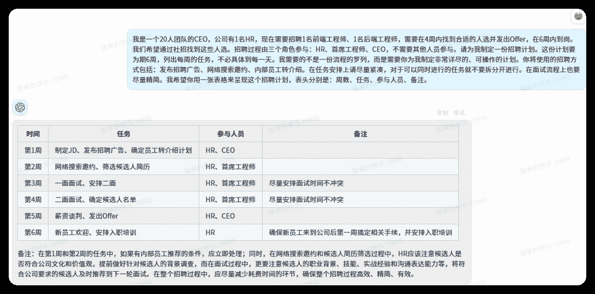
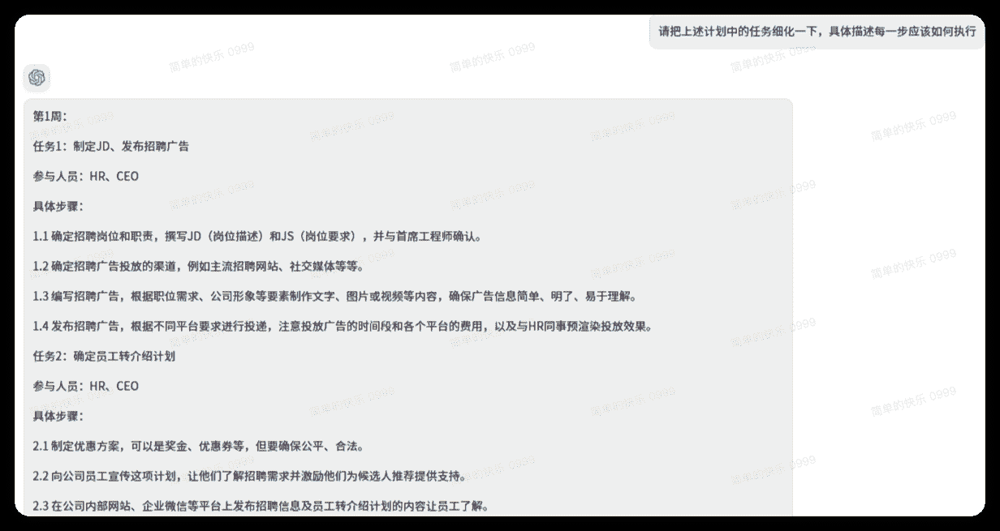
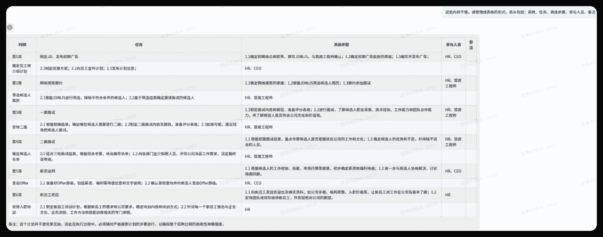
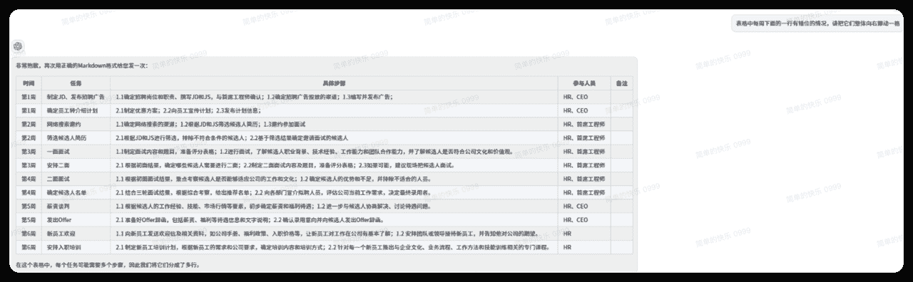
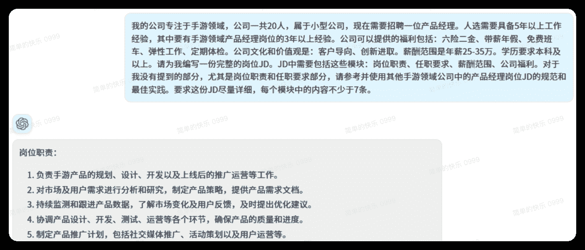
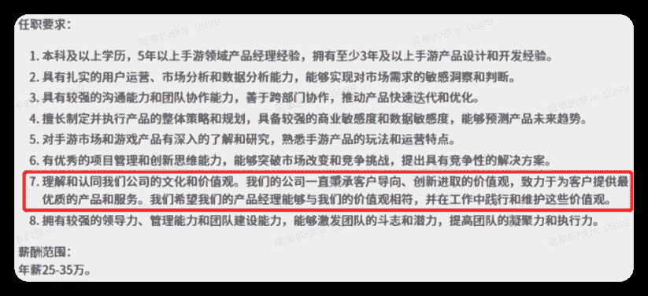

# 【招聘】场景

> 来源：[https://zcareers.feishu.cn/docx/VlXjdIrkpoaaU8xwvxJc422Snqg](https://zcareers.feishu.cn/docx/VlXjdIrkpoaaU8xwvxJc422Snqg)

# 【招聘】场景

可以解决的问题：

1.  招聘计划制定

1.  岗位JD撰写

1.  招聘广告撰写

1.  面试题库及答案生成

1.  文件撰写

## 问题1：招聘计划制定

案例：我是一个20人团队的CEO，公司有1名HR，现在需要招聘前端和后端工程师，怎么使用ChatGPT制定合理的聘计划？

### 提问思路（提示词）

【B】 建议包括：现有人工资源（影响招聘计划的推进能力）、招聘岗位、招聘人数、期望到岗时间、工作地点

可选包括：公司面试平均决策周期、期望的面试轮数、行业人选平均离职交接期、参与人员（HR、部门领导/组长、CEO等，不需要其他人员参与）、招聘场景（校招、社招）

【O】 制定一份招聘计划

【K】 计划总长度（为期X个月、为期X周）、需包括的招聘方式（发布招聘广告、网络搜索邀约、线下招聘会、内部员工转介绍）、计划精细程度（列出每周的任务不必具体到每一天、具体到每一天）、是否列明参与人员（注明各个步骤对应的参与人员）、是否需要列表格（用一张表格来呈现）

讲解（提示词用下划线标出并以【】注解）

【B】 我是一个20人团队的CEO，公司有1名HR【现有人工资源】，现在需要招聘1名前端工程师、1名后端工程麵【招聘岗位】，需要在4周内找到合适的人选并发出Offer，在6周内到岗【期望到岗时间】。我们希望通过社招 【招聘场景】找到这些人选。招聘过程由三个角色参与【参与人员】：HR、首席工程师、CEO，不需要其他人员参与【参与人员】。

【O】 请为我制定一份招聘计划。

【K】这份计划要为期6周【计划总长度】，列出每周的任务，不必具体到每一天【计划精细程度】。我需要的不是一份流程的罗列，而是需要你为我制定非常详尽的、可操作的计划。你将使用的招聘方式包括：发布招聘广告、网络搜索邀约、内部员工转介绍【招聘方式】。在任务安排上请尽量紧凑，对于可以同时进行的任务就不要拆分开进行。在面试流程上也要尽量精简。我希望你用一张表格来呈现【要求列表格】这个招聘计划，表头分别是：周数、任务、参与人员、备注。

**【E】此时我们发现，ChatGpT给出的计划较为笼统，但流程**可用，因此采用改进答案的方法要求其改进：

**【**E*2 表格化】此时，计划已足够详细，但ChatGPT未按照表格的样式列出，不够清晰，再次要求它整理表格：

【E*3 更正排版】表格整理过程中出现排版问题，要求修正：

**至此，一份较为详尽、可操作的招聘计划已经生**成，我们只需要进行一些简单调整即可使用。

### 思路拓展

上述案例的主体是20人的团队，这样规模的团队往往已经有一定的招聘经验，但可能在招聘流程上不够完善，因此案例中借助ChatGPT制定了一份较为完整的招聘计划。

**在实际操作中，不同规模的团队，在**招聘这件事上的经验和需求，往往是不同的。

#### 拓展1：3人团队（如何招聘）

例如一个3个人的团队，在招聘当中，可能没有必要事先制定一份详尽的计划。在“计划”这个层面上，由于经验不足，更重要的是需要知道具体应该怎么干、如何避坑、如何给人选留下“虽然公司不大，但招聘做得很专业”的印象。

这种情况下，我们的**提问思路**可以是：

我是一个3人团队的老板，现在需要招聘1名前端工程师，需要在1个月内找到合适的人选并发出Offer。我希望通过社招找到这些人选。招聘过程由我亲自参与。请为我制定一份招聘计划。我之前没有什么招聘经验，所以你需要告诉我每一步具体该如何进行，包括我应该使用什么渠道、应该做哪些事情、有哪些注意事项、需要规避哪些常见的错误等

等。

ChatGPT的回答如下：

> 制定招聘计划的步骤如下：

> 1.明确岗位要求和职责

> 在开始招聘前，需要明确招聘岗位的要求和职责。考虑你们公司的业务特点和团队目标，确定招聘的前端工程师的能力和技能要求。这将有助于筛选合适的候选人并确保招聘人员达到预期的绩效。

> 2.确定招聘渠道

> 根据公司规模和财力状况，制定招聘渠道的选择。社招（社交招聘）是一个不错的选择，社交媒体和招聘网站都是很好的选择。Linkedn和Indeed是面向职业人士的招聘平台，可以为你提供高质量的候选人。

> 3.制定职位描述

> 职位描述应该描述具体的岗位职责，如开发网站、设计网页、测试网站等等。此外，还要描述所需的技能、经验和学历要求，以便候选人清楚地了解招聘要求。

> 4.发布招聘信息

> 发布具体的招聘信息，应该尽可能详细地描述要求，包括所需技能、学历、经验、工资范围和福利待遇等等。您可以在招聘网站或社交媒体上发布。

> 5.筛选简历

> 筛选简历是招聘中的关键步骤。为了使筛选过程有序，可以先制定简历筛选标准。选择合适的人才池并建立筛选流程，这将有助于你快速、高效地筛选候选人的简历。

> 6.面试候选人

> 在面试过程中，应该让候选人表现出他们的技能水平和个人素质。需要考虑的因素包括：面试方式、面试问题、考察内容等等。

> 7.确定人选并发出Offer

> 当你选定了你所需要的候选人，就要发出正式的Offer。向候选人详细地介绍职责、工作福利等等，以及更换职业的关键元素。发出具体的Offer并确定起始时间，确保候选人及时到岗，并为他们提供快速适应的培训。

>

> 需要注意的问题：

> 1.要避免职位描述过分专业化

> 描述职位可以描述技术技能和所需的工具和技能，但是不要过度专业化。多数人并不会知道某个技术所对应的职位名称，因此尽可能用人们能够理解的语言来描述工作职责和要求。

> 2.避免过多的人力资源损耗

> 许多公司在扩张时常常使用大量的人力资源来招聘人才，但这并不是一种长期的有效率的方法。考虑代理或招聘中介助手等服务，这些服务的金费要比招聘经理所消耗的人力资源相对较少。如果没有其他选择，您可能需要专门聘请一位招聘经理来帮助你的任务。

> 3.注意保护个人隐私

> 虽然有必要为候选人制定筛选和面试流程，但也要注意保护他们的隐私。我们必须讲明我们当前的信息安全方案，以确保候选人的隐私得到保障。

#### 拓展2：100人团队（痛点优化）

如果你有一个100人的团队，相信你已经有自己的招聘部门、较为完整的招聘方案和切实可行的招聘**流程，在“招聘计划“**这个层面上，可能更多需要对其中的问题点进行优化。这种情况下，我们的提问思路可以是：

我有一个100人规模的公司，已经有成熟的招聘流程，但最近发现招聘效率很低，HR部门不能快速找到最合适的人选，来面试的人倒是很多，但这些人选匹配性都一般。我推测可能的原因有三个：一是HR部门对岗位的把握不确，二是公司各方面条件无法吸引优质人选，三是HR部门的招聘话术不够专业。针对这三个问题，我应该如何进行改进？请针对每个问题给出至少5条建议。

ChatGPT的回答如下：

> 问题一：HR部门对岗位的把握不准确。

1.  与公司内部领导部门协调，重新分析并优化岗位职责和职位描述，确保HR部门与各部门的理解一致，实现更精准的匹配。

1.  引入更先进的招聘工具和技术，如人工智能辅助招聘系统，以更准确的模型对求职者与岗位的能力要求进行匹配，减少关联不合适的简历。

1.  定期进行内部培训和知识分享，以提高HR部门的专业能力和职业素养，增强岗位分析和候选人筛选的能力。

1.  与专业的猎头公司合作，可以帮助HR部门更全面地了解市场和行业情况，并提供更多的人才推荐，从根源上解决招聘问题。

1.  针对每个岗位设定评估指标，定期评估招聘效果，不断优化招聘流程和策略，快速反应并调整不合适的招聘方法。

>

> 问题二：公司各方面条件无法吸引优质人选。

1.  提高薪资待遇，根据市场情况对薪酬进行合理调整，提高企业的薪资竞争力。

1.  加强公司品牌宣传，针对潜在人才群体展开针对性的营销和推广，增加公司的好评度和曝光度。

1.  优化员工福利，提供更完善的员工福利，如保险、子女教育、健身等，提高员工满意度和忠诚度。

1.  建立良好的职业发展通道，为员工提供更广阔的职业发展空间和平台，增加员工的成长机会和激励。

1.  减少或去除不利因素，如还原招聘流程，突出实际选择最适合这个岗位的人选，而不考虑其他的不必要因素。

>

> 问题三：HR部门的招聘话术不够专业。

1.  加强专业培训，将面试官培训与招聘流程相结合，培养面试官的专业技能和技巧。

1.  审核面试官的招聘判断和方法，将面试官的决策与候选人的实际素质进行比对和确认，互相帮助和改进。

1.  在招聘流程中增加笔试或模拟面试环节，以便更准确地分析面试官招聘能力。

1.  借鉴先进的面试经验和方法，针对不同的招聘岗位，精心制定专业的面试问答和评分标准，提高面试效果。

1.  积极主动收集候选人反馈，听取候选人对面试官的评价和建议，及时调整和改进面试官的面试方法。

## 问题2：岗位JD撰写

案例：我的公司专注于手游领域，需要为产品经理岗位撰写一个完整的JD，以便吸引井找到合适的人才。

### **提问思路（提示词）**

【B】

1.  公司所在行业或领域（互联网、软件、游戏、制造、教查、文娱、化工、制药等，可根据自身公司特性细化，越精细则ChatGPT给出的答案质量越好）

1.  公司规模（大型，中大型、中型、中小型、少型、初创型、x人)

1.  岗位名称（产品经理，其他岗位请自拟）

1.  职级（专员/工程师、主管、经理、部门负责人、总监、副总裁，请注意职级多数情况下可体现在岗位名称中，不 必特意交代）

1.  核心职责（产品规划与设让、需求分析与调研、项目管理与推进、数据分析与运营，其它职责可内部提炼或直接向ChatGPT询问）

1.  必要技能（掌握数据分析工具和方法、县有开放的思维和创新思维、对游戏开发和发布流程有深入的了解，此处还可添加一些针对性的技能项目，例如擅长Cohort分析、熟练使用友盟数据分析平台，可内部提炼或直接向ChatGPT询问）

1.  资历（县备x年以上工作经验，其中要有x领域x职位的x年以上经验）

1.  公司文化和价值观（客户导向、终身学习、诚实守信、创新进取，其他内容可内部提炼或直接向ChatGPT询问

1.  公司福利（六险二金、绩效奖金、年终奖、带薪年假、范日礼物、年度旅游、技能培训、免费班车、提供住宿、加班津贴、弹性工作、休闲餐点、子女福利、定期体检，其它职责可内部提炼或直接向ChatGPT询问）

1.  薪酬范围（月薪x万-x万，年薪x万-x万）

1.  性别要求（男女不限、男性优先、女性优先，请注意，公开场合发布的招聘JD通常不允许注明性别要求）

1.  学历要求（本科及以上，硕士及以上，985/211/双一流院校毕业，等）

【O】 编写一份完整的岗位JD

【K】 JD需包括的模块（JD中需要包括这些模块：岗位职责、任职要求、薪酬范围、公司福利）、精细程度（尽量精简，每个模块中的内容不超过x条、尽量详细，每个模块中的内容不少于x条）、开放程度（对于我没有提到的部分，尤其是xx部分，请参考并使用其他x领域公司中的x岗位JD的规范和最佳实践、对于我没有提到的部分，请不要放在JD中）

讲解：

【B】我的公司专注于手游领域【行业或领域】，公司一共20人【公司规模】，属于小型公司【公司规模】，现在需要招聘一位产品经理【岗位名称】。人选需要具备5年以上工作经验，其中要有手游领域产品经理岗位的3年以上经验【资历】。公司可以提供的福利包括：六险二金、带薪年假、免费班至、弹性工作、定期体检【公司福利】。公司文化和价值观是：客户导向、创新进取【公司文化和价值观】。薪酬范围是年薪25-35万【薪酬范围】。学历要求本科及以上【学历要求】。

【O】请为我编写一份完整的岗位JD。

【K】JD中需要包括这些模块：岗位职责、任职要求、薪酬范围、公司福利【JD需包括的模块】。对于我没有提到的部分，龙其是岗位职责和任职要求部分，请参考并使用其他手游领域公司中的产品经理岗位JD的规范和最佳实践【开放程度】。要求这份JD尽量详细，每个模块中的内容不少于7条【精细程度】。

ChatGPT给出的回答全文：

> 岗位职责：

1.  负责手游产品的规划、设计、开发以及上线后的推广运营等工作。

1.  对市场及用户需求进行分析和研究，制定产品策略，提供产品需求文档。

1.  持续监测和跟进产品数据，了解市场变化及用户反馈，及时提出优化建议。

1.  协调产品设计、开发、测试、运营等各个环节，确保产品的质量和进度。

1.  制定产品推广计划，包括社交媒体推广、活动策划以及用户运营等。

1.  完成产品的收益目标，并定期汇报给公司高层。

1.  组建产品团队，进行团队管理和人员培养，提高产品研发和运营能力。

>

> 任职要求：

1.  本科及以上学历，5年以上手游领域产品经理经验，拥有至少3年及以上手游产品设计和开发经验。

1.  具有扎实的用户运营、市场分析和数据分析能力，能够实现对市场需求的敏感洞察和判断。

1.  具有较强的沟通能力和团队协作能力，善于跨部门协作，推动产品快速迭代和优化。

1.  擅长制定并执行产品的整体策略和规划，具备较强的商业敏感度和数据敏感度，能够预测产品未来趋势。

1.  对手游市场和游戏产品有深入的了解和研究，熟悉手游产品的玩法和运营特点。

1.  有优秀的项目管理和创新思维能力，能够突破市场改变和竞争挑战，提出具有竞争性的解决方案。

1.  拥有较强的领导力、管理能力和团队建设能力，能够激发团队的斗志和潜力，提高团队的凝聚力和执行力。

>

> 薪酬范围：

> 年薪25-35万。

>

> 公司福利：

1.  六险二金（社会保险、住房公积金）。

1.  带薪年假和国家法定节假日。

1.  免费班车、弹性工作和定期体检。

1.  公司文化和价值观是客户导向、创新进取。

**【E**】我们看到，ChatGPT已经完全理解了我们的指令并生成了一份不错的JD，但是却把公司文化放在了公司福利中，井且表述过于干涩，针对这类小范围改进的需求，我们使用“改进答案”的方式即可：

我们看到，公司文化已经被正确放置在任职要求这部分当中，并且冰冷的列举也被改进为了充满希望的表述方式：

