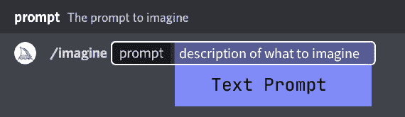
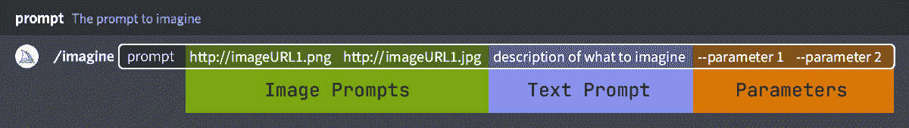

# Prompts

> 来源：[https://zcareers.feishu.cn/docx/RvsZdyC0Jo3a6cxkaPycM1NUn9b](https://zcareers.feishu.cn/docx/RvsZdyC0Jo3a6cxkaPycM1NUn9b)

Prompts(提示)是一个简短的文本短语，Midjourney bot会对其进行解释以生成图像。精心制作的Prompts可以帮助制作独特而令人兴奋的图像。

### 结构

#### 基本提示

基本提示可以简单到单个单词、短语或表情符号。

#### 高级提示

更高级的提示可以包括一个或多个图像URL、多个文本短语和一个或更多个参数。

##### **Image Prompts：**可以将图像URL添加到提示中，以影响最终结果的样式和内容。图像URL总是位于提示的前面。

##### **Text Prompt：**要生成的图像的文本描述。请参阅下面的提示信息和提示。提示直接决定图像的生成。

##### **Parameters：**参数会更改图像的生成方式。参数可以改变纵横比、模型、放大倍数等等。参数位于提示的末尾。

### 提示技巧

#### 文本长度

提示可以非常简单，比如一个单词（甚至一个表情符号）会产生一个图像。简短的提示在很大程度上依赖于Midjourney的默认样式，因此你需要独特的图像那就需要更具描述性的提示。但是，也不是越长越好，要专注于你想要创造的主要概念。

#### 语法

Midjourney机器人不像人类那样理解语法、句子结构或单词，所以选词很重要。在许多情况下，更具体的同义词效果更好。尽可能减少单词，因为更少的单词意味着每个单词都有更强大的影响力。你可以使用逗号、括号和连字符来组织你的想法，但Midjourney机器人可能不会可靠地解释它们。

#### 专注于想要什么

要专注在描述你想要什么，而不是你不想要什么。如果你要求一个“没有蛋糕”的聚会，那你的图像中可能会包括一个蛋糕。如果要确保对象不在最终图像中，请尝试使用--no参数进行提示。

#### 思考细节很重要

应尽可能具体或模糊地描述你想要的细节，遗漏的任何内容都将被随机化。模糊是获得多样性的好方法，但你可能无法获得你想要的具体细节。

尽量清楚任何对你来说重要的背景或细节。思考一下：

主题：人、动物、性格、地点、对象等。

介质：照片、绘画、插图、雕塑、涂鸦、挂毯等。

环境：室内、室外、月球上、纳尼亚、水下、翡翠城等。

照明：柔和、环境、阴天、霓虹灯、工作室灯等

颜色：鲜艳、柔和、明亮、单色、彩色、黑白、粉彩等

#### 使用集合名词

复数词留下了很多机会。试试具体的数字。“三只猫”比“猫”更具体。集体名词也起作用，“一群鸟”而不是“鸟”。