# 指令

> 来源：[https://zcareers.feishu.cn/docx/Uc4ndvj5jo4HOtxsfricj4Win2c](https://zcareers.feishu.cn/docx/Uc4ndvj5jo4HOtxsfricj4Win2c)

## 指令合集快速一览

+   /imagine： 生成图像

+   /settings：查看Midjourney Bot设置

+   /ask：获取问题答案

+   /relax：切换到放松模式

+   /fast：切换到快速模式

+   /blend：切换到两个图像混合模式

+   /prefer remix：切换到混合模式

+   /help：查看帮助信息

+   /info：查看基本信息，如订阅状况、工作模式等

+   /stealth：切换到隐身模式

+   /public：切换到公共模式

+   /subscribe：管理订阅

+   /prefer option set：创建自定义变量

+   /prefer suffix：指定要添加每个提示末尾的后缀

+   /prefer option list：列出之前设置的所有变量

+   /show：结合任务ID生成原图片

## /imagine： 生成图像

最基本的指令，用于生成图像，prompt后面加描绘词

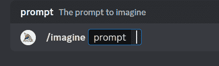

## /settings：查看Midjourney Bot设置

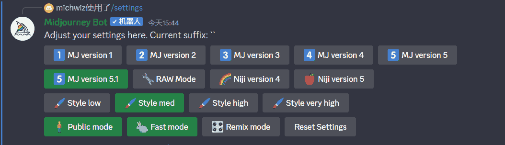

+   第一行：MJ version 1, 2, 3, 4, 5, 5.1: 生成图片版本，最新的是v5.1

+   第二行：Niji version 4, 5 是专门针对动漫和二次元风格的模型

+   第三行：Style low 、med、hight、very higt分别代表着艺术风格化程度，从低、中、高、非常高

+   第四行：输出模式：

+   Public mode：公开模式，所有人都可以看到你生成的。非 60 美元/月套餐，只能是该模式。

+   Stealth mode：隐私模式，只有自己可以看到。仅限 60 美元/月套餐

+   Remix mode：混音模式，可以局部风格进行调整

+   Fast mode：快速模式，即可以快速出图。 60 美元/月套餐，每个月有30个小时快速出图时间。30美元/月，每个月有15个小时快速出图时间 。10美元/月，每个月有200张快速出图套餐，200张额度很快会用完，不推荐此套餐。

+   Reset Settings: 重置设置

## /ask：获取问题答案

过程中有不懂的问题，可以通过/ask指令的方式提问

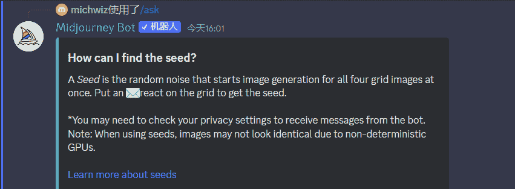

## /relax：切换到放松模式

relax模式也就是慢速模式，生成图的时候比较慢，相反是/fast快速模式

## /fast：切换到快速模式

即快速模式，生成图的时候比较快，相反是/relax模式

## /blend：切换到图像混合模式

将两张图混合模式

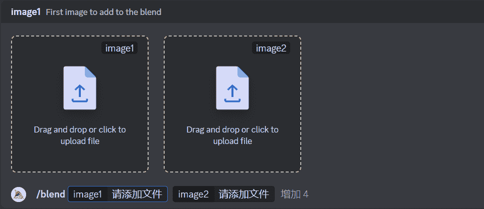

## /prefer remix：切换到混合模式

打开remix模式时，当点击v1-4 variation选择项的时候，可以重新编辑prompt，实在是太方便了。如果需要关掉，就直接重新输入一遍即可

## /help：查看帮助信息

显示有关 Midjourney Bot 的有用基本信息和提示。输入/help“回车”，会出现几个有用的 MJ 链接。你如果刚开始使用midjourney，这个是个不错的引导提示。

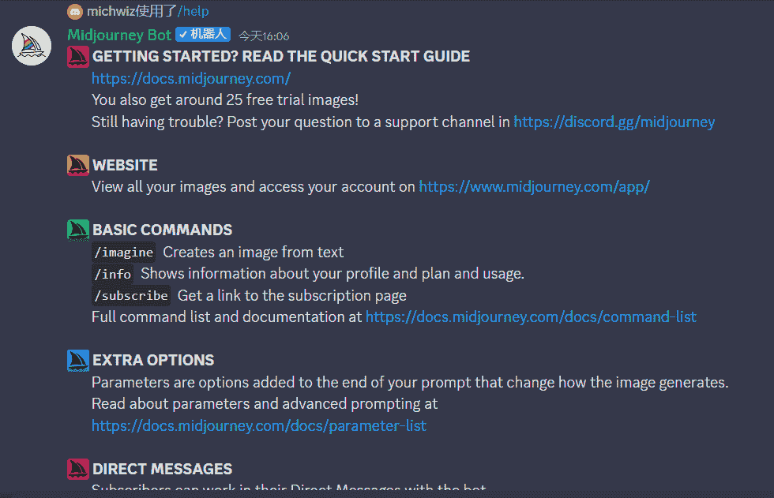

## /info：查看基本信息

查看有关您的帐户和任何排队或正在运行的作业的信息。它提供订阅详细信息，例如订阅计划、fast/relax计时使用情况。它还显示作业详细信息，例如任何排队或正在运行的作业。

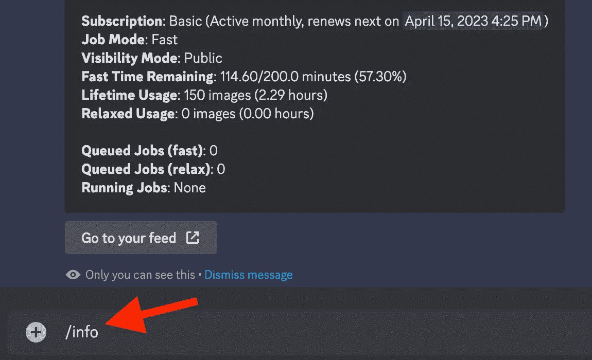

## /docs: 快速生成用户指南链接

键入/docs我们可以看到MJ官方文档标题列表，我们可以在doc后面的输入字段中选择任何感兴趣的。然后它会给出文档的链接。

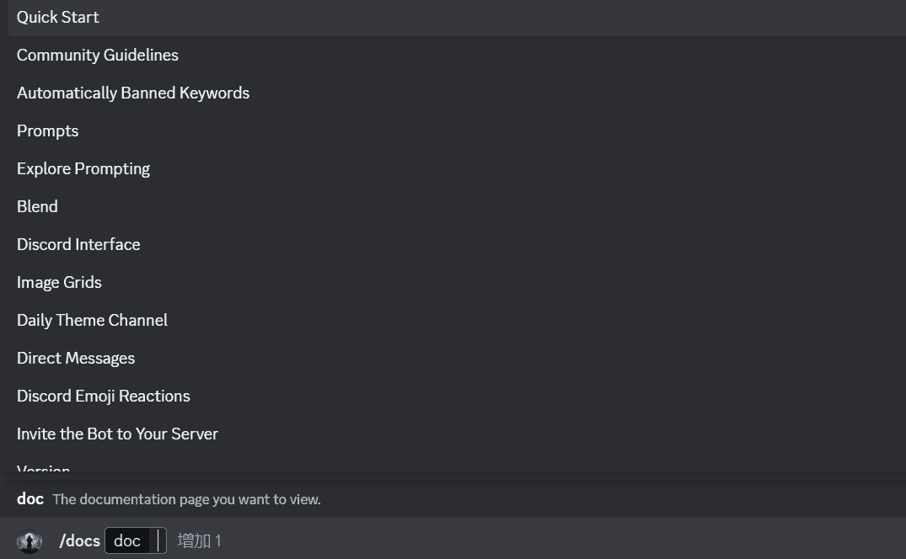

## /stealth：切换到隐身模式

对于 Pro Plan 订阅者：切换到隐身模式。即只有自己看得到生成的图像。

## /public：切换到公共模式

公共模式，即大家都可以看到你生成的图像

## /subscribe：管理订阅

为用户的帐户页面生成个人链接。只需输入“ /subscribe”并按回车键。然后您可以看到指向订阅页面的个人链接。

单击它，就可以浏览所有计划选项。

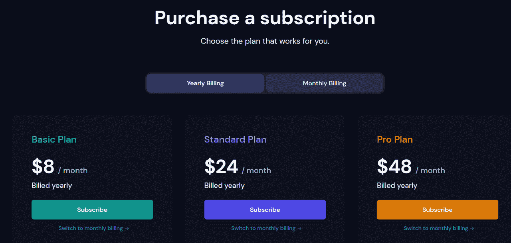

## /prefer suffix：指定要添加每个提示末尾的后缀

设置默认添加到每个提示末尾的后缀，设置后每次会自动在提示内容后面加上后缀。

如果需要去除之前设置的后缀，只需要再次输入，内容为空保存就可以清空之前的后缀设置。

注意后缀只支持参数，不支持提示词

例如：在后缀设置 3:4 图片格式

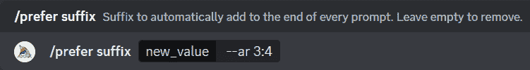

## /prefer option list：列出之前设置的所有变量

将之前所定义的变量列出来，比如我们之前自定义的变量666，显示如下

## /describe：从图像生成提示

输入 describe 命令，可以上传图片，发送作业后，它会给我们 4 个提示供我们选择。

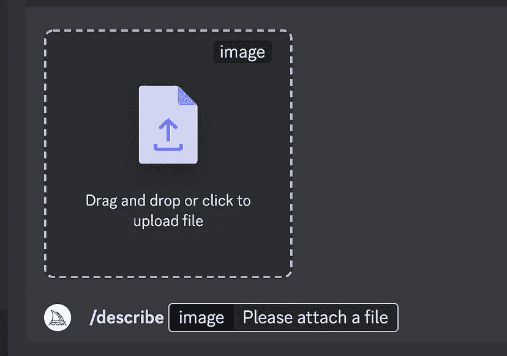

我们从本地选择一个图片文件上传。

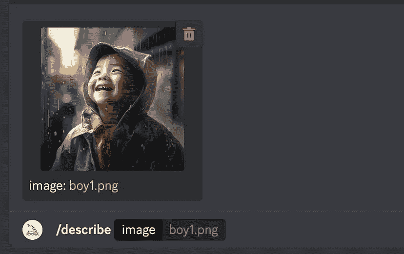

发送后，它会给出 4 个提示，我们可以选择。

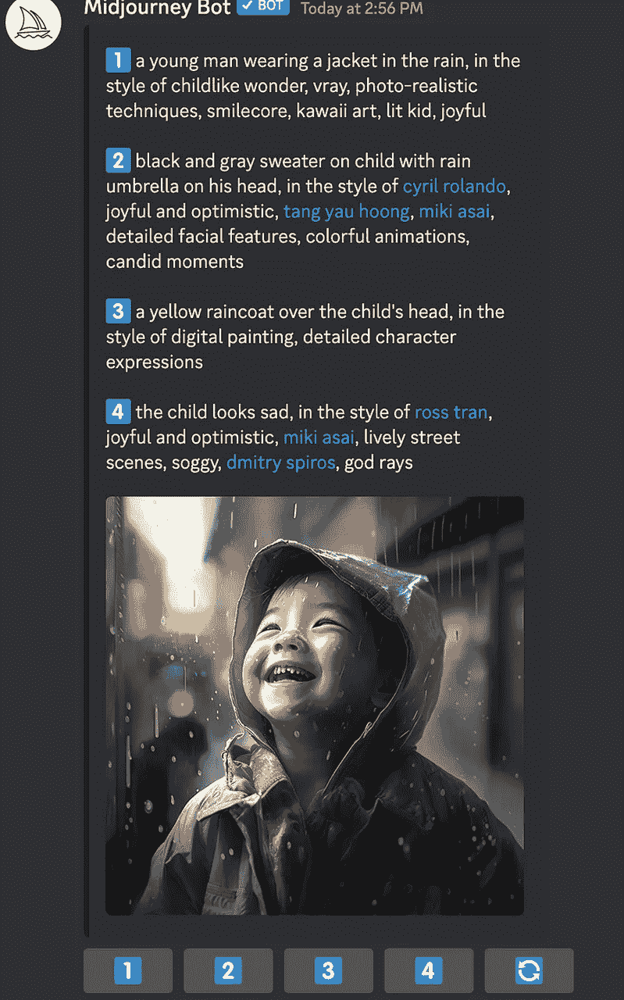

选1号，提示是“**a y****oun**g man wearing a jacket in the rain, in the style of childlike wonder, vray, photo-realistic techniques, smilecore, kawaii art, lit kid, joyful”

这就是用这个提示生成的内容。

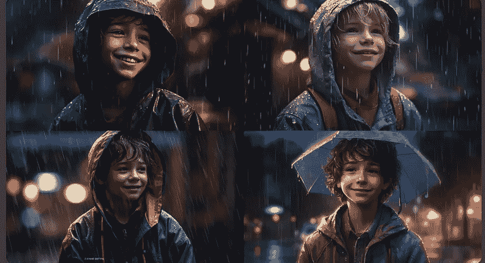