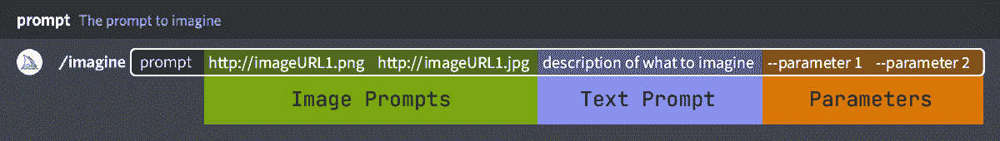
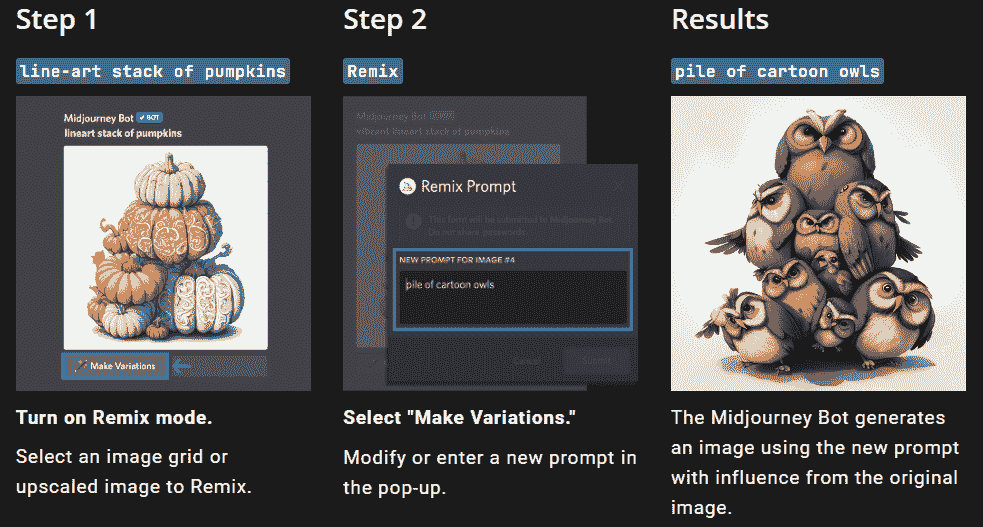
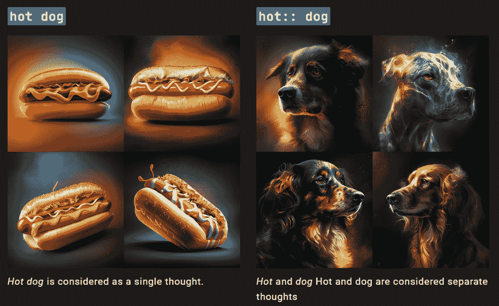
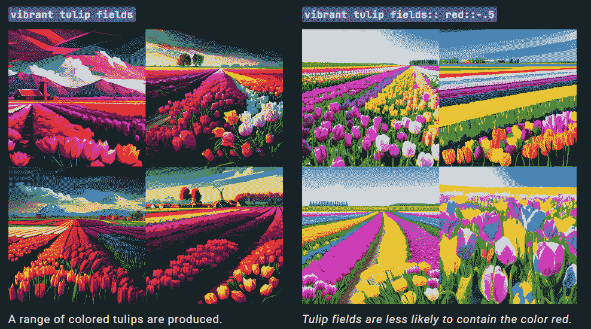

# 参数

> 来源：[https://zcareers.feishu.cn/docx/DfSOdjcATo61jexXjnjcJLqlnbh](https://zcareers.feishu.cn/docx/DfSOdjcATo61jexXjnjcJLqlnbh)

## 基础参数

### [Aspect Ratios](https://docs.midjourney.com/aspect-ratios): 纵横比 --ar 3:4

**--aspect**, or **--ar** 改变画面纵横比例，默认是1:1.

### [Chaos](https://docs.midjourney.com/chaos): 结果变化程度 --c 50

--chaos <number 0–100> 改变结果的变化程度，值越高变化越大。

### [Image Weight](https://docs.midjourney.com/image-prompts): 图像权重 --iw .5

**--iw** <.5–2> 设置相对于文本权重的图像提示权重。默认值为--iw 1。

### [No](https://docs.midjourney.com/multi-prompts): 负面提示 --no plants

**--no**** 让画面中不出现某些内**容，后面可添加多个内容。--no plants 表示生成的图像中不能有plants.

### [Quality](https://docs.midjourney.com/quality): 图片生成质量

--quality <.25, .5, or 1>, or --q <.25, .5, or 1> 生成图像所花费的时间，值越高花费的GPU时间越长。默认值是1。

### [Repeat](https://docs.midjourney.com/repeat): 多次运行作业

**--repeat <1–40>**, or **--r <1–40>** 只有适用于 Standard 和 Pro订阅者。与其他参数结合使用，例如--chaos可以加快探索的速度。多次快速重新运行Jobs。

### [Seed](https://docs.midjourney.com/seeds): 种子编号

**--seed <integer b****e**tween 0–4294967295>

种子编号是为每个图像随机生成的，但可以使用--Seed或--sameseed参数指定。使用相同的种子编号和提示将产生类似的图像。

### [Stop](https://docs.midjourney.com/stop): 停止作业

--stop <integer between 10–100> 在图像处理中途停止作业，默认值是100。

### [Style](https://docs.midjourney.com/models): 风格 **--style cute**

**--style <raw>**** Version 5.1.

--style <4a, ****4**b, or 4c> Version 4.

--style <cute, expressive, original, or scenic> Niji，Version 5。

### [Stylize](https://docs.midjourney.com/stylize): 程式化 --s 750

--sty**lize <number**>, or --s <number> 默认的美学风格在Jobs上应用的强烈程度。低程式化值生成的图像与提示非常匹配，但艺术性较差。高程式化值创建的图像非常具有艺术性，但与提示的联系较少。

V5默认值100，范围0-1000

### [Tile](https://docs.midjourney.com/tile): 重复拼贴图像 --tile

**--tile**** 生成可用作**重复拼贴的图像，以创建织物、壁纸和纹理的无缝图案。--tile只生成一片。

---

## 模型版本参数

Midjourney定期发布新的模型版本，以提高效率、一致性和质量。不同的模型擅长不同类型的图像。

### [Niji](https://docs.midjourney.com/models): --niji 5

**--niji** 专注于动漫风格图像的模型。经过调整可以制作动漫和插图风格，并具有更多的动漫、动漫风格和动漫美学知识。它在动态和动作镜头以及以角色为中心的构图方面表现出色。

要使用此模型，将**--niji 5**参数添加到提示末尾，或使用**/settings**命令并选择🍏 Niji version 5

风格化参数[**--stylize**](https://docs.midjourney.com/docs/stylize)

**--style cute**, **--style scenic**, --style original，或--style expressive

default --niji 5

### [Version](https://docs.midjourney.com/models): --v 5.1

--version接受值 1、2、3、4、5 和 5.1。

最新型号是默认型号，但可以通过添加 --version 或 --v 参数或使用 /settings 命令并选择型号版本来使用其他型号。

---

## 高级参数

### 图片/垫图

使用图像作为提示的一部分来影响作业的构图、风格和颜色。

图像提示位于提示的前面。

提示必须有两个图像或一个图像和文本才能工作。

文件可以是 .png、.gif、.webp、.jpg 或 .jpeg。

将图像上传到 Discord：

1.  将图像粘贴到与 Midjourney Bot 的聊天中。按 Enter 键发送您的图像。

1.  单击以展开图像，然后右键单击并选择“复制图像地址”。

### 混音Remix

使用命令**/prefer remix**** **或使用**/settings**命令并激活混音模式🎛️ Remix Mode

Remix 更改图像网格下的变化按钮（V1、V2、V3、V4）的行为，启用 Remix 后，它允许您在每个变体variation期间编辑提示。To Remix an upscale select🪄 Make Variations。

### 多提示Multi Prompts

分别考虑提示的每个部分

**提示权重**

将提示词改为hot::2 dog，hot一次的权重将变成2倍

cup:: cake:: illustration与cup::1 cake::1 illustration::1、cup::1 cake:: illustration::等cup::2 cake::2 illustration::2相同

**负提示权重，和--no提示等同**

负权重表示删除不需要的元素。但所有权重的总和必须是正数。

