# 辅助建筑平面设计和室内设计

> 来源：[https://zcareers.feishu.cn/docx/QZXbdrSfZoEHxhxiXQpc7754nSv](https://zcareers.feishu.cn/docx/QZXbdrSfZoEHxhxiXQpc7754nSv)

## 一、室内建筑平面设计

## 1.AutoCAD图纸（别墅首层图）

> AutoCAD drawing of the floor plan, the first floor villa building plan, including bedroom, living room, bathroom, kitchen and other building space, each space has specific furniture --ar 16:9 --v 5

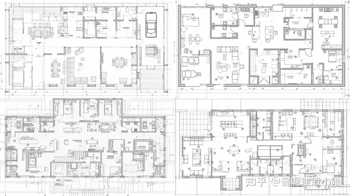

别墅二楼平面布置

## 2.平面效果图

> Renderings of the building plan, the floor plan of the house, including two bedrooms, a living room, bathroom, kitchen, balcony and other building Spaces, each space should have a corresponding furniture arrangement -- ar 16:9 -- v 5

> 建筑平面效果图，住宅建筑平面图，包括两间卧室、一个客厅、浴室、厨房、阳台等建筑空间，每个空间都要有相对应的家具布置——ar 16:9——v 5

> Architectural plan renderings, architectural plans of large shopping malls, including public toilets, shops and other architectural Spaces, each space should have a corresponding layout -- ar 16:9 -- v 5

> 建筑平面效果图，大型商场建筑平面图，包括公共厕所、商铺等建筑空间，每个空间都要有相对应的布置——ar 16:9——v 5

## 3.三维平面透视图

> Architectural plane perspective renderings, middle school architectural plan, including teacher office, classroom, music room and other architectural space, each space should have the corresponding layout -- ar 16:9 -- v 5

> 建筑平面透视效果图，中学建筑平面图，包括老师办公室、教室、音乐教室等等建筑空间，每个空间都要有相对应的布置——ar 16:9——v 5

> The three-dimensional renderings of the building, the stadium building plan, each space should have a corresponding layout -- ar 16:9 -- v 5 建筑三维平面效果图，体育场建筑平面图，每个空间都要有相对应的布置——ar 16:9——v 5

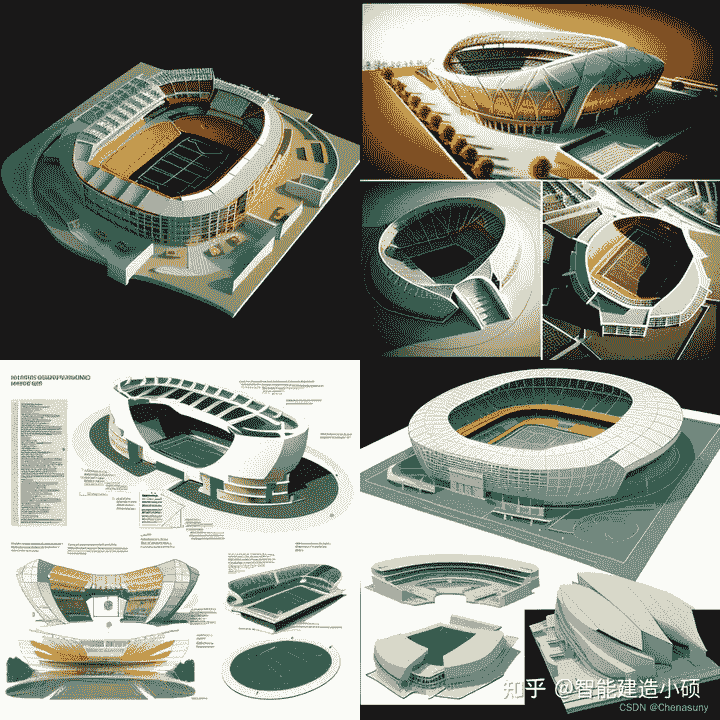

> Three-dimensional renderings of the building, the library building plan, each space should have a corresponding layout -- ar 16:9 -- v 5 建筑三维平面效果图，图书馆建筑平面图，每个空间都要有相对应的布置——ar 16:9——v 5

## 二、建筑室内设计

提示技巧：

色彩在创造一个舒适和温馨的家中扮演着重要的角色，用一些简单的颜色组合，可以用颜色来创造一个适合你个人风格的空间，也可以包括椅子、沙发等材料的颜色设计。所以在提示中可以混合【室内设计】【色彩倾向】。

## 1.现代简约

> prompt： Interior Design, a perspective of of a study, large windows with natural light, light colors, plants, modern furniture, modernist, modern interior design

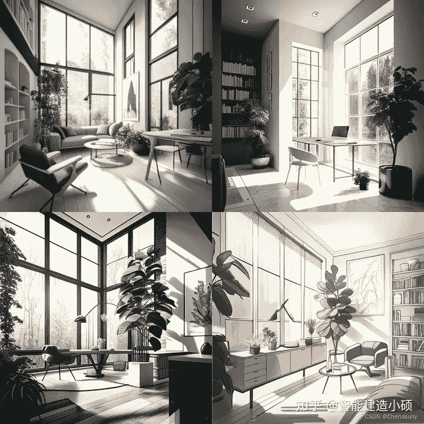

## 2.波西米亚风格

> prompt：Boho interior design, white, olive green, cognac, mustard yellow, and rusty oranges colors room and lots of patterns such as florals and paisleys mixed with natural prints and geometric patterns are a hallmark of boho style, --ar 16:9 --v 5

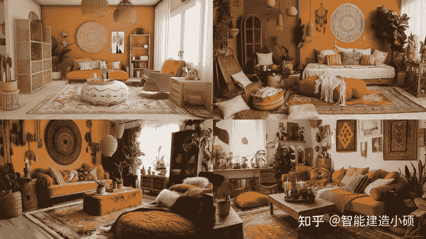

## 3.工业风格

> prompt： Industrial interior design, Monochromatic palettes of greys, iron black, and white room, raw and rough materials with modern elements. This design blend of both old and new, recycled and repurposed materials, while maintaining a sleek and modern look, --ar 16:9 --v 5

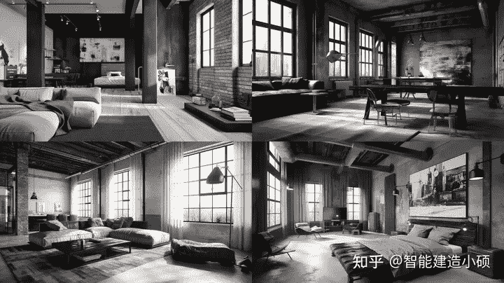

## 4.沿海风格

> prompt：coastal interior design, the room emphasizes lighter tones in shades of blue, green, beige and white to communicate a relaxed feel, the light reflecting off the water create a soothing ambiance --ar 16:9 --v 5

## 5.法国风格

> prompt：french Interior design, the room style are glossy ceramic granite or polished natural stone, parquet or laminate with light wood textures, Space, lots of light, bright colours and natural materials are the quintessence of French style, french painting --ar 16:9 --v 5

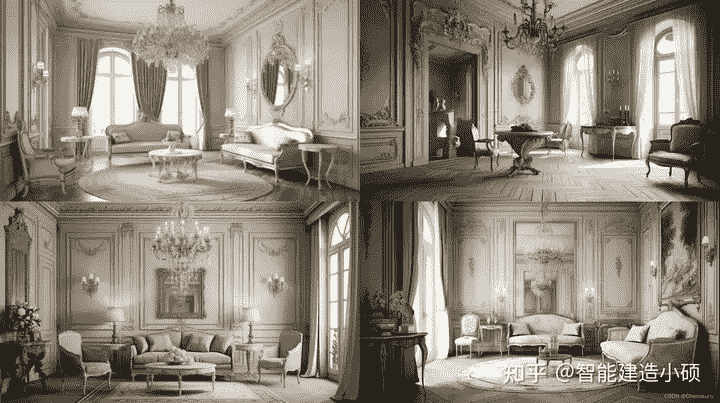

## 6.现代风格

> prompt：contemporary Interior design, the room style design fabrics include silk, linen, cotton, and wool in neutral hues, which provide beautiful textures throughout the space. While colors and patterns are often on the subtler side, clean lines, decorated minimalism, and current trends, --ar 16:9 --v 5

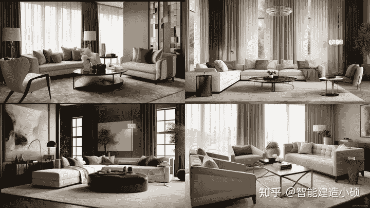

## 7.提示增加颜色倾向

> prompt： A dressing room with pale pink walls with a forest green velvet armchair, natural wood accents, and vintage-inspired botanical prints --v 5

> prompt：Earthy brown walls with a soft cream-colored linen sofa, rattan accents, and muted green foliage. --v 5

> prompt： interior design Warm beige walls with a plush, cream-colored shag rug and textured throw pillows in shades of brown and rust. --v 5

## 8.提示中增加设计师

> prompt： Design an elegant and contemporary bathroom with a futuristic twist, incorporating organic materials and soft lighting, influenced by the works of Philippe Starck --v 5

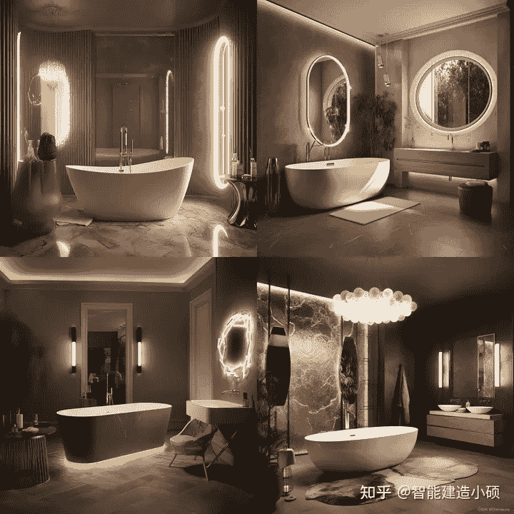

> prompt： a high-tech and aesthetically pleasing home office with a futuristic design and sleek materials, influenced by the works of Karim Rashid

> prompt： a modern and minimalist living space with an emphasis on natural light and a neutral color palette, inspired by the works of Axel Vervoordt --v 5

> prompt： a luxury home interior with biophilic design elements and a natural color scheme, inspired by the works of Kelly Wearstler --v 5

## 9.其它一些尝试

> prompt： A cool pop-art inspired kitchen with bright, eye-catching appliances and retro furnishings --v 5

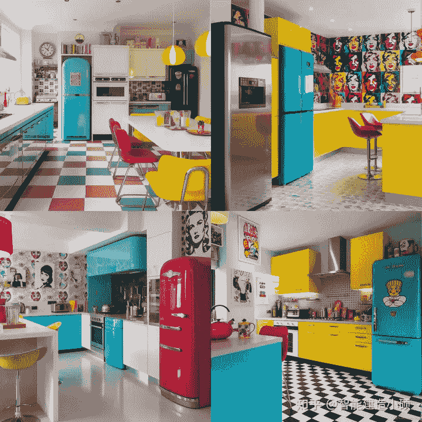

> prompt： A sophisticated gothic-inspired home office with dark wood paneling, dramatic lighting, and antique accents --v 5

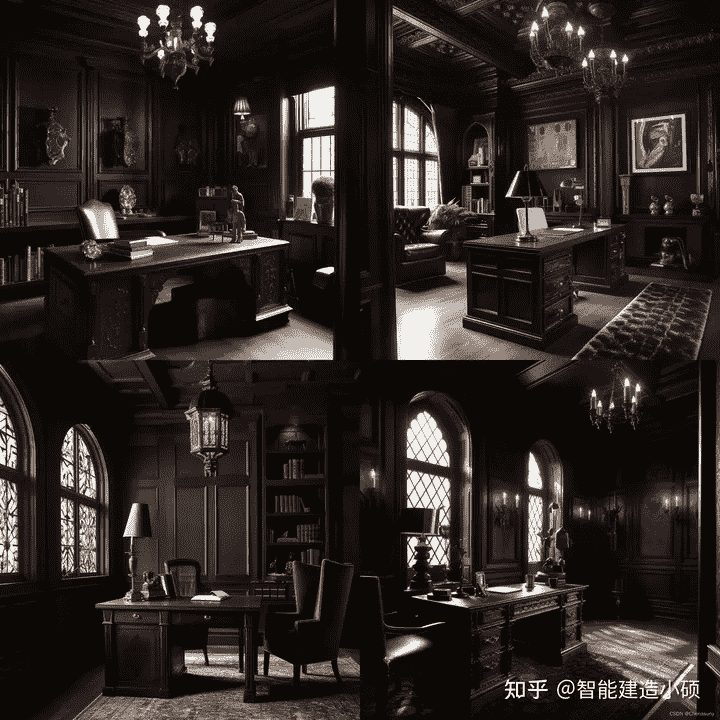

## 三、好用的Midjourney提示词网站

1.网址

[h](https://link.zhihu.com/?target=https%3A//openart.ai/discovery%3FdiscoveryModel%3Dmd%26q%3Dtower%26searchModel%3Dmd)ttps://openart.ai/discovery?discoveryModel=md&q=tower&searchModel=md

2.网址

[h](https://link.zhihu.com/?target=https%3A//prompts.aituts.com/interior-design-photographic-renderings)ttps://prompts.aituts.com/interior-design-photographic-renderings

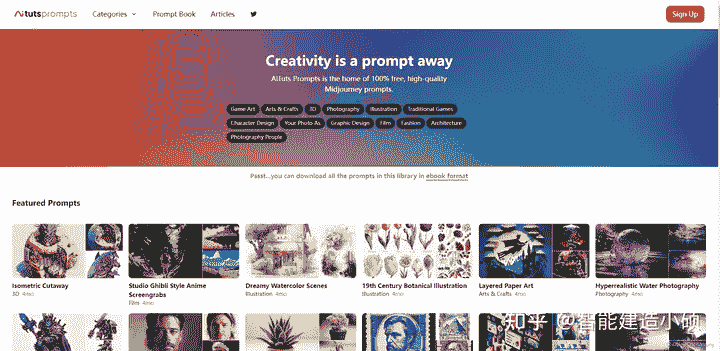

3.网址

[h](https://link.zhihu.com/?target=https%3A//github.com/willwulfken/MidJourney-Styles-and-Keywords-Reference)ttps://github.com/willwulfken/MidJourney-Styles-and-Keywords-Reference

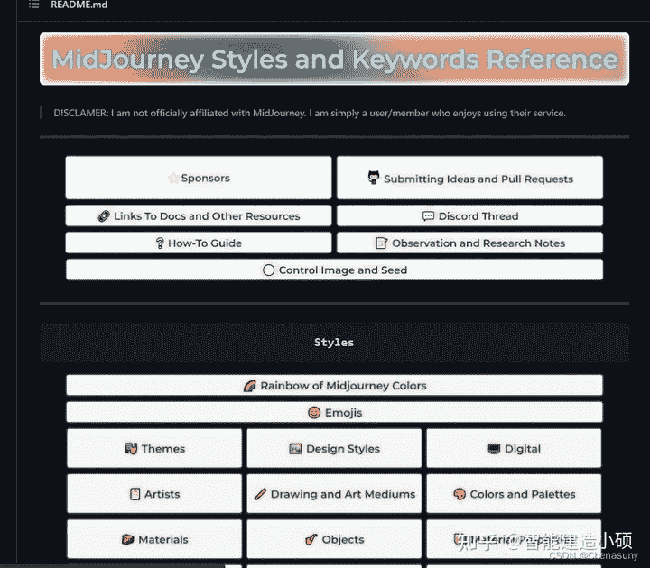

最后，使用像MidJourney这样的AI工具能够有效地简化你的过程并帮助你快速探索许多想法。