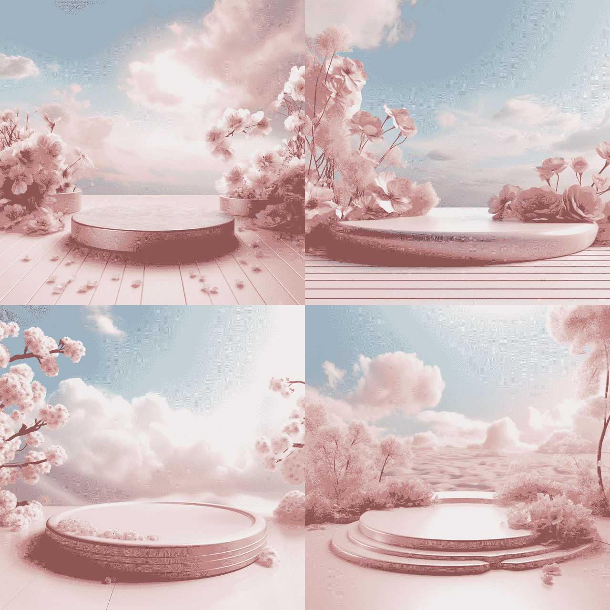
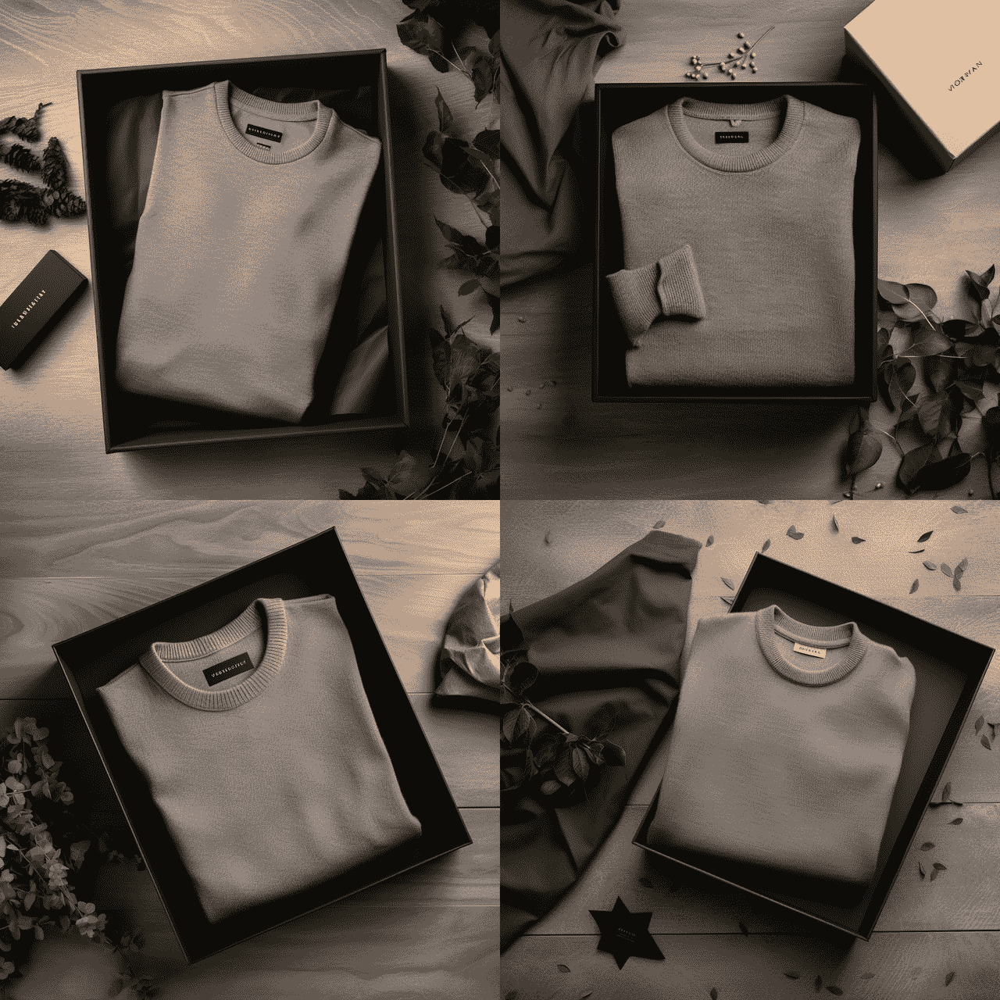
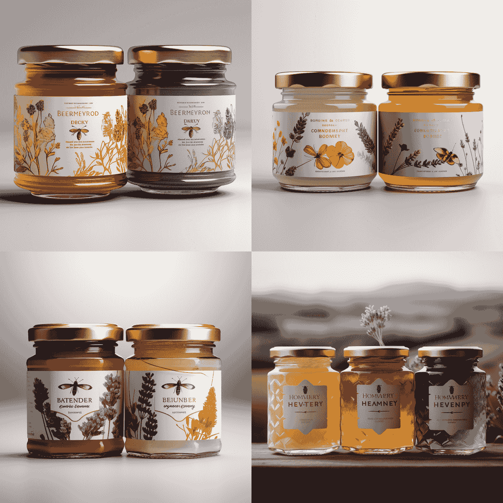
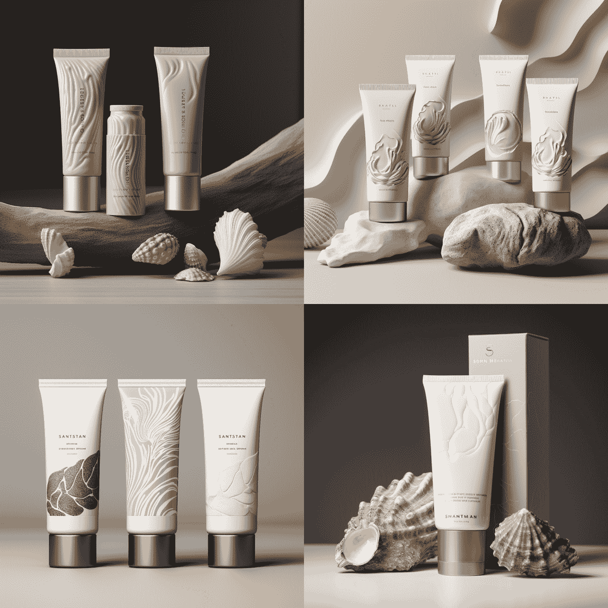
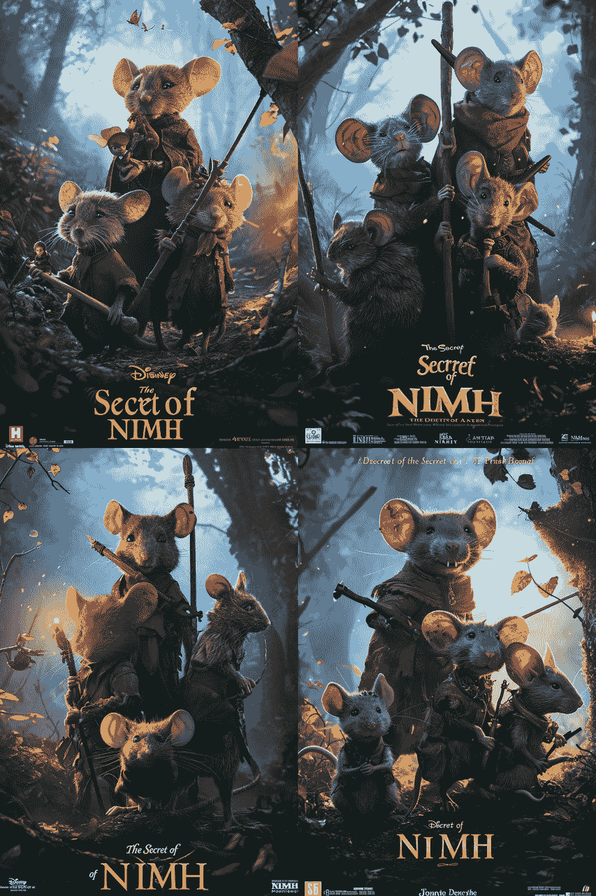
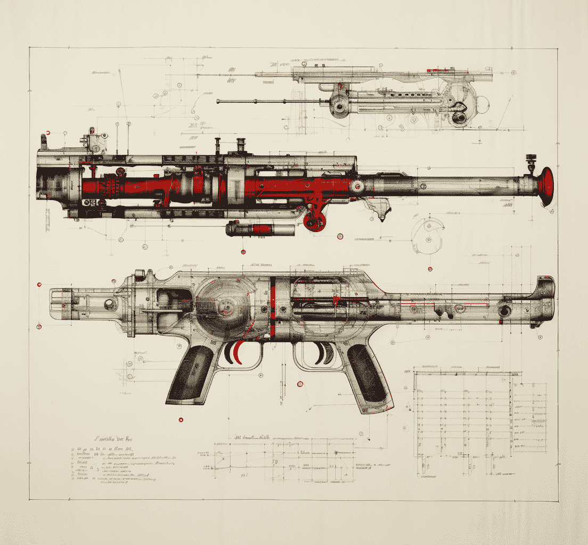
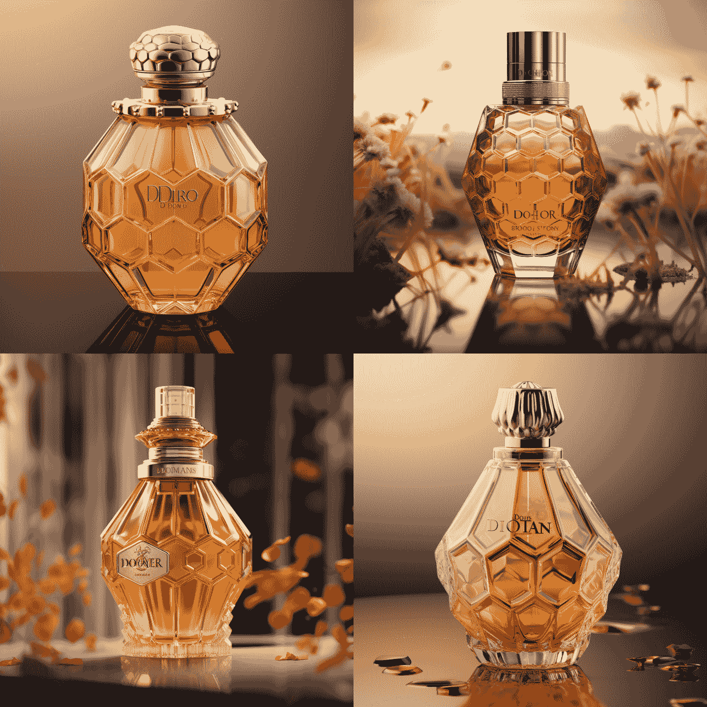
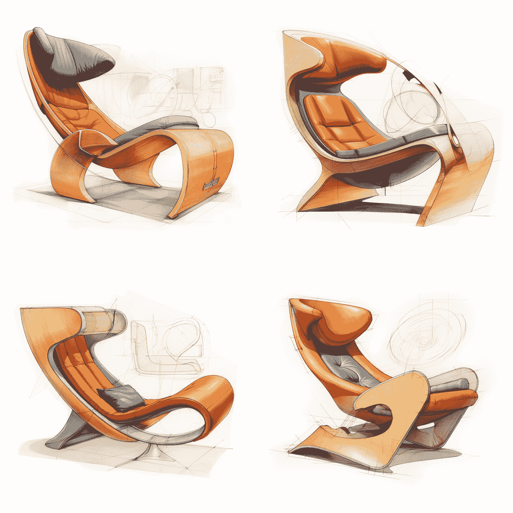
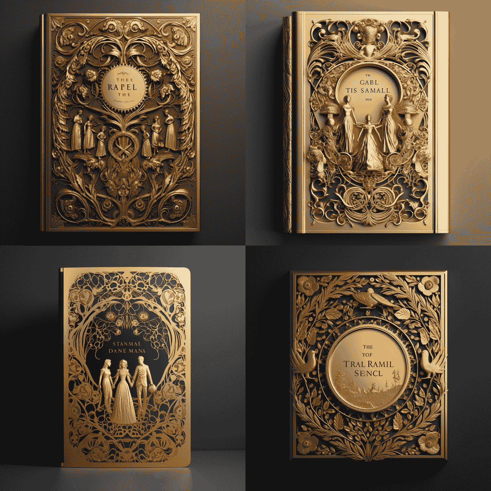

# 案例一

> 来源：[https://zcareers.feishu.cn/docx/QrXZdaK37obVfuxlQRZcMFVbn6e](https://zcareers.feishu.cn/docx/QrXZdaK37obVfuxlQRZcMFVbn6e)

1.  产品展示台

Natural beauty podium backdrop for product display with pink flowers dreamy sky background. Romantic 3d scen.

产品展示以自然美景为背景，粉色花朵为梦幻天空背景。浪漫的3d场景。

1.  产品图片

modern, minimal, flat lay product photo of a high-quality grey knit sweater in a gift box with black tissue paper on a light oak table and a black ribbon off to the side

现代、简约、平放的产品照片，一件高品质的灰色针织毛衣放在一个礼盒里，黑色纸巾放在一张浅橡木桌子上，旁边有一条黑色缎带

1.  产品包装设计

The label should include a beautiful, detailed illustration of flowers such as lavender, clover and orange blossoms associated with honey production. The design should be elegant and natural and reflect the organic and healthy essence of honey. The colors should be warm, with shades of yellow, orange and purple to reflect the sweetness and natural origin of the product. The label should include space for branding elements such as the product name and company logo.

标签上应包括与蜂蜜生产相关的薰衣草、三叶草和橙花等花朵的美丽、详细的插图。设计应优雅自然，体现蜂蜜的有机健康本质。颜色应该是温暖的，有黄色、橙色和紫色的色调，以反映产品的甜味和天然来源。标签应包括品牌元素的空间，如产品名称和公司标志。

1.  产品包装设计

Sustainable hand cream packaging with oyster shell motif, airless pump for product preservation, minimalist design with natural elements.

以牡蛎壳为主题的可持续护手霜包装，用于产品保存的无气泵，具有自然元素的极简主义设计

1.  电影海报

a movie poster for A 3D animated remake of "The Secret of NIMH" : in the style of Dark fantasy adventure, Detailed character animation, Moody color palette, Anthropomorphic animals, Gritty animation style, Inventive production design, Hauntingly beautiful music, Richly textured backgrounds, Tense storytelling, Intense action scenes, Mysterious atmosphere, Suspenseful plot, Emotional depth, Epic scope, Mature themes, mousecore, ratcore : animation inspired by Jean-Baptiste Monge, don bluth --v 6.0 --ar 2:3

3D动画翻拍版《NIMH的秘密》的电影海报：黑暗奇幻冒险风格，详细的人物动画，Moody调色板，拟人动物，Gritty动画风格，创造性的制作设计，令人着迷的优美音乐，丰富的纹理背景，紧张的讲故事，激烈的动作场面，神秘的气氛，悬疑的情节，情感深度，史诗般的范围，成熟的主题，鼠标核心，老鼠核心：受Jean-Baptiste Monge启发的动画，don bluth--v 6.0--ar 2:3

1.  设计图

a picture of a gun with all kinds of tools, in the style of american works on paper 1880–1950, dark coniferous and red, olympus af-1 (aka olympus infinity), industrial and product design, installation-based, handscroll, toy-like proportions --ar 83:77

1880-1950年美国纸上作品风格的一把枪和各种工具的照片，深色针叶树和红色，奥林巴斯af-1（又名奥林巴斯infinity），工业和产品设计，基于装置，手环，玩具般的比例--ar 83:77

1.  产品设计

design a honey themed fragrance bottle for the luxury fragrance company Christian Dior, make sure the bottle is shaped like a hexagon, bee themed, orange, honey themed, bee hive design, product placement, hyper realistic.

为奢侈香水公司Christian Dior设计一个蜂蜜主题的香水瓶，确保瓶子的形状像六边形，蜜蜂主题，橙色，蜂蜜主题，蜂箱设计，产品布局，超现实。

1.  产品设计

a comfortable lounge chair for reading and listening music, noguchi, product design sketch

舒适的休息椅，用于阅读和听音乐，noguchi，产品设计草图

1.  封面设计

beautiful book cover design. a intricate detailed family scene embellished in gold. raised textured, 3d render. product design

美丽的书封面设计。精致的金色家庭场景装饰。凸起的纹理，3d渲染。产品设计。

