# 案例二

> 来源：[https://zcareers.feishu.cn/docx/SDK5dfoXLoHeCNxYu9FcrUUtndd](https://zcareers.feishu.cn/docx/SDK5dfoXLoHeCNxYu9FcrUUtndd)

a tent in a valley at night, mountains in the distance, clear sky, stary night, milky way galaxy, vibrant colors, photorealistic, cinematic view, --ar 16:9 --v 5.2

夜晚山谷中的帐篷，远处的山脉，晴朗的天空，星夜，银河系，鲜艳的色彩，照片级真实感，电影般视角

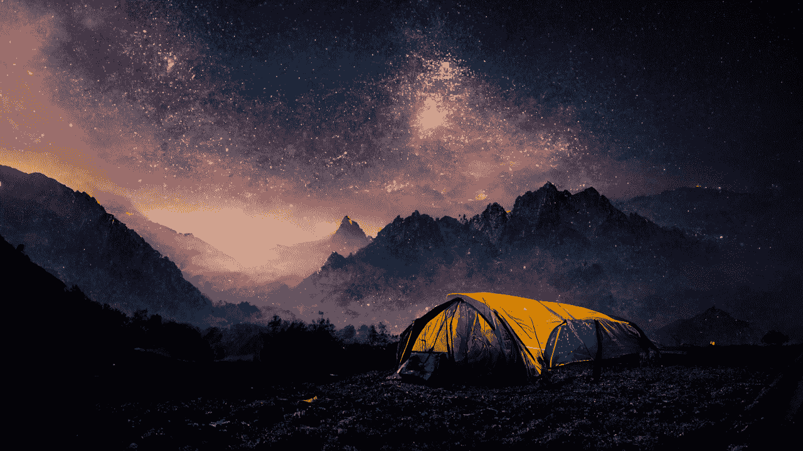

1.  illustration a couple of wolves sitting on the snow rock, some snow brushes in foreground. tree and mountain in the background, very big moon in the sky and very close, Very colorful cloud in the sky. Colors of the photo are yellow pf sunny lights, green of trees, white of snow.

插图几只狼坐在雪岩石上，前景有一些雪刷。背景中有树木和山脉，天空中有一轮非常大的月亮，非常近。天空中有非常多彩的云。照片的颜色是阳光下的黄色，树木的绿色，雪的白色。

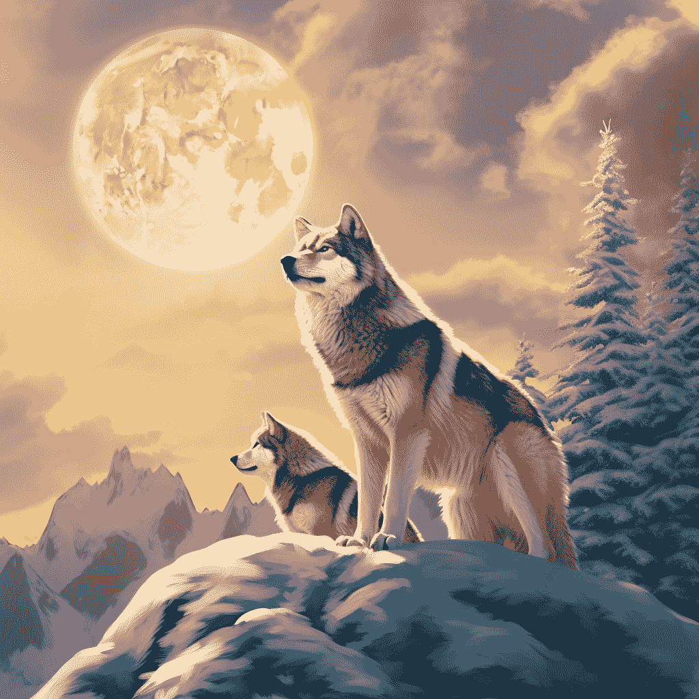

pareidolia photograph of a realistic Cirrus clouds cluster formation in shape of a bird --no face, mouth, nose, eyes

幻视现象照片，形状像鸟的逼真卷云簇形成——没有脸、嘴、鼻子、眼睛

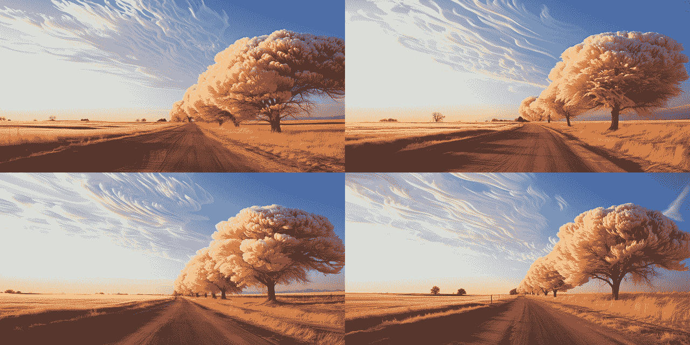

pareidolia photograph of a realistic, surreal Cirrus clouds, Altocumulus clouds, Lenticular clouds, Mammatus clouds, cluster formation in shape of a bird --no face, mouth, nose, eyes

幻视现象：现实、超现实的卷云、高积云、透镜云、乳状云、鸟形云簇的照片——没有脸、嘴、鼻子、眼睛

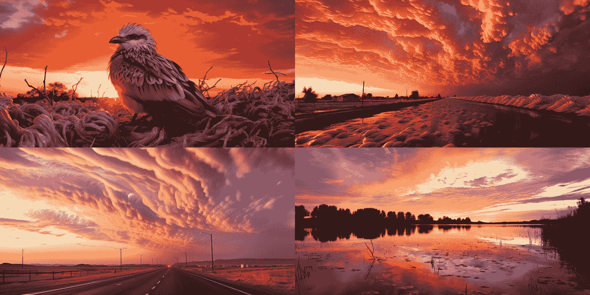

pareidolia photograph of a realistic Cirrus clouds, Altocumulus clouds, Lenticular clouds, Mammatus clouds, cluster formation in shape of a bird --no face, mouth, nose, eyes

幻视症照片，真实照片中是卷云、高积云、透镜云、乳状云，形状像鸟的云簇——没有脸、嘴、鼻子、眼睛

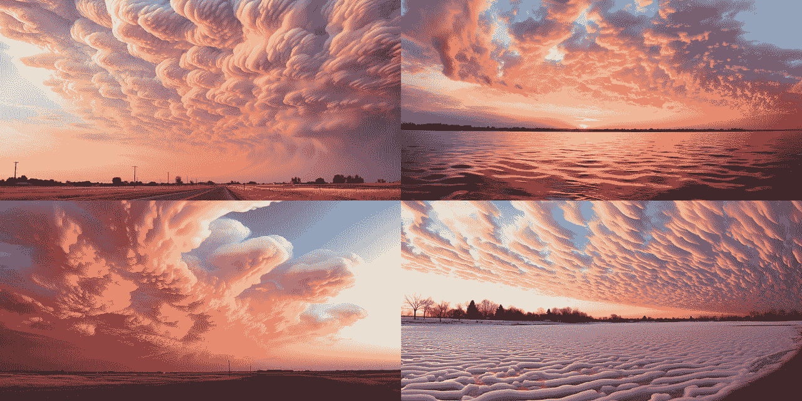

fantasy landscape, rolling hills, aurora borealis, purple skies, cirrus clouds, clouds at sunset, aurora, green light, purple light, red light, sunlight, setting sun, sun halo, sun dog, angelic light, --ar 16:9

梦幻般的风景，连绵起伏的群山，北极光，紫色天空，卷云，日落时的云彩，极光，绿光，紫光，红光，阳光，夕阳，日晕，日食，天使之光

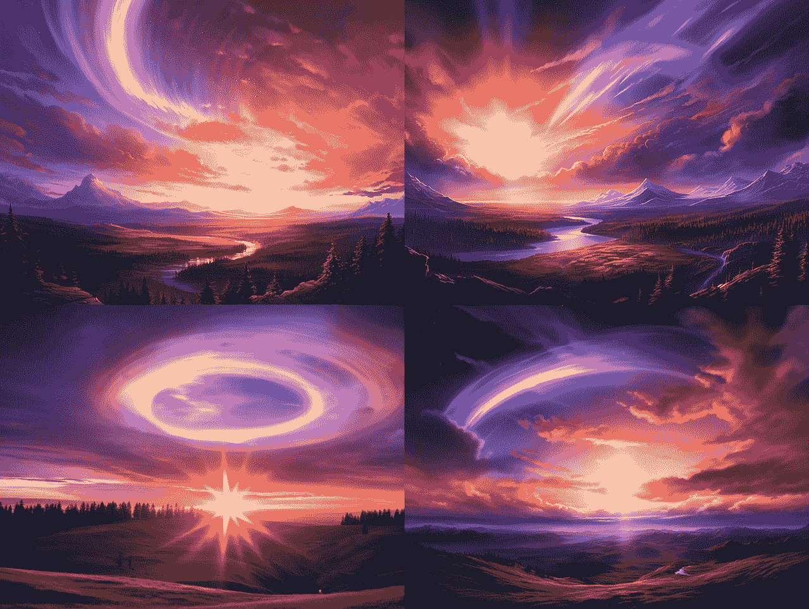

line art work coloring page of with 3 islands floating in the sky with large medieval buildings. Each of the island are connected with each other with a wooden bridge ,flat vector , 2d clean thick lines , white background 4K

线条艺术作品着色页，有3个岛屿漂浮在天空中，有大型的中世纪建筑。每个岛屿都用木桥相互连接，扁平矢量，2D干净粗线条，白色背景4K

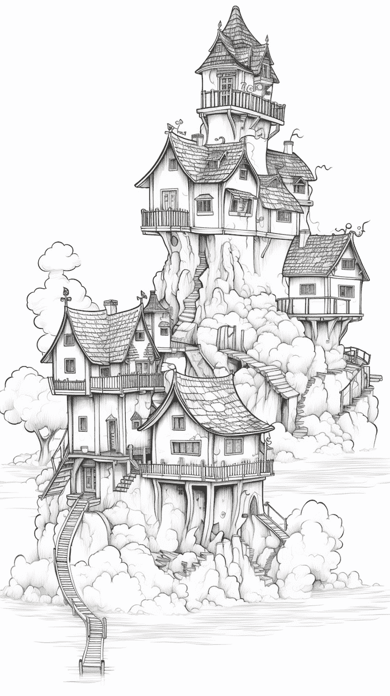

coloring page for kid

儿童涂色页

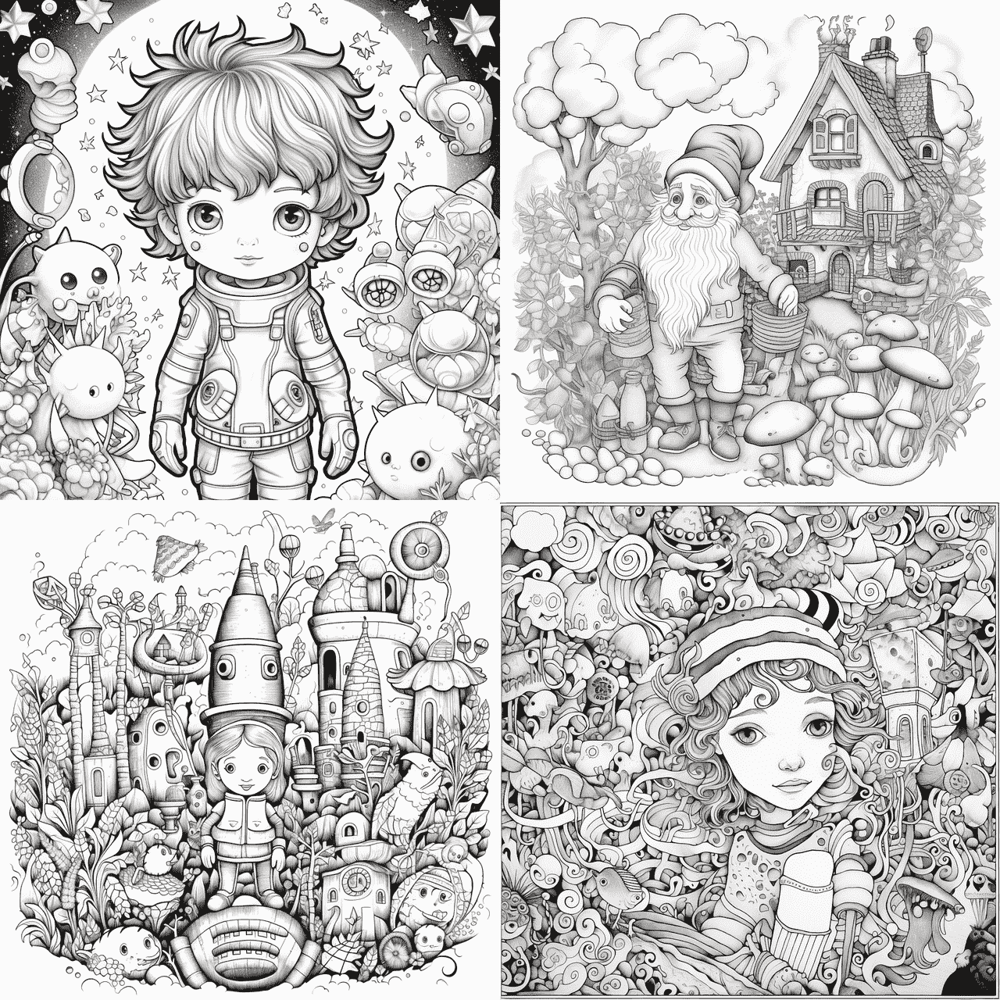

amazing night view with the full moon, romantic landscape with tree branches in front, operetta style, photo realistic

满月下的迷人夜景，前方的树枝浪漫景观，轻歌剧风格，照片逼真

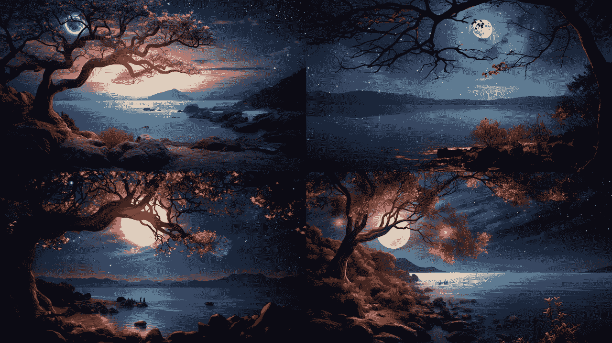

a realistic photo of people under the full moon in aries with bright light around them, stars in the sky around the full moon, beautiful landscape.

一张现实照片，人们在白羊座满月下，周围光线明亮，满月周围的天空中有星星，风景优美。

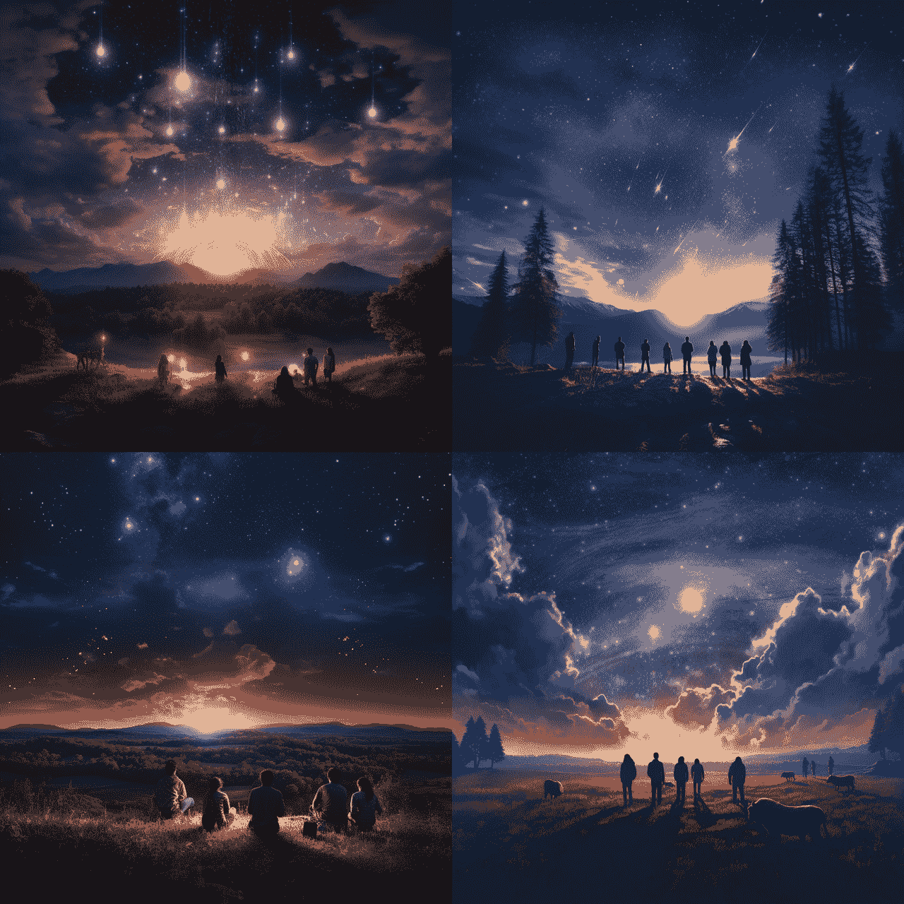

Alaska under 24 hour darkness, aurora borealis, crescent moon, snowy, landscape

阿拉斯加 24 小时黑暗，北极光，新月，白雪皑皑，风景

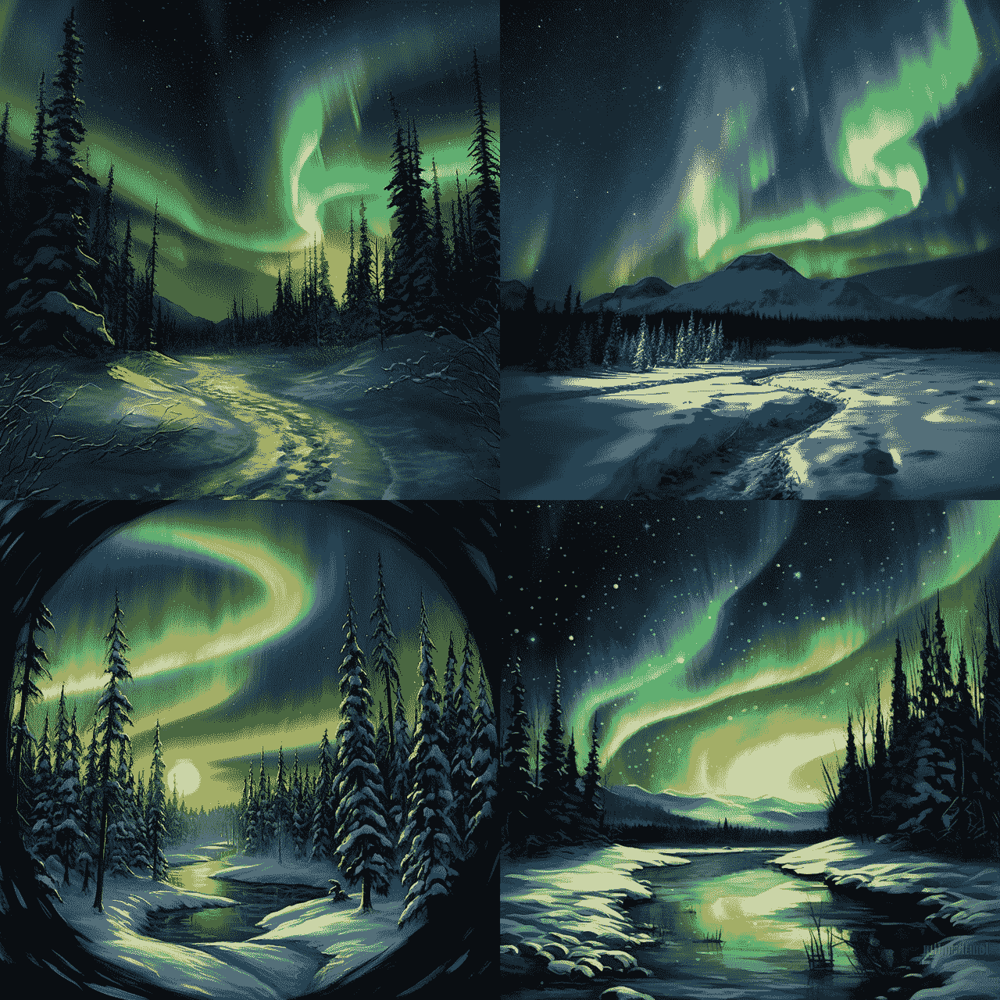