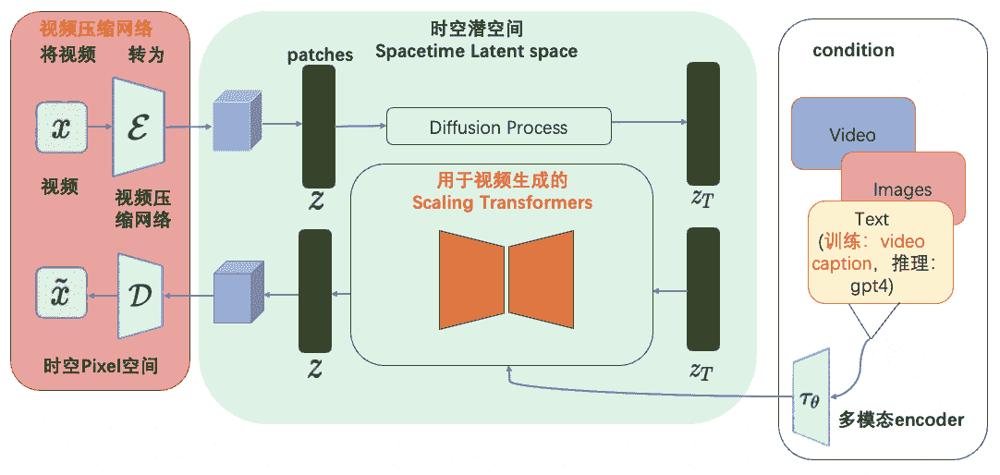
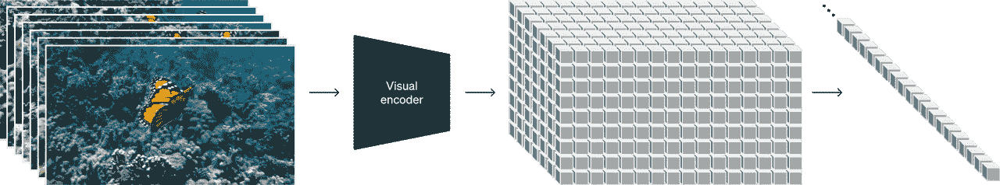
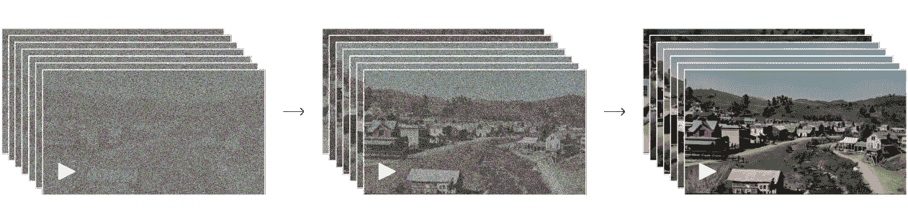
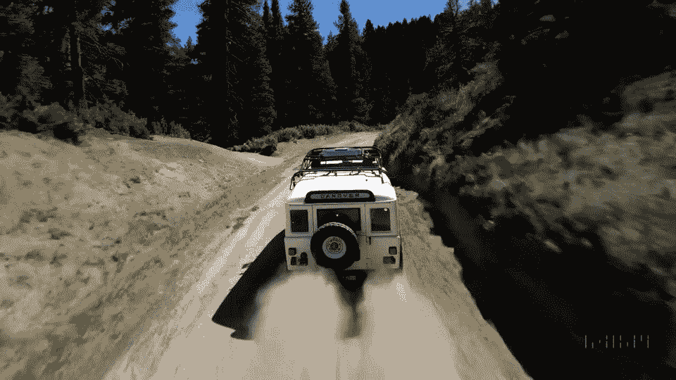
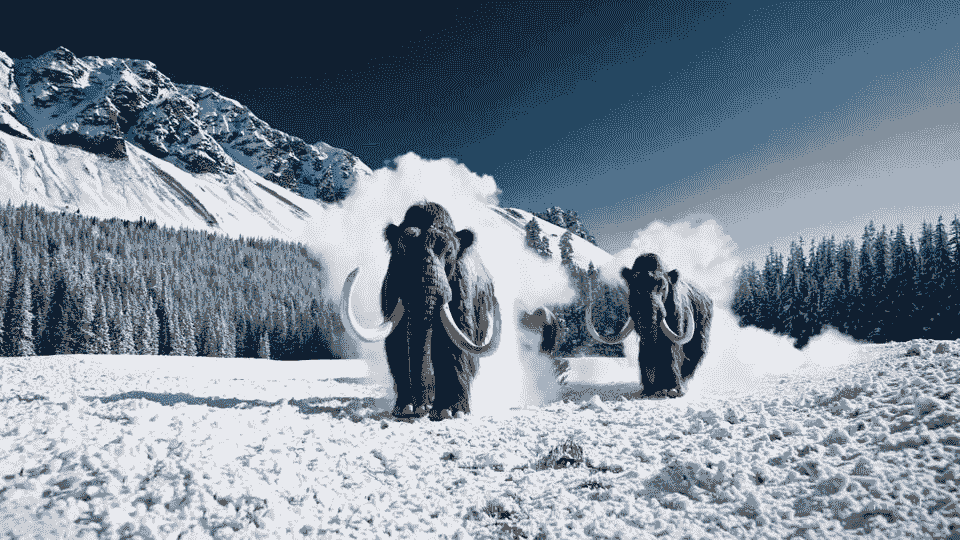
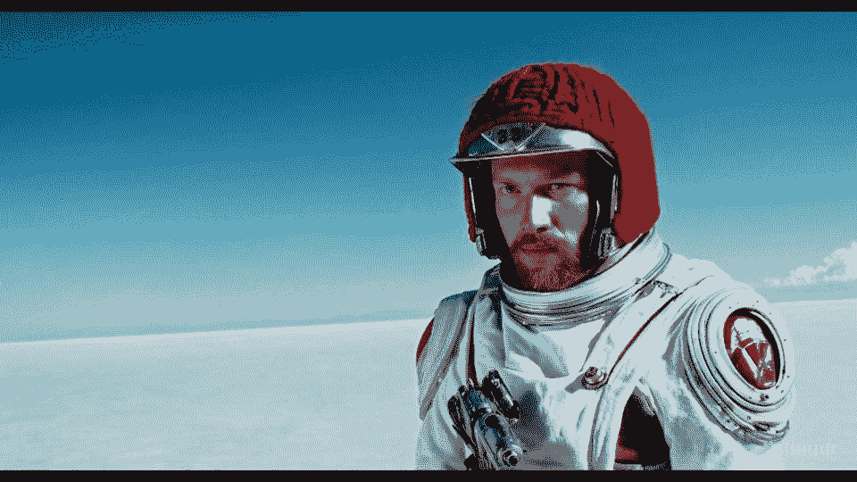
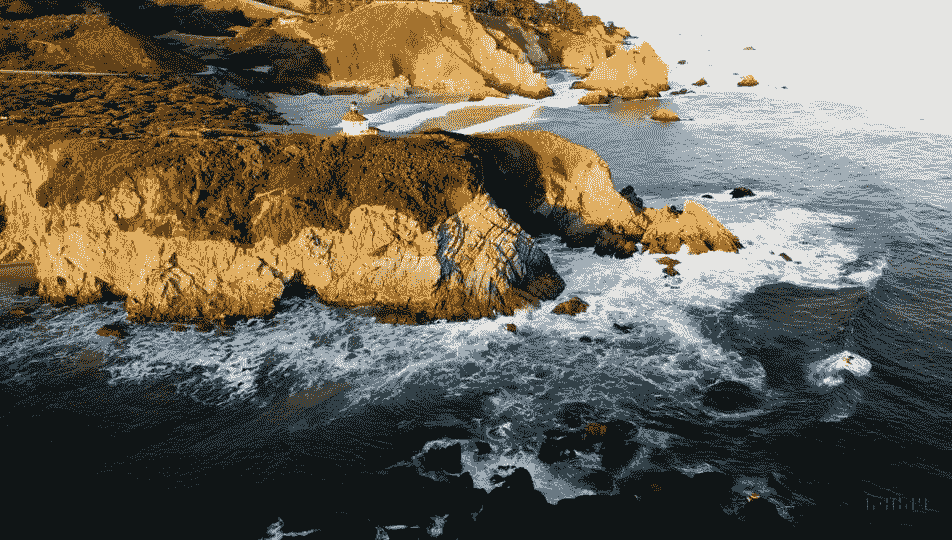

# Sora学习手册

> 来源：[https://zcareers.feishu.cn/docx/M6E7dnenmoKlIvxZYOjcnWU3nuf](https://zcareers.feishu.cn/docx/M6E7dnenmoKlIvxZYOjcnWU3nuf)


> **注：请继续****关注本文档****，支持转发，我们将****持续提供****关于如何使用Sora的****最新信息和更新****。**

# 基本介绍

## 什么是Sora?

Sora是OpenAI新推出的AI视频创作工具，它能够根据文字指示生成接近现实且极具创意的视频场景。这款在2024年2月16日宣布推出的创新模型，具备通过简单的文本命令创造出长达60秒的视频能力，视频内容包含多个角色、特定的动作及精确的主题和背景细节。

官网链接：https://openai.com/sora

官方技术文档：https://openai.com/research/video-generation-models-as-world-simulators

Sora利用了先进的扩散模型技术，通过逐步消除噪声的多步骤过程来逐渐构建视频，既能生成全新的视频，也能对已有视频进行扩展。此举标志着OpenAI将其领先的人工智能技术从文本和图像领域成功扩展到了视频生成领域。

OpenAI认为，Sora不仅是一个视频生成工具，更是向通用人工智能（AGI）迈进的关键一步，因为它展现了理解和模拟现实世界的能力。尽管业界对于AI视频生成模型的问世有所预期，Sora的出现还是超越了许多人的预期，被视为一大突破。

## 如何使用Sora?

截至2024年2月20日，Sora尚未向公众开放测试版，因此普通用户目前还无法亲自体验其功能。

特别警告：请避免相信任何有关账号交易或课程培训的信息。分享这篇文章可以帮助更多人避免被误导。

2024年2月20日的更新消息显示，OpenAI最近已经提供了一个申请账号的机会，可以通过以下链接尝试申请。

官网申请地址：[https://openai.com/form](https://openai.com/form/red-teaming-network)/red-teaming-network

这为有兴趣的用户提供了一个尝试Sora的机会。

## Sora的优势和不足

有关Sora的优势和不足，其实官网已经给出了具体的答案。

1.物理世界的交互

教授人工智能理解和模拟运动中的物理世界，目标是训练模型来帮助人们解决需要现实世界交互的问题。目前Sora是个支持文本转视频模型，可以生成长达-一分钟的视频，同时保持视觉质量并遵守用户的提示

2.创意世界的绽放

今天，红队可以使用Sora来评估关键区域的危害或风险。我们也允许一些视觉艺术家、设计师和电影制作人访问以获得关于如何推进该模型以对创意专业人士最有帮助的反馈。我们正在尽早分享我们的研究进展，以便开始与OpenAI之外的人合作，并从他们那里获得反馈，让公众了解即将出现的AI功能。

3.多角色、更精准、更细节Sora能够生成具有多个角色、特定类型的运动以及精确的主题和背景细节的复杂场景。该模型不仅了解用户在提示中要求什么，还了解这些东西在物理世界中的存在方式,

4.情感注入、多视觉

Sora对语言有深刻的理解，使其能够准确地解释提示，并生成表达充满活力的情感的引人注目的角色。Sora还可以在一个生成的视频中创建多个镜头，准确地保留角色和视觉风格。

5.复杂场的物理现象、混淆空间细节(弱点)

Sora当前的模式存在弱点。它可能难以准确地模拟复杂场景的物理，也可能无法理解因果关系的具体实例。例如-个人可能咬了一口饼干，但之后，饼干上可能没有咬痕。该模型还可能混淆提示的空间细节，例如，混淆左和右，并且可能难以精确描述随时间发生的事件，例如跟随特定的摄像机轨迹。

6.对抗测试、检测误导内容、安全问题保证

在 OpenAI 产品中使用 Sora 之前，我们将采取几个重要的安全措施。我们正在与红队成员(错误信息、仇恨内容和偏见等领域的领域专家)合作，他们将以对抗性方式测试该模型。我们还在构建工具来帮助检测误导性内容，例如检测分类器，可以判断 Sora 何时生成视频。如果我们在OpenAI 产品中部署模型，我们计划将来包含C2PA 元数据。除了开发新技术来准备部署之外，我们还利用为使用 DALL·E3 的产品构建的现有安全方法，这些方法也适用于Sora。

例如，在 OpenAI 产品中，我们的文本分类器将检査并拒绝违反我们的使用政策的文本输入提示，例如要求极端暴力、性内容、仇恨图像、名人肖像或他人 IP 的文本输入提示。我们还开发了强大的图像分类器，用于检查生成的每个视频的帧，以帮助确保它在向用户显示之前符合我们的使用政策。我们将与世界各地的政策制定者、教育工作者和艺术家合作，了解他们的担忧并确定这项新技术的积极用例。尽管进行了广泛的研究和测试，我们仍无法预测人们使用我们的技术的所有有益方式，也无法预测人们滥用我们的技术的所有方式。这就是为什么我们相信，随着时间的推移，从现实世界的使用中学习是创建和发布越来越安全的人工智能系统的关键组成部分。

## Sora功能特点

1.文生视频

你提供文本提示词，Sora根据文字，自动语言理解并扩充提示词生产1分钟视频。

对比其他AI生成视频软件也可以文生视频，但是基本只能生产4秒左右的视频。

2.图生视频

你提供参考图，Sora根据参考图，自动以参考图为核心内容生成1分钟视频对比其他AI生成视频软件也可以图生视频，但是基本也只能生产4秒左右的视频，而且可能和参考图内容有偏差

3.视频生成视频

你提供参考视频，Sora根据参考视频和你需要的风格文本提示词，自动以参考视频为核心内容+特定风格要求生成1分钟视频。你可以更换视频风格也可以更换视频环境，比如原始视频是在森林中，你可以修改视频背景环境为水

下，街景，雪地等。

对比其他AI生成视频软件也可以视频生视频，但是基本也只能生产4秒左右的视频，但是风格变化的效果不是很逼真

4.时间层面扩展视频

你提供参考视频，Sora能够在时间层面向前或向后扩展视频，简单说就是人工智能可以通过原始视频猜测出这个视频的过去和未来，扩展出这个视频的过去和将来。我们先展示向前扩展时间功能，虽然这四个视频的开头都并不相同，但所有四个视频的结局都是相同的。

5.视频拼接

你提供多个不同内容或风格的参考视频，Sora能够把完全不同主题或场景构成的视频无缝拼接成1个完整的视频。

6.3D-致性

Sora 可以生成带有动态摄像机运动的视频。

例如，画面中虽然是3D的移动和旋转，人和场景元素在三维空间中保持一致性的移动。Sora的大杀器之三，对比其他AI生成视频软件还不具备这个功能。因为其他AI生成视频软件画面移动基本都是基于2D世界层面做的，只能实现简单的一些左右移动，上下移动，曲线移动等，为了确保生产视频画面不抖动，我们用这些软件必须尽量减少镜头的移动和旋转。

这点在Sora中就不需要担心了，他是基于3D世界的动态摄像机移动的，而且人物在3D世界中的运动会保持高度的致性。

7.长时间主体一致性

Sora可以保持主体长时间的外观一致性。

例如，我们的模型可以保留人动物和物体，即使被遮挡或离开画面，并能在整个视频中保持其主体的外观一致性，比如画面中的斑点狗不受人物遮挡的影响，也能保持斑点狗在整段视频中的外观一致性。比如你不断的切换画面镜头，比如让主体离开画面再回到画面中，也能保持机器人在整段视频中的外观一致性。Sora的大杀器之四，现阶段其他AI生成视频软件还不具备这个功能，毕竟能生成的视频都很短才4秒钟。

8.模拟真实世界交互

Sora用简单的方式模拟真实世界状况物理交互。

例如，画家可以在画布上留下每一步新的笔触，或者一个人可以吃汉堡并留下咬痕并且只吃掉一部分的食物，虽然这在真实世界是时时刻刻发生的事情，这在Sora中都尽可能的去模拟真实世界。不过现在Sora的也是有一定局限性，并不能完全准确地模拟许多真实世界的基本相互作用的物理过程，例如玻璃破碎，投篮等。其他交豆(例如吃食物，多个主体)又是会出错。

# 技术解读

魔搭社区的开发者也针对Sora的技术报告展开了热烈的讨论，并根据技术报告的内容，推测了Sora的技术架构图如下



Sora的技术架构图（from魔搭社区开发者）

Sora模型的核心技术点（图中红色标注）：

## 视频压缩网络

OpenAI训练了一个降低视觉数据维度的网络。这个网络接受原始视频作为输入，并输出在时间和空间上都被压缩的潜在表示。Sora在这个压缩的潜在空间上进行训练，并随后生成视频。同时还训练了一个相应的解码器模型，将生成的潜在表示映射回像素空间（源自Sora技术报告）。这部分内容为图中的红色部分，核心工作为将视觉数据转化为patches，patches是从大语言模型中获得的灵感，大语言模型范式的成功部分得益于使用优雅统一各种文本模态（代码、数学和各种自然语言）的token。大语言模型拥有文本token，而Sora拥有视觉分块（patches）。OpenAI在之前的Clip等工作中，充分实践了分块是视觉数据模型的一种有效表示（参考论文：An image is worth 16x16 words: Transformers for image recognition at scale.）这一技术路线。而视频压缩网络的工作就是将高维度的视频数据转换为patches，首先讲视频压缩到一个低纬的latent space，然后分解为spacetime patches。



图片来源：Sora技术报告

这个方法同样适用于图像（将图像作为单一帧视频处理），基于Patches的表示使得Sora能够训练具有不同分辨率，持续时间和纵横比的视频和图像，而在推理过程中，只需要在适当大小的grid中随机初始化patches即可控制视频生成的大小。

技术难点：视频压缩网络类比与latent diffusion model中的VAE，但是压缩率是多少，如何保证视频特征被更好的保留，还需要进一步的研究。

## 用于视频生成的Scaling Transformers

Sora是一个diffusion模型；给定输入的噪声块+文本prompt，它被训练来预测原始的“干净”分块。重要的是，Sora是一个Scaling Transformers。Transformers在大语言模型上展示了显著的扩展性，我们相信OpenAI将很多在大语言模型的技术积累用在了Sora上。



在Sora的工作中，OpenAI发现Diffusion Transformers作为视频生成模型具备很好的扩展性。

技术难点：能够scaling up的transformer如何训练出来，对第一步的patches进行有效训练，可能包括的难点有long context（长达1分钟的视频）的支持、期间error accumulation如何保证比较低，视频中实体的高质量和一致性，video condition，image condition，text condition的多模态支持等。

## 语言理解

OpenAI发现训练文本到视频生成系统需要大量带有相应文本标题的视频。这里，OpenAI将DALL·E 3中介绍的标题生成技术用到了视频领域，训练了一个具备高度描述性的视频标题生成（video captioning）模型，使用这个模型为所有的视频训练数据生成了高质量文本标题，再将视频和高质量标题作为视频文本对进行训练。通过这样的高质量的训练数据，保障了文本（prompt）和视频数据之间高度的align。而在生成阶段，Sora会基于OpenAI的GPT模型对于用户的prompt进行改写，生成高质量且具备很好描述性的高质量prompt，再送到视频生成模型完成生成工作。

技术难点：如何训练一个高质量的视频caption模型，需要海量的高质量视频数据，包括数据的获取和标注，为了保障通用型，需要支持各种多样化的视频源，电影、纪录片、游戏、3D引擎渲染等等；标注工作包括对长视频的精准切片，以及切片后的captioning。中文高质量视频数据一直是稀缺资源，随着国内短视频业务发展，也许可以加快中文高质量短视频的收集和获取。

## 世界模型，涌现的模拟能力

大规模训练时，sora同样也出现了有趣的“涌现的模拟能力”，这些能力使Sora能够模拟物理世界中的人、动物和环境的某些方面。这些属性没有任何明确的三维、物体等归纳特征信息——可以理解为由于模型参数足够大而产生的涌现现象。

这些能力包括：

+   三维一致性。Sora可以生成具有动态摄像机移动的视频。随着摄像机的移动和旋转，人物和场景元素在三维空间中一致地移动。

+   长距离连贯性和物体持久性。对于视频生成系统来说，一个重大挑战一直是在采样长视频时保持时间上的连续性。研究发现，Sora通常能够有效地模拟短距离和长距离依赖关系（不稳定）。例如，Sora可以在人物、动物和物体被遮挡或离开画面时仍然保持它们的存在。同样，它可以在单个样本中生成同一角色的多个镜头，贯穿视频始终保持他们的外观。

+   与世界互动。 Sora可以模拟以简单方式影响世界状态的行为。例如，画家可以在画布上留下新的笔触，这些笔触随着时间的推移而持续存在，或者一个人可以吃汉堡并留下咬痕。

+   模拟数字世界。 Sora还能够模拟人工过程，一个例子是视频游戏。Sora可以通过基本策略控制《Minecraft》中的玩家，同时以高保真度渲染世界及其动态。这些能力可以通过prompt包含“Minecraft”，零样本激活这样的能力。

而这些能力都表明，顺着这个方向发展（持续扩大规模），Sora真的可能成为世界模型（能够高度模拟物理和数字世界的模拟器）。也许头部玩家，黑客帝国这些科幻片，就在不太遥远的未来。

技术难点：“大”模型，“高”算力，“海量”数据

# 技术原理

## 基于Transformer架构

Sora模型在其核心构造上与GPT模型颇为相似，均是基于先进的Transformer架构，从而赋予了Sora卓越的扩展能力。Transformer架构采用的是一种革命性的自注意力机制的神经网络，它能够高效地处理输入文本中各个位置的信息。这种机制使得模型能夾捉到更广泛的全局上下文信息，极大地增强了对文本的理解深度。正是得益于这样的架构，Sora在将文本转化为视频的过程中，能够更加精准地把握并表现出文本中的细节和含义。

## 扩散模型和训练稳定性

Sora模型引入了创新的扩散模型方法，这与传统的生成对抗网络(GAN)模型相比，展现出了更加卓越的生成多样性和训练稳定性。扩散模型的核心在于逐步消除噪声的过程，以此逐渐构建和完善视频内容。这种方法不仅有效提升了生成视频的质量，而且还确保了视频场景的真实感和细节丰富度。通过采用这种先进的扩散模型，Sora能够创造出更加逼真、细腻的视频环境，为用户带来更为生动和丰富的视觉体验。

## 生成视频的数据处理和压缩

为了应对生成视频时涉及的大量数据处理需求，Sora模型巧妙地采用了高效的数据处理和压缩技术。通过对视频数据进行精细的处理和智能压缩，Sora不仅能够显著减少对存储空间的需求，同时也确保了视频质量的保持。这意味着在优化存储效率的同时，Sora依然能够提供清晰、高质量的视频输出，从而在保障视频质量的前提下实现了数据处理的高效率。

## 视频质量和逼真度

Sora模型在生成视频的过程中，注重保持视频质量和逼真度。通过采用Tansformer架构和扩散模型的方法，Sora能够生成更加连贯、且具有很高逼真度的视频场景。这使得Sora在应用领域具有广泛的潜力，比如可以用于影视制作、游戏开发等方面。

更多内容，大家也可以查看官方技术文档链接:https://openai.com/research/video-generation-models-as-worldsimulators

# Sora提示词学习

官方给出了48个视频案例及提示词，因篇幅问题，这里只列出几个展示，可以去官方查看。


[monster-with-melting-candle.mp4](https://internal-api-drive-stream.feishu.cn/space/api/box/stream/download/all/KTgNb4VR8oMsbnxcuOEcb1E9nTf)

```
Prompt: Animated scene features a close-up of a short fluffy monster kneeling beside a melting red candle. The art style is 3D and realistic, with a focus on lighting and texture. The mood of the painting is one of wonder and curiosity, as the monster gazes at the flame with wide eyes and open mouth. Its pose and expression convey a sense of innocence and playfulness, as if it is exploring the world around it for the first time. The use of warm colors and dramatic lighting further enhances the cozy atmosphere of the image.
中文翻译：动画场景特写了一个毛茸茸的短怪物跪在融化的红色蜡烛旁。艺术风格是3D和逼真的，重点是照明和纹理。这幅画充满了好奇和好奇，怪物睁大眼睛张大嘴巴凝视着火焰。它的姿势和表情传达出一种天真和顽皮的感觉，仿佛它是第一次探索周围的世界。暖色和戏剧性灯光的使用进一步增强了图像的舒适氛围。
```



[suv-in-the-dust.mp4](https://internal-api-drive-stream.feishu.cn/space/api/box/stream/download/all/PBcybn6CZokC61xlyKhcCsfUnkg)

```
Prompt: The camera follows behind a white vintage SUV with a black roof rack as it speeds up a steep dirt road surrounded by pine trees on a steep mountain slope, dust kicks up from it’s tires, the sunlight shines on the SUV as it speeds along the dirt road, casting a warm glow over the scene. The dirt road curves gently into the distance, with no other cars or vehicles in sight. The trees on either side of the road are redwoods, with patches of greenery scattered throughout. The car is seen from the rear following the curve with ease, making it seem as if it is on a rugged drive through the rugged terrain. The dirt road itself is surrounded by steep hills and mountains, with a clear blue sky above with wispy clouds.
中文翻译：镜头跟随在一辆带黑色车顶行李架的白色复古SUV后面，它在陡峭的山坡上加速行驶在一条被松树包围的陡峭土路上，轮胎上的灰尘飞溅，阳光照射在SUV上，在土路上加速行驶，给现场投下温暖的光芒。土路缓缓向远处弯曲，看不到其他汽车或车辆。路两边的树都是红木，到处都是成片的绿色植物。从后面可以看到这辆车轻松地沿着弯道行驶，看起来就像是在崎岖的地形上行驶。土路本身被陡峭的山丘和山脉包围，上面是晴朗的蓝天和稀疏的云层。
```



[wooly-mammoth.mp4](https://internal-api-drive-stream.feishu.cn/space/api/box/stream/download/all/XDvSbOgv2oR2WIx2nRkcZyoknSe)

```
Prompt: Several giant wooly mammoths approach treading through a snowy meadow, their long wooly fur lightly blows in the wind as they walk, snow covered trees and dramatic snow capped mountains in the distance, mid afternoon light with wispy clouds and a sun high in the distance creates a warm glow, the low camera view is stunning capturing the large furry mammal with beautiful photography, depth of field.
中文翻译：几头巨大的长毛象在雪地草地上漫步，它们长长的长毛在风中轻轻地吹着，远处是白雪皑皑的树木和引人注目的雪山，午后的光线与稀疏的云层和远处的太阳形成了温暖的光芒，低相机的视野令人惊叹，用美丽的照片捕捉到了这只毛茸茸的大型哺乳动物，景深。
```



[mitten-astronaut.mp4](https://internal-api-drive-stream.feishu.cn/space/api/box/stream/download/all/We19bX3DNoi371xBObWcWfZ5nSc)

```
Prompt: A movie trailer featuring the adventures of the 30 year old space man wearing a red wool knitted motorcycle helmet, blue sky, salt desert, cinematic style, shot on 35mm film, vivid colors.
中文翻译：一部电影预告片，讲述了这位30岁的太空人的冒险故事，他戴着红色羊毛针织摩托车头盔，蓝天，盐沙漠，电影风格，用35毫米胶片拍摄，色彩生动。
```



[big-sur.mp4](https://internal-api-drive-stream.feishu.cn/space/api/box/stream/download/all/Say1byMT1owxWXxU5ykc1qH7nId)

```
Prompt: Drone view of waves crashing against the rugged cliffs along Big Sur’s garay point beach. The crashing blue waters create white-tipped waves, while the golden light of the setting sun illuminates the rocky shore. A small island with a lighthouse sits in the distance, and green shrubbery covers the cliff’s edge. The steep drop from the road down to the beach is a dramatic feat, with the cliff’s edges jutting out over the sea. This is a view that captures the raw beauty of the coast and the rugged landscape of the Pacific Coast Highway.
中文翻译：在大苏尔的garay角海滩上，海浪拍打着崎岖的悬崖，无人机尽收眼底。汹涌的蓝色海水形成了白色的波浪，而落日的金色光芒照亮了岩石海岸。远处坐落着一个带灯塔的小岛，绿色的灌木林覆盖着悬崖边缘。从公路到海滩的陡峭落差是一个戏剧性的壮举，悬崖的边缘伸出大海。这是一个捕捉到海岸原始美景和太平洋海岸公路崎岖景观的视图。
```

我们可以从这些提示词中发现规律，提示词内容包括：

## 1.主体部分

每个场景都有一个或多个主体，如猛犸象、太空人、无人机拍摄的海景、小怪物、章鱼和帝王蟹、老式电视、神秘生物、SUV车辆、历史教堂等。

## 2.场景设置

每个提示词都明确描述了一个特定的场景，比如雪地上的猛犸象、太空人的冒险、海岸线、动画场景、海底世界、电视展示、魔法森林、山坡上的SUV行驶、阿马尔菲海岸的教堂等。

## 3.视觉细节

提示词中详细描述了场景、人物或物体的具体特征，包括颜色、形状、表情、动作和环境等，如女性的服饰、动物的毛发、车辆的细节等。

## 4.动作与情感

描述中包括了人物、动物或物体的动作和活动，如走路、踏雪而行、探索、拍打海浪、跳舞等，以增加场景的动态感。

还塑造了特定的氛围和情感，通过使用特定的形容词和动词来实现，如“温暖的光芒”、“惊奇和好奇”、“敬畏”、“神奇而浪漫的感觉”等。

## 5.技术和风格

提示词通过指定的视角和摄影技巧来增加场景的吸引力，如“低相机视角”、“无人机拍摄”、“广角拍摄”、“高动态范围”等。

或者使用的技术或艺术风格，如“3D和现实的”、“35毫米胶片拍摄”、“动画”等特效风格。

汇成表格如下：

# 更多AI相关资讯

请关注雷老师讲AI: 焦人工智能、实战AI、企业培训、商业咨询。

主理人：雷老师，原微软Office产品负责人、清华启迪之星创业导师、微软人才顾问、微软Toastmasters主席、微软ignite、TechSummit大会讲师

