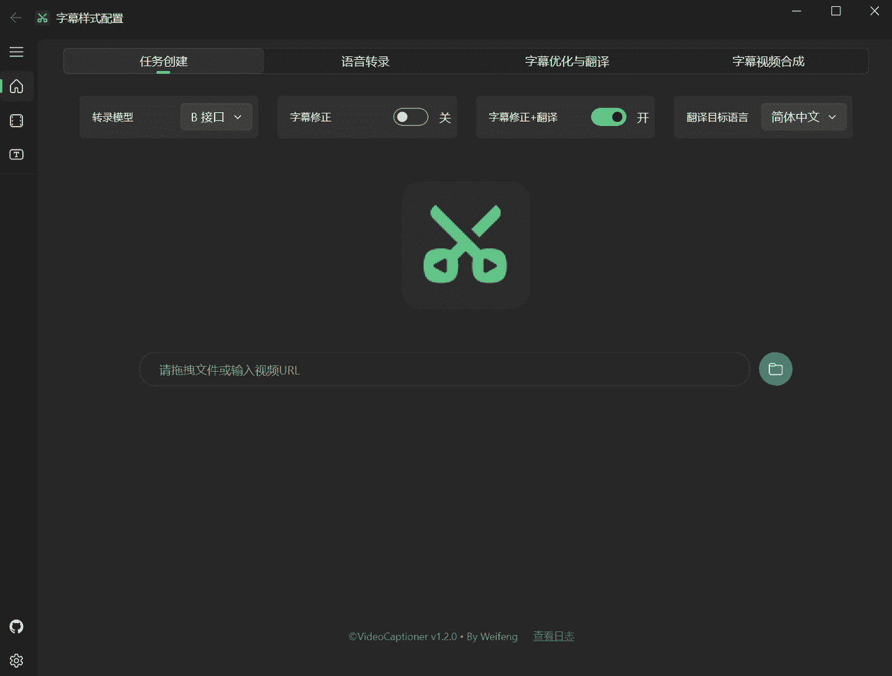

# 视频字幕识别+翻译VideoCaptioner

> 来源：[https://zcareers.feishu.cn/docx/JOPudt9HToTTocxH17jcsDlKnoc](https://zcareers.feishu.cn/docx/JOPudt9HToTTocxH17jcsDlKnoc)

Github仓库：https://github.com/WEIFENG2333/VideoCaptioner

可以从release页面直接下载windows安装包：https://github.com/WEIFENG2333/VideoCaptioner/releases

如果不方便访问github，可以从网盘下载: https://pan.baidu.com/s/172nCyEfKlc7JnKAwTRk24w?pwd=txee

## **主要功能**

软件充分利用大语言模型(LLM)在理解上下文方面的优势，对语音识别生成的字幕进一步处理。有效修正错别字、统一专业术语，让字幕内容更加准确连贯，为用户带来出色的观看体验！

1.  **多平台视频下载与处理**

+   支持国内外主流视频平台（B站、Youtube等）

+   自动提取视频原有字幕处理

1.  **专业的语音识别引擎**

+   提供多种接口在线识别，效果媲美剪映（免费、高速）

+   支持本地Whisper模型（保护隐私、可离线）

1.  **字幕智能纠错**

+   自动优化专业术语、代码片段和数学公式格式

+   上下文进行断句优化，提升阅读体验

+   支持文稿提示，使用原有文稿或者相关提示优化字幕断句

1.  **高质量字幕翻译**

+   结合上下文的智能翻译，确保译文兼顾全文

+   通过Prompt指导大模型反思翻译，提升翻译质量

+   使用序列模糊匹配算法、保证时间轴完全一致

1.  **字幕样式调整**

+   丰富的字幕样式模板（科普风、新闻风、番剧风等等）

+   多种格式字幕视频（SRT、ASS、VTT、TXT）

