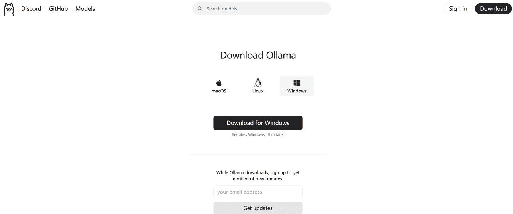
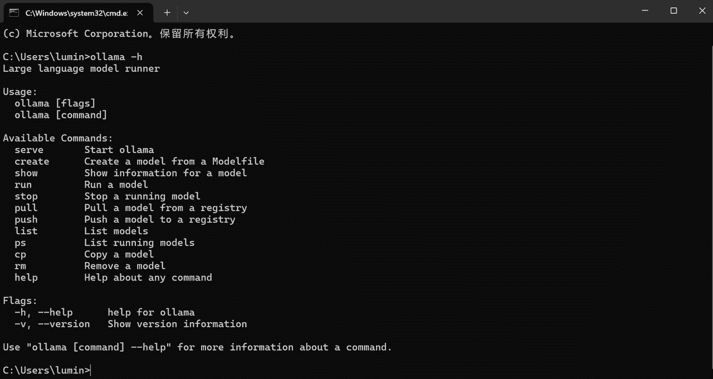
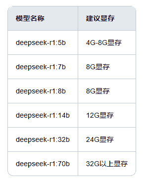
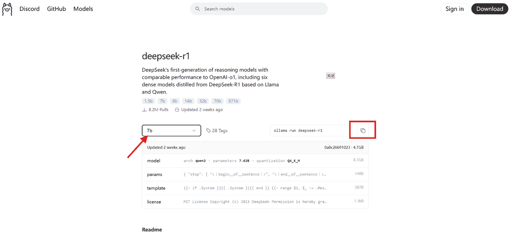
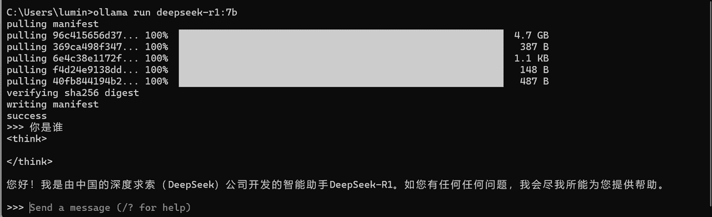
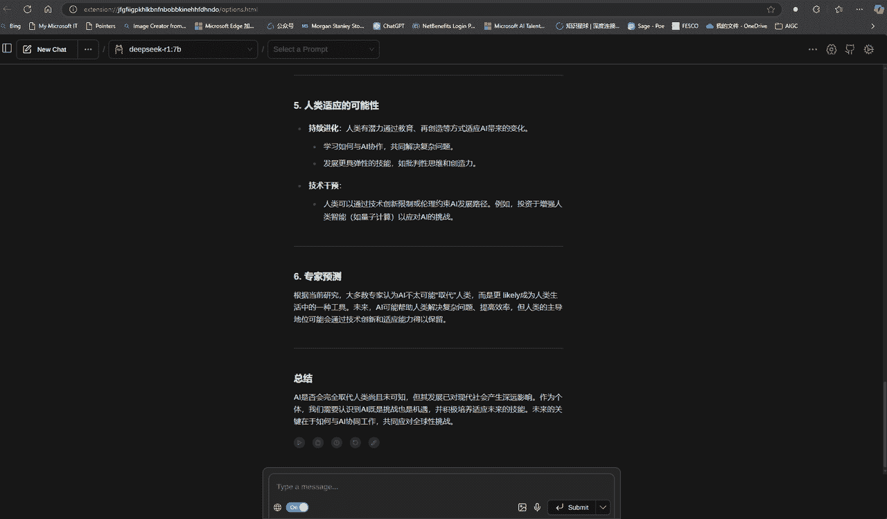
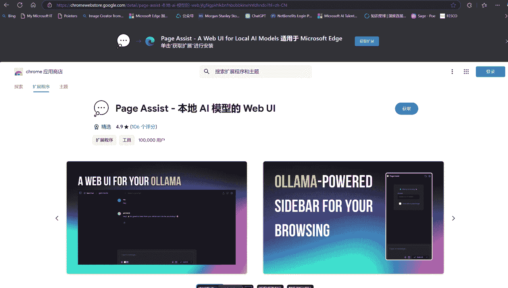

# Ollama本地部署Deepseek

> 来源：[https://zcareers.feishu.cn/docx/Sux0d5amgoer2dxPm7Ac7eYznEe](https://zcareers.feishu.cn/docx/Sux0d5amgoer2dxPm7Ac7eYznEe)

## 命令行部署Deepseek

1.  网页搜索：https://ollama.com/，进入ollama官网页面

1.  不需要登录，直接点击Download下载，自行选择不同的系统进行下载，下载后安装就可以了

1.  Window键+R键，弹出运行窗口，输入cmd，打开命令行窗口

1.  输入ollama -h，如果显示 Large language model runner，说明运行成功了

1.  再打开ollama 的官方网站，点击Models，点击deepseek-r1

1.  就会进入deepseek-r1界面，默认是7b，可以自行根据配置选择大小

1.  选择好大小后，直接点击右边的“复制”按钮

1.  打开刚刚启动的cmd窗口，如果关掉了，重复第3步

1.  粘贴第7步复制的东西进去，按enter键，就开始下载了。下载完成后，就可以在窗口内进行对话了（在这里对话有点不方便，可以按照后面的步骤到浏览器上使用）

1.  启动deepseek命令，ollama run deepseek-r1:7b，7b可以替换成你下载的版本

删除命令：ollama rm deepseek-r1:7b，7b这里根据自己下载的版本进行更改，如果显示 deleted‘deepseek-r1:7b’，说明删除成功

## 安装ChatBox

下载地址：https://chatboxai.app/zh

## 附录：

### 安装浏览器插件，在浏览器上使用Deepseek

如下图：

#### 方法1）Edge浏览器+ Page Assist

https://www.crxsoso.com/webstore/detail/jfgfiigpkhlkbnfnbobbkinehhfdhndo

#### 方法2）Chrome浏览器+ Page Assist

**注意需要科学上网**

在chrome应用商店搜索“Page Assist”，获取并安装

安装好后，点击浏览器右上角的扩展图标，就可以打开页面使用了。

