# DeepSeek搭建本地知识库AnythingLLM

> 来源：[https://zcareers.feishu.cn/docx/B3VudUyzUodbhExzNKmc8ycdnAf](https://zcareers.feishu.cn/docx/B3VudUyzUodbhExzNKmc8ycdnAf)

# **万事先问为什么：**

1.  为什么要搭建AI知识库系统？

+   **对个人**：

+   记录个人学习、工作经验，打造专属的知识体系

+   收藏网页摘录/本地文档，终结"收藏即遗忘"的无效囤积。

+   **对企业**：

+   知**识管理与传承:**让新员工一键继承资深员工的实战经验库，将离职风险降低

+   快速查找案例、技术方案。**提升运营效率**

+   重要：确保安全隐私

# **安装AnythingLLM**

https://anythingllm.com/desktop一个强大的灵活的平台，通过它可以连接多个LLM模型，构建本地私有的LLM应用，配置界面简单直观。

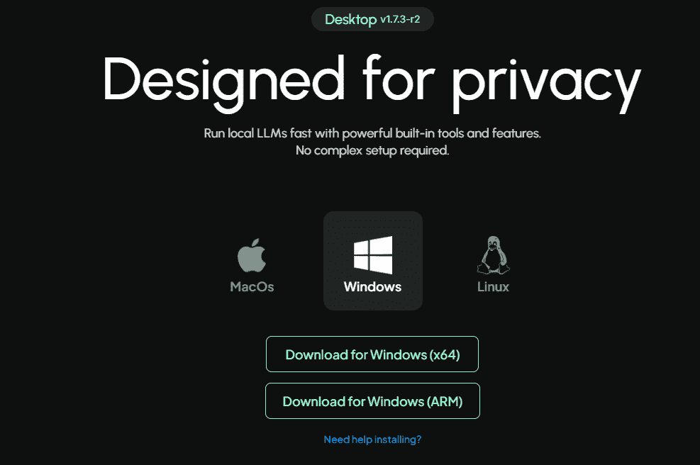

# 安装nomic-embed-text嵌入式模型

ollama pull nomic-embed-text

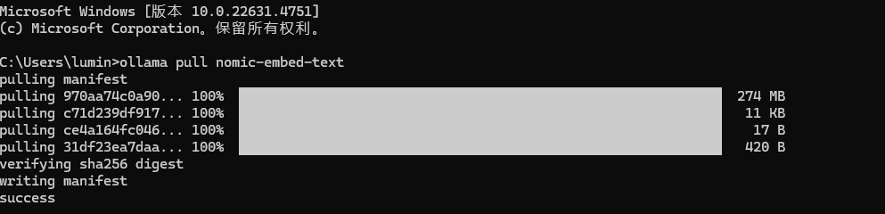

# 配置AnythingLLM

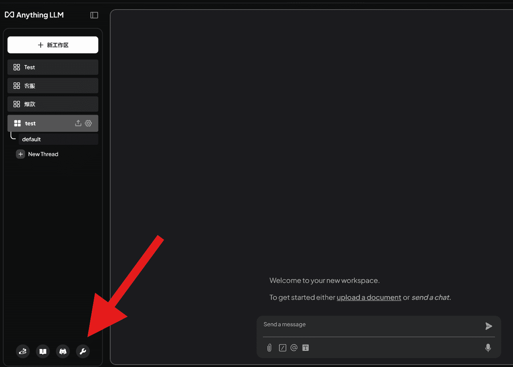

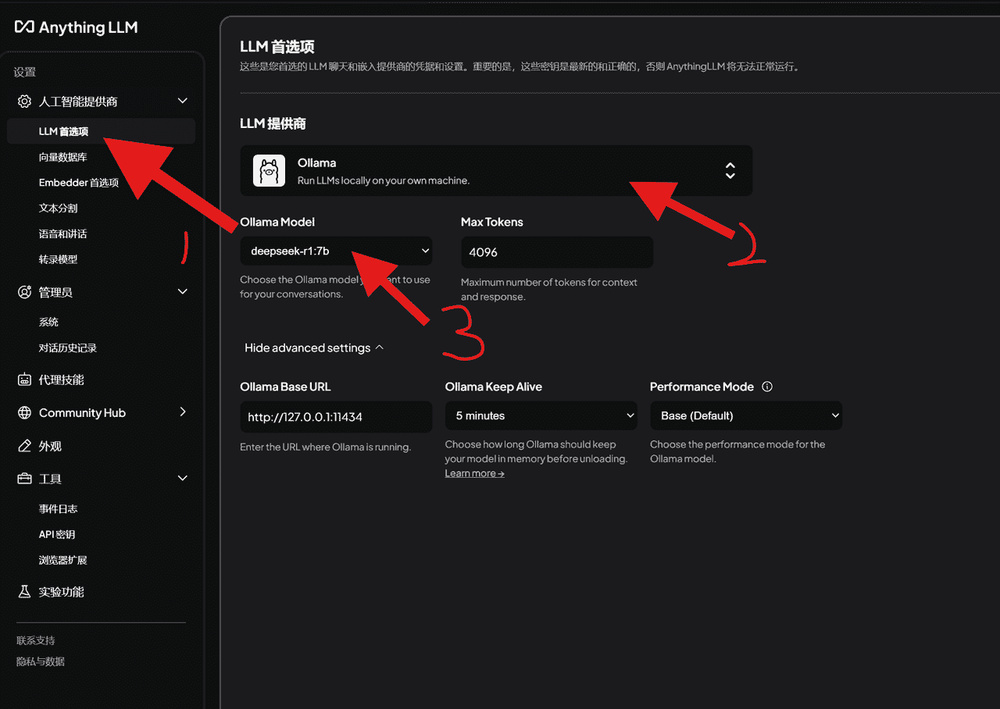

## 配置Embedder首选项

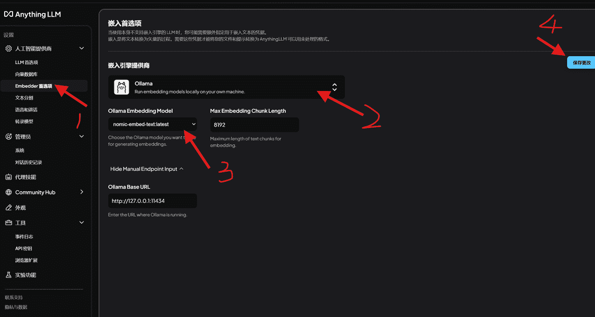

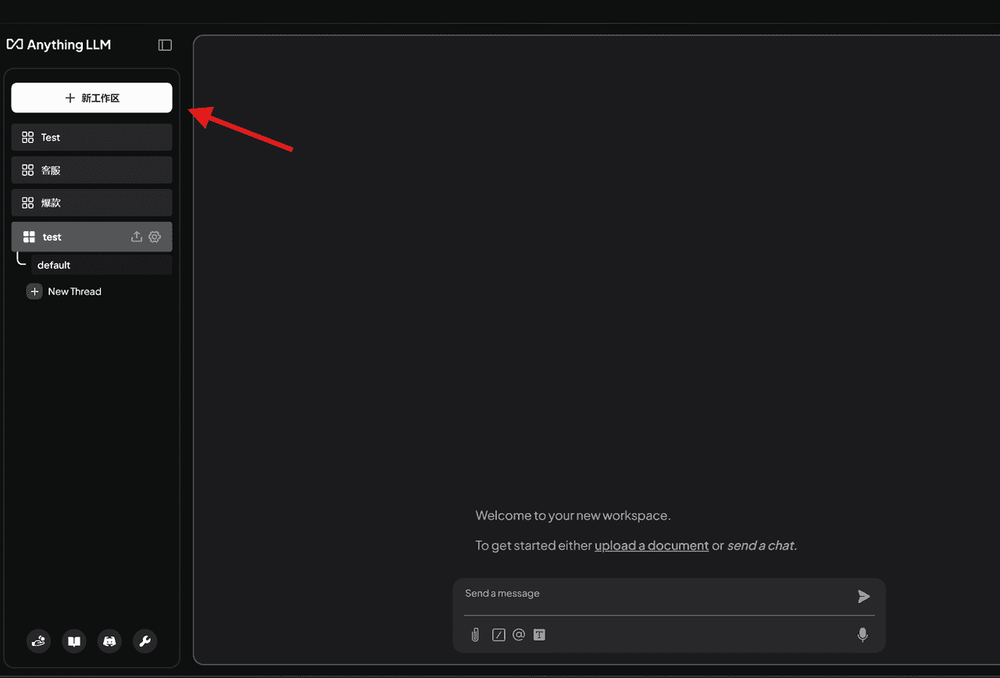

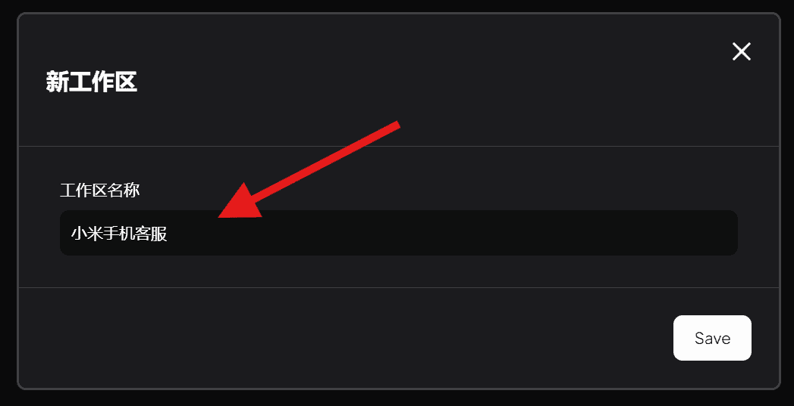

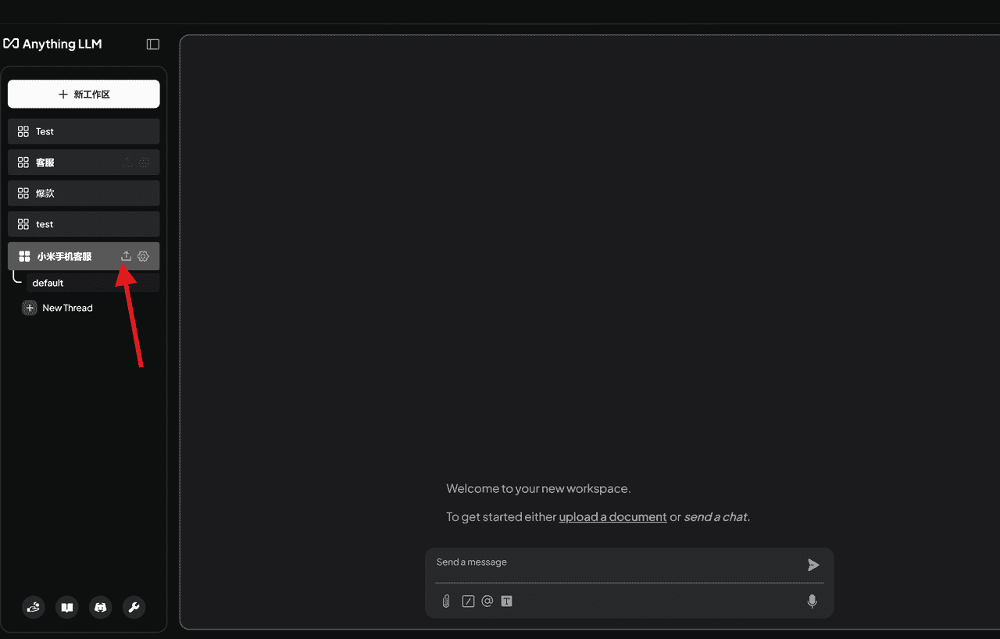

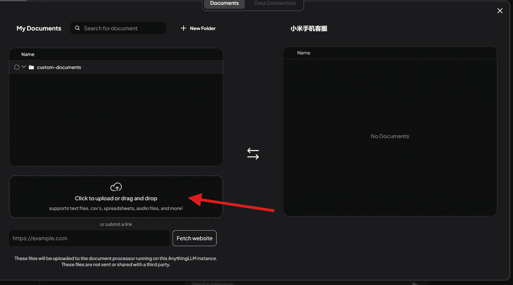

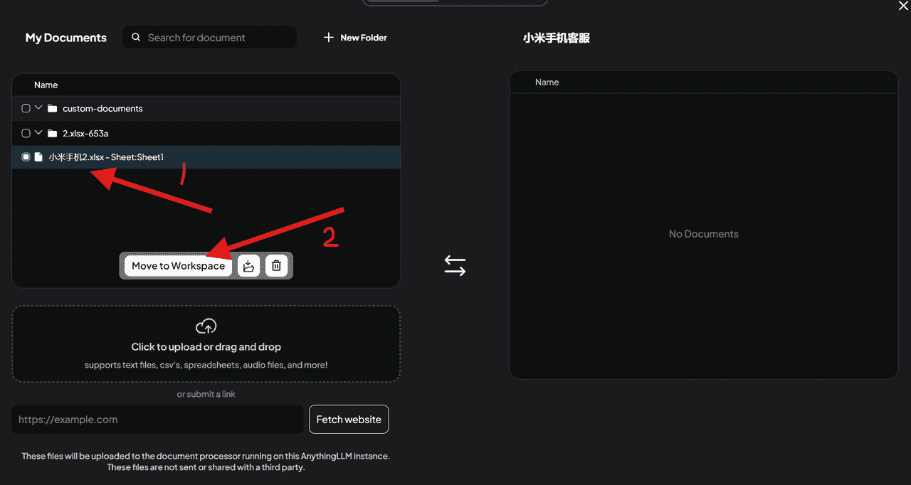

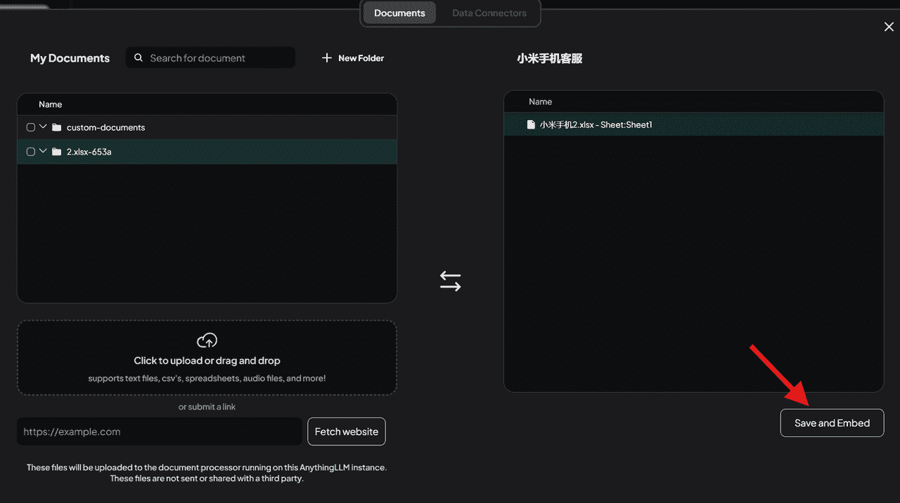

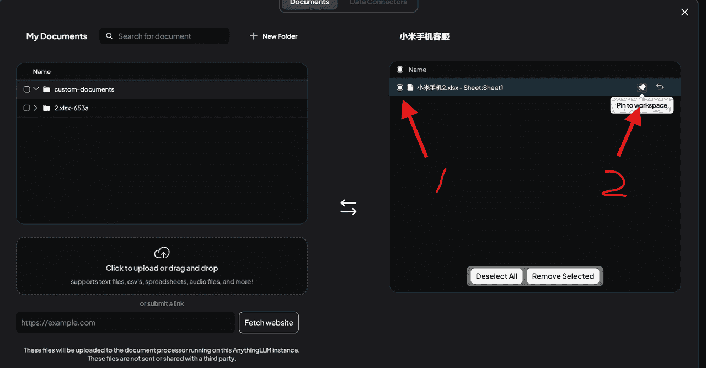

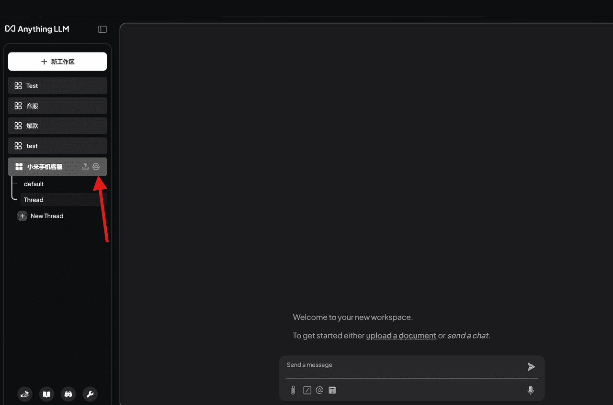

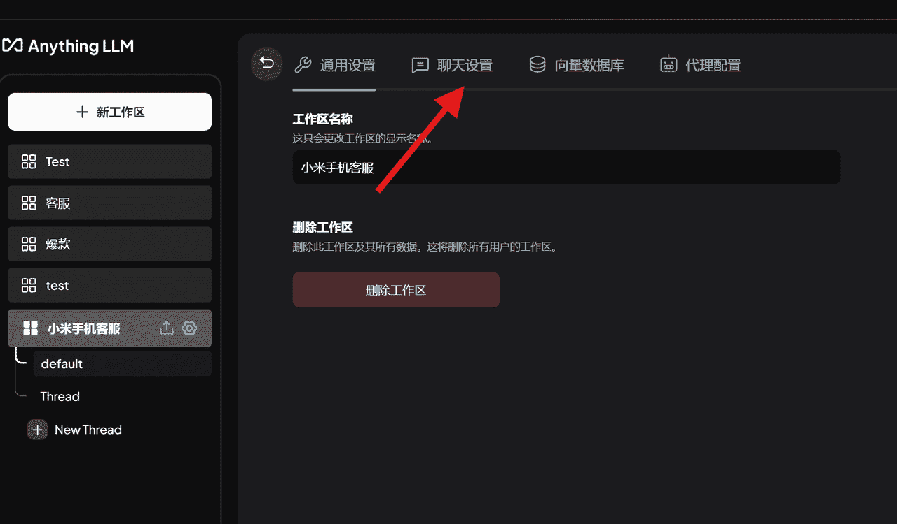

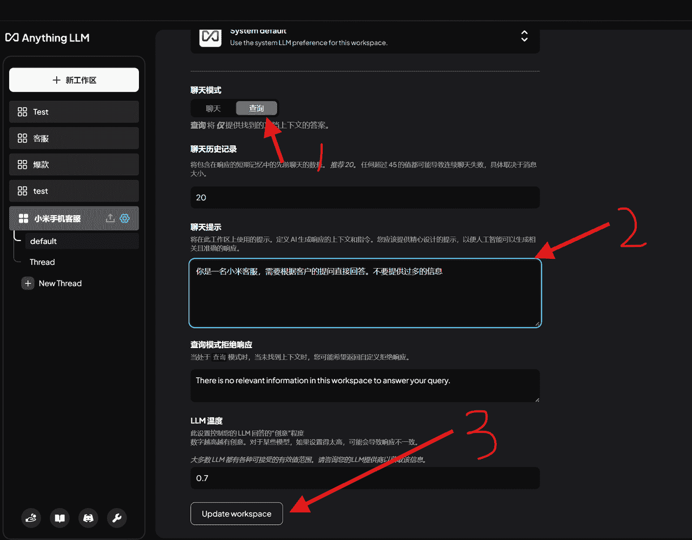

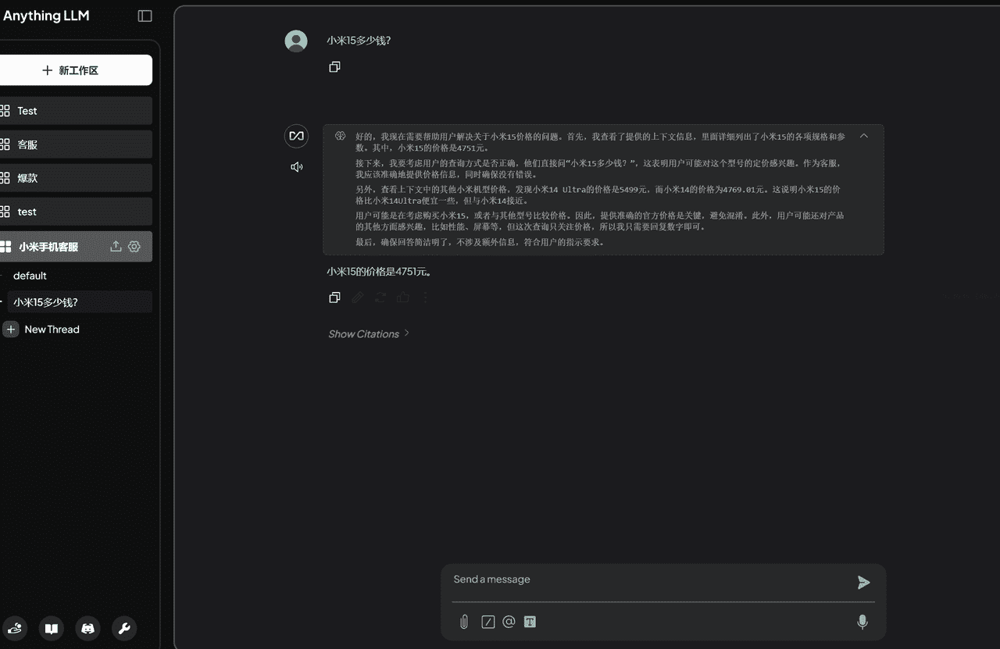