# CherryStudio搭建DeepSeek本地知识库

> 来源：[https://zcareers.feishu.cn/docx/MYC6d85JQoo75sxbAwgcbXjdnxe](https://zcareers.feishu.cn/docx/MYC6d85JQoo75sxbAwgcbXjdnxe)

### **一、万事先问为什么：**

1.  为什么要搭建AI知识库系统？

+   **对个人**：

+   记录个人学习、工作经验，打造专属的知识体系

+   自动消化收藏/网页摘录/本地文档等碎片信息，终结"收藏即遗忘"的无效囤积，打造个人认知复利引擎。

+   **对企业**：

+   **识管理与传承:**让新员工一键继承资深员工的实战经验库，将离职风险转化为组织知识资产沉淀

+   **内部搜索更精**准，快速查找案例、技术方案，减少人工成本。提升运营效率

+   重要：确保安全隐私

打开**硅基流动官网(****https://cloud.silic****o**nflow.cn/i/pUC5NvWx)，点击Log in，进入模型页面。

建议使用手机号码登录，

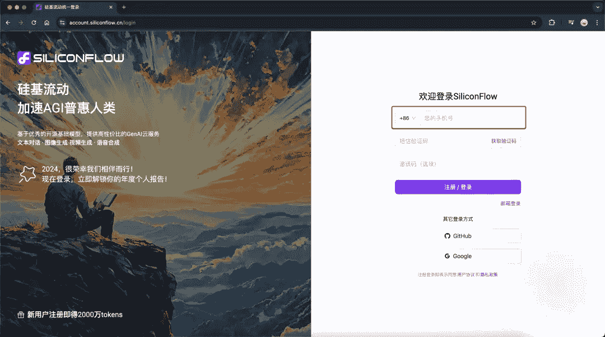

使用登录进去之后，点击左侧菜单栏的API密钥，点击新建API密钥，输**入密钥名称，点击新建密钥**，创建一个硅基流动的API Key，创建成功之后点击复制密钥。

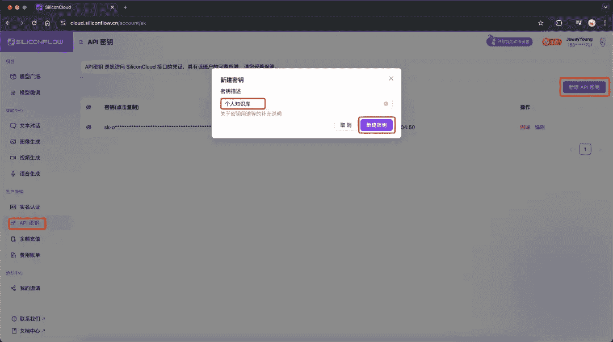

##### **配置AI客户端**

打开**CherryStudio （****h**ttps://cherry-ai.com/），点击左下角的设置按钮，选择硅基流动，把刚才创建好的API Key复制进去，打开右上角的开关按钮。

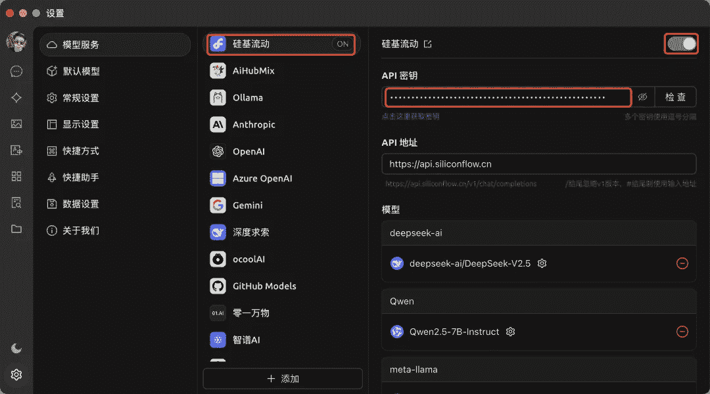

返回**硅基流动**，击左侧菜单栏的模型广场，选择嵌入，点击BAAI/bge-m3，把这个模型名称BAAI/bge-m3复制下来。

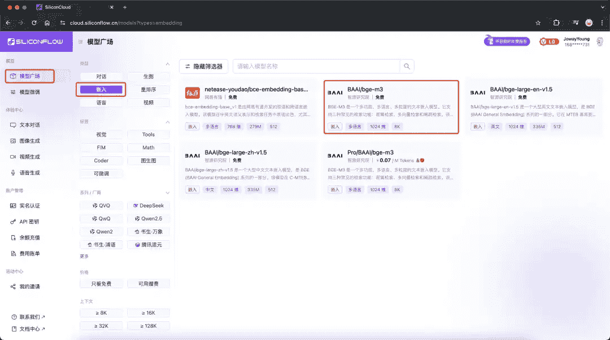

滚动到底部，点击添加，打开配置弹窗，在模型ID的输入框中输入BAAI/bge-m3，就会自动补充其余信息，最后点击添加模型。

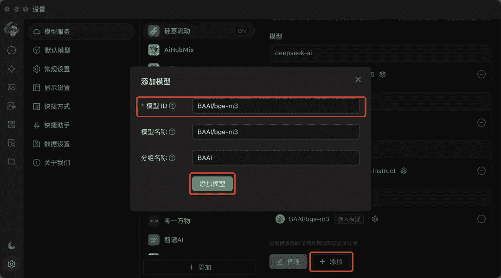

##### **创建私人知识库**

打开**CherryStudio**，点击菜单栏的知识库按钮，点击添加，输入知识库名称，选择刚才配置好的BAAI/bge-m3，点击确认。

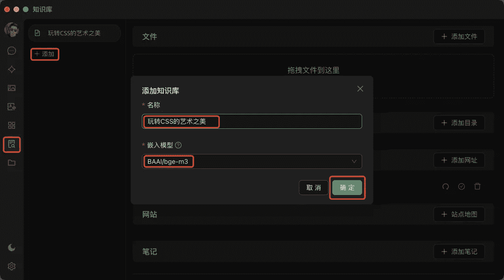

这时可以把你所有的知识内容全部上传上去，例如工作文档、工作报告、工作总结、面试简历、链接、截图、病例、电子书PDF等等各种杂七杂八内容，只要文件格式是文本、图像、链接、PDF等都能上传。

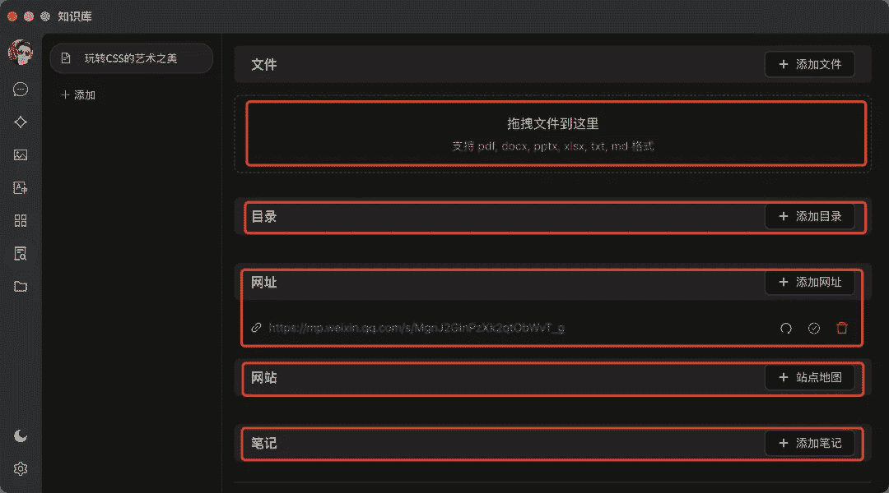

这时刚才引用的文本嵌入模型就会把你上传的所有资料进行知识向量化，这时一种非常智能的内容检索拓扑算法，大家无需理会底层原理。

##### **调用私人知识库解答自己的问题**

点击菜单栏的聊天按钮，点击添加助手，输入助手名称，点击新建。

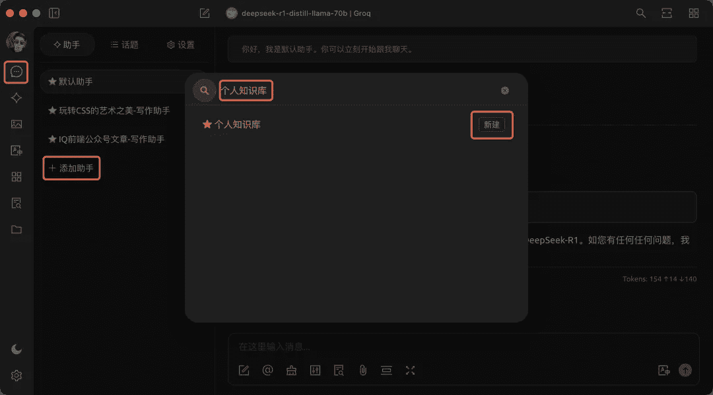

在点击顶部工具栏的模型选框，选择之前配置好的deepseek-r1-distill-llama-70b。

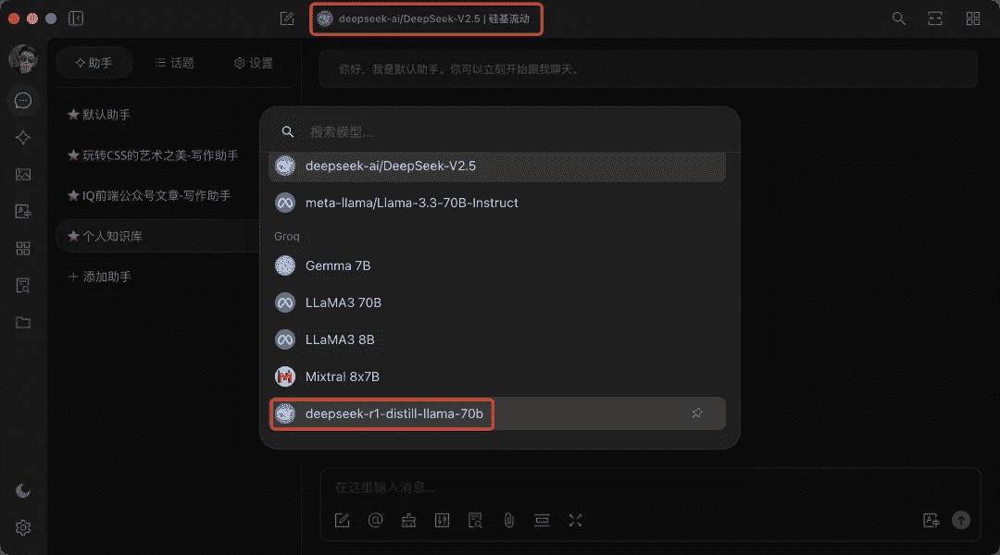

##### 开启私人知识库的DeepSeek之旅

我的知识库是上传了很多关于**CSS技术**的内容，可以**像我这样，在聊天**输入框中输入：请根据知识库的内容，看看CSS如何模拟真实的进度条？，点击知识库，选择你自己配置好的知识库，然后就能看到DeepSeek根据你的知识库来回答你的的问题了～

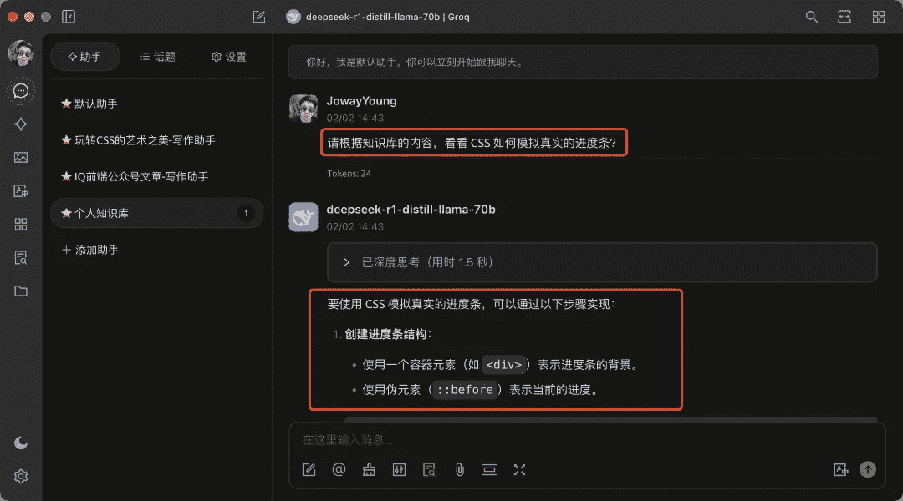

另外，**DeepSeek**还**能根据你的知识库来思考与推**理出知识库不存在的答案，这些答案都是基于你的知识库中的内容进行深度求索，思考与推理出来的，这正是DeepSeek R1模型的厉害之处。

基于Cherry Studio搭建（首选）

基于本地的deepseek搭建个人知识库。 使用本地服务,安装嵌入模型，用于将文本数据转换为向量标识的模型。

```
#命令行窗口执行拉取下即可。
ollama pull bge-m3
pulling manifest
pulling daec91ffb5dd... 100% ▕████████████████████████████████████████████████████████▏ 1.2 GB
pulling a406579cd136... 100% ▕████████████████████████████████████████████████████████▏ 1.1 KB
pulling 0c4c9c2a325f... 100% ▕████████████████████████████████████████████████████████▏  337 B
verifying sha256 digest
writing manifest
success
```

### 下载cherry studio

根据自己的环境下载cherry studio

安装的时候，注意安装到其他磁盘，不要在c盘安装。

### 本地模型知识库

#### 配置本地ollama

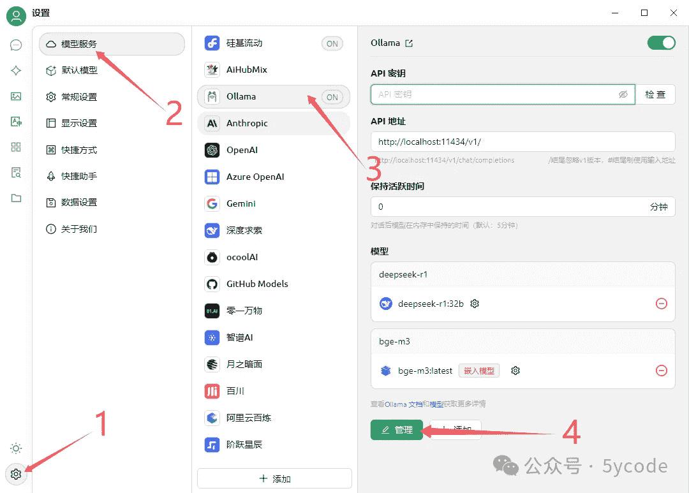

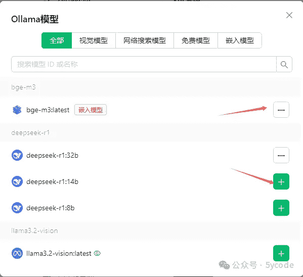

操作步骤：

1.  找到左下角设置图标

1.  选择模型服务

1.  选择ollama

1.  点击管理

1.  点击模型后面的加号（会自动查找到本地安装的模型）

1.  减号表示已经选择了

#### 知识库配置

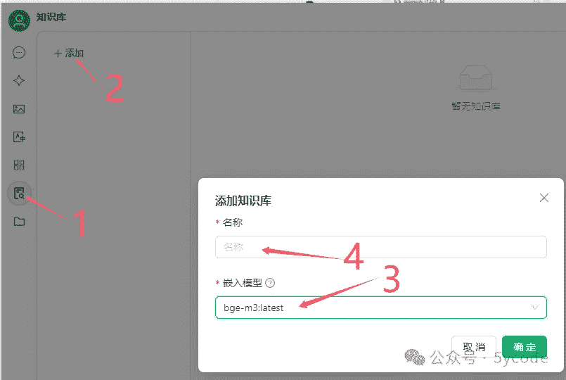

1.  选择**知识库**

1.  选择添加

1.  选择嵌入模型

1.  填写知识库名称

#### 添加知识文档

**cherry可以添加文档**，也可以添加目录（这个极其方便），添加完以后出现绿色的对号，表示向量化完成。

#### 搜索验证

1.  点击搜索知识库

1.  输入搜索顺序

1.  点击搜索 大家可以看下我搜索的内容和并没有完全匹配，不过已经和意境关联上了。

#### 大模型处理

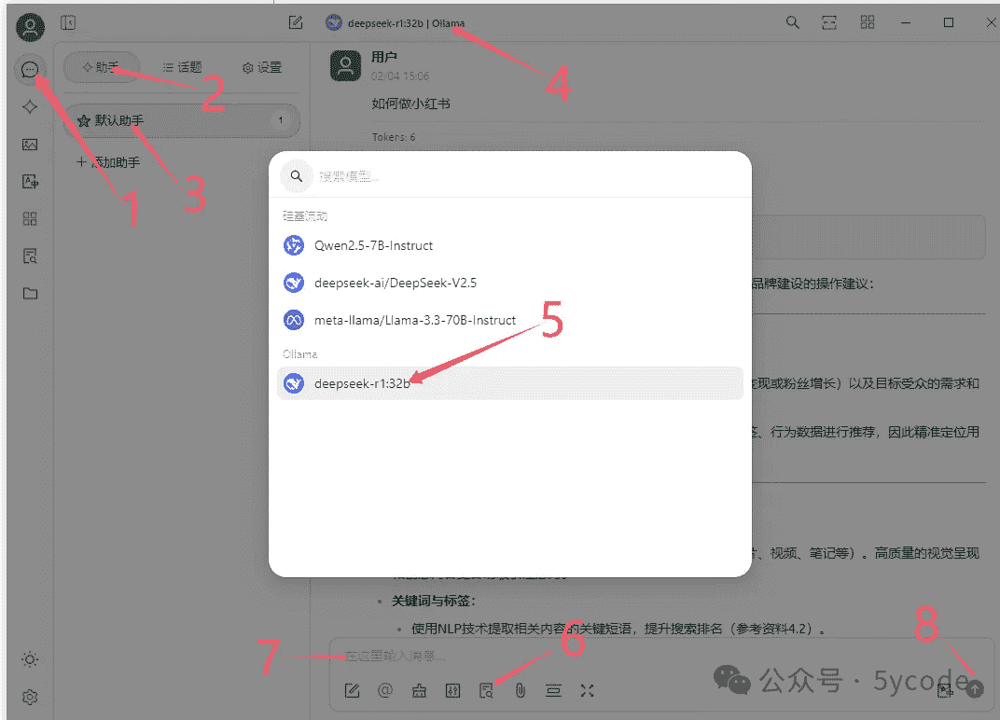

1.  点击左上角的聊天图标

1.  点击助手

1.  点击默认助手（你也可以添加助手）

1.  选择大模型

1.  选择本地deepseek，也可以选择自己已经开通的在线服务

1.  设置知识库（不设置不会参考）

1.  输入提问内容

1.  发问

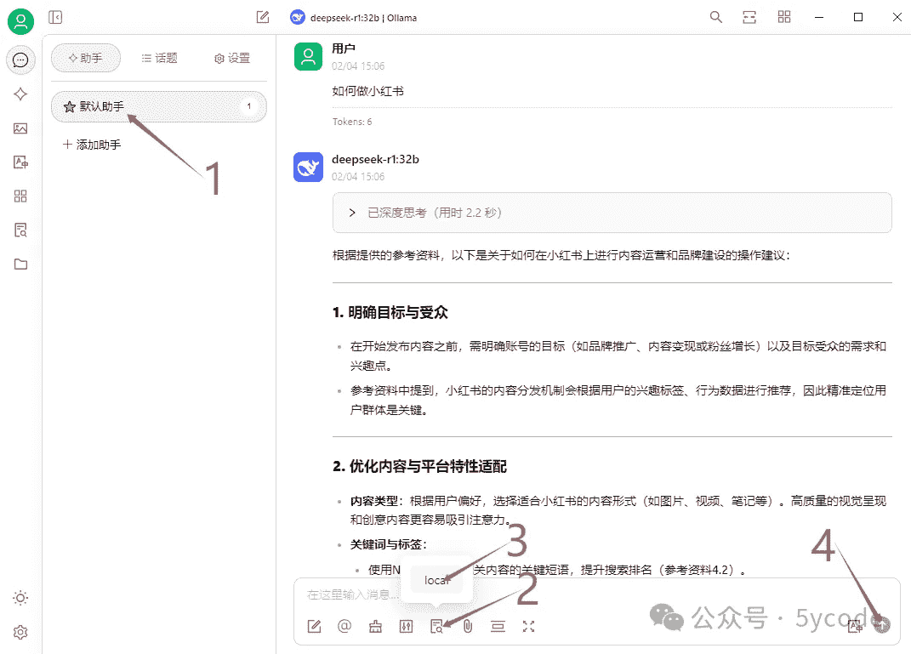

大家可以看到deepseek已经把结果整理了，并告诉了我们参考了哪些资料。

### 满血版

差别就是大模型的选择，在模型服务里配置下在线的deepseek服务即可。

> 如果你的知识库有隐私数据，不要联网！不要联网！不要联网！