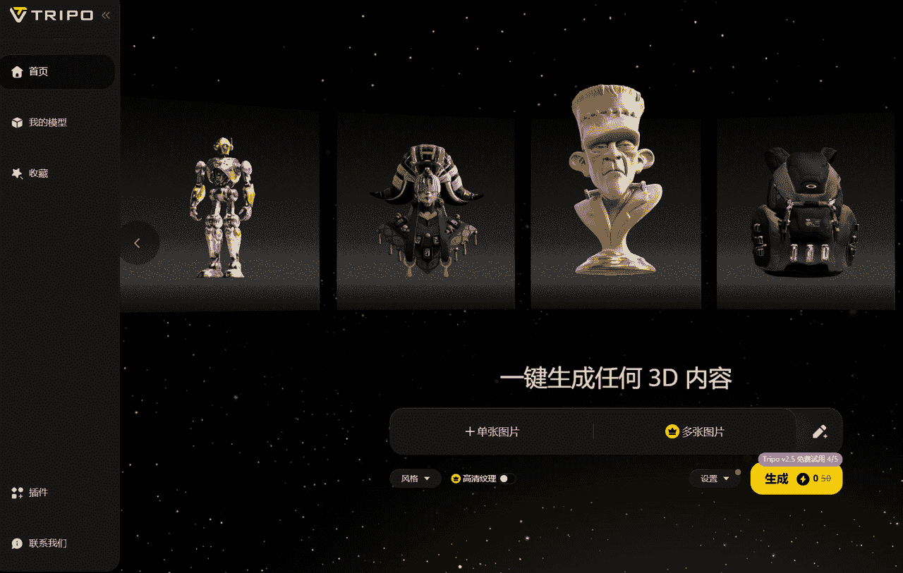

# 如何3D建模

> 来源：[https://zcareers.feishu.cn/docx/KNhCdTbJTokeNoxx7xac79iYnec](https://zcareers.feishu.cn/docx/KNhCdTbJTokeNoxx7xac79iYnec)

[屏幕录制 2025-02-13 170529.mp4](https://internal-api-drive-stream.feishu.cn/space/api/box/stream/download/all/XSHQbjdQAo0KvXxmlbocGLtYngK)

3D建模还需要用另外2个AI工具

即梦AI

下载地址https://jimeng.jianying.com/s/iPfaBeDF/?t=-4

Tripo AI

https://www.tripo3d.ai/app?invite_code=NQ9IUW

