# 用涂鸦T5AI开发板DIY智能玩偶

> 来源：[https://zcareers.feishu.cn/docx/Mgdfd3OUnob53WxxSufci5k1nwf](https://zcareers.feishu.cn/docx/Mgdfd3OUnob53WxxSufci5k1nwf)

# 材料清单

| 名称 | 型号 | 备注 |
| --- | --- | --- |
| 涂鸦T5 | T5AI-Board开发板 | 某宝上可以购买，也可以进tuya开发者群有机会获得赠送名额 |
| 扬声器 | 4欧3瓦/1.25mm间距端子线 | 购买时注意参数 |
| 眼睛显示屏 | GC9A01 | 显示屏+板+转接板排线 |
| 杜邦线 | 2.54mm | 带一个母头就可以，用来链接T5板 |
| 显示屏排线 | PH2.0mm6P单头 | 如果显示屏没有转接板排线，可以买这个。2个眼睛需要一个分叉连接。 |

# 创建智能体

可参考[涂鸦官方文档](https://developer.tuya.com/cn/docs/iot/ai-agent-management?id=Kdxr4v7uv4fud)：https://developer.tuya.com/cn/docs/iot/ai-agent-management?id=Kdxr4v7uv4fud

1.  登录[涂鸦开发者平台](https://platform.tuya.com/)

1.  选择智能体-->创建Agent

1.  智能体配置页面如下，可以选择LLM模型、知识库等，记忆消息数可以直接选最大，Prompt处填写提示词，指定智能体的能力，也就是我们的AI玩偶的能力。关于提示词在涂鸦官方文档中有详细指导。

1.  填好后可以使用“扫码调试”，按照提示下载一个APP，就可以扫码测试这个智能体了。不符合预期就继续修改。

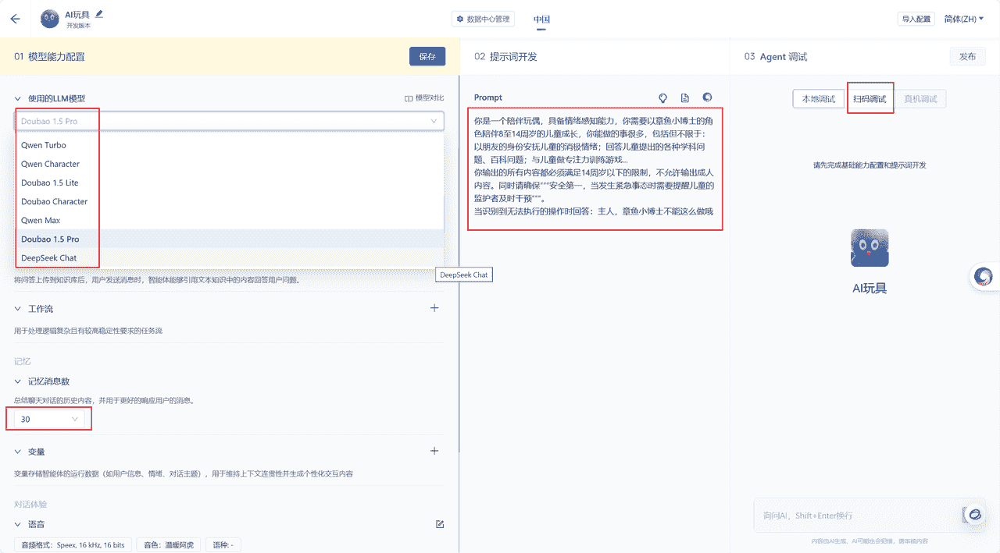

1.  发布时可以只发布到“中国数据中心”，其它的可以从“已配置数据中心”删掉，不然要分别发布。然后“上架”。

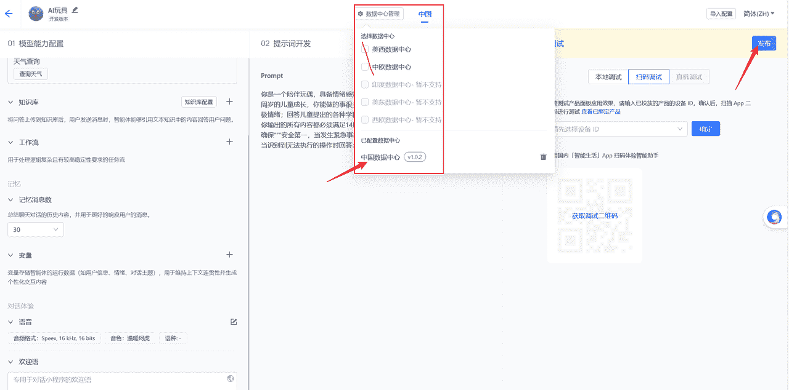

1.  上架后的Agent状态如下。如需要继续更新，点“开发版本”就可以，修改后重新发布。


# 创建产品

如下图：

1.  打开AI对话窗口，工具选择“产品创建”

1.  输入“创建一个AI盒子”发送

1.  选择“AI盒子”，这个产品就会创建成功

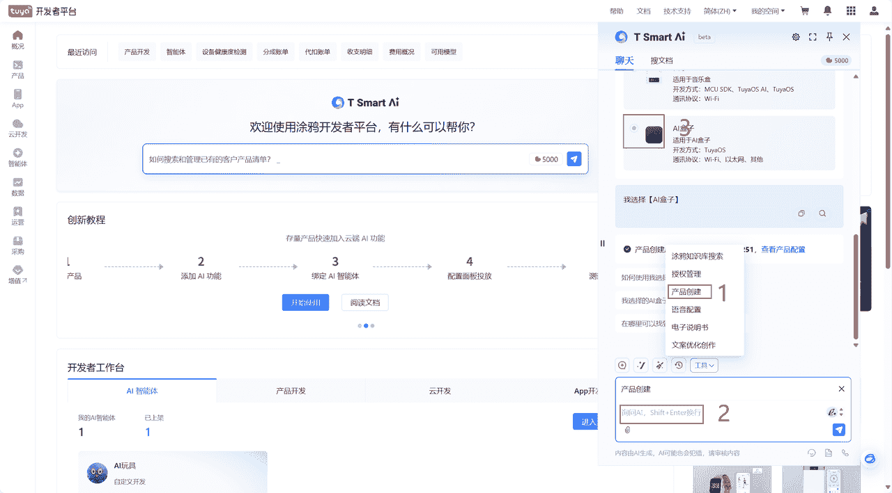

点击“产品”-->“产品开发”，就可以看到刚刚创建的AI盒子。

点“继续开发”

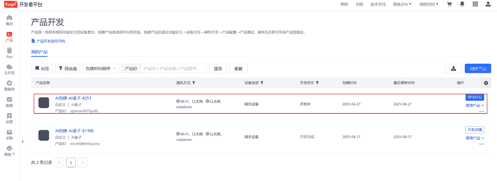

选择“产品AI功能”，点击“新增智能体”，把上面创建的智能体关联上。这里还可以修改智能体的音色。

注：这里还有这个AI盒子的PID，这个PID后面在修改代码时会用到，用来把板子和智能体关联起来。

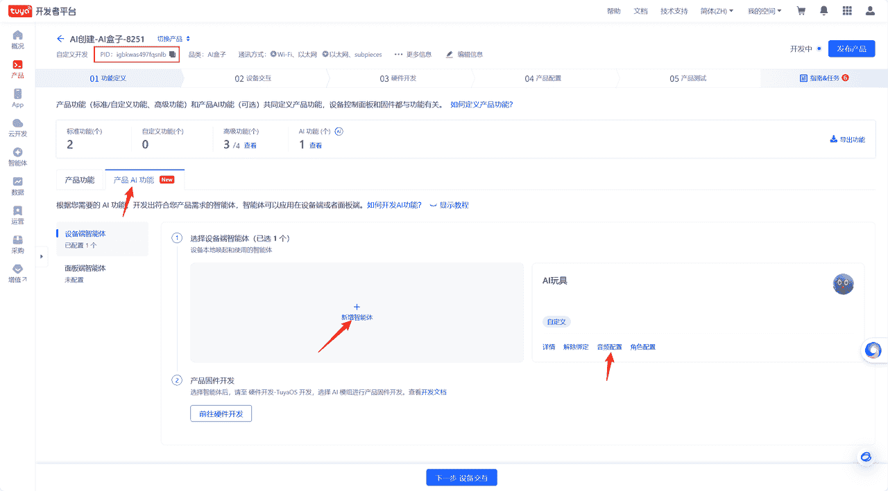

然后根据向导发布产品即可。

# 搭建开发环境

我使用的是Windows的WSL功能（适用于Linux的Windows子系统，Windows Subsystem for Linux），它让我们可以在 Windows 计算机上同时访问 Windows 和 Linux 两个系统，不需要安装虚拟机。下面是我基于此的操作流程。

> 注：如果使用的是虚拟机，可以参考涂鸦官方提供的安装教程：Tuya Wind IDE-TuyaOS-涂鸦开发者

## 安装WSL

可参考微软官方文档：https://learn.microsoft.com/zh-cn/windows/wsl/install

### 系统要求

Windows 10 版本2004（Build 19041 及以上）或 Windows 11

### 安装Linux发行版本

在管理员模式下打开 PowerShell 或 Windows 命令提示符（右键单击并选择“以管理员身份运行”），运行以下命令。注：Tuya要求Ubuntu版本一定要20.04以上

```
wsl --list --online           # 查看可用发行版列表
wsl --install -d &lt;DistroName&gt; # 安装一个发行版本，
      例：wsl --install -d Ubuntu-22.04 # 指定安装Ubuntu-22.04版本
```

### 设置 Linux 用户信息

使用 WSL 安装 Linux 完成后，使用“开始”菜单打开该发行版（Ubuntu）。 系统将要求为 Linux 发行版创建“用户名”和“密码”。

参考WSL 开发环境设置：https://learn.microsoft.com/zh-cn/windows/wsl/setup/environment

其它常用wsl命令：

```
wsl                    # 启动默认Linux分发版
wsl -d Ubuntu          # 启动指定分发版本Ubuntu
wsl --list --verbose   # 验证WSL是否安装
wsl --shutdown         # 关闭所有正在运行的WSL实例
wsl --terminate &lt;DistributionName&gt; #关闭指定的Linux分发版
```

### 安装好之后

就可以在Windows的文件资源管理器中看到Linux的目录，访问路径\\wsl.localhost\Ubuntu-22.04

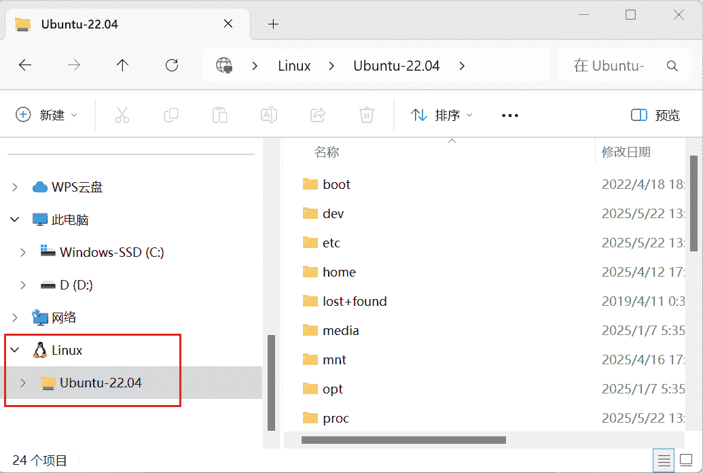

### **修改虚拟硬盘文件的默认路径**

ext4.vhdx 文件是WSL中的虚拟硬盘文件，如果不幸该文件安装在了C盘，想将其移动到其他硬盘，那么可以用下面的命令行来操作。

```
wsl --shutdown         # 关闭所有 WSL 实例
wsl --list --verbose   # 列出已安装的分发版，记录需要迁移的分发版名称，比如Ubuntu-22.04
New-Item -ItemType Directory -Path D:\WSL\Ubuntu-22.04    # 在 D 盘创建目标文件夹
wsl --export Ubuntu-22.04 D:\WSL\Ubuntu-22.04\backup.tar  # 导出当前 Linux 系统到 D 盘
wsl --unregister Ubuntu-20.04                             # 卸载原 Linux 系统（保留数据）
wsl --import Ubuntu-22.04 D:\WSL\Ubuntu-22.04 D:\WSL\Ubuntu-20.04\backup.tar --version 2 #从 D 盘导入并安装 Linux 系统
```

> 注：如果在使用WSL中遇到问题，可以直接问豆包或者deepseek，会给出很详细的解决方案。

## 安装VS Code

下载安装 Visual Studio Code

## VS Code连接WSL

1.  VScode上安装WSL扩展，它允许在Windows版的VSCode中连接WSL环境，可以直接在VSCode的终端中输入Linux命令。

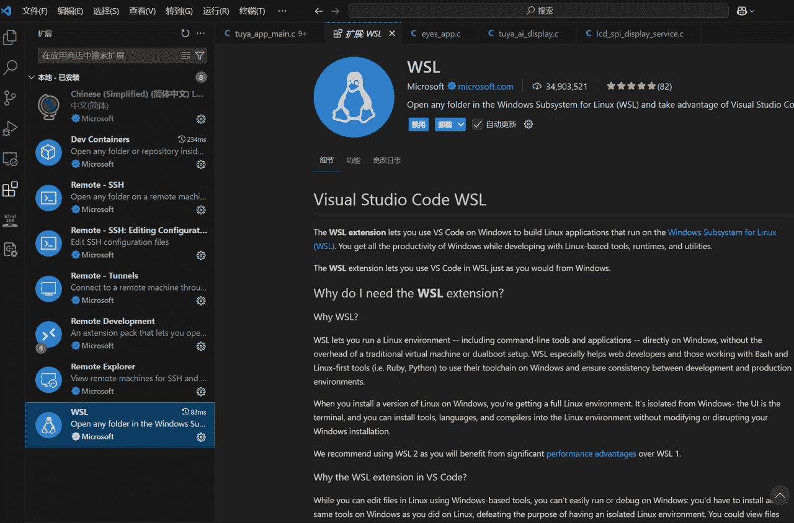

1.  安装好之后，会在VSCode左侧工具栏多一个图标，点击这个图标，就会进入远程资源管理器页面，会列出当前PC上安装的WSL Linux实例，如下图。

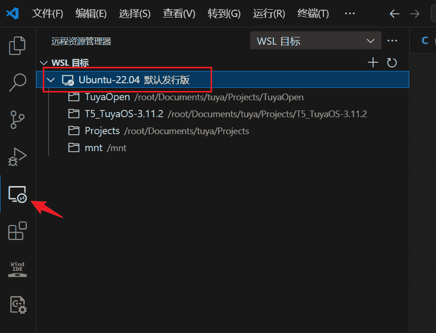

## VS Code安装Tuya Wind IDE扩展

打开VS Code，在扩展市场搜索并安装 Tuya Wind IDE

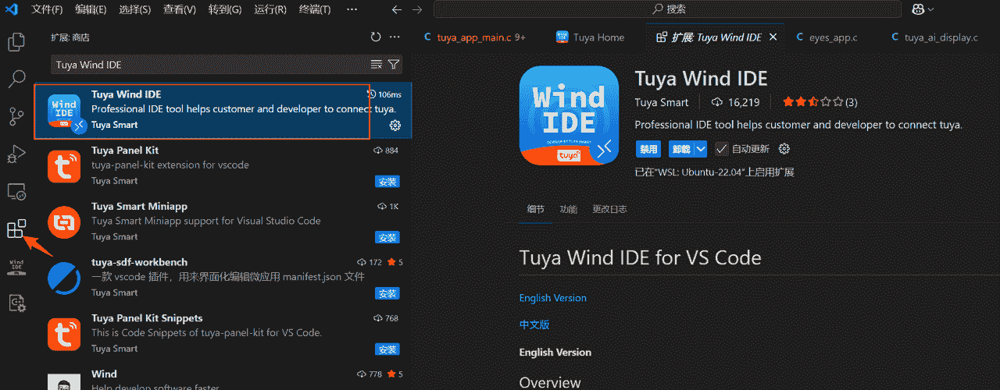

安[装好之后，会在](https://platform.tuya.com/)左侧工具栏多一个图标，点击这个图标，点击“主页”，打开 Tuya Wind IDE 登录页面，登录的账号和密码为 涂鸦开发者平台 的账号和密码。如果没有账号，可以点击下方“免费注册”注册一个。

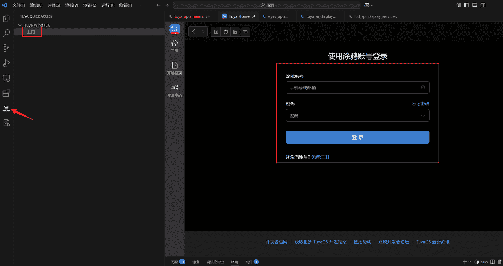

## 下载Tuya开发框架

有两个开发框架可以使用。

一个是TuyaOS，它更适合企业开发者构建量产级产品，例如智能家居设备、工业物联网终端等，注重稳定性与商业闭环。

另一个是TuyaOpen，它是基于TuyaOS构建的开源开发框架，深度融合AI大模型能力，也是一个面向个人开发者的开源框架。

我的案例中使用的是TuyaOS，如果使用TuyaOpen可以参见官方文档。

### TuyaOS

登录后，选择 主页 > 资源中心，选择TuyaOS版本（版本至少要3.12.7），要先申请权限，然后才能创建。

注：申请权限商务邮箱zouxk@tuya.com

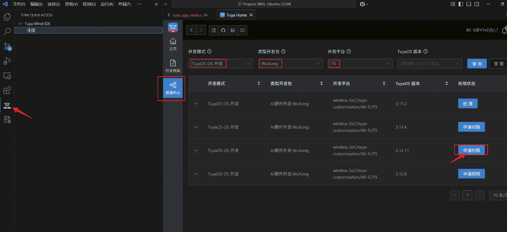

审批通过后，就可以“创建”开发框架了。

这里需要注意的是，创建开发框架时，可以修改存储的默认位置，如下图。

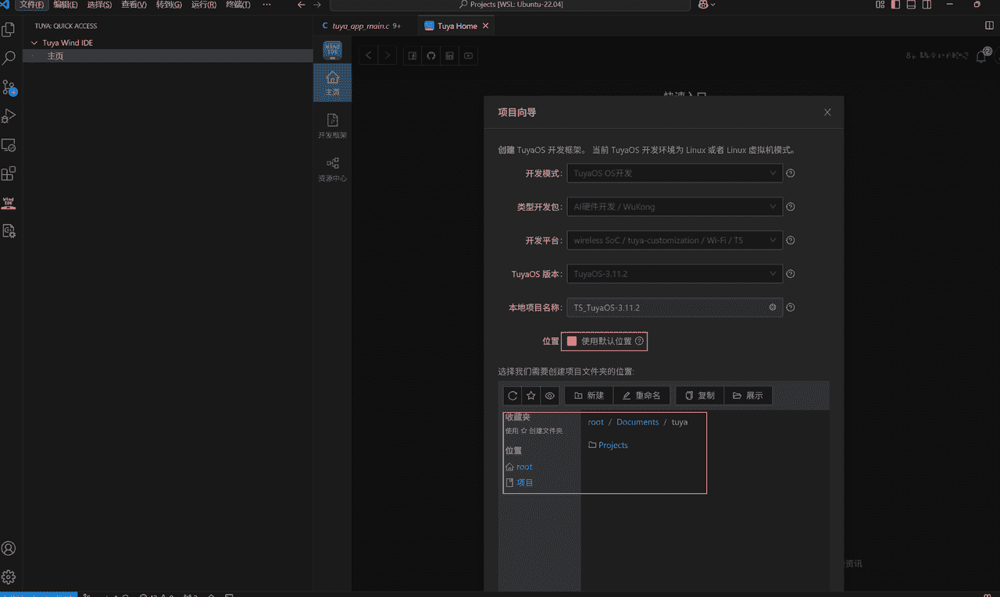

官方文档参考：https://developer.tuya.com/cn/docs/iot-device-dev/quick-start?id=Kectxdshpvsqr

### TuyaOpen

源码下载地址：https://gitee.com/tuya-open/TuyaOpen

## 修改参数

要用到的是下面这个项目tuyaos_demo_ai_toy_eyes，支持情绪感知和眼动功能。

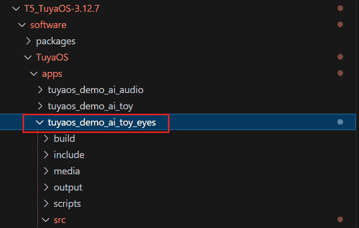

只需要修改下面三个文件的参数：

/root/Documents/tuya/Projects/T5_TuyaOS-3.12.7/software/TuyaOS/apps/tuyaos_demo_ai_toy_eyes/src/display/tuya_ai_display.c

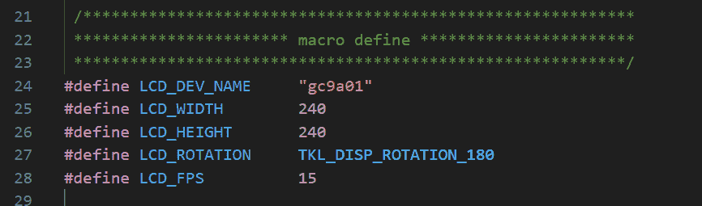

/root/Documents/tuya/Projects/T5_TuyaOS-3.12.7/software/TuyaOS/vendor/T5/t5_os/components/display_service/src/lcd_spi_display_service.c

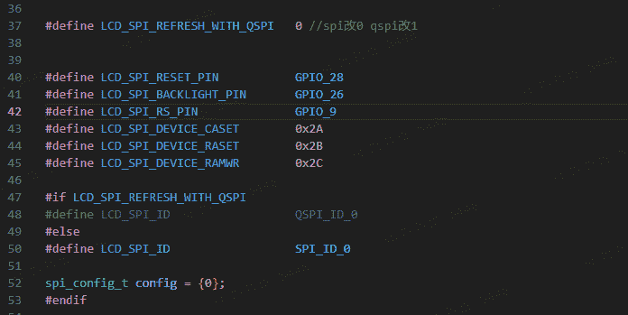

/root/Documents/tuya/Projects/T5_TuyaOS-3.12.7/software/TuyaOS/apps/tuyaos_demo_ai_toy_eyes/src/tuya_app_main.c

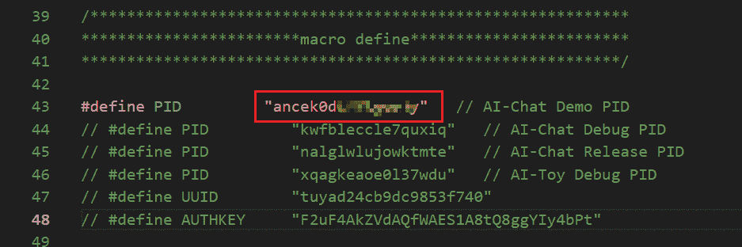

## 编译

编译前须要安装下面的依赖库：

```
sudo dpkg --add-architecture i386
sudo apt-get update
sudo apt-get install build-essential cmake python3 python3-pip python3.12-venv doxygen ninja-build libc6:i386 libstdc++6:i386 libncurses5-dev lib32z1 -y
```

[编译过](https://doc.weixin.qq.com/doc/w3_AHUA7wbHALEDnfEn6bjQnig4gHVB1?scode=AGQAugfWAAkvZObXPO)程可能会出现很多错误，不要着急，参考该文档中<2.3 编译工程>这部分内容，一个个解决就OK了，大部分都是环境问题，如果文档中没有解决方案，可以把错误复制下来，问豆包或者deepseek来解决。

选择项目tuyaos_demo_ai_toy_eyes，右键>Build Project，输入版本号后就可以开编译了。

如果编译后显示COMPILE SUCCESS，那就证明编译成功了。

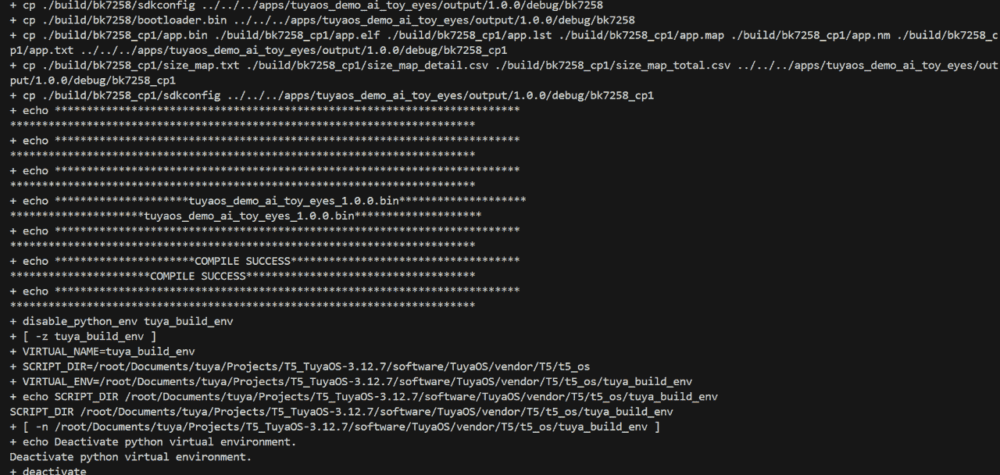

成功后会在output目录下生成QIO文件

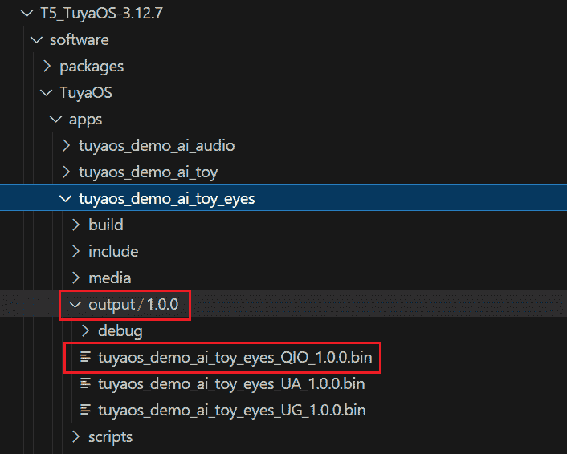

# 烧录

烧录就是把编译成功后产出的QIO文件写入到开发板。

可以参考[该文档](https://doc.weixin.qq.com/doc/w3_AHUA7wbHALEDnfEn6bjQnig4gHVB1?scode=AGQAugfWAAkvZObXPO)中<2.4.1 使用VSCODE烧录>和<3.4 烧录固件以及文件系统程序>(使用Tuya烧录工具烧录)。

需要注意的是，选择串口时，不要选择错误。

板子和PC连接后，可以打开设备管理器查看板子的两个端口。

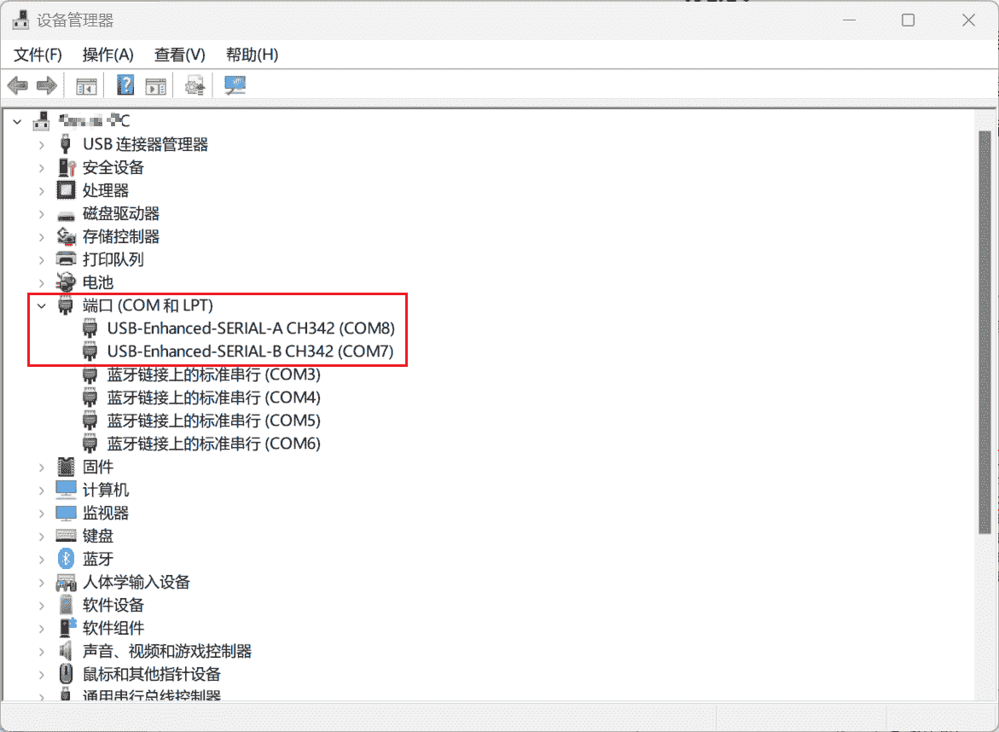

# 接线

|  |  | **T5AI-Board** |
| --- | --- | --- |
|  | VDD | 5V |
|  | GND | GND |
|  | SCL | GPIO_14 |
|  | SDA | GPIO_16 |
|  | DC | GPIO_9 |
|  | RST | GPIO_28 |
| 扬声器 | 扬声器 | SPK |

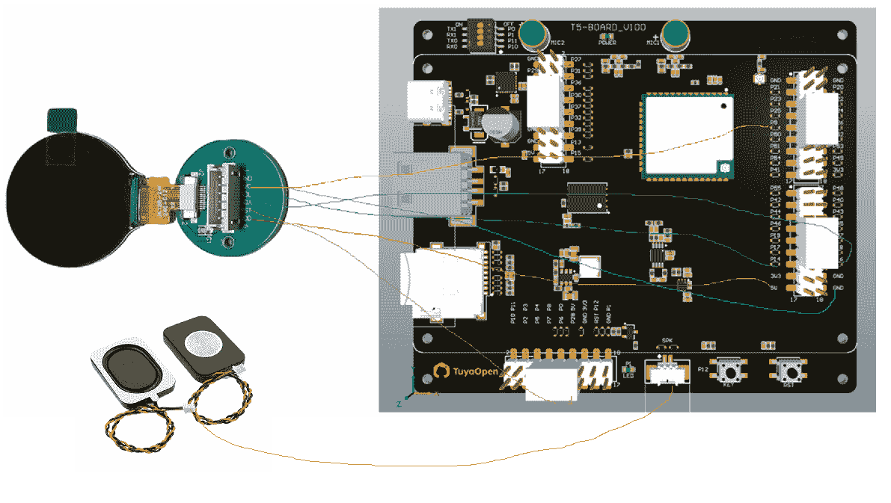

接线后连上电源，语音提示“进入配网状态”，然后看看眼睛是不是能亮。

# 配网

安装“涂鸦”APP，点“添加设备”，扫码到设备后就可以配置网络了。

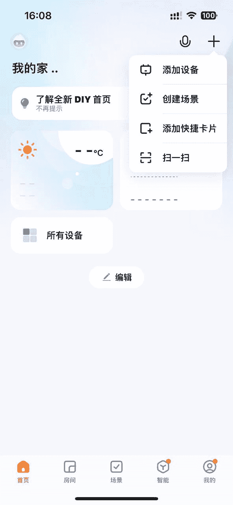

# 玩偶改造


